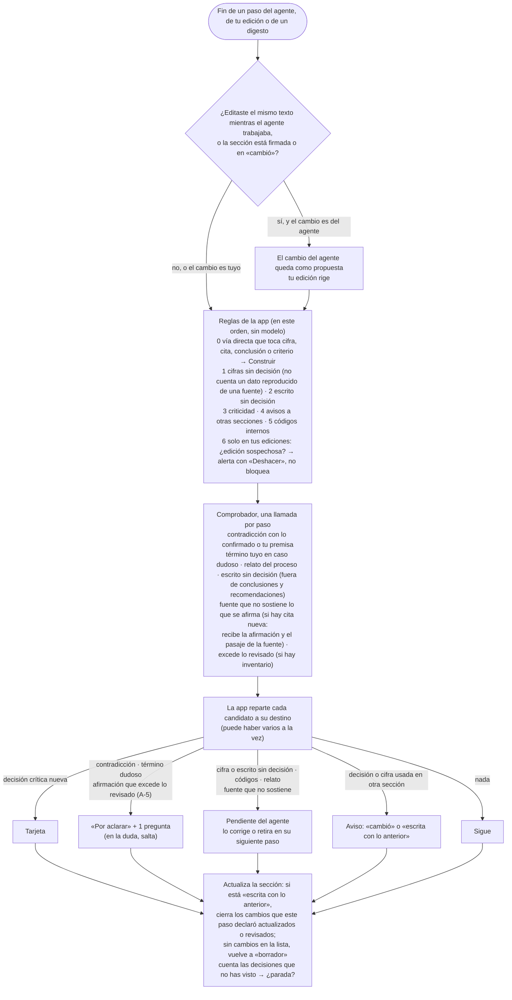
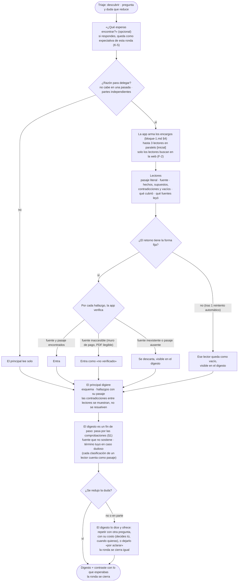
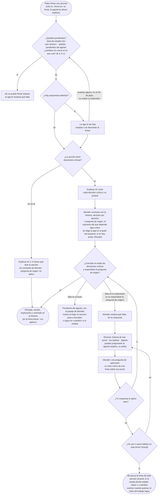

# Bloque 1 · Flujos propios

*Tres etapas tienen ramas que ninguna simulación recorrió del todo: comprobaciones, investigar con subagentes y firma. El resto del ciclo se entiende con su ficha.*

## 1. Comprobaciones (en cada fin de paso, también de tus ediciones y del digesto)

- **Primero lo barato y seguro.** Las reglas 1 a 5 de la app corren siempre; la 0, solo en un paso por vía directa; el comprobador es una sola llamada por paso, con todo junto.
- **El comprobador no decide:** devuelve candidatos con los dos pasajes literales. «En la duda, salta»: un falso positivo cuesta una pregunta; un falso negativo, una reversión silenciosa.
- **Lo que corrige el agente no te llega como pregunta.** Los pendientes del agente (lista en estados §1) bloquean la firma mientras sigan ahí. Lo único que sale de esa vía es la afirmación que excede lo revisado: va a «por aclarar», porque el alcance lo decides tú.
- **Tu edición** pasa por lo mismo, salvo que su tarjeta solo pide el «porque» o te deja deshacer (R4, G-1). Además, la regla 6 te muestra una alerta si parece accidental: borraste mucho, quitaste algo que sostiene una decisión o lo firmado, editaste otra sección o pegaste algo que ya existe. Si deshaces, la edición vuelve atrás por las mismas comprobaciones y la propuesta desplazada se puede reaplicar.
- **Cambios en lo que usa una sección (A-1):** la sección se libera por cambio, no por actividad. Un paso del agente cierra un cambio solo si lo declara en su salida y toca esa sección. Tú o el agente pueden cerrarlo como «revisado, no requiere cambio», con un «porque». Tú también puedes marcarlo «actualizado» después de editar. En una sección firmada o en «cambió», los pasos llegan como propuesta: aceptar la que declara el cambio lo cierra. Corregir una coma no cierra nada. Con cambios sin cerrar no se firma, en ningún estado. Una nueva versión de una fuente usada (al subirla, indicas que reemplaza a otra) dispara el mismo aviso sin esperar un paso; subir el mismo contenido, no.
- **Datos reproducidos (A-3):** un número que aparece literal en una fuente usada en el paso o en tu material es un dato reproducido: la app lo vincula a esa fuente, no pide decisión y no vuelve crítico nada. Si está redondeado o convertido, ya no es literal y pide decisión.
- **Respaldo (A-2):** por cada cita nueva, el comprobador recibe la afirmación junto al pasaje literal de la fuente (id y huella). Si la fuente es inaccesible, la afirmación queda «no verificado», nunca verificada por falta de objeciones.
- **Sin bucles:** las comprobaciones no lanzan pasos nuevos. Lo que encuentran entra al siguiente triaje.

## 2. Investigar con subagentes

- **La app verifica por hallazgo, no por retorno.** Una cita inexistente se descarta sola; los demás hallazgos del mismo lector siguen.
- **Clasificar con tus términos pasa por las comprobaciones.** Si un lector decide que un contrato «no permite terminar» o que un piloto es «de campo», esa clasificación es un pasaje más. Si es un caso dudoso, salta «por aclarar» antes de que se redacte nada.
- **Material masivo:** los lotes de un mismo encargo (por ejemplo, 300 contratos en 4 lotes) son **una sola ronda**. No esperan tu decisión entre lote y lote.
- **Contradicciones entre lectores:** el principal no las resuelve en silencio. Van al digesto con los dos pasajes, y si tocan algo crítico, a «por aclarar».
- **Reintento:** un retorno sin la forma fija se reintenta una vez, automáticamente (fichas §7). Si vuelve a fallar, queda como vacío en el digesto: no es un pendiente que bloquee la firma. Repetir la ronda completa lo decides tú.
- **Cobertura (A-5):** la app compara lo asignado con las fuentes que cada lector dice haber leído y con los vacíos. El digesto muestra qué quedó sin revisar («75 de 300 contratos sin revisar»), y el comprobador recibe ese inventario: una afirmación que excede lo revisado («se revisaron los 300») el comprobador la marca como «excede lo revisado», citando el inventario, y la app no la deja como pendiente del agente: va a «por aclarar» de alcance (completar la revisión o declarar el límite en el texto), porque el alcance lo decides tú. El inventario acompaña cada paso posterior de las secciones que usan esa ronda.
- **Tu expectativa** es la de esa ronda (K-5): sirve para el contraste del digesto (lo que no coincide se muestra ahí, sin abrir «por aclarar»), y va en literal en el encargo (bloque-1.md §4). No cambia la premisa del proyecto ni su carácter exploratorio.
- **Ramas sin probar:** lectores que se contradicen, fuente inaccesible, una ronda que no reduce la duda y material en lotes. Los casos 3 y 5 son los naturales para probarlas al construir.

## 3. Firma

- **Antes de explicar, nada te toma por sorpresa:** la app ya te mostró pendientes y propuestas.
- **«Coincide»** = nombraste cada decisión crítica y su porqué (C2), respondiste la pregunta de origen (E-3) y, si hubo brecha, aplicaste bien el caso nuevo. Si no respondes la pregunta de origen, cuenta como «falta en tu explicación».
- **Después de un caso bien resuelto se vuelve a contrastar,** con tu explicación más tus respuestas a los casos, por si faltaba más de una decisión.
- **Wonder no da la respuesta, ni en el caso nuevo.** Si no coincide, llega otro caso distinto, no el mismo.
- **Tras 2 casos fallidos (E-2):** se pausa la firma de esa sección. Cuentan los fallos, no los casos. La pausa es un evento de la historia: la sección queda donde estaba y el resto del trabajo sigue.
- **Firma breve (A-4):** una sección sin decisiones críticas (antecedentes, contexto) se firma con una explicación breve; la historia registra «pregunta de origen: no aplica». Si después aparece una decisión crítica, o una existente se vuelve crítica (K-6), la sección pasa a «cambió» y vuelve la firma completa.
- **Sin firma (K-10):** puedes llevarte el documento igual; las secciones sin firmar quedan marcadas como tales.
- **El marco se oculta** en la pantalla de firma: explicas sin mirar.
- **«Firma tú»** no tiene efecto: solo tú pides firmar. El agente te ofrece empezar la explicación.
- **Si Wonder no está disponible:** contrasta Spark 1.3 `xhigh`, y queda indicado en la firma.
- **Ramas sin probar:** 2 casos fallidos, propuestas abiertas al firmar, pregunta de origen sin respuesta, Wonder no disponible y firma breve. Los casos 1 y 10 son los naturales para probarlas.

## 4. Llamadas a modelos por flujo `[inferencia]`

| Flujo | Llamadas | Lo más caro |
|---|---|---|
| Comprobaciones | 1 comprobador por paso | — |
| Investigar | hasta 3 lectores + 1 digesto + 1 comprobador (+ 1 reintento por lector, si falla la forma) | Con material masivo, verificar muchas fuentes por red. Para la demo conviene un caso con pocas fuentes |
| Firma | 1 contraste Wonder + 1 para juzgar tu respuesta a la pregunta de origen + 2 por cada caso (plantearlo y juzgarlo) + 1 contraste nuevo por cada caso bien resuelto | Acotado por E-2 y por el número de decisiones críticas; ninguna en la firma breve (A-4) |

## Decisiones de este documento

E-1 a E-4, F-1, F-2, G-1, A-1 a A-5, K-1 a K-11 (K-10 solo en su parte b), K-13 y N-1 fueron adoptadas; K-12 fue retirada por Eber (27-oct); su contraste está en `bloque-1-decisiones.md`.
