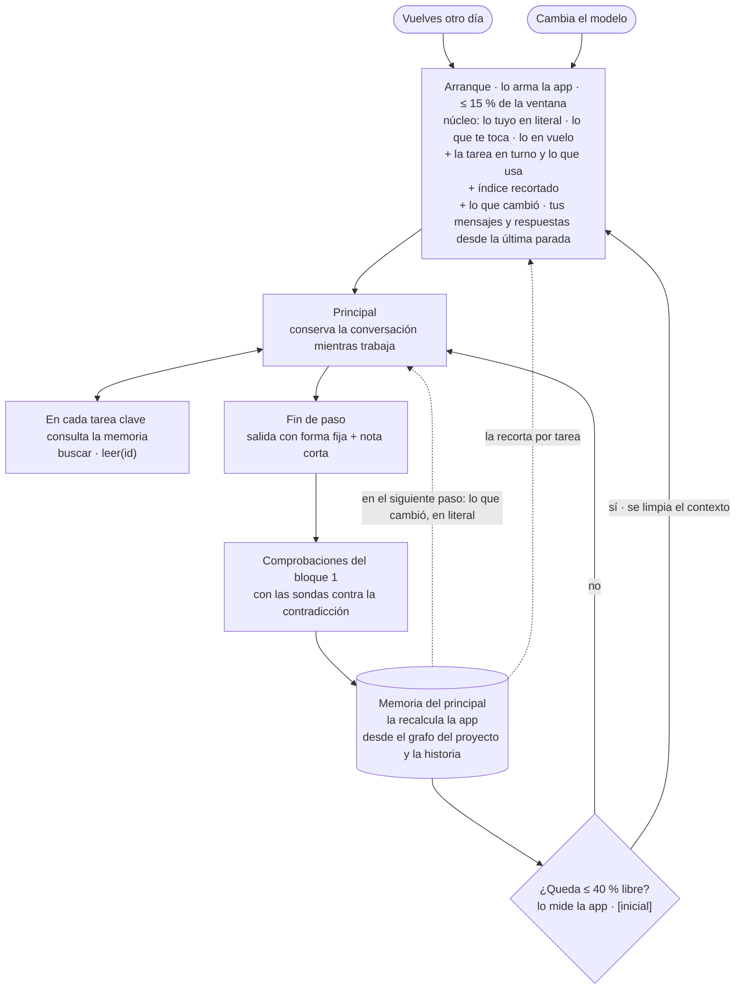

# Bloque 2 · La memoria del principal

*El principal nunca depende de lo que recuerda. Tiene una memoria propia, nuestra versión de lo que Engram es para gentle-pi, que guarda solo lo esencial y que calcula la app. Al reiniciarse no relee los documentos: recibe un arranque ligero, recortado para la tarea en turno.*

*La memoria es solo del principal. Los subagentes, el comprobador y Wonder no la leen: reciben su encargo (bloque-1.md §4). El humano tampoco la ve: ve el marco, que se calcula con la misma consulta (bloque 1, M-1).*

## 1. Cómo funciona

## 2. Qué guarda (B2-1)

Una memoria por proyecto; es lo que el bloque 1 llama «estado de trabajo». **No tiene almacén propio:** es una consulta del grafo del proyecto (bloque 1, fichas §9), más los eventos de la historia que no son nodos del grafo (modo, nota del agente, lo diferido, último triaje, tus mensajes e informe de parada). La app la recalcula en cada fin de paso; el agente no decide qué guardar. **Copia los estados del bloque 1 y no define estados propios.**

| Capa | Contiene | Forma, para gastar pocos tokens |
|---|---|---|
| **1 · Lo esencial** | Pedido y destinatario · criterios vigentes con sus casos del «Entendí» y su estado · premisa (o «exploratorio») · rol de cada sección · **tus decisiones y las críticas** · **lo que te toca**: tarjetas abiertas, «por aclarar», propuestas, casos sin confirmar, preguntas del destinatario abiertas, firma en pausa, informe sin ver y tus mensajes sin respuesta | Lo que dijiste tú, en literal y nunca resumido. Cada decisión, en forma compacta: id y versión · enunciado · tu «porque» · «en vez de» · aristas por id («aplica», «depende del supuesto», «se usa en») |
| **2 · Índice** | Cada sección (uno de sus 5 estados más el número de pendientes), decisión no crítica, ronda (de investigación o de juez, con su digesto o informe) y fuente, incluidos los cálculos | Una línea: id · versión · estado · primera línea |
| **3 · En vuelo** | Modo («normal» o «continúa hasta terminar») y tu mensaje al activarlo · sección y paso actuales · último triaje · pendientes del agente (bloque 1, estados §1) · cambios sin cerrar por sección · inventario de lo no revisado · rondas abiertas · **lo diferido**, hasta que un informe lo recoja (B2-6) · nota del agente del último paso | Completa |

- **Solo cuenta la versión vigente** de cada decisión. Lo reemplazado queda en la historia («reemplaza D-x»), como el *upsert* por tema de Engram.
- **La primera línea es la respuesta:** por la regla «primero la respuesta», la primera línea de cada sección, digesto o decisión ya dice lo esencial, y el índice la usa tal cual.
- **Nota del agente:** es parte de la salida de cada paso (bloque 1, fichas §7). Dice qué intentó, qué descartó y qué piensa hacer después. Va marcada «del agente».
- **Nunca contiene:** copias de documentos, tus mensajes parafraseados ni nada que solo valga para un modelo.

## 3. El arranque (B2-2)

**Un solo arranque** para otro día (no hay una conversación viva del principal en tu sesión), cambio de modelo o umbral. **Es un recorte de la memoria por tarea y pesa como máximo 15 % de la ventana `[inicial]`;** apunta a ≤ 5 %, y una prueba automática lo mide. Va de lo estable a lo variable, para aprovechar la caché por prefijo:

1. **Núcleo:** la capa 1 sin las decisiones críticas ajenas a la tarea, más la capa 3. **Nunca se recorta.**
2. **Tarea en turno:** tu mensaje sin respuesta; si no hay, el paso en vuelo; si no, el primer pendiente del agente o lo diferido; si solo queda lo tuyo, la parada con su informe. Va con lo que usa según el grafo: sus decisiones críticas en forma compacta (la criticidad la calcula la app por regla, aunque todavía no haya tarjeta), las no críticas en una línea, los supuestos de los que depende y sus fuentes.
3. **Índice recortado:** la capa 2, con una línea por sección y conteos para lo demás («312 fuentes → `buscar`»), y líneas sueltas si caben.
4. **Lo que cambió** desde lo último entregado al principal, sea cual sea su instancia o modelo.
5. **Tus mensajes ya respondidos y sus respuestas desde la última parada,** en literal (tope de 10 `[inicial]`). Los que no tienen respuesta ya van en el núcleo.

- **Si se pasa del tope,** la app recorta en este orden: el índice recortado hasta dejar solo las secciones; lo que cambió, a una línea por cambio (el texto, con `leer(id)`); tus mensajes ya respondidos, de los más antiguos. El núcleo y la tarea en turno nunca se recortan. Si aun así pasa del tope, te avisa.
- **En cada tarea clave consulta la memoria:** `buscar` en el índice, por texto o tipo, y `leer(id)`, que devuelve el texto vigente con su versión. Cada lectura queda registrada como entregada.
- **Durante la sesión,** lo que cambia (tus ediciones y sus avisos) entra en literal al empezar el siguiente paso.
- **Trae los ids que pide la salida fija** del principal (bloque 1, fichas §7). Lo que no venga, lo obtiene con `leer(id)`.

## 4. Umbral y limpieza del contexto (B2-3)

- **El principal conserva la conversación** y lo que consultó mientras su contexto está bajo el umbral.
- **La app mide el contexto** con el uso que reporta cada respuesta; el modelo no lo estima. Umbral: **cuando solo queda ~40 % de la ventana libre** (~60 % usado) `[inicial]`, calibrado por modelo.
- **Orden:** fin de paso → comprobaciones → la app recalcula la memoria → mide el contexto. Tras tu edición se hace lo mismo (bloque 1, flujos §1). Por eso, un arranque por umbral ya trae lo que abrieron las comprobaciones de ese fin de paso (tarjetas, «por aclarar», avisos).
- **Al llegar al umbral, se limpia el contexto** al cerrar el paso en curso (si se cruza en el fin de paso, en ese mismo), nunca a mitad de un paso ni durante una firma. Arranca un principal nuevo con el arranque. **No se resume:** lo literal ya está en la memoria. Como el arranque pesa ≤ 15 %, el principal nuevo arranca lejos del umbral: no hay reinicios en bucle.
- **Un cambio de modelo siempre arranca de nuevo,** aunque no se haya llegado al umbral. Del modelo anterior solo pasa lo registrado (su nota y lo diferido, marcados «del agente»), nunca su razonamiento no escrito.
- **Si un paso llena la ventana antes de terminar,** la app lo descarta sin aplicarlo, limpia el contexto y lo reintenta una vez desde el arranque. Si vuelve a fallar, queda como pendiente del agente, como el reintento de fichas §7.
- **Si lo que el principal recuerda choca con la memoria, manda la memoria.**
- **Un contexto largo no es razón para delegar** (B2-4): lo resuelve esta limpieza. Delegar es para leer más de lo que cabe, para partes independientes, o por un riesgo o una auditoría que pides (bloque 1, fichas §8.3).

## 5. Lo que el principal no ve de entrada (B2-7)

Con el arranque por tarea, el principal no ve de entrada las decisiones críticas de otras secciones. **La contradicción no depende de que las vea:** la juzga en cada paso un turno de otro LLM, el comprobador del bloque 1, con contexto limpio y sin ver el razonamiento del principal.

- **Sondas que arma la app:** una pregunta cerrada {lo protegido en literal, pasaje nuevo} → contradice · no · duda. La duda salta. Van siempre el pedido, los criterios con sus casos confirmados del «Entendí», la premisa, todas tus decisiones y **todas las decisiones críticas vigentes**, estén o no vinculadas al paso; además, las decisiones confirmadas y las de una sección firmada que el grafo vincula a lo que tocó el paso. Todas van en una sola llamada. Si cambió un criterio o la premisa, la sonda va contra el texto vigente de cada sección afectada (bloque 1, estados §6).
- **Lo estructural lo ve la app sola:** rechaza una salida cuyo «reemplaza» apunte a una decisión tuya, confirmada o de una sección firmada.
- **Si se le pasó al principal,** el «por aclarar» dice «la última entrega contradice D-x · no lo declaró el agente», y cuenta en la métrica del bloque 1. En «continúa hasta terminar», va al informe para tu revisión. No bloquea ni deshace (DEC-003).

## 6. Cada caso

| Caso | Qué pasa | Qué ve el humano |
|---|---|---|
| **Vuelves otro día** (caso 8) | Arranque. El triaje empieza por lo que cambió; tus cambios rigen y ya pasaron por las comprobaciones | La reentrada del bloque 1: tras ≥ 3 días o al terminar «continúa hasta terminar», una línea y el marco (M-2); si no, primero el informe pendiente (P3). La arma la app desde el grafo, no desde esta memoria |
| **Llega al umbral** (caso 7) | Se limpia el contexto y entra un principal nuevo con el arranque | Nada, salvo el aviso si el arranque pasa del tope (§3). El modo sigue igual |
| **Cambia el modelo** | Igual que llegar al umbral. Rigen el umbral y el tope del modelo nuevo | Lo que diga el bloque 3 |
| **El proyecto no cabe en la ventana** (caso 3) | El arranque trae la tarea en turno y el índice recortado con conteos; lo demás, con `buscar` y `leer(id)`. Los barridos van a lectores | Todo, como siempre, salvo el aviso si el arranque pasa del tope (§3) |

## 7. Presupuesto

**Presupuesto de complejidad:** 0 estados nuevos · 0 estados visibles para el humano · 1 umbral · 2 topes del arranque (15 % de la ventana y 10 mensajes) · 1 memoria, que es una consulta sin almacén propio · 1 campo en la salida del principal (lo diferido) · 1 aviso (el arranque pasa del tope) · 1 rechazo estructural («reemplaza») · 1 marca («no lo declaró el agente»).

Las hipótesis, cómo se prueba cada una y su resultado están en `hipotesis.md`.

## 8. En el hackathon (B2-5)

Entra todo, salvo calibrar el umbral y el tope por modelo (son constantes) y exportar a Engram (hoja de ruta del bloque 3). Las sondas van con las comprobaciones (rebanada 2). El reparto por rebanadas está en `../_plan-hackathon.md`.
