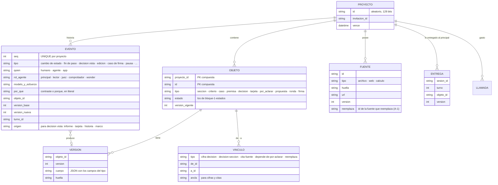

# Bloque 3 · Especificación

*Lo que necesita un agente de código para construir el almacén, la puerta de escritura, la firma y el despliegue. La idea está en `bloque-3.md`.*

## 1. Modelo de datos

- **Se toma:** todo pertenece a un proyecto (clave compuesta, ids aleatorios); los binarios son del proyecto; un escritor global para SQLite.
- **Sección** lleva un campo `rol` (conclusión · recomendación · otro): la criticidad lo necesita. Lo propone el principal en el «Entendí» y lo confirmas tú `[pregunta al bloque 1]`.
- **Decisión:** enunciado, en vez de, elegiría si, secciones donde se usa, crítica (sí/no y motivo, calculado). **«Por aclarar»:** pregunta, opciones con contraste, consecuencia y riesgo, variantes rotuladas, y de qué depende. **Firma:** ver §4.
- **El estado vigente se guarda junto con su evento, en la misma transacción.** Si no cuadran, gana la historia y se recalcula.

## 2. Escritura

- **Condicionada por versión (se toma):** `UPDATE … WHERE id = ? AND version_vigente = ?` con `rowsAffected == 1`; el evento y la versión nueva en la misma transacción. Sin cambio canónico no hay escritura. Nunca hay una transacción abierta mientras se espera al modelo.

| Llega… | y entre medias cambió… | Qué pasa |
|---|---|---|
| Un paso del agente | El mismo texto, por ti | **Queda como propuesta** con su contraste; tu edición rige |
| Un paso del agente | Otra cosa (otra sección, una decisión) | Se aplica; las comprobaciones ven el conflicto si lo hay |
| Un paso del agente | Una sección firmada, en «cambió» o en firma (B3-2) | Queda como propuesta |
| Tu edición | Lo que sea del agente o la app | Se aplica la tuya; lo del agente que quedó debajo pasa a propuesta |
| Tu edición desde otra pestaña | — | No ocurre: la segunda pestaña es de solo lectura |

- **Deshacer (G-1):** cada edición tuya se revierte con un clic. Deshacer es un evento nuevo que restaura la versión anterior; si había una propuesta desplazada, vuelve a abrirse.
- **Edición sospechosa (G-1):** la app la detecta por regla (borra más de la mitad de la sección o borra texto con decisiones vinculadas `[inicial]`) y muestra un aviso con «Deshacer». No bloquea.
- **Guardado:** al salir del campo, cada ~30 s, al ocultar la pestaña y siempre antes de enviar un mensaje o firmar (se toma). El cliente no envía si el documento no cambió.

## 3. Puerta de escritura del agente (B3-1)

| Componente | Herramientas | Lo que escribe |
|---|---|---|
| Principal | `buscar` (en el índice) · `leer(id)` (bloque 2) | Nada directo. Su salida fija de cada paso (fichas §7) |
| Lector | Búsqueda web alojada de Meta (F-2) · `leer(id)` de fuentes del proyecto | Nada. Devuelve hallazgos |
| Juez, comprobador, Wonder | Ninguna: todo llega en su encargo | Nada. Devuelven su forma fija |

**La app valida la salida del principal antes de aplicarla:**
1. tiene la forma fija; si no, un reintento y luego pendiente del agente (fichas §7);
2. el ancla existe y es única en la versión que leyó;
3. sin contenido invisible ni HTML crudo (se toma);
4. filtro de códigos: solo ids que existen en el proyecto, tras normalizar (NFKC, sin caracteres de formato, confusables UTS #39, guiones a «-»). Un rechazo vuelve al agente con el nombre que debe usar (se toma);
5. cada decisión nueva trae su contraste completo; cada vínculo apunta a una decisión que existe;
6. una decisión del agente solo reemplaza otra suya, vigente y fuera de lo firmado (estados §2);
7. cada cambio que el paso declara atendido está en la lista de esa sección; si lo declara «actualizado», el paso toca esa sección; si «revisado sin cambio», trae un «porque» válido (A-1). Si no, ese cierre se rechaza y vuelve al agente.

Lo que pasa la validación se aplica; luego corren las comprobaciones (flujo §1).

- **Verificación de hallazgos web (F-2):** Go descarga la URL (tiempo y tamaño acotados), normaliza el texto y busca el pasaje. Resultado: entra · no verificado (inaccesible) · descartado.
- **Límites `[inicial]`:** 8 llamadas a herramientas por paso; 3 lectores en paralelo.
- **No existe como herramienta:** firmar, responder tarjetas o «por aclarar», revocar, tocar la historia, escribir el estado de trabajo, borrar.

## 4. Huella, estado y firma

- **Huella `tq-md/1` (se toma):** SHA-256 de un JSON canónico (JCS) del árbol de goldmark con GFM: tipo de nodo, texto en NFC, niveles, celdas, destino de enlaces, contenido literal de bloques de código y Mermaid. Ignora marcadores de lista, carácter de énfasis, relleno y escapes.
- **Estado de la sección:** una sola función en Go que usan todas las vistas, con los 5 estados y los pendientes de bloque-1-estados §1.
- **«Cambió desde que la firmaste»** compara por componentes: la huella de la sección, la versión de cada decisión crítica firmada y la huella de cada fuente que la sección usa (A-1).
- **Firma (B3-2):** al pedir firmar, la sección entra en firma; los pasos del agente sobre ella llegan como propuesta. Tu edición cancela la firma en curso.
- **Lo que guarda la firma:** sección (versión y huella) · decisiones críticas y criterios aplicados (id y versión) · fuentes usadas (id y huella) · tarjetas respondidas · tu explicación · pregunta de origen y tu respuesta (o «no aplica», A-4) · casos de aplicación y su resultado · modelo que contrastó (Wonder o Spark `xhigh`). El resultado de Wonder va al lado, no dentro del compromiso.
- **Límite honesto (se toma):** la huella prueba que nada cambió, no quién firmó.

## 5. Para el bloque 2

- **Lo entregado** se registra al entregarlo: arranque, lecturas y avisos, con versión. «Lo que cambió» = lo vigente frente a lo último entregado, sea cual sea la instancia del principal.
- **El estado de trabajo** (capas 1–3) se calcula desde objetos e historia en cada fin de paso, y se guarda como caché. Si no cuadra, se recalcula.
- **Nota del agente y modo** (con tu mensaje de activación) se guardan como eventos; la capa 3 los lee.
- **El uso de contexto** de cada respuesta se guarda en `LLAMADA` para el umbral.

## 6. Despliegue y acceso

- **Fly.io** (se toma): una máquina, disco de 3 GB, siempre encendida; plan B Railway con el mismo contenedor. **No se despliega desde la entrega hasta que termine el juzgamiento.**
- **Copia (se toma):** `VACUUM INTO` diaria fuera del host; ensayo de restauración con `integrity_check` el 2-nov.
- **Streaming (se toma):** sin límite de escritura en esas rutas, latido cada 15 s, un escritor por conexión, `idle_timeout` fijado.
- **Acceso por invitación (B3-3):** link con token, pocos proyectos por token; solo un POST crea proyecto. Topes: 3 USD por proyecto, 10 USD/día, 60 USD total, fondo aparte para el jurado `[inicial]`; reserva del máximo antes de cada llamada.
- **Tamaño (se toma):** sección ≤ 200 KB, fuente ≤ 5 MB, 25 MB por proyecto; al 80 % del disco no se aceptan proyectos nuevos, salvo del jurado.
- **Seguridad (se toma):** Mermaid ≥ 11.15 sin HTML crudo; CSP sin scripts en línea; cookies `__Host-`; `http.CrossOriginProtection`; el streaming nunca reenvía errores crudos del proveedor; una prueba recorre todas las rutas con la cookie de otro visitante.
- **Vencimiento:** 14 días, si el aviso lo promete; si no entra, el aviso no promete plazo.

## 7. Pila (se toma)

React + Vite (editor TipTap 3; tipos generados desde Go con `tygo`) · Go en un binario que embebe la página · `modernc.org/sqlite` en WAL, un `*sql.DB` de escritura con `SetMaxOpenConns(1)` y otro de lectura · goldmark v1 + GFM, `x/text/unicode/norm`, `gowebpki/jcs` · cliente de la Responses API de Meta que guarda cada ítem de salida crudo y lo reenvía byte a byte, con `store: false` e `include: ["reasoning.encrypted_content"]`.

## 8. Horas por rebanada `[inferencia]`

| Rebanada | Piezas de este bloque | Horas |
|---|---|---|
| 0 · Base | Esqueleto desplegado · almacén, historia y escritura condicionada · proveedor y streaming · lo entregado | 10–13 |
| 1 · Ciclo mínimo | Puerta de escritura y validación · huella y estado · firma guardada · una pestaña y guardado antes del turno | 7–9 |
| 2 · Protecciones | Estado de trabajo completo (vista) · avisos en el texto · el marco y la línea de vuelta (§9) | 8–13 |
| 3 · Potencia | Búsqueda web de lectores y verificación de pasajes | 2–3 |
| 4 · Casos difíciles | Propuestas por choque · deshacer y edición sospechosa | 3–4 |
| Entrega | Acceso por invitación y topes · copia y restauración · seguridad | 5–6 |
| **Total** | | **35–48** |

**Lectura honesta:** es la mitad de las 60–65 h del plan, antes de la lógica del bloque 1 (encargos, comprobaciones, firma, interfaz). Con agentes de código parte se solapa, pero no alcanza sin recortes. Las palancas, en orden: B3-5 y B3-6 (ya fuera), B3-4 (voz fuera), acceso por invitación mínimo, y las rebanadas 3–4 tras interruptores, como ya dice el plan.

## 9. El marco (bloque 1, M-1 a M-4)

*Qué es y para qué: `bloque-1-fichas.md` §2, «El marco». Aquí, cómo se construye. Es una vista de solo lectura: no escribe nada salvo el evento «decisión vista», ningún modelo la redacta y nunca bloquea.*

- **Cálculo:** `marco(proyecto)` reutiliza la función que calcula las capas 1 y 2 del estado de trabajo (§5) y le suma: el «porque» de cada tarjeta respondida (`EVENTO.por_que`), tu explicación de firma vigente y los eventos «decisión vista». Solo muestra lo vigente: excluye decisiones reemplazadas y revocadas. Usa la misma caché del estado de trabajo, que se recalcula en cada fin de paso; los puntos «sin ver» se calculan al pedir la vista.
- **Contenido**, en este orden:
  1. **Para qué:** pedido, destinatario y premisa, en literal (capa 1).
  2. **Cómo se juzga:** criterios con su caso que cuenta y el que no (capa 1).
  3. **Esqueleto:** secciones en el orden del documento, con su estado y su primera línea (M-4: la primera oración del texto, hasta 200 caracteres `[inicial]`). Debajo de cada una, sus decisiones críticas vigentes. Una decisión que usan varias secciones aparece en cada una, con el mismo id.
  4. **Lo que te toca:** pendientes del humano (capa 1), incluido el informe de parada sin ver.
- **Ítem de una decisión:** ícono según el primer motivo de criticidad que cumpla, en este orden: cifra · conclusión o recomendación · varias secciones · marcada por ti. Al lado, el enunciado y un punto si no la viste.
- **Tarjeta al desplegar:** enunciado · en vez de · elegiría si · tu «porque» · tu explicación de firma, si hay · secciones que la usan · enlaces a la historia del párrafo (D7) y al texto. Desplegar registra «decisión vista» con `origen = marco`. Desplazarse por el panel no registra nada.
- **Filtro «solo lo que no viste»:** las decisiones con más vínculos `decision-seccion` primero; a igual número, en el orden del documento `[inicial]`.
- **Línea de vuelta (M-2):** aparece arriba del panel si pasaron ≥ 3 días `[inicial, parámetro]` desde tu último evento, o si terminó «continúa hasta terminar» desde tu última visita. Dice:
  - **dónde quedaste:** la última sección y el último acto tuyo;
  - **qué cambió:** el número de cambios de estado desde tu última visita, con enlace a la historia;
  - **qué te toca:** el número de tus pendientes.

  En vueltas más cortas, el panel abre igual, sin la línea, y la reentrada empieza por el informe pendiente (P3).
- **Firma:** la pantalla de firma no muestra el marco ni permite abrirlo.
- **Modelo de datos:** sin tablas nuevas. `EVENTO` suma el campo `origen` para «decisión vista» (§1).
- **Rendimiento:** ≤ 300 ms `[inicial]` con el caso de demo.
- **Hoja de ruta:** el intento de recuerdo antes de mirar (M-3: un objeto con texto, fecha y marcas) y la tesis de sección redactada por un modelo (M-4).
