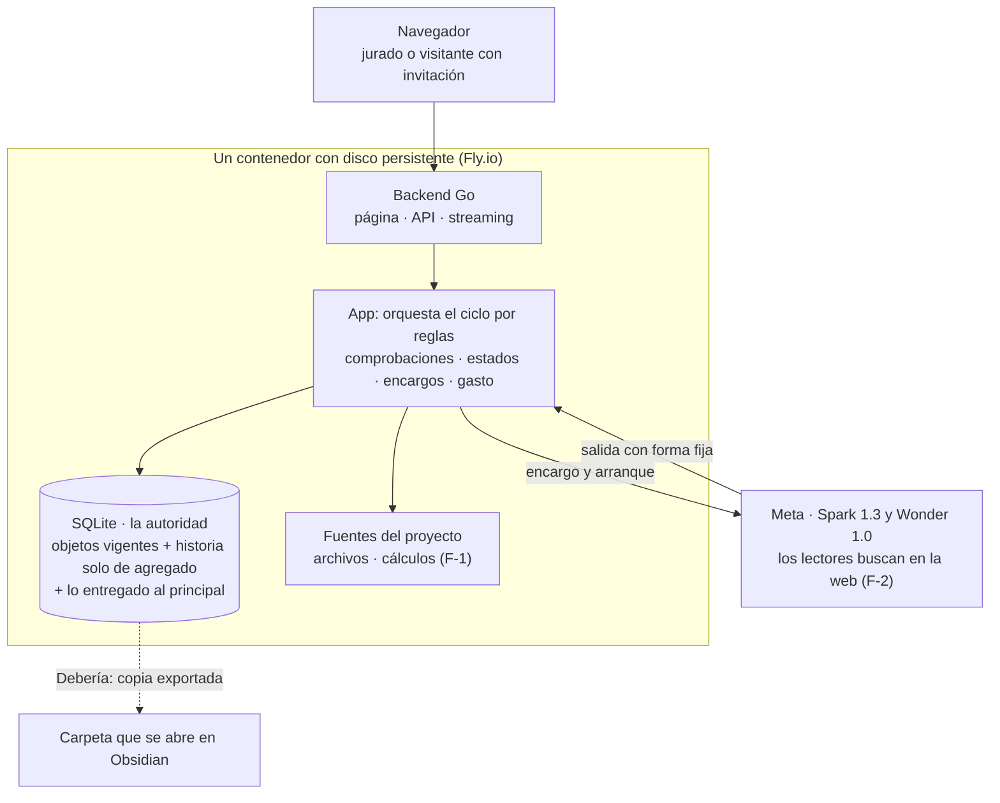
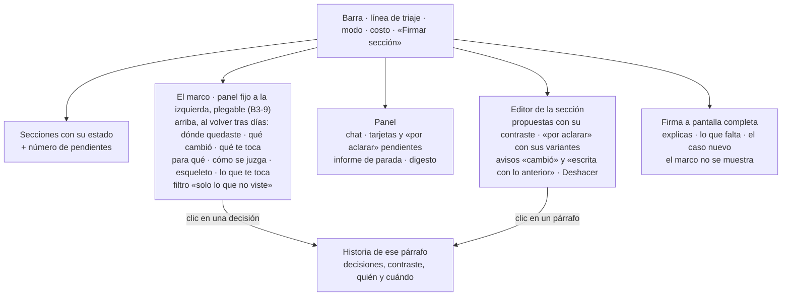

# Bloque 3 · Dónde corre, dónde se guarda y qué ves

*Una app web. La base de datos es la autoridad; la historia solo crece. El agente nunca escribe directo: entrega su paso y la app lo aplica. Todo lo de los bloques 1 y 2 se guarda aquí; nada nuevo se decide aquí sobre el ciclo.*

## 1. Esquema

## 2. Lo que se toma del bloque 3 anterior

- **App web propia en Go, React solo presenta.** El jurado entra con un link y no instala nada. Lo que tiene valor de evidencia (estados, huellas, comprobaciones) lo calcula Go.
- **La base de datos es la autoridad;** los archivos son una copia que se genera. Una escritura y su registro van juntos, en una sola operación.
- **Un vigente por objeto; la historia solo crece.** Cada cambio dice quién (tú, el agente, la app), por dónde y sobre qué versión se hizo.
- **Solo cuenta lo que cambia.** Abrir y guardar sin editar no crea versión, así no aparece un «cambió» falso.
- **Una pestaña editora;** otra pestaña abre en solo lectura. Tu texto se guarda siempre antes de enviar un mensaje o firmar.
- **La huella de una sección depende de su estructura, no del formato.** Lo firmado no admite contenido invisible.
- **Sin códigos internos en lo que ves;** el filtro de la app los detecta (regla 5 de las comprobaciones).
- **Topes de gasto y de disco que controla la app,** y aislamiento por proyecto.

## 3. Lo que cambia para alinearse con la v4.4

| Antes (25-oct) | Ahora | Por qué |
|---|---|---|
| El agente escribe con 7 herramientas (`edit_section`, `propose_record`, `open_act`…) | **Lee con `buscar` y `leer`; escribe solo entregando su paso con forma fija** (fichas §7). La app valida y aplica (B3-1) | Una sola puerta de escritura; la app ya calcula lo demás |
| Actos con predicción oculta | **Tarjetas** con opción y «porque» | Lo decidió el bloque 1 |
| Propuestas de revocación con `supersedes` | **El agente solo reemplaza sus decisiones, fuera de lo firmado;** revocar es solo tuyo | Estados §2 |
| Marcadores `[POR ACLARAR]` dentro del texto | **«Por aclarar» es un objeto** con sus opciones y variantes; el editor lo muestra sin escribirlo en el texto | Lo firmado no lleva metadatos |
| Cuatro estados de sección | **Cinco** (suma «escrita con lo anterior», E-4) | Estados §1 |
| La firma congela una instantánea al abrir la puerta | **Mientras firmas, los pasos del agente sobre esa sección llegan como propuesta,** igual que en una firmada (B3-2) | Una sola regla en vez de dos |
| Contraste: Cubierto · Omitido · Contradicho | **Coincide · falta en tu explicación · falta en el texto**, pregunta de origen, caso nuevo, pausa tras 2 fallos | Flujo de firma del bloque 1 |
| Agente que choca con tu edición: rehace una vez y luego propuesta | **Directo a propuesta;** tu edición rige | Flujo de comprobaciones |
| Búsqueda web apagada | **Encendida solo para los lectores;** la app verifica cada pasaje | F-2 |
| Sin memoria del agente en el hackathon | **El estado de trabajo del bloque 2 completo,** calculado desde la historia | B2-1 a B2-3 · alcance en el plan |
| Sin deshacer | **Deshacer cada edición tuya con un clic** y reaplicar la propuesta desplazada | G-1 |
| Espejo git como Debería · cadena de huellas | **A la hoja de ruta** (B3-5, B3-6) | Horas; no protegen nada del caso de demo |
| Voz para explicar en la firma (Debe) · «mueve una caja» del diagrama | **Texto primero; voz como Debería** (B3-4) · sale, porque la demo es el caso 2 (H-1) | Horas |

## 4. Qué ves

- **Es la lista de fichas §5, completa:** línea de triaje, tarjetas, «por aclarar», informe, digesto, historia por párrafo, el marco y la línea de vuelta, firma, la marca de las secciones sin firmar y la alerta de edición sospechosa con «Deshacer».
- **El marco (bloque 1, M-1 a M-4):** muestra qué se construye y por qué, ordenado por el argumento; no es un historial. Es de solo lectura, lo calcula la app sin modelo y usa el mismo cálculo que el estado de trabajo del bloque 2, así que no se desalinea. Cada decisión crítica es un ítem con ícono; al desplegarla, una tarjeta con su contraste, tu «porque» y enlaces a la historia y al texto. Detalle en la especificación §9.
- **Presupuesto de avisos:** en el texto solo se marcan «cambió desde que la firmaste», «escrita con lo anterior» y lo que tiene una propuesta. Lo demás va al número de pendientes, que abres cuando quieres.
- **Objetos, no carpetas.** La vista de carpeta y la exportación son Debería (B3-7).

## 5. Lo que este bloque guarda para los otros

- **Bloque 1:** los objetos de estados §1–§7 con versión y vínculos (cifra → decisión, dato → fuente, decisión → sección), lo que usa cada sección con su versión y su lista de cambios sin cerrar (A-1), las fuentes con id y huella, y la historia como eventos (estados §8), incluida «decisión vista» con su origen (informe, tarjeta, historia o marco), que el marco usa para sus puntos «sin ver».
- **Bloque 2:** lo entregado al principal en cada turno (con versión), la nota del agente y el modo de trabajo «en vuelo». El estado de trabajo es una vista que se recalcula desde la historia; no se escribe aparte. Exportar la memoria del principal a Engram queda en la hoja de ruta.

## 6. Hipótesis que se prueban construyendo

| Hipótesis | Cómo se prueba |
|---|---|
| La salida fija del principal basta para escribir, sin herramientas de escritura | Rebanada 1: el caso de demo pasa sin intervención manual |
| La huella por estructura no da «cambió» falsos tras abrir y guardar en el editor | Prueba de ida y vuelta con tablas y Mermaid, el primer día |
| El streaming largo de Wonder no se corta en Fly | Prueba desplegada con un proveedor falso de 90 s (rebanada 0) |
| El costo de una demo cabe en el tope por proyecto | Medirlo en el corte del 31-oct |
| El marco se recalcula en cada fin de paso sin frenar la interfaz | Con el caso de demo: ≤ 300 ms `[inicial]` |

**Presupuesto de complejidad:** 0 estados nuevos (usa los del bloque 1) · 1 puerta de escritura del agente · 3 avisos en el texto · 1 vista de solo lectura (el marco) y 1 campo en el evento «decisión vista».
