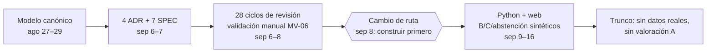

# Caso 02 · Motor de valoraciones de Observa Perú

*Análisis retrospectivo del motor de «Cómo está» de Observa Perú: desde el modelo de indicadores hasta una implementación que quedó trunca (27 de agosto – 16 de septiembre de 2026). El detalle, con rutas de respaldo, está en [notas.md](notas.md). Aprendizajes de ambos casos: [diagnóstico y aprendizajes](../diagnostico-y-aprendizajes.md).*

## 1. El caso en cifras

| | |
|---|---|
| Período | 21 días (27 ago – 16 sep) |
| Palabras | ≈ 195 000 en Markdown |
| Producto (ADR, SPEC, contratos) | 20 % |
| Proceso (backlogs, handoffs, auditorías, planes, dossiers) | 73 % |
| Ciclos de especificación | 28 en tres días; 5 sobre el propio protocolo, que tuvo 4 versiones en ~36 h |
| Código antes del cambio de ruta | Ninguno |
| Pruebas después del cambio de ruta | De 25 a 1 138 en 8 días, todas sobre datos sintéticos |
| Costo declarado | «aproximadamente equivalente a dos semanas de su plan» |

## 2. Qué es el motor

Decide, para el público no técnico, cómo está cada indicador sin inventar juicios. El modelo encadena concepto de medición, definición, familia de series, serie y observación, con una serie principal por ficha. La valoración tiene cuatro salidas:
- **A:** juicio valorativo contra una meta o un estándar habilitado.
- **B:** comparación factual contra un rango explícito.
- **C:** sin referencia, solo cuando una búsqueda concluida acredita que no existe.
- **Abstención:** no hay dato publicable.

No hay degradación automática de A a B ni de B a C.

## 3. Lo que coincide con el caso 01

| Patrón | Cómo aparece aquí |
|---|---|
| El proceso supera al producto | 73 % de las palabras son proceso; el backlog del motor tiene 233 KB, 203 hashes y unos 1 318 códigos (uno cada 21 palabras) |
| Aprobar no es comprender | Las decisiones se registran como «Ok, vamos con tus propuestas», «Autorizado», «Dale!», envueltas en actas de cientos de palabras que redacta el agente. Firma el agente coordinador, no el humano |
| El humano se retira | «No volver a pedir permisos ya otorgados para el mismo alcance»; ciclos aplicados «sin nuevo permiso del usuario» |
| Ciclos que giran | 5 de 28 ciclos perfeccionan el protocolo de ciclos |
| Varios vigentes a la vez | El protocolo 2.2 está escrito pero rige el 2.1 «hasta el cierre de C27»; dos handoffs se contradicen sobre por dónde retomar |
| Proceso en el producto | SPEC-005 incluye «acuerdos 2026-09-15»; el índice normativo, «precisiones adoptadas en conversación» |

## 4. Lo que este caso agrega

1. **Un oráculo externo cambia todo.** Mientras el producto fue texto, la validación fueron dictámenes manuales sobre casos sintéticos. Al empezar a construir, en ocho días hubo un motor ejecutable, una web y pruebas. La aprobación más real del humano fue sobre la ficha **renderizada**, no sobre texto.
2. **Gobernanza simulada.** Los subagentes imitaron controles de una institución pública (separación de funciones, firmas, autoridad) sobre un proyecto personal. El costo fue alto y no comprobó la comprensión de nadie.
3. **El costo económico fue la señal de corte, y llegó tarde.** El humano cortó rondas dos veces («no se realizará una nueva ronda» y el cambio de ruta), pero recién cuando el costo era evidente. Hay que hacerlo visible antes.
4. **El rigor migra a la nueva capa.** Al construir, la ceremonia pasó al código: 1 138 pruebas para un perfil sintético. Lo último registrado fue cerrar avisos de cobertura, no capacidad nueva.
5. **Inmutabilidad excesiva en lugar de reversión silenciosa.** No se reescribió nada en silencio, pero todo se congeló como «histórico», y eso multiplicó los vigentes simultáneos.
6. **Una especificación puede volver inalcanzable lo real.** Para usar datos reales se exige una autoridad institucional que un proyecto propio no tiene. La valoración A, el núcleo de valor, nunca llegó.
7. **El alcance crece al construir.** El trabajo pasó del motor a la plataforma completa (10 entregas) y a coordinar ramas y agentes paralelos.

## 5. Mecanismos que conviene rescatar

| Mecanismo del caso | En tupaqnin |
|---|---|
| Cita literal de la decisión con un contraejemplo de mala lectura («registrar "Avancemos" como aceptación de SPEC…» no es válido) | Regla de `DEC`: qué no cuenta como confirmación |
| Niveles de evidencia: diseñado ≠ ejercicio manual ≠ prueba automatizada ≠ caso real | Estado de cada afirmación y de cada componente |
| Alternativas descartadas con su razón en cada ADR | Contraste en `DEC` |
| Lista explícita de decisiones que no se reabren | DEC confirmadas, consultadas por `tq check` |
| Aprobación sobre lo renderizado | Acto de comprobación con el producto visible |
| Cambio de ruta a construir primero | Construir pronto lo que tiene oráculo; especificar solo lo suficiente para el alcance |

## 6. Caso aparte: medición de cuidados (ENUT 2024)

En la misma carpeta hay una medición de dos indicadores con microdatos de la ENUT 2024. No forma parte del motor. Se hizo en unos dos días, con unas 10 000 palabras de documentación, scripts reproducibles y denominadores y límites explícitos. Sirve de contraste: un trabajo acotado, con oráculo (los datos) y poco proceso.
