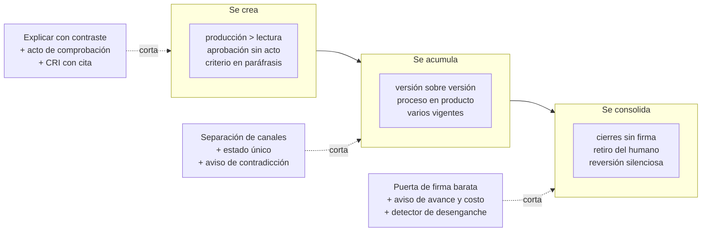

# Diagnóstico y aprendizajes de los casos

*Consolida lo observado en dos casos reales de construcción humano–agente: qué le duele al humano, en qué etapa del trabajo y cómo se crea y se consolida la deuda cognitiva (parte I), y qué se aprende para construir tupaqnin (parte II). El caso 01 es privado (trabajo presentado a una entidad pública); el caso 02 es público: [motor de valoraciones](caso-02-motor-valoraciones/README.md). Diseño vigente: [planteamiento](../planteamiento.md).*

## Los casos

| | Caso 01 · Marco metodológico de evaluación | Caso 02 · Motor de valoraciones de Observa Perú |
|---|---|---|
| Qué es | Documento metodológico para evaluar la gestión pública | Especificación y software para valorar indicadores |
| Duración | ~4 meses, en dos etapas | 21 días |
| Palabras | ≈ 510 000 | ≈ 195 000 |
| Proceso / producto | 52 % / 14 % (etapa 2) | 73 % / 20 % |
| Pico de producción | ≈ 95 000 palabras en 1 h 40 min | 28 ciclos en 3 días |
| Desenlace | Producto vigente acotado; calidad «indeterminada» | Trunco: sin datos reales ni valoración final |

---

# Parte I · Diagnóstico

## 1. Cómo nace y se consolida la deuda cognitiva

La deuda no aparece de golpe. En ambos casos siguió el mismo recorrido: se **crea** cuando el agente produce algo que el humano no hace suyo; se **acumula** cuando lo siguiente se construye sobre eso; se **consolida** cuando un cierre la congela y la vuelve cara de revisar; y se **paga** tarde, con una reescritura completa o un cambio de ruta.

```mermaid
flowchart LR
  subgraph C["Se crea"]
    c1["El agente produce<br/>más de lo que se lee"]
    c2["El humano aprueba<br/>sin un acto propio"]
    c3["Su criterio queda<br/>en paráfrasis"]
  end
  subgraph A["Se acumula"]
    a1["La versión nueva se apoya<br/>en la anterior no comprendida"]
    a2["Proceso y códigos<br/>dentro del producto"]
    a3["Varios documentos<br/>vigentes a la vez"]
  end
  subgraph K["Se consolida"]
    k1["Cierres declarados:<br/>«cerrada», «completa», v1.0"]
    k2["Autorización anticipada:<br/>el agente cierra y promueve"]
    k3["Decisiones revertidas<br/>sin acta, ya incrustadas"]
  end
  subgraph P["Se paga, tarde"]
    p1["Consolidación que descubre<br/>contradicciones"]
    p2["Depuración masiva"]
    p3["Replanteamiento<br/>o cambio de ruta"]
  end
  C --> A --> K --> P
  P -. "si nada cambia,<br/>vuelve a empezar" .-> C
```

| Fase | Mecanismo | Evidencia |
|---|---|---|
| Se crea | **Asimetría de velocidad.** El agente escribe en minutos lo que el humano tarda horas en leer | Caso 01: ≈ 95 000 palabras en menos de dos horas, más de 6 h de lectura. Caso 02: 28 ciclos en tres días |
| | **Aprobación sin acto.** El humano responde «ok», «autorizado», «dale», y el agente redacta el contenido de la decisión | Ambos casos: actas de cientos de palabras alrededor de una cita de una palabra |
| | **Criterio parafraseado.** Lo que el humano quiso decir queda escrito por el agente, sin cita ni contraste | Caso 01: los criterios aparecen como «la dirección», sin citas literales |
| | **Investigación no digerida.** Los informes entran al corpus sin que el humano extraiga lo que importa | Caso 01: 36 informes de investigación, ≈ 40 % del volumen de la primera etapa |
| Se acumula | **Construir sobre lo no comprendido.** Cada versión parte de la anterior, que nadie verificó contra las decisiones | Caso 01: el producto creció 64 % en tres versiones, cada una con otra arquitectura |
| | **Proceso y códigos en el producto.** El documento narra sus correcciones y usa identificadores en vez de nombres | Caso 01: 17 menciones de «corrección» en el producto final. Caso 02: un código cada 21 palabras en el backlog |
| | **Más de un vigente.** Conviven versiones que se declaran vigentes o cerradas | Ambos casos |
| Se consolida | **Cierres que congelan.** Declarar «cerrado» o firmar con hash vuelve costoso reabrir | Caso 01: tres versiones del marco se declararon cerradas. Caso 02: firmas y hashes en cada ciclo |
| | **Retiro del humano.** Para no frenar, autoriza por adelantado y el agente cierra, promueve y firma | Ambos casos: «continúa hasta terminar», «no volver a pedir permisos ya otorgados» |
| | **Reversión silenciosa.** Una decisión explícita se contradice en la versión siguiente y queda incrustada | Caso 01: de 7 decisiones de una sesión, unas 2 sobrevivieron intactas; la reversión se detectó dos meses después |
| Se paga | **Tarde y en bloque.** La deuda se descubre en una consolidación, una depuración o por el costo | Caso 01: 6 contradicciones halladas al consolidar; una depuración redujo 619 archivos a 86, y en dos horas volvieron a ser 421. Caso 02: el costo («dos semanas de su plan») forzó el cambio de ruta |

**La raíz común:** en ningún punto del recorrido se pidió al humano un acto que demostrara comprensión. La deuda se creó en cada aprobación sin acto y se consolidó en cada cierre sin firma humana.

## 2. Dónde duele, por etapa del trabajo

| Etapa | Dolor del humano | Cómo se ve en los casos | Qué crea o consolida |
|---|---|---|---|
| **Encuadre y concepción** | El objeto cambia de definición varias veces y no sabe cuál rige | Caso 01: el marco pasó por siete versiones (v1 a v7) antes del replanteamiento. Caso 02: renombre del concepto central a mitad de camino | Crea: criterios iniciales en paráfrasis |
| **Investigación** | Recibe más informes de los que puede procesar | Caso 01: 36 informes; ≈ 120 000 palabras en tres días | Crea: conocimiento que entra sin pasar por el humano |
| **Construcción y redacción** | No puede seguir los cambios entre versiones | Caso 01: tres versiones del producto en tres semanas, la segunda 74 minutos después de la primera | Acumula: versiones apoyadas en lo no verificado |
| **Revisión y auditoría** | Ve ciclos que se repiten sin saber si avanzan | Caso 01: auditorías sobre los mismos pasajes, mérito «indeterminado» en todos los ciclos finales. Caso 02: 5 de 28 ciclos sobre el propio protocolo | Acumula: proceso que crece más que el producto |
| **Decisión** | Debe decidir en lote sobre lo que no alcanzó a leer | Caso 01: 7 decisiones de fondo en una sola acta | Crea: decisiones sin comprensión |
| **Bloqueos y esperas** | El trabajo se detiene esperando un insumo suyo, o una compuerta lo detiene y luego se salta | Caso 01: el agente esperó descargas manuales; el gate en NO-GO se ignoró | Consolida: aprende que las puertas no protegen nada |
| **Pausa y reentrada** | Al volver, debe releer todo para retomar | Caso 02: 4 handoffs con «prompt para el chat nuevo» y la regla de releer autoridad y protocolo completos | Acumula: la memoria vive en documentos que nadie relee |
| **Cierre y promoción** | Queda fuera: el agente cierra, firma y promueve | Caso 01: ningún cierre con un acto humano. Caso 02: firma el agente coordinador | Consolida: lo cerrado parece validado sin serlo |
| **Limpieza y reorganización** | Tiene que aprobar depuraciones de cientos de rutas | Caso 01: una propuesta de depuración de 518 rutas, aprobada con «ok procedamos» | Paga, pero la acumulación vuelve en horas |
| **Paso a implementación** | El alcance crece y el rigor migra a la capa nueva | Caso 02: del motor a la plataforma completa; 1 138 pruebas sobre datos sintéticos | Acumula: ceremonia en otra forma |
| **Costo** | Se entera del costo cuando ya es alto | Caso 02: «aproximadamente equivalente a dos semanas de su plan» | Paga: corte por agotamiento, no por criterio |

## 3. Catálogo de dolores

| # | Dolor | Etapa | Casos |
|---|---|---|---|
| D-01 | No alcanzo a leer lo que se produce | Investigación, construcción | 01, 02 |
| D-02 | Decido sobre lo que no entendí | Decisión | 01, 02 |
| D-03 | No reconozco mi criterio en lo escrito | Encuadre, decisión | 01 |
| D-04 | Lo que decidí cambió sin que me enterara | Reescritura | 01 |
| D-05 | No sé qué documento rige | Todas | 01, 02 |
| D-06 | El trabajo se detiene esperándome, o una compuerta lo frena | Bloqueos | 01 |
| D-07 | Al volver tengo que releerlo todo | Reentrada | 01, 02 |
| D-08 | El texto está en clave: códigos que no recuerdo | Revisión | 01, 02 |
| D-09 | Veo ciclos que se repiten y no sé si avanzan | Revisión | 01, 02 |
| D-10 | El agente cierra y firma; yo quedo fuera | Cierre | 01, 02 |
| D-11 | Limpiar y reorganizar me cuesta, y el desorden vuelve | Limpieza | 01 |
| D-12 | Me entero del costo cuando ya es alto | Costo | 02 |
| D-13 | El alcance crece cuando empiezo a construir | Implementación | 02 |
| D-14 | Coordinar frentes y agentes paralelos me consume | Implementación | 02 |

## 4. Lo que sí funcionó

Ambos casos tienen momentos en que el humano comprendió y condujo de verdad. Todos fueron **actos**, no lecturas:

- **Dibujar antes de encargar:** un mapa propio del concepto antes de pedir la investigación (caso 01).
- **Dar casos testigo** para probar el marco (caso 01).
- **Probar contra un insumo externo real**, un documento de otro equipo (caso 01).
- **Aportar una dimensión nueva** que entró en la definición final (caso 01).
- **Aprobar sobre lo renderizado**, la ficha visible y no su especificación (caso 02).
- **Cortar ciclos:** «no se realizará una nueva ronda» y el cambio a construir primero (caso 02).

Y un contraste en la misma carpeta del caso 02: una medición acotada de dos indicadores con datos reales, hecha en dos días, con unas 10 000 palabras y poco proceso.

---

# Parte II · Aprendizajes para construir el harness

## 5. Aprendizajes

| # | Aprendizaje | Dolores | En tupaqnin |
|---|---|---|---|
| L-01 | **La lectura nunca alcanza.** Reducir lectura no basta: la comprensión tiene que venir de otra parte | D-01 | Comprensión por actos (principio 1) |
| L-02 | **Aprobar no es comprender.** Un asentimiento no confirma contenido | D-02, D-10 | `DEC` con cita literal y regla de qué no cuenta como confirmación; actos en la puerta de firma |
| L-03 | **El criterio humano se pierde si no se guarda con sus palabras.** | D-03 | `CRI` con cita, ejemplo de origen y estado; teach-back del agente |
| L-04 | **Las decisiones se revierten al reescribir.** | D-04 | Aviso de contradicción contra `DEC` y `CRI` confirmados, sin bloquear |
| L-05 | **Un solo vigente.** Ni reescribir en silencio ni congelar todo como histórico | D-05 | `tq estado` como única fuente del estado |
| L-06 | **Las compuertas que bloquean se saltan.** | D-06 | Nada bloquea la construcción; la única puerta es la firma (DEC-003) |
| L-07 | **La memoria no puede depender de releer.** | D-07 | Reentrada con teach-back del agente y nota «cuando vuelva, primero…» |
| L-08 | **Los códigos no explican.** | D-08 | Nombres en el producto; códigos solo en el expediente |
| L-09 | **Los ciclos necesitan una razón para seguir.** | D-09 | Aviso de avance por ciclo: qué incertidumbre se redujo |
| L-10 | **Ante el volumen, el humano se retira.** Autoriza por adelantado y deja que el agente cierre | D-10 | La puerta de firma debe ser barata; medir si se delega |
| L-11 | **Una regla escrita no separa canales.** El proceso entra al producto aunque esté prohibido | D-11 | Separación estructural: un hook redirige el proceso al expediente |
| L-12 | **El costo tiene que verse antes.** | D-12 | Costo del ciclo visible desde el inicio |
| L-13 | **Un oráculo externo cambia todo.** Con pruebas, render o datos hubo avance verificable en días | D-09, D-13 | Construir pronto lo que tiene oráculo; especificar solo lo suficiente (principio 8) |
| L-14 | **La ceremonia entre agentes no protege al humano.** Aislar a quien propone de quien valida dejó al humano fuera | D-10, D-14 | Independencia de agentes como apoyo, no como sustituto; gobernanza proporcional al proyecto |
| L-15 | **El rigor migra a la capa nueva.** | D-13 | Medir avance en capacidad útil, no en cantidad de controles |
| L-16 | **Los aportes reales del humano ya son actos.** | — | Registrar dibujos, casos testigo y pruebas externas como evidencia de comprensión y de autoría |

## 6. Dónde actúa cada parte del harness sobre la deuda

## 7. Mecanismos de los casos que se adoptan

| Mecanismo | Origen | En tupaqnin |
|---|---|---|
| Acta con estado y supuesto por decisión | 01 | Campos de `DEC` |
| «Qué cambiaría este juicio» | 01 | Campo de `DEC`; base de la pregunta de proyección |
| Lectura previa sellada antes de ver resultados | 01 | Acto de predicción |
| Transferencia de saldo con la condición de cierre literal | 01 | Nota de reentrada y cola de pendientes |
| Inventario de contradicciones entre versiones | 01 | `tq check` en cada cambio, no meses después |
| Regla de parada: otra prueba solo si responde a un riesgo abierto | 01 | Aviso de avance |
| Contraejemplo de mala lectura de una autorización | 02 | Regla de `DEC` |
| Niveles de evidencia: diseñado, probado a mano, probado con oráculo, caso real | 02 | Estado de cada afirmación |
| Lista de decisiones que no se reabren | 02 | `DEC` confirmadas |
| Aprobación sobre lo renderizado | 02 | Acto con el producto visible |
| Vistas generadas desde datos estructurados | 01, 02 | Vistas desde el expediente |

## 8. Lo que el harness no debe hacer

- Pedir aprobación en lugar de un acto.
- Bloquear la construcción con compuertas intermedias.
- Escribir el criterio del humano con palabras del agente sin devolvérselo.
- Mezclar proceso, códigos o salvedades en el producto.
- Declarar algo cerrado o vigente sin firma humana.
- Repetir ciclos sin decir qué incertidumbre reducen.
- Imitar la gobernanza de una institución en un proyecto personal.
- Especificar en exceso lo que puede construirse y verificarse.

## 9. Qué probar en la aplicación manual

1. ¿Un acto de una línea por decisión basta para que reconozcas tu criterio una semana después?
2. ¿El aviso de contradicción habría detectado la reversión del caso 01 en el momento?
3. ¿La puerta de firma se mantiene barata, o tiendes a autorizar por adelantado?
4. ¿Cuánto proceso llega al producto con la separación estructural?
5. ¿El aviso de avance y costo corta ciclos antes de que lo fuerce el agotamiento?
