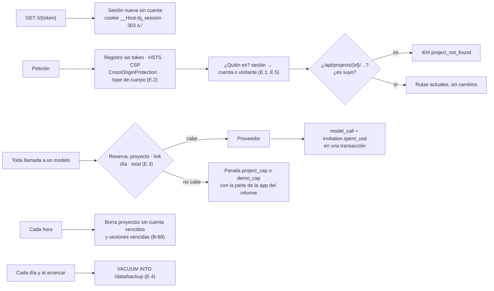
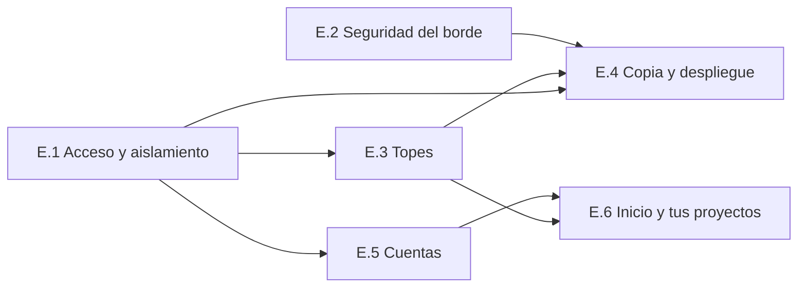

# Backlog · rebanada Entrega

**Respuesta:** 6 piezas, de la E.1 a la E.6. Al terminar, **la demo se puede abrir en público**: entras con un link de invitación, creas un proyecto y vuelves a él; con la cookie de otro visitante o con otra cuenta no ves nada; cada link gasta solo su saldo; la copia diaria se restaura. «Listo cuando» del plan: el de H-4, que la E.6 prueba en Chrome con el link del jurado. **Horas: 14–19 `[inferencia]`**; el plan le da el 2-nov y deja el despliegue público para el 3-nov.

**Orden (para que la demo sirva lo antes posible):** E.1 acceso y aislamiento → E.2 seguridad del borde → E.3 topes → E.4 copia y despliegue → E.5 cuentas → E.6 inicio. Con la E.1 a la E.4 en verde ya se puede desplegar: el jurado entra, crea y descarga su primer proyecto sin cuenta y vuelve a él con el menú de proyectos actual. Si la E.5 no llega, rige lo que B3-18 dejó dicho para ese caso: «sin cuentas, y el proyecto del link dura 14 días» (una constante).

**Decisiones:** B-87 a B-94 (abajo). 6 se infieren y no piden respuesta. **2 son tuyas:** B-90 (confirmar la única dependencia nueva, la que exige bcrypt) y B-94 (permisos del volumen, solo si el despliegue de prueba confirma P-5).

**Falta de Eber:** sincronizar al repo, antes de la E.1, `docs/construccion/backlog-entrega.md`, `docs/diseno/bloque-3/` (decisiones, especificación, pantallas y funcionalidades) y `docs/construccion/versiones-seguras.md` · sumar en la tabla de `AGENTS.md` la línea de este backlog y decir que lo que este backlog nombra de B3-22 está aprobado (hoy la regla 13 pide parar ante todo lo que toque B3-22, y aquí lo toca cada pieza) · correr los pasos marcados «lo corre Eber».

**Presupuesto de complejidad (regla 2.4):** 0 estados y 0 eventos nuevos (cuentas, links y sesiones no son del grafo). 3 tablas nuevas y 2 columnas (espec. §1.7; `project.invitation_id` y `project.expires_at` ya existen desde la `0001`). Un valor nuevo de parada: `demo_cap` (B-89). 0 variables de entorno nuevas. 1 dependencia nueva (B-90).

## Qué cubre cada pieza

| Del plan (§1, H-4) y del diseño | Pieza |
|---|---|
| Acceso con link (B3-3), sesión sin cuenta, dueño de cada proyecto, un proyecto sin cuenta por navegador, vencimiento con la sesión del navegador (B3-18, 2-nov) · B3-22 filas 2 (máximos del link), 3, 4 (cookie y hash) y 6 | E.1 |
| B3-22 filas 7 a 10 · `http.CrossOriginProtection` (espec. §6, «se toma»; hoy no está en `server.go`) | E.2 |
| Topes por link, del día y total; saldo para la firma; aviso al 80 % y al tope; disco al 80 % (B3-20, espec. §6, B3-22 fila 2) | E.3 |
| Copia diaria y su restauración (B3-17, espec. §6, B3-22 fila 5) · despliegue de prueba (H-5) y público (H-2) · P-5 | E.4 |
| Registro, entrada y salida con usuario y clave (B3-18) · B3-22 filas 1, 4 (rotación) y 5 | E.5 |
| P1 Inicio y «Tus proyectos» (pantallas P1, funcionalidades 1a y 1c a 1h) · «Probar con el caso de demo» (B3-19, ya construido) en el inicio · el recorrido de H-4 | E.6 |

**Fuera de Entrega:** pantalla de administración (B3-22 fila 2: no existe, a propósito); recuperar la clave (sin correo, espec. §1.7); entrar con Google o GitHub (B3-18, «en vez de»); volver a desplegar durante el juzgamiento (B3-17).

## Arquitectura (lo que suma Entrega)

**Reglas de la arquitectura:** un solo control de dueño, delante de todas las rutas (B-87): ningún handler lo repite ni lo puede olvidar. Ningún secreto en registros (T-10): ni el token del link, ni la cookie, ni la clave, ni su hash. Configuración solo por las variables que ya existen (T-9): `TQ_CAP_PROJECT_USD`, `TQ_CAP_DAY_USD` y `TQ_CAP_TOTAL_USD` ya se leen en `internal/config` y las dos últimas hoy no se usan.

**Rutas nuevas de Entrega** (la API sigue bajo `/api`, como en `server.go`):

| Vista | Ruta | Escribe |
|---|---|---|
| Entrar con el link | `GET /i/{token}` → 303 a `/` con la cookie | `session` |
| Estado para el inicio | `GET /api/session` → cuenta, link, si puedes crear y por qué no | — |
| Cuentas | `POST /api/account/register` `{username, password}` · `POST /api/account/login` · `POST /api/account/logout` | `account`, `session`, `project.account_id` |
| Tus proyectos | `GET /api/projects` (ahora filtra por dueño y suma campos) · `POST /api/projects` (ahora con dueño y topes) | `project` |

## Elecciones técnicas de este backlog (para Eber)

*El diseño no las fija y el agente las necesita. «Se infiere» cita el pasaje adoptado que la sostiene.*

| # | Propuesta | En vez de | Elegiría la otra si… | Decisión de Eber (literal) |
|---|---|---|---|---|
| B-87 | **Un solo control de dueño, como middleware delante del `mux`:** toda ruta cuyo camino empieza por `/api/projects/{projectID}/` (incluido el streaming, que hoy se registra fuera del bloque de la API) resuelve la sesión y responde **404 `project_not_found`** si el proyecto no es de la cuenta ni de la sesión sin cuenta, igual que si no existiera. Sin sesión, 401 `no_session`. Las rutas se registran desde una tabla (`[]route{method, pattern, handler}`) para que una prueba las recorra todas. Los proyectos sin dueño (los de antes de la `0005`, en una base local) quedan en la base y no se ven desde la web | Un `requireOwner` dentro de cada uno de los ~55 handlers que hoy llaman a `requireProject` (se puede olvidar uno, y la ruta 56 nace sin él) | — | **Se infiere, no requiere decisión:** B3-22 fila 6 («un solo control de dueño en el servidor para toda ruta con `{projectID}`… recorre todas las rutas con otra cookie y con otra cuenta») y espec. §6 |
| B-88 | **Una sola cookie y la vida del proyecto sin cuenta.** La cookie `__Host-tq_session` sirve con y sin cuenta (`session.account_id` vacío = sin cuenta). Un proyecto sin cuenta guarda en `project.anon_session_hash` el hash de esa sesión, y su `expires_at` se corre a «ahora + 24 h» `[inicial]` con cada petición tuya al proyecto (como mucho una escritura por hora). **Sin cuenta, la cookie es de sesión del navegador** (sin `Max-Age` ni `Expires`): al cerrar el navegador se pierde el proyecto (Eber, 2-nov, B3-18). Con cuenta, la cookie dura 14 días desde la última actividad. **Cada hora, la app borra los proyectos sin cuenta vencidos con todas sus filas** (en toda tabla con `project_id`) y las sesiones vencidas. Es la única excepción a «la historia solo crece» (AGENTS regla 6), y la pide el diseño. El gasto del link no se pierde al borrar: vive en `invitation.spent_usd` | Marcar el proyecto como vencido sin borrarlo (el disco crece con proyectos que nadie puede abrir) | — | **Se infiere, no requiere decisión:** B3-18 («tu proyecto dura 7 días desde tu última actividad… «se borra en n días»») y espec. §1.7 (`anon_session_hash`, `expires_at`, `spent_usd`) |
| B-89 | **Cómo se componen los topes.** Antes de cada llamada a un modelo (principal, lectores, digesto, juez, comprobador y Wonder), la app reserva el máximo de esa llamada (una constante por rol en `models.go` `[inicial]`: principal 0,15 USD; juez, digesto y comprobador 0,05 USD; Wonder 0,20 USD (Eber, 2-nov); o lo que costó la llamada más cara de ese rol en el proyecto, si fue más, como B-65. La de los lectores ya existe en `internal/cycle/reader.go` y se mueve a `models.go`. «Lo gastado hoy» es la suma de `model_call.cost` del día UTC, por `created_at`, de los proyectos cuyo `invitation_id` es un link que no es `jury`. Con el modo activo (backlog-r4 B-83), llegar a un tope termina el modo con `mode_finished` y `data.cause: project_cap` o `demo_cap`, más `data.cap`; adoptado 1-nov) y la deja pasar solo si cabe en **los cuatro**: (1) el proyecto: gastado + reservado ≤ 3 USD **menos el saldo de la firma** (0,40 USD `[inicial]`, ≈ 2 contrastes), salvo las llamadas de la firma (`contraster`), que pueden usar ese saldo; (2) el link: `spent_usd` + reservado ≤ `budget_usd`; (3) el día: lo gastado hoy (UTC) por los links cuya etiqueta no es `jury` ≤ `TQ_CAP_DAY_USD`; (4) el total: la suma de `spent_usd` de todos los links ≤ `TQ_CAP_TOTAL_USD`. Al no caber, el turno termina con `stop_reason: project_cap` (1) o **`demo_cap`** con `data.cap: link · day · total` (2 a 4), y el informe se queda con la parte de la app, sin llamar al modelo (como `PrincipalFailed`). Las rondas, el digesto y el juez, que ya cortan con `project_cap`, suman `demo_cap` en el mismo campo. El link agotado tampoco abre proyectos nuevos; los que existen se leen, se editan y se descargan | Que el saldo del link solo impida crear proyectos (los que existen seguirían gastando hasta 3 USD cada uno) · o guardar un tope por cuenta (B3-22 lo descartó) | — | **Se infiere, no requiere decisión:** B3-20 (aviso al 80 %, «el agente se detiene con su informe», saldo para la firma), espec. §6 («reserva del máximo antes de cada llamada»; «10 USD al día para los links que no son del jurado»; 60 USD en total) y los costos de B3-22 («el peor caso es 10 USD por cada link de invitados»: el saldo frena también las llamadas). La etiqueta `jury` sale de espec. §1.7 (`label`: «jurado o invitados») |
| B-90 | **bcrypt con `golang.org/x/crypto/bcrypt`**, la única dependencia nueva: la versión etiquetada más reciente con 7 días o más de publicada, sin avisos en OSV ni en `govulncheck` (la regla de `versiones-seguras.md` §1 y B-19). El agente la fija en `go.mod` y la reporta; el chat de diseño suma la fila en `versiones-seguras.md` §3 | PBKDF2 de la biblioteca estándar (`crypto/pbkdf2`, sin dependencia; cambiaría lo adoptado en B3-22 fila 5) | Prefieres no sumar ninguna dependencia durante el hackathon | **Decides tú, solo confirmar:** bcrypt de costo 12 ya está adoptado (B3-22 fila 5, espec. §1.7), pero AGENTS reglas 11 y 13 piden tu aprobación para toda dependencia nueva. **Adoptada (1-nov).** |
| B-91 | **Valores de las cuentas `[inicial]`:** usuario de 3 a 32 caracteres `[a-z0-9_.-]`, guardado en minúsculas; clave de 10 a 64 caracteres **y no más de 72 bytes** (con tildes o emojis, 64 caracteres pueden pasar de 72 bytes, y `bcrypt` los rechaza); usuario desconocido y clave errada dan la misma respuesta y el mismo tiempo (se compara contra un hash de relleno); la espera por cuenta empieza en el 3.er fallo seguido: 1 s, 2 s, 4 s… hasta 30 s, como 429 con `Retry-After` (nunca un bloqueo); el límite por IP (10 fallos cada 15 min) y la espera viven en memoria (una sola máquina); entrar no pide link, registrarte sí | Guardar los intentos en la base (sobreviven a un reinicio, pero suman una tabla) | Los registros muestran intentos que se reparten entre reinicios | **Se infiere, no requiere decisión:** B3-22 filas 1, 4 y 5 y espec. §1.7; los valores nuevos son `[inicial]`. B3-18 («solo se registra quien llegó con un link»; con cuenta, cambiar de navegador no te hace perder el proyecto: entrar no puede pedir link) |
| B-92 | **Links por comando en el mismo binario:** `tupaqnin invite create --label jury --budget 30 --accounts 10 --anon 10` imprime una sola vez `/i/<token>` (32 bytes aleatorios en base64url; la base guarda su SHA-256); `invite list` muestra etiqueta, saldo, gastado, cuentas y proyectos, nunca el token; `invite revoke <id>`. En Fly se corre con `fly ssh console -C "/tupaqnin invite …"`. Si la imagen sin shell no lo permite, la imagen pasa a la variante `debug-nonroot` de distroless, fijada por digest | Una variable de entorno con los links al arrancar (otra opción de configuración, y el token quedaría en los secretos de Fly) | — | **Se infiere, no requiere decisión:** B3-22 fila 2 («que fijas al crearlo con un comando en el servidor y que puedes revocar: no hay pantalla de administración») y espec. §1.7. Que `fly ssh console -C` corra sin shell es `[inferencia]`: lo prueba Eber en la E.4 |
| B-93 | **La copia diaria:** la app hace `VACUUM INTO /data/backup/tq-AAAAMMDD.db` al arrancar (si no hay copia de hoy) y cada 24 h, y guarda las 3 últimas `[inicial]`; la instantánea diaria del volumen de Fly la saca del host, en la cuenta de Fly de Eber (almacenamiento privado). `tupaqnin backup-check <archivo>` corre `PRAGMA integrity_check`, comprueba la versión del esquema y cuenta proyectos, cuentas y links, sin mostrar contenido | Subir la copia a un almacenamiento de objetos (un bucket con su clave: otra credencial y otra dependencia) | Las instantáneas de Fly resultan estar en el mismo host | **Se infiere, no requiere decisión:** espec. §6 («`VACUUM INTO` diaria fuera del host; ensayo de restauración con `integrity_check`»), B3-22 fila 5 («la copia diaria va a un almacenamiento privado») y sus costos («las primeras 10 GB de copias son gratis», que son las instantáneas de Fly). Que la instantánea quede fuera del host es `[inferencia]`: Eber lo confirma en la documentación de Fly al desplegar |
| B-94 | **Permisos del volumen (P-5), solo si el despliegue de prueba lo confirma:** la imagen de ejecución pasa de `distroless/static-debian12:nonroot` a `distroless/static-debian12` (corre como root dentro de la máquina virtual de Fly, que solo tiene esta app), fijada por digest | Que el binario arranque como root, haga `chown` de `/data` y baje a `nonroot` con `syscall.Setuid` (≈ 1 h, y no se puede probar en CI) | La app sigue publicada después del hackathon | **Decides tú:** toca la seguridad de la imagen. Recomendación: root durante el hackathon; lo que puede leer root dentro de la máquina (la base) ya lo lee la app. **Adoptada (1-nov): root durante el hackathon, solo si H-5 confirma P-5.** |

## Piezas

### E.1 · Acceso y aislamiento

| Campo | Contenido |
|---|---|
| **Qué** | Solo entras con un link de invitación. La app te reconoce por una cookie y solo te muestra tus proyectos. Sin cuenta, creas uno por navegador; vive mientras dure la sesión del navegador (en el servidor, 24 h sin actividad) y después se borra |
| **Implementa** | B3-3 · B3-18 (sin cuenta, vencimiento, abuso) · B3-22 filas 2 (máximos de cuentas y de proyectos sin cuenta), 3, 4 (cookie y hash) y 6 · espec. §1.7 y §6 (acceso) · B-87 · B-88 · B-92 |
| **Leer** | Espec. §1.7 y §6 · B3-18 y B3-22 (con sus detalles) en `bloque-3-decisiones.md` · defaults T-8, T-10 y T-11 · `internal/server/server.go` · `internal/store/project.go` y `internal/store/migrations/0001_init.sql` |
| **Interfaz** | **Migración `0005_access.sql`:** tablas `invitation`, `account` y `session` con los campos de espec. §1.7; `project` suma `account_id` y `anon_session_hash`; índices por `session.id_hash`, `account.username` (único) y `project.account_id`; ningún dato se borra · **cookie `__Host-tq_session`:** 32 bytes aleatorios, `Path=/`, `HttpOnly`, `Secure`, `SameSite=Lax`, 14 días; la base guarda su SHA-256 · `GET /i/{token}`: link válido y no revocado → sesión sin cuenta (si ya tienes una válida, la conserva) y 303 a `/`; si no, 404 sin cookie; `requestLog` registra esa ruta como `/i/…` · **middleware de dueño (B-87)** delante del `mux`; la tabla de rutas reemplaza los `mux.HandleFunc` sueltos · `POST /api/projects`: sin cuenta, un proyecto por sesión (403 `account_required`) y `max_anon_projects` del link (403 `link_full`); guarda `invitation_id`, `anon_session_hash` y `expires_at` · `GET /api/projects`: solo los tuyos · **limpieza horaria (B-88)** · **comando `invite` (B-92)** en `cmd/tupaqnin` · las herramientas del agente siguen leyendo solo el proyecto del turno |
| **Listo cuando** | Prueba `TestB3_22_6_EveryProjectRouteChecksOwner`: recorre la tabla de rutas; con la cookie de otro visitante cada ruta con `{projectID}` responde 404 y no escribe nada (mismo número de eventos y de `model_call`); sin cookie, 401 · prueba: el streaming de un turno ajeno da 404 · prueba `TestB3_22_3_InviteRedeemed`: 303 a `/` sin token, la cookie trae `__Host-`, `HttpOnly`, `Secure` y `SameSite=Lax`, y la línea del registro no contiene el token · prueba: un link revocado o desconocido da 404 sin cookie · prueba `TestB3_22_4_OnlyHashesStored`: ni el token ni la cookie aparecen en la base · prueba: el segundo proyecto sin cuenta da `account_required`; el 6.º de un link con `--anon 5`, `link_full` · prueba `TestB3_18_AnonProjectExpires`: con el reloj 7 días y 1 min después de tu última petición, la limpieza deja sin filas al proyecto en toda tabla con `project_id`, y `spent_usd` no cambia; una petición a los 6 días corre el vencimiento · prueba: `GET /api/projects` lista solo los tuyos · prueba: una herramienta del agente con la etiqueta o el id de otro proyecto no lo encuentra · prueba: la `0005` sobre una base con proyectos los conserva · prueba: `invite create` imprime el token una vez y `invite list` no lo muestra · **lo corre Eber:** en Chrome, el link en una ventana normal y otro en una de incógnito: cada una ve solo su proyecto |
| **Depende de** | Rebanadas 0 a 3 (hechas; la 3.7 entró en `a4c7884`) · B-87 · B-88 · B-92 |
| **No hacer** | Cuentas ni claves (E.5). Topes de gasto (E.3). Una pantalla de administración. Registrar la cookie, el token o el cuerpo de una petición · Ninguna opción, variable ni etiqueta desactiva el control de dueño: los helpers de prueba (`newAPI` en `api_test.go`, `NewWithAPI` y el driver de recorrido de `driver_test.go`) crean link y sesión en el store y mandan la cookie (adoptado 1-nov) |
| **Si algo no está** | `[EL DISEÑO NO LO DICE]` y una línea en `elecciones-agente.md` |

### E.2 · Seguridad del borde

| Campo | Contenido |
|---|---|
| **Qué** | Lo que llega de afuera no puede ejecutar código en el sitio, ni hacer que el servidor visite su propia red, ni tumbarlo con peticiones enormes. Nada de esto se nota al usar la app |
| **Implementa** | B3-22 filas 7, 8, 9 y 10 · espec. §6 (seguridad: `http.CrossOriginProtection`, CSP, tamaños) |
| **Leer** | B3-22 (tabla) · espec. §6 · `internal/server/server.go` (`securityHeaders`) · `internal/server/request.go` (tipos de fuente, descarga) · `internal/evidence/fetch.go` (`checkURL`) |
| **Interfaz** | `securityHeaders` suma `Strict-Transport-Security: max-age=31536000` en toda respuesta y mantiene la CSP actual · `http.CrossOriginProtection` delante del `mux` · **tope de cuerpo en toda petición:** 256 KB `[inicial]` por defecto (cabe una sección de 200 KB), y la subida de fuentes sigue con 5 MB + 1 MB; más, 413 · la lista cerrada de tipos de fuente (`.md`, `.txt`, `.csv`, `.pdf`; XLSX no está construido) y la descarga como adjunto ya existen: se prueban · toda URL que el servidor visita pasa por `checkURL` (solo `http` y `https`, sin IP privadas, locales ni de enlace, también tras una redirección, 5 s y 5 MB); si algún otro camino visita URLs sin él, se pasa por él · ningún componente de React usa `innerHTML` ni `dangerouslySetInnerHTML` para texto del documento o del modelo |
| **Listo cuando** | Prueba `TestB3_22_10_HSTSEverywhere`: el encabezado está en `/healthz`, en `/`, en una ruta de la API y en un 404 · prueba: un cuerpo de 300 KB a `PUT …/sections/{label}` da 413; una fuente de 6 MB, 413 (hoy responde 400 `source_too_large`, `internal/server/request.go`: pasa a 413 con el mismo código) · prueba: un `POST` con `Sec-Fetch-Site: cross-site` da 403 · prueba `TestB3_22_7_UploadTypes`: `.html`, `.svg` y `.js` dan `source_unsupported_type`; la descarga trae `Content-Disposition: attachment` y `nosniff` · prueba `TestB3_22_8_MaliciousDocument`: una sección con `<script>`, `` y `[x](javascript:alert(1))` vuelve como texto en la API y en `export.md`, y la CSP sigue igual · prueba web: ningún archivo de `web/src` usa `innerHTML` (una prueba que lee los archivos) y `safeLink` anula `javascript:` · prueba `TestB3_22_9_NoInternalURLs`: `169.254.169.254`, `10.0.0.1`, `::1` y `x.internal` se rechazan, también tras una redirección desde una URL pública |
| **Depende de** | Nada de Entrega: puede ir en paralelo con la E.1 |
| **No hacer** | Cambiar la CSP. Sumar tipos de fuente |
| **Si algo no está** | `[EL DISEÑO NO LO DICE]` en el retorno |

### E.3 · Topes por link, del día y total

| Campo | Contenido |
|---|---|
| **Qué** | Cada link gasta solo su saldo, la demo tiene un tope por día y uno total, y siempre queda saldo para firmar lo construido. Al 80 % del tope del proyecto ves un aviso de una línea; al tope, el agente se detiene con su informe y tu trabajo queda intacto |
| **Implementa** | B3-20 (avisos y saldo para la firma) · B3-22 fila 2 (saldo del link) · espec. §6 (topes, reserva antes de cada llamada, disco al 80 %) · B-89 |
| **Leer** | B3-20 y B3-22 (tabla y «Costos que sostienen estos topes») · espec. §6 · `internal/store/model_call.go` (`ProjectSpend`, `RecordModelCall`) · `internal/cycle/reader.go` (`roundBudget`, `budgetProvider`) · `internal/cycle/stopreport.go` (`PrincipalFailed`) · `internal/server/sections.go` (`getSummary`) · `internal/config/config.go` |
| **Interfaz** | **Puerta de gasto** en `internal/cycle` (como `budgetProvider`, para todas las llamadas del runner): reserva, comprueba los cuatro topes de B-89 y libera al terminar; las reservas en vuelo viven en memoria · `RecordModelCall` suma `cost` a `invitation.spent_usd` en la misma transacción · `stop_reason: project_cap` o `demo_cap` (`data.cap`) en `step_ended`; la parada lleva la parte de la app del informe · `main.go` pasa `SpendCapDayUSD` y `SpendCapTotalUSD` al runner (hoy no los pasa) · `POST /api/projects` también responde 403 `link_budget`, `day_cap` o `disk_full` (disco al 80 % de `TQ_DATA_DIR` con `syscall.Statfs`; el link `jury` sí crea) · `SummaryView` suma `warn` (gastado ≥ 80 % del tope) y `stopped_by` (`project_cap` · `link` · `day` · `total`), calculados en Go · web: la línea del aviso en la barra, con textos en `en.json` y `es.json` |
| **Listo cuando** | Prueba `TestB3_20_PrincipalStopsAtProjectCap`: con 2,50 USD gastados y la reserva del principal, el turno termina con `project_cap`, sin llamar al proveedor, y el informe trae la parte de la app · prueba `TestB3_20_SignoffReserve`: con el proyecto al tope menos el saldo, el principal no arranca y la firma sí llama a Wonder · prueba `TestB3_22_2_LinkBudget`: dos proyectos del mismo link; cuando el link no alcanza, la llamada siguiente no sale (`demo_cap`, `link`), un proyecto nuevo da `link_budget`, y el existente se lee, se edita y se descarga · prueba: lo gastado hoy por links que no son `jury` llega a `TQ_CAP_DAY_USD` y para (`day`); el link `jury` sigue · prueba: el total para (`total`) · prueba: `spent_usd` crece con cada `model_call` y no baja al borrar un proyecto vencido · prueba: una ronda y un juez cortan con `demo_cap` cuando el link no alcanza · prueba: `warn` es verdadero al 80 % · prueba: con el disco simulado al 80 %, crear da `disk_full`, salvo con el link `jury` · prueba web: la función que elige el aviso da el texto de cada caso |
| **Depende de** | E.1 (links y dueño) · B-89 |
| **No hacer** | Topes por cuenta. Cortar a mitad de una llamada: el tope se mira antes de cada llamada |
| **Si algo no está** | `[EL DISEÑO NO LO DICE]` en el retorno |

### E.4 · Copia, restauración y despliegue

| Campo | Contenido |
|---|---|
| **Qué** | La base se copia sola cada día y la copia se puede abrir en otra máquina. La imagen escribe en el disco de Fly, y la app queda lista para el despliegue público |
| **Implementa** | B3-17 · espec. §6 (Fly, copia, streaming) · B3-22 fila 5 (copia privada) · H-5 · P-5 · B-92 (prueba en Fly) · B-93 · B-94 |
| **Leer** | Espec. §6 · H-2 y H-5 en `_plan-hackathon.md` · P-5 en `docs/construccion/supervision.md` · `deploy/Dockerfile` · `deploy/fly.toml` · `Makefile` · `internal/server/dev_routes*.go` |
| **Interfaz** | La copia diaria de B-93 (una gorutina con el reloj inyectable) y el subcomando `tupaqnin backup-check <archivo>` · `make backup-check FILE=…` · `deploy/fly.toml`: se quita el aviso «DO NOT DEPLOY», sin otros cambios · `deploy/Dockerfile` acepta `ARG TAGS` y compila con `go build -tags "$TAGS"` (vacío por defecto; H-5 usa `devroutes`) · `deploy/Dockerfile`: lo de B-94 si H-5 confirma P-5, o la variante `debug-nonroot` si B-92 lo pide · la imagen pública sin `-tags=devroutes` (B-4) |
| **Listo cuando** | Prueba `TestSpec6_BackupRestores`: con dos proyectos, la copia pasa `backup-check` y, abierta como base, lista los mismos proyectos con su historia · prueba: un archivo dañado hace fallar `backup-check` con código distinto de 0 · prueba: quedan solo las 3 últimas copias · prueba: sin `-tags=devroutes` no existe `/api/dev/…` · **lo corre Eber, en la app de prueba `tupaqnin-prueba` (H-5, con `-tags=devroutes` y el proveedor falso):** (1) la app escribe en `/data` (P-5; si no, B-94); (2) los 90 s de streaming llegan completos; (3) `fly ssh console -C "/tupaqnin invite create …"` funciona (B-92); (4) **ensayo de restauración:** `fly ssh sftp get` de la copia, `backup-check`, y la app local con esa base muestra los proyectos en Chrome; (5) `fly volumes snapshots list` muestra la instantánea del día. Después borra la app de prueba · **lo corre Eber, el 3-nov:** `fly secrets set META_API_KEY=…`, `fly deploy`, los links `jury` (30 USD, 10 cuentas, 10 sin cuenta) y de invitados (10 USD, 3, 5) con `invite create`, y el recorrido de la E.6 con el link del jurado. Después, no se vuelve a desplegar hasta que termine el juzgamiento (B3-17) |
| **Depende de** | E.1 · E.2 · E.3 (para el despliegue público) · B-93 · B-94 |
| **No hacer** | Desplegar en público antes de que la E.1, la E.2 y la E.3 estén en verde. Leer el `.env` o los secretos de Fly |
| **Si algo no está** | `[EL DISEÑO NO LO DICE]` en el retorno |

### E.5 · Cuentas

| Campo | Contenido |
|---|---|
| **Qué** | Para conservar tu proyecto o crear otro, te registras con usuario y clave, sin correo; tu proyecto sin cuenta pasa a tu cuenta y deja de vencer. Tienes hasta 3 proyectos y los ves desde cualquier navegador. Nadie te deja fuera de tu cuenta probando claves |
| **Implementa** | B3-18 (con cuenta) · B3-22 filas 1, 4 (rotación de sesión) y 5 · espec. §1.7 (`account`, `session`) · B-90 · B-91 |
| **Leer** | B3-18 y B3-22 · espec. §1.7 · `docs/construccion/versiones-seguras.md` (regla de versiones) · lo que dejó la E.1 |
| **Interfaz** | `POST /api/account/register` (solo con una sesión que vino de un link; `max_accounts` del link → 403 `link_accounts_full`; usuario tomado → 409 `username_taken`): crea la cuenta con bcrypt de costo 12, pasa el proyecto de la sesión a la cuenta (`account_id`, sin `anon_session_hash` ni `expires_at`) y abre una **sesión nueva**, todo en una transacción; la sesión sin cuenta se borra · `POST /api/account/login`: 401 `invalid_credentials` igual para usuario y clave; sesión nueva · `POST /api/account/logout`: borra la sesión en el servidor y la cookie · límites de B-91: por IP solo desde `Fly-Client-IP` (sin ese encabezado, la dirección de la conexión; nunca `X-Forwarded-For`), 429 con `Retry-After` · `POST /api/projects` con cuenta: hasta 3 (403 `account_limit`), con el link de la cuenta para el gasto (E.3) |
| **Listo cuando** | Prueba `TestB3_18_RegisterKeepsAnonProject`: el proyecto sin cuenta pasa a la cuenta y ya no vence · prueba `TestB3_22_4_SessionRotates`: al registrarte, entrar y salir, la cookie anterior deja de valer · prueba `TestB3_22_5_PasswordRules`: 9 caracteres, 65 caracteres y 64 caracteres de más de 72 bytes se rechazan; el hash guardado es bcrypt de costo 12 · prueba: usuario desconocido y clave errada dan el mismo código y el mismo cuerpo · prueba `TestB3_22_1_IPLimit`: 10 fallos desde una `Fly-Client-IP` dan 429 al 11.º; cambiar `X-Forwarded-For` no lo esquiva; desde otra IP la clave correcta entra · prueba `TestB3_22_1_NoLockout`: tras fallos en tu cuenta, pasada la espera, tu clave entra · prueba: el 4.º proyecto da `account_limit`; la 4.ª cuenta de un link con `--accounts 3`, `link_accounts_full` · prueba: entrar sin link y con la cuenta muestra tus proyectos · `TestB3_22_6_EveryProjectRouteChecksOwner` suma el caso «otra cuenta» · **lo corre Eber:** en Chrome, te registras, cierras, entras desde otro navegador y ves tu proyecto |
| **Depende de** | E.1 · B-90 (la dependencia) · B-91 |
| **No hacer** | Correo, recuperación de clave o entrar con Google o GitHub. Bloquear una cuenta. Registrar el usuario junto a un fallo de clave |
| **Si algo no está** | `[EL DISEÑO NO LO DICE]` en el retorno |

### E.6 · Inicio y tus proyectos

| Campo | Contenido |
|---|---|
| **Qué** | Al abrir el link ves el inicio: qué es tupaqnin, que no subas datos sensibles, «Probar con el caso de demo», «Proyecto en blanco» y tus proyectos. Ves cuánto le queda a tu proyecto sin cuenta y, cuando algo no se puede, por qué: necesitas una cuenta, llegaste a 3, el link agotó su saldo, la demo llegó a su tope de hoy o no hay disco |
| **Implementa** | Pantallas P1 · funcionalidades 1a, 1c, 1d (avisos del inicio), 1e, 1f, 1g y 1h · B3-18 · B3-19 (los dos botones, ya construidos) · B3-20 (avisos del inicio) · el «Listo cuando» de H-4 |
| **Leer** | `pantallas.md` (P1 y «El recorrido del jurado») · `funcionalidades.md` (1a a 1h) · `web/src/App.tsx` (menú de proyectos) · `web/src/api/client.ts` · `web/src/i18n/` |
| **Interfaz** | `GET /api/session` → `{account: username o vacío, link_label, can_create, cannot_create: account_required · account_limit · link_full · link_budget · day_cap · disk_full}` · `GET /api/projects` suma por proyecto `last_activity` (último evento), `signed` y `sections` (con `SectionStatus`) y `expires_in_days` (vacío con cuenta), todo calculado en Go · web: P1 como pantalla cuando no hay proyecto abierto; sin sesión, «Necesitas un link de invitación» y «Entrar»; formularios de registro y entrada; el menú de proyectos del marco sigue igual · textos en `en.json` y `es.json` |
| **Listo cuando** | Prueba `TestP1_ProjectListFields`: nombre, última actividad, firmadas de cuántas y días para vencer · prueba: `can_create` y su motivo en cada caso de la E.1, la E.3 y la E.5 · prueba web: la función que arma los avisos del inicio da el texto de cada motivo, y cada clave existe en `en.json` y en `es.json` · prueba web: con `no_session`, el inicio muestra «Entrar» y no la lista · **lo corre Eber, en Chrome, con el link del jurado (el «Listo cuando» de H-4):** entras, «Probar con el caso de demo», cierras y vuelves a tu proyecto; en incógnito, con el mismo link, no lo ves; te registras y entras desde otro navegador; descargas el `.md` |
| **Depende de** | E.3 (motivos de gasto) · E.5 (cuentas) |
| **No hacer** | Mostrar proyectos de otros. Una pantalla de administración. Cambiar el ciclo o el caso de demo |
| **Si algo no está** | `[EL DISEÑO NO LO DICE]` en el retorno |

## Las 10 correcciones de B3-22, dónde y con qué prueba

| # | Corrección | Pieza | Prueba |
|---|---|---|---|
| 1 | Límite por IP (`Fly-Client-IP`) y espera creciente por cuenta | E.5 | `TestB3_22_1_IPLimit` · `TestB3_22_1_NoLockout` |
| 2 | Saldo y máximos por link, por comando, revocable | E.1 · E.3 | `invite` · `link_full` · `TestB3_22_2_LinkBudget` |
| 3 | Token canjeado por cookie, dirección sin token, sin token en el registro | E.1 | `TestB3_22_3_InviteRedeemed` |
| 4 | Sesión nueva al registrarte, entrar y salir · solo hashes · `__Host-`, `HttpOnly`, `Secure`, `Lax` · 14 días con cuenta; sin cuenta, cookie de sesión | E.1 · E.5 | `TestB3_22_4_OnlyHashesStored` · `TestB3_22_4_SessionRotates` |
| 5 | Clave de 10 a 64 caracteres · bcrypt 12 · mismo mensaje · copia privada | E.5 · E.4 | `TestB3_22_5_PasswordRules` · `TestSpec6_BackupRestores` |
| 6 | Un solo control de dueño · herramientas con el proyecto del turno | E.1 | `TestB3_22_6_EveryProjectRouteChecksOwner` |
| 7 | Tipos cerrados · fuentes como descarga | E.2 | `TestB3_22_7_UploadTypes` |
| 8 | Sin HTML crudo ni `javascript:` · React sin `innerHTML` · CSP | E.2 | `TestB3_22_8_MaliciousDocument` · prueba web |
| 9 | Solo `http`/`https`, sin IP internas, también tras redirección, 5 s y 5 MB | E.2 | `TestB3_22_9_NoInternalURLs` |
| 10 | Tope de cuerpo · `Strict-Transport-Security` | E.2 | `TestB3_22_10_HSTSEverywhere` · prueba de 413 |

## Horas `[inferencia]`

E.1: 4–5 · E.2: 1,5–2 · E.3: 2–3 · E.4: 1,5–2,5 (más el tiempo de Eber en Fly) · E.5: 3–4 · E.6: 2–3. **Total: 14–19 h**, dentro de las 14–18 de H-4.

**Lectura honesta:** la rebanada 3 está completa (la 3.7 entró en `a4c7884`). Con «Entrega» (14–19 h) y la 4 (27–38 h), son 44–61 h antes del 4-nov al mediodía, sin contar video ni README. «Entrega» y la 3.7 caben el 2-nov si el agente no se traba; el 3-nov queda para el despliegue y, en lo que sobre, la 4 en su orden (4.1 → 4.5 → …), que no llegará entera. Si «Entrega» se atrasa, la E.1 a la E.4 bastan para desplegar; la E.5 y la E.6 entran el 3-nov o se quedan fuera, con el proyecto sin cuenta a 14 días (B3-18). Lo que no se puede saltar es la parte de Eber en Fly: el despliegue de prueba (H-5) aún no se hizo (P-5 sigue abierto) y es el que dice si la imagen escribe en el disco y si el streaming de 90 s aguanta.

## Retorno de cada pieza

El mismo de `backlog.md`: qué hace en 5 líneas · archivos · pruebas · lo que no hizo · `[EL DISEÑO NO LO DICE]` · dudas para Eber (máximo 3, con contraste).
