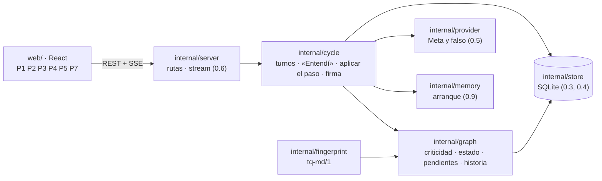
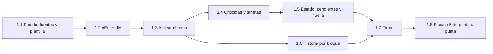

# Backlog · rebanada 1

**Respuesta:** 8 piezas. Al terminar, **el tramo del caso 5 que toca a la rebanada 1 pasa de punta a punta sin intervención manual** (plan §1, H-1): creas el proyecto de demo, envías el pedido, confirmas el «Entendí», el agente escribe con una decisión crítica y su cifra, respondes la tarjeta, ves la historia del párrafo y firmas después de que Wonder te pide lo que faltaba. Quedan para la 2 las comprobaciones completas, el «por aclarar», la parada y el marco.

**Antes de empezar hace falta tu respuesta** a B-8 (aristas, en `backlog.md`) y a B-9 a B-18 (abajo). La 1.8 necesita además la plantilla del caso 5 (B-12), que preparamos nosotros, no el agente.

**Corrección de diseño ya aplicada (28-oct):** los tres esquemas de salida tenían en `label` el patrón `(?!new-)`, que el motor de expresiones regulares de Go no compila. Ahora el patrón es `^[a-z]{2,5}-[1-9][0-9]*$` y la exclusión de `new-n` la hace la regla 4 en Go (espec. §3). El significado no cambia. La 0.7 todavía no lo había embebido.

## Arquitectura

**Reglas de la arquitectura** (de la especificación): la interfaz solo muestra; todo lo que tiene valor de evidencia lo calcula Go (`bloque-3.md` §2). Toda escritura pasa por `store.Write` con su evento (§2). El agente solo escribe con su salida fija, que valida `cycle` (§3). El estado de la sección, la criticidad y los pendientes salen de una sola función cada uno, en `graph` (§4, T-5).

**Rutas de la rebanada 1** (las de 0.10 siguen; todas bajo `/api/projects/{projectID}`):

| Pantalla | Ruta | Escribe (evento) |
|---|---|---|
| P1 | `GET /api/projects` · `POST /api/projects` `{name, template}` (`template`: vacío o `case-5`) | — |
| P2 | `GET /request` · `PUT /request` `{text, audience, criteria[], premise, exploratory}` · `POST /sources` (archivo, `kind`: `file` · `calculation`) · `POST /request/submit` → `{turn_id}` | `human_message` y lo que crea la 1.1 |
| P2 | `GET /understanding` · `POST /cases/{label}/confirm` · `POST /cases/{label}/correct` `{text}` · `PUT /sections/{label}/role` `{role}` | `state_changed` · `role_changed` |
| P3 | `GET /sections/{label}` (texto, estado, pendientes, cifras y citas vinculadas) · `GET /todo` (lo que te toca) · `GET /summary` (gastado, tope, último triaje) | — |
| P4 | `GET /cards/{label}` · `POST /cards/{label}/answer` `{option, reason}` | `state_changed` · `decision_seen` (`card`) |
| P5 | `GET /sections/{label}/history?block={n}` | `decision_seen` (`history`) |
| P7 | `POST /sections/{label}/signoff` → la firma en curso (`sign-n`) · `POST /signoffs/{label}/explanation` `{text}` → `{turn_id}` · `POST /signoffs/{label}/answers` `{origin_answer, case_answer}` → `{turn_id}` · `GET /signoffs/{label}` · `POST /signoffs/{label}/sign` · `POST /signoffs/{label}/leave` (B-13, B-14) | `signoff_case` · `signoff_paused` · `signoff_cancelled` (B-14) · `brief_signoff` · `state_changed` · `act_timed` |

Wonder responde por el mismo stream de turnos (0.6), con un turno de tipo firma. Como en la 0.10, las rutas nombran cada objeto por su etiqueta.

## Elecciones técnicas de este backlog (para Eber)

*El diseño no las fija y el agente las necesita. La última columna es tu respuesta.*

| # | Propuesta | En vez de | Elegiría la otra si… | Decisión de Eber (literal) |
|---|---|---|---|---|
| B-9 | **En la rebanada 1, las fuentes son de texto: MD, TXT y CSV.** El caso 5 usa artículos ficticios en MD. PDF y XLSX entran cuando haga falta leerlos, con la lista de tipos de B3-22. **La huella de una fuente** (espec. §4 solo define la de una sección) es el SHA-256 de su texto en NFC con los finales de línea normalizados | Extraer texto de PDF desde ya (≈ 3 h y una dependencia más) | El caso de demo necesita un PDF real | |
| B-10 | **La historia es por bloque del texto vigente:** un párrafo, un ítem de lista o una tabla, según goldmark. Su historia junta las decisiones vinculadas a sus cifras y citas, y los cambios de texto (pasos y ediciones) cuyo texto aparece en ese bloque | Guardar un id por párrafo que sobreviva a las ediciones (más preciso, pero cambia el editor y el modelo de datos) | En las pruebas, la historia pierde el rastro de un párrafo editado varias veces | |
| B-11 | **Hasta la rebanada 4, si la sección cambió desde la versión que leyó el agente, su paso se rechaza y se reintenta una vez con el texto vigente.** En la 4 pasa a ser una propuesta (espec. §2). Choca poco, porque el turno lo abre tu mensaje y el editor guarda antes de enviar | Adelantar las propuestas a la 1 | Las pruebas de la 1 chocan seguido | |
| B-12 | **La plantilla del caso 5 vive en `docs/demo/caso-5/`, y la preparamos nosotros:** el pedido, el destinatario, los criterios, los artículos ficticios en MD y el cálculo de la comparación como fuente (F-1, B3-19), con los conteos que dan 60 veces y 1,5 veces. La regla de comparación es crítica porque la usan «Síntesis» y «Conclusiones» (fichas §3, dos o más secciones), no por la cifra, que es un dato copiado de una fuente (A-3). El botón «Probar con el caso de demo» la carga. El agente no inventa contenido | Que el agente escriba la plantilla | — | |
| B-13 | **La firma con Wonder va en dos llamadas por vuelta.** (1) Con tu explicación: Wonder marca cada decisión crítica y formula la pregunta de origen; si falta algo en tu explicación, nombra qué falta y trae un caso nuevo. (2) Con tus respuestas a la pregunta de origen y al caso: Wonder las juzga y vuelve a contrastar todo, como pide flujos §3 («después de un caso bien resuelto se vuelve a contrastar»). Se repite (2) hasta que todo coincide o hay 2 casos fallidos. Si no hay arista hacia un supuesto, la pregunta la elige Wonder (fichas §9) | Una llamada por cada cosa (contrastar, formular, juzgar la pregunta, plantear el caso, juzgarlo), como cuenta flujos §4: más llamadas y más espera | En las pruebas, Wonder mezcla los juicios cuando van juntos | |
| B-14 | **La firma en curso es una firma (`sign-n`) que todavía no se firmó:** guarda la versión de la sección, tu explicación, las respuestas y el resultado de cada vuelta. Los 2 casos fallidos la pausan con `signoff_paused` (E-2). Dejarla para después o tu edición de esa sección (K-16) la cancelan: el glosario no tiene ese evento, así que se suma `signoff_cancelled`, con su motivo (`left` · `edited`), al glosario §4 si adoptas esta fila. Hasta la rebanada 4, un paso del agente que toca una sección en firma o firmada se rechaza, como en B-11. «Preguntar al agente» desde la firma pide una respuesta sin texto nuevo | Un estado nuevo «en firma» en la sección, que el diseño no tiene | — | |
| B-15 | **Los pendientes del agente se calculan; no se guardan como objetos.** «Cifra sin decisión»: una cifra sin arista `covers` que no es un dato copiado; se cierra al vincularla o al quitarla del texto. «Falta en el texto»: el evento de la firma con el pasaje; se cierra cuando cambia la huella de la sección. «Retorno sin la forma fija»: el último `output_retry` del turno; se cierra con el siguiente fin de paso válido. «Fuente que no sostiene»: una cita sin `comes_from` porque su pasaje no está literal en su fuente; se cierra al corregir o quitar la cita. «Texto con una decisión reemplazada» (B-16): se cierra con el siguiente paso del agente que toca esa sección y declara tu decisión entre las que usa | Una tabla de pendientes, que el modelo de datos no tiene | Calcularlos se vuelve lento con el caso 5 | |
| B-16 | **Si eliges la otra opción en una tarjeta, nace una decisión tuya:** su enunciado es el «en vez de» anterior; su «en vez de», el enunciado anterior; su «porque», el tuyo. Las aristas `covers` y `used_in` pasan a ella (B-8), y la sección queda con un pendiente del agente «texto con una decisión reemplazada», que se cierra como dice B-15. En la rebanada 2 eso pasa a ser «escrita con lo anterior» (E-4) | Que elegir la otra opción solo marque la anterior como reemplazada, sin decisión nueva | — | |
| B-17 | **En la rebanada 1, el agente encadena pasos hasta 5 `[inicial]`** después del «Entendí» confirmado y después de cada mensaje tuyo, y se detiene antes si su paso no deja trabajo. La parada con informe llega en la 2. Lo que la 1 no aplica (`proposed_open_questions`, `handled_changes`) se guarda en el fin de paso, sin aplicarse | Un paso por mensaje: el agente no avanzaría solo, como pide fichas §8.2 | El caso 5 necesita más de 5 pasos para llegar a la firma | |
| B-18 | **La sección guarda su título en `body.title`.** El modelo de datos (espec. §1.1) no tiene dónde ponerlo, y las pantallas lo muestran | Que el título sea el primer encabezado del texto | Al exportar el `.md`, el título duplicado molesta | |

Los esquemas del «Entendí» y de Wonder ya están en `docs/diseno/bloque-3/` (`salida-entendi.schema.json` y `salida-wonder.schema.json`). Traducen la fila de cada uno en fichas §7, sin reglas nuevas.

## Piezas

### 1.1 · Pedido, fuentes y plantilla

| Campo | Contenido |
|---|---|
| **Qué** | Escribes el pedido con su destinatario, criterios e idea (o «exploratorio»), subes fuentes y lo envías. Un proyecto puede nacer de la plantilla del caso 5 |
| **Implementa** | Fichas §2 (Pedido y «Entendí», Entra) · F-1 (el cálculo entra como fuente) · B3-19 · B-9 · B-12 · B-18 · inventario 1b, 2a, 2b · P1 mínimo y la mitad izquierda de P2 |
| **Leer** | Fichas §2 y §8.2 («Tu premisa») · espec. §1 (tabla 1.1: `request`, `criterion`, `premise`, `source`) · espec. §4 (huella) y §6 (tamaños) · glosario §2 · `docs/diseno/bloque-3/pantallas.md` (P1 y P2) |
| **Interfaz** | Las rutas de P1 y P2 de la tabla, salvo `/understanding` · lo que escribes nace confirmado: criterios `current`; premisa `current`, o `premise.exploratory: true` · `internal/fingerprint`: `Source(text string) string`, como dice B-9 · una fuente guarda su texto, su `kind` y su huella; volver a subir una idéntica no crea versión · `template: case-5` copia `docs/demo/caso-5/` embebido en el binario · `submit` guarda `human_message` y abre el turno del «Entendí» (1.2) · P1 lista los proyectos y trae los dos botones |
| **Listo cuando** | Prueba: lo que escribes se guarda en literal · prueba: un archivo que no es MD, TXT ni CSV se rechaza con un mensaje del catálogo · prueba: una fuente de más de 5 MB se rechaza · prueba: un proyecto desde la plantilla trae el pedido, los criterios y las fuentes de `docs/demo/caso-5/` |
| **Depende de** | 0.10 · B-9 · B-12 (con una plantilla de prueba mientras no esté la real) |
| **No hacer** | Cuentas, aviso e invitación («Entrega»). Cambiar un criterio después de enviar (rebanada 2). PDF ni XLSX |
| **Si algo no está** | `[EL DISEÑO NO LO DICE]` en el retorno |

### 1.2 · «Entendí»

| Campo | Contenido |
|---|---|
| **Qué** | El principal devuelve lo que entendió, con un caso que cuenta y otro que no por criterio, lo que leyó de tu material y las secciones con su rol propuesto. Tú confirmas o corriges; nada bloquea |
| **Implementa** | Fichas §2 (Pedido y «Entendí») y §7 (fila «Principal · «Entendí»») · K-2 · inventario 2d, 2e y 4h (el rol) · la mitad derecha de P2 |
| **Leer** | Fichas §2 y §7 · `docs/diseno/bloque-3/salida-entendi.schema.json` · estados §6 (caso del «Entendí» y rol de la sección) · espec. §3 (reintento) · `docs/diseno/bloque-3/pantallas.md` (P2) |
| **Interfaz** | Un turno de tipo «Entendí»: arranque (0.9), llamada con `effort: high` (fichas §1) y el esquema del «Entendí»; si no cumple, un reintento y luego pendiente del agente (como en 0.7); la regla 4 de espec. §3 rechaza también aquí un `new-n` en `criterion` · crea los casos `unconfirmed` (dos por criterio: `counts` verdadero y falso) y las secciones nuevas en `draft`, con su título (B-18) y el rol `proposed`; a una sección que ya existe solo le propone el rol · lo leído de tu material son casos sin criterio y `understood` se guarda en el evento del fin del «Entendí»: ambas cosas, `[EL DISEÑO NO LO DICE]` en el retorno · las rutas de P2 de la tabla · confirmar o corregir un caso: `confirmed` o `corrected`, con tu texto en literal · cambiar o confirmar el rol: `confirmed`, evento `role_changed` · instrucciones en `internal/cycle/prompts/understanding.en.md`, borrador que revisa Eber |
| **Listo cuando** | Prueba con una salida grabada: crea los casos y las secciones con su rol propuesto · prueba: una salida sin un criterio del pedido se rechaza y se reintenta · prueba: si no respondes, el trabajo sigue y los casos quedan `unconfirmed` · prueba: confirmar un rol lo deja `confirmed` y registra el evento |
| **Depende de** | 1.1 |
| **No hacer** | El efecto de cambiar el rol sobre una sección firmada (rebanada 2, K-13). Que el chat confirme algo |
| **Si algo no está** | `[EL DISEÑO NO LO DICE]` en el retorno |

### 1.3 · Aplicar el paso del agente

| Campo | Contenido |
|---|---|
| **Qué** | Lo que el principal entrega se valida y se aplica: su texto, sus decisiones con contraste, las cifras vinculadas a una decisión y los datos copiados, vinculados a su fuente |
| **Implementa** | Espec. §3, reglas 2 a 6, y «Largo de la nota» · fichas §3 («Cifra sin decisión» y «"Reemplaza" válido») · A-3 · T-2 a T-4 · B-8 · B-11 |
| **Leer** | Espec. §2 y §3 completos · `docs/diseno/bloque-3/salida-principal.schema.json` · fichas §3 y §9 (aristas y regla de origen) · estados §2 (decisión) · glosario §3 y §8 · defaults T-2 a T-4 |
| **Interfaz** | `internal/cycle`: `ApplyStep(ctx, projectID, turnID string, output json.RawMessage) (ApplyResult, error)`, después de `EndStep` (0.7) · las reglas 2 a 6 rechazan con un mensaje para el agente y cuentan como el reintento · aplica `replace` e `insert_after` de atrás hacia adelante; asigna etiquetas a los `new-n` antes de crear aristas · crea decisiones (`agent`), cifras, datos y citas, y las aristas `covers`, `used_in`, `applies`, `depends_on_assumption`, `comes_from` y `uses` con la operación de B-8 · un número del texto nuevo sin vínculo, que no aparece literal (con separadores normalizados) en una fuente usada en el paso ni en tu material, es un pendiente del agente «cifra sin decisión» (B-15); qué cuenta como número (años, numeración de listas) es `[EL DISEÑO NO LO DICE]`: el mínimo, en el retorno · una cita cuyo pasaje no aparece literal en su fuente se crea sin la arista `comes_from` y deja el pendiente del agente «fuente que no sostiene» (fichas §3, glosario §9, B-15); no rechaza la salida · lo que la 1 no aplica se guarda sin aplicarse (B-17) · B-11 si la sección cambió |
| **Listo cuando** | Pruebas con salidas grabadas: un ancla que no aparece, o que se repite, se rechaza diciendo cuántas veces aparece · un `new-n` en el texto se rechaza · «reemplaza» que apunta a una decisión tuya se rechaza · una cifra con vínculo crea `covers`; un dato literal de una fuente crea `comes_from`; un número suelto deja el pendiente · todo el paso va en una sola transacción |
| **Depende de** | 0.7 · 1.2 · B-8 · B-11 · B-15 · B-17 |
| **No hacer** | La regla 7 (A-1) y las demás comprobaciones de fichas §3, como los códigos internos en el texto: rebanada 2. Propuestas (rebanada 4) |
| **Si algo no está** | Un caso de anclas que §3 no cubre: rechazar y marcar `[EL DISEÑO NO LO DICE]` |

### 1.4 · Criticidad y tarjetas

| Campo | Contenido |
|---|---|
| **Qué** | La app calcula qué decisión es crítica y le abre su tarjeta. Respondes con una opción y un «porque»; «ok» no cuenta |
| **Implementa** | T-5 · fichas §3 («Criticidad», «Tarjeta válida») · estados §2 y §3 · inventario 4d · P4 |
| **Leer** | Defaults T-5 · fichas §3 y §8.3 (criticidad) · estados §2 y §3 · espec. §1.5 · glosario §2 · `docs/diseno/bloque-3/pantallas.md` (P4) |
| **Interfaz** | `internal/graph`: `Critical(ctx, projectID, decisionLabel) (bool, []Reason, error)`, una sola función, llamada al leer y en cada transacción que cambia aristas o el rol (T-5) · una decisión del agente que pasa a crítica abre su tarjeta (`open`) · `POST /cards/{label}/answer`: «mantener» la deja `confirmed`; «la otra opción» la deja `superseded` y aplica B-16 · una respuesta sin «porque» válido registra `answer_without_reason`, y cada respuesta, `act_timed` (K-11) · el «porque» no puede estar vacío ni ser un asentimiento de la lista de tu idioma (T-1) · una tarjeta cuya decisión cambió antes de responder pasa a `obsolete` · si una decisión de una sección firmada pasa a crítica, la sección pasa a `changed_since_signoff` (T-5, K-6) · `GET /todo` lista las tarjetas abiertas |
| **Listo cuando** | Prueba: cada uno de los motivos de la 1 (cifra, rol conclusión o recomendación, 2 o más secciones) hace crítica una decisión · prueba: «ok», «sí», «yes», «sure» y el vacío dejan la tarjeta abierta · prueba: elegir la otra opción crea una decisión tuya y reemplaza la del agente · prueba: responder registra `decision_seen` con `card` |
| **Depende de** | 1.3 · B-16 |
| **No hacer** | El cuarto motivo, tu marca (rebanada 2). La tarjeta de tu propia edición crítica (rebanada 2). Objetar y revocar (rebanada 4) |
| **Si algo no está** | `[EL DISEÑO NO LO DICE]` en el retorno |

### 1.5 · Estado de la sección, pendientes y huella

| Campo | Contenido |
|---|---|
| **Qué** | Cada sección dice en qué estado está y qué le falta, con una sola función que usan todas las vistas. La huella de la sección reemplaza la comparación de B-3. Solo una pestaña edita |
| **Implementa** | Espec. §4 (huella y estado) y §2 (guardado, una pestaña) · estados §1 · B-3 (se reemplaza) · P3 |
| **Leer** | Espec. §2, §4 y §8 · estados §1 · defaults (B-3 en `backlog.md`) · `docs/diseno/bloque-3/pantallas.md` (P3) |
| **Interfaz** | `internal/fingerprint`: `Section(markdown string) string` (`tq-md/1`) · `internal/graph`: `SectionStatus(ctx, projectID, label) (Status, []Pending, error)`: `draft`, `ready` (calculado), `signed` y `changed_since_signoff`; los pendientes de la 1 son tarjetas abiertas y pendientes del agente, calculados (B-15) · tu edición sobre una sección firmada la pasa a `changed_since_signoff` (estados §1) · `GET /sections/{label}` y `GET /summary` (lo gastado frente al tope, B3-20) · la segunda pestaña abre en solo lectura · el editor guarda antes de enviar un mensaje o pedir firmar |
| **Listo cuando** | Prueba: dos Markdown con distinto formato y el mismo contenido dan la misma huella; uno con contenido invisible da otra · prueba: abrir y guardar sin editar no crea versión · prueba: con una tarjeta abierta la sección está en `draft`; al responderla, en `ready` · prueba: una segunda pestaña no puede guardar |
| **Depende de** | 1.3 · 1.4 · B-15 |
| **No hacer** | «Escrita con lo anterior» y la lista de cambios (rebanada 2, E-4 y A-1). Volver a «firmada» al deshacer (rebanada 4, G-1) |
| **Si algo no está** | Cómo se reconoce la pestaña editora: el mínimo, con `[EL DISEÑO NO LO DICE]` |

### 1.6 · Historia por bloque

| Campo | Contenido |
|---|---|
| **Qué** | Haces clic en un párrafo y ves cómo se llegó a él: quién, cuándo, qué decisión con su contraste, tu «porque» y lo descartado |
| **Implementa** | D7 · fichas §8.1 (la historia como mapa por párrafo) · B-10 · inventario 6a · P5 |
| **Leer** | Fichas §8.1 y §9 («Historia y grafo») · estados §8 · B-10 · `docs/diseno/bloque-3/pantallas.md` (P5) |
| **Interfaz** | `internal/graph`: `BlockHistory(ctx, projectID, sectionLabel string, block int) ([]Entry, error)`, calculada desde la historia y el grafo, sin modelo · `GET /sections/{label}/history?block={n}` · abrirla registra `decision_seen` con `history` para cada decisión mostrada |
| **Listo cuando** | Prueba: tras un paso del agente y una edición tuya, el bloque muestra las dos entradas en orden · prueba: una cifra vinculada lleva a su decisión con su contraste · prueba: una decisión reemplazada aparece como descartada |
| **Depende de** | 1.3 · 1.4 · B-10 |
| **No hacer** | Que un modelo narre la historia. Abrirla desde el marco (rebanada 2) |
| **Si algo no está** | `[EL DISEÑO NO LO DICE]` en el retorno |

### 1.7 · Firma

| Campo | Contenido |
|---|---|
| **Qué** | Pides firmar una sección, explicas sin mirar, Wonder contrasta, te plantea un caso nuevo si falta algo, y firmas cuando todo coincide |
| **Implementa** | Flujos §3 completo · fichas §2 (Firma) y §9 (pregunta de origen) · E-2 · E-3 · A-4 · K-16 (tu edición cancela) · espec. §4 (lo que guarda la firma) · inventario 7a a 7g · P7 |
| **Leer** | Flujos §3 y §4 · fichas §2 (Firma), §7 (fila Wonder) y §9 · `docs/diseno/bloque-1/bloque-1.md` §4 (el encargo, que Wonder recibe reducido) · `docs/diseno/bloque-3/salida-wonder.schema.json` · espec. §1.2 (`explains`) y §4 · estados §1 · glosario §10 · `docs/diseno/bloque-3/pantallas.md` (P7) |
| **Interfaz** | Las rutas de P7 de la tabla · al pedir firmar: si quedan pendientes, la respuesta los lista y no abre la firma · sin decisiones críticas: firma breve (`brief_signoff`), sin Wonder · la app elige el supuesto de la pregunta de origen siguiendo `depends_on_assumption` (fichas §9) · Wonder 1.0 `high`; si no está disponible, Spark 1.3 `xhigh`, y la firma lo indica · la secuencia de llamadas es la de B-13, y la firma en curso, la de B-14 · la regla 4 de espec. §3 rechaza también aquí un `new-n` en `decision` · «coincide» lo decide Go con las marcas de Wonder: todas `match`, la pregunta de origen `answers` y, si hubo caso, `applies_well` · `missing_in_text` deja un pendiente del agente con el pasaje · 2 casos `does_not_apply` pausan la firma (`signoff_paused`) · `sign` guarda lo de espec. §4, crea las aristas `explains` de la firma a cada decisión crítica y deja la sección `signed` · cada respuesta tuya registra `act_timed` (K-11) · «Wonder no está disponible» = el modelo no responde tras su reintento o no está en `models.go`; qué errores cuentan es `[EL DISEÑO NO LO DICE]` · las salidas de Wonder que usan las pruebas se graban con un objetivo como `make microtest`, que corre Eber · tu edición de esa sección cancela la firma en curso · instrucciones en `internal/cycle/prompts/contraster.en.md`, borrador que revisa Eber |
| **Listo cuando** | Pruebas con salidas grabadas de Wonder: todo coincide y se firma · falta en tu explicación: el mensaje nombra qué falta, no la respuesta, y llega un caso nuevo · 2 casos mal aplicados pausan la firma y la sección queda donde estaba · falta en el texto: pendiente del agente · sección sin decisiones críticas: firma breve · tu edición durante la firma la cancela · la pantalla de firma no muestra el marco |
| **Depende de** | 1.4 · 1.5 · 1.6 · B-13 · B-14 |
| **No hacer** | Propuestas abiertas al firmar y pasos del agente como propuesta mientras firmas (rebanada 4). Voz (B3-14) |
| **Si algo no está** | `[EL DISEÑO NO LO DICE]` en el retorno |

### 1.8 · El caso 5 de punta a punta

| Campo | Contenido |
|---|---|
| **Qué** | Todo lo anterior junto, con la plantilla real del caso 5 y con Meta. Es el «Listo cuando» de la rebanada |
| **Implementa** | Plan §1 (rebanada 1) · H-1 · `docs/diseno/bloque-3/pantallas.md` («Recorrido del jurado», pasos 1 a 6) |
| **Leer** | `docs/demo/caso-5/` · `docs/diseno/bloque-3/pantallas.md` · `docs/casos-prueba/simulacion-v4.1/casos/caso-05.md` (solo para entender el caso; el diseño vigente manda) |
| **Interfaz** | Una prueba de recorrido con el proveedor falso y las respuestas grabadas del recorrido real · `make demo-check`, que corre el recorrido con `TQ_PROVIDER=meta` (con la clave del llavero, como `make microtest`) y lo corre Eber |
| **Listo cuando** | Con el proveedor falso: el recorrido completo pasa en una prueba · con Meta, en el navegador: el recorrido pasa sin intervención manual, y la historia tiene en orden los eventos de cada paso |
| **Depende de** | 1.1 a 1.7 · B-12 (la plantilla real) · 0.8 |
| **No hacer** | La parte del caso que es de las rebanadas 2 y 3 |
| **Si algo no está** | Si el recorrido real no pasa, el retorno dice en qué paso y con qué salida, sin corregir el diseño |

## Horas `[inferencia]`

1.1: 2–3 · 1.2: 3–4 · 1.3: 5–7 · 1.4: 3–4 · 1.5: 3–4 · 1.6: 2–3 · 1.7: 5–7 · 1.8: 2–3. **Total: 25–35 h.** El plan le da a la rebanada 1 dos días (29 y 30-oct). No cabe sin recortes ni sin agentes en paralelo: es lo primero que debe resolver la reconciliación de horas.

## Retorno de cada pieza

El mismo de `backlog.md`: qué hace en 5 líneas · archivos · pruebas · lo que no hizo · `[EL DISEÑO NO LO DICE]` · dudas para Eber (máximo 3, con contraste).
