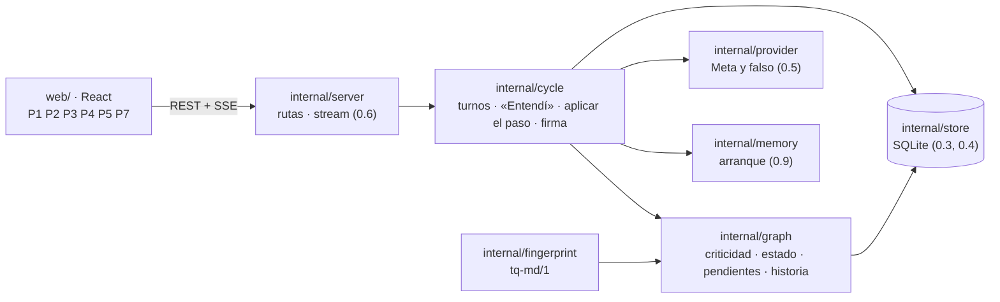
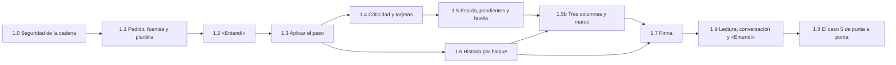

# Backlog · rebanada 1

**Respuesta:** 12 piezas: la 1.0 cierra la cadena de dependencias, las 1.1 a 1.8 construyen el ciclo y la 1.5b pone la interfaz en tres columnas con el marco mínimo. La 1.9 y la 1.9b corrigen lo que mostraron las pruebas con Meta y en el navegador. Al terminar, **el tramo del caso 5 que toca a la rebanada 1 pasa de punta a punta sin intervención manual** (plan §1, H-1): creas el proyecto de demo, envías el pedido, confirmas el «Entendí», el agente escribe con la regla de comparación como decisión crítica (la usan dos secciones) y el dato 1,5 copiado del cálculo (A-3, `docs/demo/caso-5/README.md`), respondes la tarjeta, ves la historia del párrafo y firmas después de que Wonder te pide lo que faltaba. Quedan para la 2 las comprobaciones completas, el «por aclarar», la parada y el marco.

**Decisiones:** B-8 (aristas, en `backlog.md`) y B-9 a B-20 (abajo) están adoptadas; B-9, con PDF. **Listo de nuestro lado:** la plantilla del caso 5 (B-12) y la versión de pnpm (B-19).

**Corrección de diseño ya aplicada (28-oct):** los tres esquemas de salida tenían en `label` el patrón `(?!new-)`, que el motor de expresiones regulares de Go no compila. Ahora el patrón es `^[a-z]{2,5}-[1-9][0-9]*$` y la exclusión de `new-n` la hace la regla 4 en Go (espec. §3). El significado no cambia. La 0.7 todavía no lo había embebido.

## Arquitectura

**Reglas de la arquitectura** (de la especificación): la interfaz solo muestra; todo lo que tiene valor de evidencia lo calcula Go (`bloque-3.md` §2). Toda escritura pasa por `store.Write` con su evento (§2). El agente solo escribe con su salida fija, que valida `cycle` (§3). El estado de la sección, la criticidad y los pendientes salen de una sola función cada uno, en `graph` (§4, T-5).

**Rutas de la rebanada 1** (las de 0.10 siguen; todas bajo `/api/projects/{projectID}`):

| Pantalla | Ruta | Escribe (evento) |
|---|---|---|
| P1 | `GET /api/projects` · `POST /api/projects` `{name, template}` (`template`: vacío o `case-5`) | — |
| P2 | `GET /request` · `PUT /request` `{text, audience, criteria[], premise, exploratory}` · `POST /sources` (archivo, `kind`: `file` · `calculation`) · `POST /request/submit` → `{turn_id}` | `human_message` y lo que crea la 1.1 |
| P2 | `GET /understanding` · `POST /cases/{label}/confirm` · `POST /cases/{label}/correct` `{text}` · `PUT /sections/{label}/role` `{role}` | `state_changed` · `role_changed` |
| P3 | `GET /sections/{label}` (texto, estado, pendientes, cifras y citas vinculadas) · `GET /todo` (lo que te toca) · `GET /summary` (gastado, tope, último triaje) | — |
| P4 | `GET /cards/{label}` · `POST /cards/{label}/answer` `{option: keep · other, reason}` | `state_changed` · `decision_seen` (`card`) |
| P5 | `GET /sections/{label}/history?block={n}` | `decision_seen` (`history`) |
| P7 | `POST /sections/{label}/signoff` → la firma en curso (`sign-n`) · `POST /signoffs/{label}/explanation` `{text}` → `{turn_id}` · `POST /signoffs/{label}/answers` `{origin_answer, case_answer}` → `{turn_id}` · `GET /signoffs/{label}` · `POST /signoffs/{label}/sign` · `POST /signoffs/{label}/leave` · `POST /signoffs/{label}/ask` `{text}` → `{turn_id}` (B-13, B-14) | `signoff_case` · `signoff_paused` · `signoff_cancelled` (B-14) · `brief_signoff` · `state_changed` · `act_timed` |
| P3 | `POST /sections` `{title, role, focus}` · `PUT /sections/{label}/details` `{title?, focus?}` · `PUT /sections/order` `{labels[]}` (1.9b, K-17) | `state_changed` · `role_changed` · `section_details_changed` |

Wonder responde por el mismo stream de turnos (0.6), con un turno de tipo firma. Como en la 0.10, las rutas nombran cada objeto por su etiqueta.

## Elecciones técnicas de este backlog (para Eber)

*El diseño no las fija y el agente las necesita. La última columna es tu respuesta.*

| #    | Propuesta                                                                                                                                                                                                                                                                                                                                                                                                                                                                                                                                                                                                                                                                                                                                                                                                                                                                                                                                                                                                                             | En vez de                                                                                                                                          | Elegiría la otra si…                                                            | Decisión de Eber (literal) |
| ---- | ------------------------------------------------------------------------------------------------------------------------------------------------------------------------------------------------------------------------------------------------------------------------------------------------------------------------------------------------------------------------------------------------------------------------------------------------------------------------------------------------------------------------------------------------------------------------------------------------------------------------------------------------------------------------------------------------------------------------------------------------------------------------------------------------------------------------------------------------------------------------------------------------------------------------------------------------------------------------------------------------------------------------------------- | -------------------------------------------------------------------------------------------------------------------------------------------------- | ------------------------------------------------------------------------------- | -------------------------- |
| B-9  | **En la rebanada 1, las fuentes son MD, TXT, CSV y PDF** (tu respuesta). XLSX entra después, con la lista de tipos de B3-22. **El PDF trae una dependencia nueva para extraer su texto** (regla 11): el agente la propone con contraste (Go puro, sin cgo, mantenida, con su versión publicada hace más de 7 días) y tú la apruebas antes de sumarla. El PDF es una entrada hostil: hasta 100 páginas `[inicial]`, extracción con tope de 10 s `[inicial]`, sin OCR; un PDF sin texto (escaneado) se rechaza con un mensaje del catálogo. Se guarda el texto extraído. **La huella de una fuente** (espec. §4) es el SHA-256 de su texto en NFC con los finales de línea normalizados; en un PDF, del texto extraído. Se sirve como descarga (B3-22, fila 7). ≈ 3 h más en la 1.1 **Librería aprobada (29-oct):** `github.com/ledongthuc/pdf`, fijada a un commit de al menos 7 días. La extracción corre en un **proceso hijo** (el mismo binario con un subcomando oculto, el archivo por stdin), que se mata a los 10 s, porque en Go una goroutine trabada no se puede matar; las páginas se cuentan antes de extraer. Se elegiría `go-pdfium` (WebAssembly) si las pruebas muestran mala extracción | Extraer texto de PDF desde ya (≈ 3 h y una dependencia más)                                                                                        | El caso de demo necesita un PDF real                                            | que entre también PDF      |
| B-10 | **La historia es por bloque del texto vigente:** un párrafo, un ítem de lista o una tabla, según goldmark. Su historia junta las decisiones vinculadas a sus cifras y citas, y los cambios de texto (pasos y ediciones) cuyo texto aparece en ese bloque **Precisión (29-oct, validación como implementador):** los bloques se numeran desde 1, en el orden de goldmark; una lista anidada cuenta como un solo ítem de su lista de arriba. Un paso del agente entra en la historia del bloque si su `new_text` o su ancla aparece en él; una edición tuya, si el bloque contiene, normalizado (NFC, espacios colapsados), un fragmento nuevo de 20 caracteres o más respecto de la versión anterior `[inicial]` | Guardar un id por párrafo que sobreviva a las ediciones (más preciso, pero cambia el editor y el modelo de datos)                                  | En las pruebas, la historia pierde el rastro de un párrafo editado varias veces | Adoptamos propuesta     |
| B-11 | **Hasta la rebanada 4, si la sección cambió desde la versión que leyó el agente, su paso se rechaza y se reintenta una vez con el texto vigente.** En la 4 pasa a ser una propuesta (espec. §2). Choca poco, porque el turno lo abre tu mensaje y el editor guarda antes de enviar                                                                                                                                                                                                                                                                                                                                                                                                                                                                                                                                                                                                                                                                                                                                                    | Adelantar las propuestas a la 1                                                                                                                    | Las pruebas de la 1 chocan seguido                                              | Adoptamos propuesta        |
| B-12 | **La plantilla del caso 5 la preparamos nosotros** (dónde vive y su formato, en la precisión de abajo): el pedido, el destinatario, los criterios, los artículos ficticios en MD y el cálculo de la comparación como fuente (F-1, B3-19), con los conteos que dan 60 veces y 1,5 veces. La regla de comparación es crítica porque la usan «Síntesis» y «Conclusiones» (fichas §3, dos o más secciones), no por la cifra, que es un dato copiado de una fuente (A-3). El botón «Probar con el caso de demo» la carga. El agente no inventa contenido **Precisión (29-oct, validación como implementador):** la plantilla vive en `internal/demo/case5/` (la carpeta que embebe el binario; `go:embed` no sube a `docs/`), con `request.json` (`name`, `text`, `audience`, `criteria[]`, `premise`, `exploratory` y `sources[]` con `filename` y `kind`) y un archivo por fuente en `sources/`, cuyo nombre es el `filename` de la fuente. Está lista en `docs/demo/caso-5/plantilla/` (29-oct), con su explicación en `docs/demo/caso-5/README.md`; Eber la copia a `internal/demo/case5/`; mientras no esté, la 1.1 usa una de prueba con el mismo formato | Que el agente escriba la plantilla                                                                                                                 | —                                                                               | Adoptamos propuesta        |
| B-13 | **La firma con Wonder va en dos llamadas por vuelta.** (1) Con tu explicación: Wonder marca cada decisión crítica y formula la pregunta de origen; si falta algo en tu explicación, nombra qué falta y trae un caso nuevo. (2) Con tus respuestas a la pregunta de origen y al caso: Wonder las juzga y vuelve a contrastar todo, como pide flujos §3 («después de un caso bien resuelto se vuelve a contrastar»). Se repite (2) hasta que todo coincide o hay 2 casos fallidos. Si no hay arista hacia un supuesto, la pregunta la elige Wonder (fichas §9)                                                                                                                                                                                                                                                                                                                                                                                                                                                                          | Una llamada por cada cosa (contrastar, formular, juzgar la pregunta, plantear el caso, juzgarlo), como cuenta flujos §4: más llamadas y más espera | En las pruebas, Wonder mezcla los juicios cuando van juntos                     | Adoptamos propuesta        |
| B-14 | **La firma en curso es una firma (`sign-n`) que todavía no se firmó:** guarda la versión de la sección, tu explicación, las respuestas y el resultado de cada vuelta. Los 2 casos fallidos la pausan con `signoff_paused` (E-2). Dejarla para después o tu edición de esa sección (K-16) la cancelan: el glosario no tiene ese evento, así que se suma `signoff_cancelled`, con su motivo (`left` · `edited`), al glosario §4 si adoptas esta fila. Hasta la rebanada 4, un paso del agente que toca una sección en firma o firmada se rechaza, como en B-11. «Preguntar al agente» desde la firma pide una respuesta sin texto nuevo **Precisión (29-oct, validación como implementador):** la firma en curso se deduce de la historia, sin estado guardado: **en curso** = un `sign-n` sin `signoff_cancelled`, sin `sign` y sin `signoff_paused` posterior a su última vuelta · **pausada** = su último evento es `signoff_paused`; pedir firmar de nuevo crea otro `sign-n` · **cancelada** = `signoff_cancelled` · **firmada** = la sección pasó a `signed` con esa firma. `missing_in_text` cancela la firma en curso con motivo `missing_in_text` y deja el pendiente con su pasaje en ese evento. Un paso del agente que toca una sección en firma: se rechaza solo ese `new_text`, con un mensaje para el agente; el resto del paso se aplica. «Preguntar al agente» va por `POST /signoffs/{label}/ask` `{text}` → `{turn_id}`, sin `new_text` | Un estado nuevo «en firma» en la sección, que el diseño no tiene                                                                                   | —                                                                               | Adoptamos propuesta        |
| B-15 | **Los pendientes del agente se calculan; no se guardan como objetos.** «Cifra sin decisión»: una cifra sin arista `covers` que no es un dato copiado; se cierra al vincularla o al quitarla del texto. «Falta en el texto»: el evento de la firma con el pasaje; se cierra cuando cambia la huella de la sección. «Retorno sin la forma fija»: el último `output_retry` del turno; se cierra con el siguiente fin de paso válido. «Fuente que no sostiene»: una cita sin `comes_from` porque su pasaje no está literal en su fuente; se cierra al corregir o quitar la cita. «Texto con una decisión reemplazada» (B-16): se cierra con el siguiente paso del agente que toca esa sección y declara tu decisión entre las que usa                                                                                                                                                                                                                                                                                                     | Una tabla de pendientes, que el modelo de datos no tiene                                                                                           | Calcularlos se vuelve lento con el caso 5                                       | Adoptamos propuesta        |
| B-16 | **Si eliges la otra opción en una tarjeta, nace una decisión tuya:** su enunciado es el «en vez de» anterior; su «en vez de», el enunciado anterior; su «porque», el tuyo. Las aristas `covers` y `used_in` pasan a ella (B-8), y la sección queda con un pendiente del agente «texto con una decisión reemplazada», que se cierra como dice B-15. En la rebanada 2 eso pasa a ser «escrita con lo anterior» (E-4) **Precisión (29-oct, validación como implementador):** `option` toma `keep` o `other`. La decisión tuya que nace con `other` lleva como «elegiría si» el «elegiría si» de la decisión anterior, si lo tenía; si no, queda vacío y no deja pendiente | Que elegir la otra opción solo marque la anterior como reemplazada, sin decisión nueva                                                             | —                                                                               | Adoptamos propuesta        |
| B-17 | **En la rebanada 1, el agente encadena pasos hasta 5 `[inicial]`** después del «Entendí» confirmado y después de cada mensaje tuyo, y se detiene antes si su paso no deja trabajo. La parada con informe llega en la 2. Lo que la 1 no aplica (`proposed_open_questions`, `handled_changes`) se guarda en el fin de paso, sin aplicarse **Precisión (29-oct, validación como implementador):** la cadena arranca sola cuando termina el «Entendí» (no espera a que confirmes los casos) y con cada mensaje tuyo. Un paso encadenado sin mensaje tuyo recibe un mensaje fijo de la app, en inglés y sin contenido tuyo (`Continue with the next step of the task.`). La cadena para cuando un paso no trae `new_text` ni decisiones nuevas, cuando un paso queda como pendiente del agente o al llegar a 5 | Un paso por mensaje: el agente no avanzaría solo, como pide fichas §8.2                                                                            | El caso 5 necesita más de 5 pasos para llegar a la firma                        | Adoptamos propuesta        |
| B-18 | **La sección guarda su título en `body.title`.** El modelo de datos (espec. §1.1) no tiene dónde ponerlo, y las pantallas lo muestran **Precisión (29-oct, validación como implementador):** una sección que nace en un paso trae su título en `proposed_roles[].title` (obligatorio si `section_id` es un `new-n`; lo valida Go). El nombre del proyecto va en `project.name` | Que el título sea el primer encabezado del texto                                                                                                   | Al exportar el `.md`, el título duplicado molesta                               | Adoptamos propuesta        |
| B-19 | **Seguridad de la cadena de dependencias, en una pieza 1.0 antes de la 1.1 (≈ 1–2 h).** (1) La web pasa de npm a **pnpm 12.16.1** (la que instaló Eber con Homebrew; precisión del 29-oct: pnpm 12 conserva la configuración y el lockfile de la 11), con la versión fija en `packageManager`, y Node 24.22.2 o más (parche de seguridad del 21-oct). Las versiones exactas de cada dependencia están en `versiones-seguras.md` (columna «Adoptado»). (2) `web/pnpm-workspace.yaml` con `minimumReleaseAge: 10080` (7 días), `strictDepBuilds: true`, `blockExoticSubdeps: true` y `allowBuilds` solo para lo que el build necesita (`esbuild: true`, `fsevents: false` `[inferencia]`: se confirma con un build limpio); versiones exactas en `package.json`. (3) `make web` usa `pnpm install --frozen-lockfile`. (4) `tygo` con versión fija (directiva `tool` de `go.mod`), sin `@latest`. (5) El CI suma un trabajo web: pnpm fijado, `--frozen-lockfile`, `pnpm audit` y el build. (6) Reglas para el agente en `AGENTS.md`: sin `@latest`, sin `curl … \| sh`, sin `pnpm dlx` ni `npx`; no lee `.env` ni el llavero salvo `make microtest`; ninguna dependencia nueva ni versión mayor sin preguntar. (7) Durante el hackathon no se suben versiones mayores (Vite, React, TipTap); solo parches de seguridad | Seguir con npm 11 endurecido: `.npmrc` con `min-release-age=7` y `npm ci`, con los scripts que ya bloquea `allowScripts`                           | pnpm 12 choca con TipTap o Vite en el build limpio                              | Adoptamos propuesta        |
| B-20 | **Valores iniciales de la rebanada 1 `[inicial]`.** (a) **Asentimientos** (1.4, clave `assent_list` del catálogo): es: ok, okay, sí, si, dale, listo, de acuerdo, bien, vale, va; en: ok, okay, yes, yep, sure, fine, agreed, k, lgtm. Se comparan sin mayúsculas, sin tildes y sin signos finales; un «porque» de solo signos o emojis tampoco vale. (b) **Qué cuenta como número** (1.3): una secuencia con al menos un dígito; no cuentan la numeración de listas ni las etiquetas (`sec-3`); un año cuenta, pero si aparece literal en una fuente usada no deja pendiente. (c) **«Wonder no está disponible»** (1.7): se agotó el tiempo, respondió 5xx o 429 después de su reintento, o no está en `models.go`; un 4xx de validación no cuenta: es un error del turno                                                                                                                                                                                                                                                            | Que el agente elija el mínimo y lo marque `[EL DISEÑO NO LO DICE]`                                                                                 | —                                                                               | Adoptamos propuesta        |
| B-21 | **Una sección sin texto queda en «borrador»; no aparece como «lista» ni para firmar.** Pasa a «lista» solo cuando tiene texto y ningún pendiente. Precisa estados §1 («lista» = sin pendientes), que hoy deja «lista» a una sección vacía: en la prueba del 29-oct, «Te toca» pedía firmar «Síntesis» sin texto (P-35). ≈ 15 min, en `SectionStatus` con su prueba | Dejar «lista» = sin pendientes, aunque la sección esté vacía | Quisieras firmar una sección vacía a propósito, para acordar que va así | «Esta bueno la propuesta P-35, la adoptamos» (29-oct) |
| B-22 | **El principal recibe el texto de tus fuentes en la tarea en turno mientras quepan** (bloque-2 §3.2: la tarea «va con […] sus fuentes»): todas las del pedido hasta que el grafo tenga aristas `uses`, y después las que usa la sección del paso; con un tope de 25 % de la ventana `[inicial]` (≈ 250 mil tokens en Spark; el caso 5 ocupa ≈ 16 mil). Si no caben, van las que quepan, en orden de uso, y el resto como líneas del índice. Cada entrega queda registrada (`delivery`, `via = startup`). Causa: en la primera corrida con Meta (30-oct) el principal escribió las tres secciones sin una sola cifra ni decisión porque nunca vio las fuentes; solo su primera línea en el índice, y `read(id)` no está expuesto al modelo como herramienta. ≈ 1–2 h | Exponer `read(id)` como herramienta del modelo (llamadas a funciones de la Responses API), como pide bloque-2 §3: más fiel, pero ≈ 3–5 h y una forma de llamada que aún no se probó con Meta en modo estricto | El material del caso no cabe en el tope, o las pruebas muestran que el principal necesita leer a demanda; queda para la rebanada 3, con `buscar` | Reemplazada por R-3 (30-oct, propuesta adoptada); queda como respaldo si la micro-prueba de herramientas falla. **Descartada (30-oct):** la micro-prueba pasó 5/5 (`44f0b11`) |
| B-23 | **Un pedido puede no tener criterios:** el esquema del «Entendí» acepta `criteria` vacío (`minItems: 0`) cuando el pedido no trae criterios, y entonces no hay casos. En la corrida de Eber (30-oct), un pedido sin criterios dejó el «Entendí» vacío tras dos rechazos (el modelo inventó criterios que no existían) | Exigir al menos un criterio al enviar el pedido | Los casos por criterio son lo que hace valioso al «Entendí» y quieres obligar a escribir uno; choca con «Afinar» opcional (B3-9) | «Aprobamos B-23 y B-24» (30-oct) |
| B-24 | **El motivo de la parada se guarda en `step_ended`** (`stop_reason`: `no_work` · `agent_pending` · `step_limit`), para que la pantalla siga diciendo por qué paró el agente después de recargar o al volver días después | Que viaje solo en el stream y se pierda al recargar | Nunca recargas en medio del trabajo | «Aprobamos B-23 y B-24» (30-oct) |

Los esquemas del «Entendí» y de Wonder ya están en `docs/diseno/bloque-3/` (`salida-entendi.schema.json` y `salida-wonder.schema.json`). Traducen la fila de cada uno en fichas §7, sin reglas nuevas.

## Piezas

### 1.0 · Seguridad de la cadena de dependencias

| Campo | Contenido |
|---|---|
| **Qué** | La web se instala solo con versiones fijadas y con al menos 7 días publicadas, y ningún paquete corre scripts de instalación sin permiso. El agente no puede traer código nuevo sin preguntar |
| **Implementa** | B-19 · `AGENTS.md` regla 11 |
| **Leer** | B-19 · `Makefile` · `.github/workflows/ci.yml` · `web/package.json` |
| **Interfaz** | `web/package.json`: `packageManager: "pnpm@12.16.1"`, `engines.node: ">=24.22.1"`, las versiones exactas de `versiones-seguras.md` §2, sin el campo `allowScripts` · `web/pnpm-workspace.yaml` como dice B-19 · `pnpm-lock.yaml` en lugar de `package-lock.json` · `Makefile`: `web` con `pnpm install --frozen-lockfile && pnpm run build`; `web-types` con `go tool tygo generate` · `go.mod` con `tool github.com/gzuidhof/tygo` en una versión fija · CI: un trabajo `web` con las acciones fijadas por SHA, como las de Go |
| **Listo cuando** | `make web` desde cero pasa con `--frozen-lockfile` · un paquete con script de instalación que no está en `allowBuilds` hace fallar la instalación · no queda ningún `@latest` en `Makefile`, `web/package.json` ni `.github/` · el CI pasa con los dos trabajos |
| **Depende de** | 0.10 · Eber tiene pnpm 12.16.1 y Node 24.22.2 (29-oct) |
| **No hacer** | Subir versiones mayores (Vite 8, TypeScript 7, plugin-react 6 quedan para después del hackathon). Dividir el bundle (el aviso de 548 kB no es de seguridad). Tocar `AGENTS.md`: lo actualizamos en el diseño |
| **Si algo no está** | Un paquete que necesite script para compilar: no aprobarlo; decirlo en el retorno |

### 1.1 · Pedido, fuentes y plantilla

| Campo               | Contenido                                                                                                                                                                                                                                                                                                                                                                                                                                                                                                                            |
| ------------------- | ------------------------------------------------------------------------------------------------------------------------------------------------------------------------------------------------------------------------------------------------------------------------------------------------------------------------------------------------------------------------------------------------------------------------------------------------------------------------------------------------------------------------------------ |
| **Qué**             | Escribes el pedido con su destinatario, criterios e idea (o «exploratorio»), subes fuentes y lo envías. Un proyecto puede nacer de la plantilla del caso 5                                                                                                                                                                                                                                                                                                                                                                           |
| **Implementa**      | Fichas §2 (Pedido y «Entendí», Entra) · F-1 (el cálculo entra como fuente) · B3-19 · B3-22 (fila 7) · B-9 · B-12 · B-18 · inventario 1b, 2a, 2b · P1 mínimo y la mitad izquierda de P2                                                                                                                                                                                                                                                                                                                                                                |
| **Leer**            | Fichas §2 y §8.2 («Tu premisa») · espec. §1 (tabla 1.1: `request`, `criterion`, `premise`, `source`) · espec. §4 (huella) y §6 (tamaños) · glosario §2 · `docs/diseno/bloque-3/pantallas.md` (P1 y P2)                                                                                                                                                                                                                                                                                                                               |
| **Interfaz**        | Las rutas de P1 y P2 de la tabla, salvo `/understanding` · lo que escribes nace confirmado: criterios `current`; premisa `current`, o `premise.exploratory: true` · `internal/fingerprint`: `Source(text string) string`, como dice B-9 · una fuente guarda su texto, su `kind`, su `filename`, su `media_type` y su huella; volver a subir una idéntica no crea versión · el proyecto guarda su `name` (migración `0003`; la `0002` es la de B-8) · `template: case-5` copia `internal/demo/case5/` (embebida en el binario, formato de B-12) · `submit` guarda `human_message` y abre el turno del «Entendí» (1.2) · P1 lista los proyectos y trae los dos botones |
| **Listo cuando**    | Prueba: lo que escribes se guarda en literal · prueba: un archivo que no es MD, TXT, CSV ni PDF se rechaza con un mensaje del catálogo · prueba: un PDF sin texto, uno de más de 100 páginas y uno cuya extracción pasa de 10 s se rechazan con su mensaje · prueba: la huella de un PDF es la de su texto extraído · prueba: una fuente de más de 5 MB se rechaza · prueba: un proyecto desde la plantilla trae el pedido, los criterios y las fuentes de `internal/demo/case5/`                                                                                                                                                                                                                                         |
| **Depende de**      | 0.10 con P-19 y P-20 corregidos · 1.0 · B-9 (la librería de PDF, aprobada por Eber) · B-12 (con una plantilla de prueba mientras no esté la real)                                                                                                                                                                                                                                                                                                                                                                                                                                                             |
| **No hacer**        | Cuentas, aviso e invitación («Entrega»). Cambiar un criterio después de enviar (rebanada 2). XLSX. OCR. Sumar la librería de PDF antes de que Eber la apruebe                                                                                                                                                                                                                                                                                                                                                                                                                             |
| **Si algo no está** | `[EL DISEÑO NO LO DICE]` en el retorno                                                                                                                                                                                                                                                                                                                                                                                                                                                                                               |

### 1.2 · «Entendí»

| Campo | Contenido |
|---|---|
| **Qué** | El principal devuelve lo que entendió, con un caso que cuenta y otro que no por criterio, lo que leyó de tu material y las secciones con su rol propuesto. Tú confirmas o corriges; nada bloquea |
| **Implementa** | Fichas §2 (Pedido y «Entendí») y §7 (fila «Principal · «Entendí»») · K-2 · inventario 2d, 2e y 4h (el rol) · la mitad derecha de P2 |
| **Leer** | Fichas §2 y §7 · `docs/diseno/bloque-3/salida-entendi.schema.json` · estados §6 (caso del «Entendí» y rol de la sección) · espec. §3 (reintento) · `docs/diseno/bloque-3/pantallas.md` (P2) |
| **Interfaz** | Un turno de tipo «Entendí»: arranque (0.9), llamada con `effort: high` (fichas §1) y el esquema del «Entendí»; si no cumple, un reintento y luego pendiente del agente (como en 0.7); la regla 4 de espec. §3 rechaza también aquí un `new-n` en `criterion` · crea los casos `unconfirmed` (dos por criterio: `counts` verdadero y falso) y las secciones nuevas en `draft`, con su título (B-18) y el rol `proposed`; a una sección que ya existe solo le propone el rol · lo leído de tu material son casos sin criterio y `understood` se guarda en el evento del fin del «Entendí»: ambas cosas, `[EL DISEÑO NO LO DICE]` en el retorno · las rutas de P2 de la tabla · confirmar o corregir un caso: `confirmed` o `corrected`, con tu texto en literal · cambiar o confirmar el rol: `confirmed`, evento `role_changed` · instrucciones en `internal/cycle/prompts/understanding.en.md`, borrador que revisa Eber |
| **Listo cuando** | Prueba con una salida grabada: crea los casos y las secciones con su rol propuesto · prueba: una salida sin un criterio del pedido se rechaza y se reintenta · prueba: si no respondes, el trabajo sigue y los casos quedan `unconfirmed` · prueba: confirmar un rol lo deja `confirmed` y registra el evento |
| **Depende de** | 1.1 |
| **No hacer** | El efecto de cambiar el rol sobre una sección firmada (rebanada 2, K-13). Que el chat confirme algo |
| **Si algo no está** | `[EL DISEÑO NO LO DICE]` en el retorno |

### 1.3 · Aplicar el paso del agente

| Campo | Contenido |
|---|---|
| **Qué** | Lo que el principal entrega se valida y se aplica: su texto, sus decisiones con contraste, las cifras vinculadas a una decisión y los datos copiados, vinculados a su fuente |
| **Implementa** | Espec. §3, reglas 2 a 6, y «Largo de la nota» · fichas §3 («Cifra sin decisión» y «"Reemplaza" válido») · A-3 · T-2 a T-4 · B-8 · B-11 · B-20 (b) |
| **Leer** | Espec. §2 y §3 completos · `docs/diseno/bloque-3/salida-principal.schema.json` · fichas §3 y §9 (aristas y regla de origen) · estados §2 (decisión) · glosario §3 y §8 · defaults T-2 a T-4 |
| **Interfaz** | `internal/cycle`: `ApplyStep(ctx, projectID, turnID string, output json.RawMessage) (ApplyResult, error)`, después de `EndStep` (0.7) · **`EndStep` cambia:** solo valida la forma (y pide el reintento); `ApplyStep` escribe `step_ended` (con las etiquetas asignadas a cada `new-n` y lo que no se aplica, B-17) en la misma transacción que el paso · las reglas 2 a 6 rechazan con un mensaje para el agente y cuentan como el reintento · aplica `replace` e `insert_after` de atrás hacia adelante; asigna etiquetas a los `new-n` antes de crear aristas · crea decisiones (`agent`), cifras, datos y citas, y las aristas `covers`, `used_in`, `applies`, `depends_on_assumption`, `comes_from` y `uses` · **B-8:** migración `0002` con la clave de `edge` en `(project_id, id, version)`; `ChangeEdge` y `EndEdge` reemplazan a `SupersedeEdge` de la 0.4 (P-6), cada una con su evento `edge` · un número del texto nuevo sin vínculo, que no aparece literal (con separadores normalizados) en una fuente usada en el paso ni en tu material, es un pendiente del agente «cifra sin decisión» (B-15); qué cuenta como número lo fija B-20 (b) · una cita cuyo pasaje no aparece literal en su fuente se crea sin la arista `comes_from` y deja el pendiente del agente «fuente que no sostiene» (fichas §3, glosario §9, B-15); no rechaza la salida · lo que la 1 no aplica se guarda sin aplicarse (B-17) · **encadenar pasos (B-17):** el runner de la 0.10 vuelve a llamar al principal, paso tras paso, hasta 5 `[inicial]`, y se detiene antes si su paso no deja trabajo; cada paso pasa por `EndStep` y `ApplyStep` · B-11 si la sección cambió |
| **Listo cuando** | Pruebas con salidas grabadas: un ancla que no aparece, o que se repite, se rechaza diciendo cuántas veces aparece · un `new-n` en el texto se rechaza · «reemplaza» que apunta a una decisión tuya se rechaza · una cifra con vínculo crea `covers`; un dato literal de una fuente crea `comes_from`; un número suelto deja el pendiente · todo el paso va en una sola transacción |
| **Depende de** | 0.7 · 1.2 · B-8 · B-11 · B-15 · B-17 |
| **No hacer** | La regla 7 (A-1) y las demás comprobaciones de fichas §3, como los códigos internos en el texto: rebanada 2. Propuestas (rebanada 4) |
| **Si algo no está** | Un caso de anclas que §3 no cubre: rechazar y marcar `[EL DISEÑO NO LO DICE]` |

### 1.4 · Criticidad y tarjetas

| Campo | Contenido |
|---|---|
| **Qué** | La app calcula qué decisión es crítica y le abre su tarjeta. Respondes con una opción y un «porque»; «ok» no cuenta |
| **Implementa** | T-5 · fichas §3 («Criticidad», «Tarjeta válida») · estados §2 y §3 · inventario 4d · P4 · B-20 (a) |
| **Leer** | Defaults T-5 · fichas §3 y §8.3 (criticidad) · estados §2 y §3 · espec. §1.5 · glosario §2 · `docs/diseno/bloque-3/pantallas.md` (P4) |
| **Interfaz** | `internal/graph`: `Critical(ctx, projectID, decisionLabel) (bool, []Reason, error)`, una sola función, llamada al leer y en cada transacción que cambia aristas o el rol (T-5) · una decisión del agente que pasa a crítica abre su tarjeta (`open`) · `POST /cards/{label}/answer`: «mantener» la deja `confirmed`; «la otra opción» la deja `superseded` y aplica B-16 · una respuesta sin «porque» válido registra `answer_without_reason`, y cada respuesta, `act_timed` (K-11) · el «porque» no puede estar vacío ni ser un asentimiento de la lista de tu idioma (T-1; la lista y cómo se compara, en B-20 (a), con la clave `assent_list` en `en.json` y `es.json`) · una tarjeta cuya decisión cambió antes de responder pasa a `obsolete` · si una decisión de una sección firmada pasa a crítica, la sección pasa a `changed_since_signoff` (T-5, K-6) · `GET /todo` lista las tarjetas abiertas |
| **Listo cuando** | Prueba: cada uno de los motivos de la 1 (cifra, rol conclusión o recomendación, 2 o más secciones) hace crítica una decisión · prueba: «ok», «sí», «yes», «sure» y el vacío dejan la tarjeta abierta · prueba: elegir la otra opción crea una decisión tuya y reemplaza la del agente · prueba: responder registra `decision_seen` con `card` |
| **Depende de** | 1.3 · B-16 |
| **No hacer** | El cuarto motivo, tu marca (rebanada 2). La tarjeta de tu propia edición crítica (rebanada 2). Objetar y revocar (rebanada 4) |
| **Si algo no está** | `[EL DISEÑO NO LO DICE]` en el retorno |

### 1.5 · Estado de la sección, pendientes y huella

| Campo | Contenido |
|---|---|
| **Qué** | Cada sección dice en qué estado está y qué le falta, con una sola función que usan todas las vistas. La huella de la sección reemplaza la comparación de B-3. Solo una pestaña edita |
| **Implementa** | Espec. §4 (huella y estado) y §2 (guardado, una pestaña) · estados §1 · B-3 (se reemplaza) · P3 |
| **Leer** | Espec. §2, §4 y §8 · estados §1 · defaults (B-3 en `backlog.md`) · `docs/diseno/bloque-3/pantallas.md` (P3) |
| **Interfaz** | `internal/fingerprint`: `Section(markdown string) string` (`tq-md/1`) · `internal/graph`: `SectionStatus(ctx, projectID, label) (Status, []Pending, error)`: `draft`, `ready` (calculado), `signed` y `changed_since_signoff`; los pendientes de la 1 son tarjetas abiertas y pendientes del agente, calculados (B-15) · tu edición sobre una sección firmada la pasa a `changed_since_signoff` (estados §1) · `GET /sections/{label}` y `GET /summary` (lo gastado frente al tope, B3-20) · la segunda pestaña abre en solo lectura · el editor guarda antes de enviar un mensaje o pedir firmar |
| **Listo cuando** | Prueba: dos Markdown con distinto formato y el mismo contenido dan la misma huella; uno con contenido invisible da otra · prueba: abrir y guardar sin editar no crea versión · prueba: con una tarjeta abierta la sección está en `draft`; al responderla, en `ready` · prueba: una segunda pestaña no puede guardar |
| **Depende de** | 1.3 · 1.4 · B-15 |
| **No hacer** | «Escrita con lo anterior» y la lista de cambios (rebanada 2, E-4 y A-1). Volver a «firmada» al deshacer (rebanada 4, G-1) |
| **Si algo no está** | Cómo se reconoce la pestaña editora: el mínimo, con `[EL DISEÑO NO LO DICE]` |

### 1.5b · Interfaz en tres columnas y marco mínimo

| Campo | Contenido |
|---|---|
| **Qué** | La app pasa de una página apilada a tres columnas: el marco a la izquierda, la conversación al centro y el documento a la derecha. El marco te deja ver para qué es el documento, cómo se juzga, su esqueleto con las decisiones críticas y lo que te toca |
| **Implementa** | B3-9 (precisión del 29-oct) · espec. §9 (el marco), sin la línea de vuelta ni el «sin ver» exacto · `pantallas.md` («Disposición general») · P-28 si la 1.3 no lo cerró |
| **Leer** | `docs/diseno/bloque-3/pantallas.md` («Disposición general» y P4, P5) · `docs/diseno/bloque-3/boceto-ui.html` (disposición, textos y comportamiento de referencia; sus datos son de ejemplo) · espec. §9 · fichas §2 («El marco») |
| **Interfaz** | `internal/graph`: `Frame(ctx, projectID) (Frame, error)`, sin modelo y de solo lectura; reutiliza el estado de trabajo, `Critical` (1.4) y los pendientes (1.5); suma el «porque» de cada tarjeta respondida y la explicación de firma vigente; excluye lo reemplazado y lo revocado · `GET /api/projects/{projectID}/frame` · desplegar una decisión registra `decision_seen` con `seen_via: frame` · web: tres columnas; selector de proyectos arriba del marco; el pedido con «Qué quieres» y las fuentes, y «Afinar» plegado (para quién, criterios, tu idea, exploratorio); el «Entendí» y las tarjetas como tarjetas dentro de la conversación; el documento aparece cuando hay secciones; «Firmar sección» junto al documento; la traza plegada; «Te toca» del marco lleva a la tarjeta o a la firma · todo texto de pantalla desde `en.json`/`es.json` · en pantallas angostas, columnas apiladas |
| **Listo cuando** | Prueba: `Frame` del caso 5 trae el pedido literal, los criterios con sus casos, las secciones con su primera línea y la decisión crítica bajo «Síntesis» y «Conclusiones» con el mismo id · prueba: una decisión reemplazada no aparece · prueba: desplegarla registra `decision_seen` (`frame`) · prueba: ≤ 300 ms con el caso 5 · en el navegador (lo prueba Eber): el recorrido del boceto, etapas 1 a 4, con el proveedor falso |
| **Depende de** | 1.4 · 1.5 · 1.6 (la historia que abre el marco) |
| **No hacer** | La línea de vuelta y el «sin ver» exacto (rebanada 2). Que un modelo resuma el marco. Mostrar ids internos. Abrir el marco desde la firma |
| **Si algo no está** | `[EL DISEÑO NO LO DICE]` y una línea en `elecciones-agente.md` |

### 1.6 · Historia por bloque

| Campo | Contenido |
|---|---|
| **Qué** | Haces clic en un párrafo y ves cómo se llegó a él: quién, cuándo, qué decisión con su contraste, tu «porque» y lo descartado |
| **Implementa** | D7 · fichas §8.1 (la historia como mapa por párrafo) · B-10 · inventario 6a · P5 |
| **Leer** | Fichas §8.1 y §9 («Historia y grafo») · estados §8 · B-10 · `docs/diseno/bloque-3/pantallas.md` (P5) |
| **Interfaz** | `internal/graph`: `BlockHistory(ctx, projectID, sectionLabel string, block int) ([]Entry, error)`, calculada desde la historia y el grafo, sin modelo · `GET /sections/{label}/history?block={n}` · abrirla registra `decision_seen` con `history` para cada decisión mostrada |
| **Listo cuando** | Prueba: tras un paso del agente y una edición tuya, el bloque muestra las dos entradas en orden · prueba: una cifra vinculada lleva a su decisión con su contraste · prueba: una decisión reemplazada aparece como descartada |
| **Depende de** | 1.3 · 1.4 · B-10 |
| **No hacer** | Que un modelo narre la historia. Abrirla desde el marco (rebanada 2) |
| **Si algo no está** | `[EL DISEÑO NO LO DICE]` en el retorno |

### 1.7 · Firma

| Campo | Contenido |
|---|---|
| **Qué** | Pides firmar una sección, explicas sin mirar, Wonder contrasta, te plantea un caso nuevo si falta algo, y firmas cuando todo coincide |
| **Implementa** | Flujos §3 completo · fichas §2 (Firma) y §9 (pregunta de origen) · E-2 · E-3 · A-4 · K-16 (tu edición cancela) · espec. §4 (lo que guarda la firma) · inventario 7a a 7g · P7 · B-20 (c) |
| **Leer** | Flujos §3 y §4 · fichas §2 (Firma), §7 (fila Wonder) y §9 · `docs/diseno/bloque-1/bloque-1.md` §4 (el encargo, que Wonder recibe reducido) · `docs/diseno/bloque-3/salida-wonder.schema.json` · espec. §1.2 (`explains`) y §4 · estados §1 · glosario §10 · `docs/diseno/bloque-3/pantallas.md` (P7) |
| **Interfaz** | Las rutas de P7 de la tabla · al pedir firmar: si quedan pendientes, la respuesta los lista y no abre la firma · sin decisiones críticas: firma breve (`brief_signoff`), sin Wonder · la app elige el supuesto de la pregunta de origen siguiendo `depends_on_assumption` (fichas §9) · Wonder 1.0 `high`; si no está disponible, Spark 1.3 `xhigh`, y la firma lo indica · la secuencia de llamadas es la de B-13, y la firma en curso, la de B-14 · la regla 4 de espec. §3 rechaza también aquí un `new-n` en `decision` · «coincide» lo decide Go con las marcas de Wonder: todas `match`, la pregunta de origen `answers` y, si hubo caso, `applies_well` · `missing_in_text` deja un pendiente del agente con el pasaje · 2 casos `does_not_apply` pausan la firma (`signoff_paused`) · `sign` guarda lo de espec. §4, crea las aristas `explains` de la firma a cada decisión crítica y deja la sección `signed` · cada respuesta tuya registra `act_timed` (K-11) · «Wonder no está disponible» es lo que fija B-20 (c) · las salidas de Wonder que usan las pruebas se graban con un objetivo como `make microtest`, que corre Eber · tu edición de esa sección cancela la firma en curso · instrucciones en `internal/cycle/prompts/contraster.en.md`, borrador que revisa Eber |
| **Listo cuando** | Pruebas con salidas grabadas de Wonder: todo coincide y se firma · falta en tu explicación: el mensaje nombra qué falta, no la respuesta, y llega un caso nuevo · 2 casos mal aplicados pausan la firma y la sección queda donde estaba · falta en el texto: pendiente del agente · sección sin decisiones críticas: firma breve · tu edición durante la firma la cancela · la pantalla de firma no muestra el marco |
| **Depende de** | 1.4 · 1.5 · 1.6 · B-13 · B-14 |
| **No hacer** | Propuestas abiertas al firmar y pasos del agente como propuesta mientras firmas (rebanada 4). Voz (B3-14) |
| **Si algo no está** | `[EL DISEÑO NO LO DICE]` en el retorno |

### 1.9 · Lectura a demanda, conversación y entendimiento claro (30-oct)

| Campo | Contenido |
|---|---|
| **Qué** | Lo que mostraron las corridas con Meta: el agente lee tu material cuando lo necesita, no inventa evidencia, responde tus preguntas en la conversación y propone decisiones de verdad; la pantalla se entiende |
| **Implementa** | `../diseno/_propuesta-30oct-fuentes-y-flujo.md`: R-3, R-4, R-5, R-7, R-8, U-1 a U-6 · B-23 · B-24 · P-44 · P-46 · la corrección de P-41 |
| **Leer** | La propuesta del 30-oct completa · espec. §3 («Precisiones del 30-oct») · bloque-2 §3 · `pantallas.md` («Disposición general») · glosario §11 · los dos esquemas de salida · flujos §3 (nodo «Revisas») |
| **Interfaz** | **Primero, una micro-prueba con Meta** (`make microtest-tools`, la corre Eber): llamadas a herramientas en modo estricto con la Responses API; si falla, aplicar B-22 en lugar de las herramientas y decirlo en el retorno · `read_source(fuente, tramo)` y `search_sources(texto)` sobre las fuentes del proyecto, con `delivery` (`via = read`) · ficha de cada fuente en el índice (título, tipo, largo, primeras líneas) · una cifra o cita literal debe estar en una fuente que el principal leyó (`delivery` con `via = read`) · instrucciones del principal y del «Entendí»: leer el material en el «Entendí» y reportar lo leído; sin material y sin búsqueda, no escribir una síntesis de memoria y ofrecer en `understood` «subir material» o «esperar la búsqueda» (R-4 precisada; «de memoria, marcado» llega con R-1); decisiones de verdad (≤ 2 nuevas por paso, «elegiría la otra si» = cuándo gana la alternativa); triaje en palabras · `reply` en la salida del principal (esquema ya actualizado) y en la conversación · `project_title` en la salida del «Entendí» (esquema ya actualizado), editable en la cabecera · `criteria` puede venir vacío (B-23) · `stop_reason` en `step_ended` (B-24) · rol `conclusion` u `other` (R-8) · interfaz U-1 a U-6 (el botón del «Entendí» es «Confirmar» y no condiciona el arranque, B-17) · párrafos insertados separados (P-46) · en la firma, «Ver la historia de ese punto» vuelve a aparecer después de una vuelta con «falta» (flujos §3), nunca antes de tu primera explicación (corrige P-41) |
| **Listo cuando** | Prueba: un pedido sin criterios produce un «Entendí» aceptado · prueba: un mensaje que pregunta trae `reply`, no escribe en el documento y no cuenta como trabajo · prueba: una cifra que no está literal en una fuente leída (`delivery` con `via = read`) deja «cifra sin decisión» · prueba: `stop_reason` se lee al recargar · prueba de las herramientas con salidas grabadas · en el navegador (Eber): el caso 5 con Meta llega a la regla de 1,5 veces con su tarjeta; «pobreza y desarrollo cerebral» sin material no escribe de memoria y ofrece opciones; «¿en qué te basaste?» se responde en la conversación |
| **Depende de** | 1.7 · la micro-prueba de herramientas |
| **No hacer** | Procedencia por párrafo y «afirmación sin fuente» (R-1, R-2: rebanada 2). Plan acordado (R-6: rebanada 2). Búsqueda fuera de tu material (R-9: rebanada 3) |
| **Si algo no está** | `[EL DISEÑO NO LO DICE]` y una línea en `elecciones-agente.md` |

### 1.9b · Secciones a mano (30-oct)

| Campo | Contenido |
|---|---|
| **Qué** | Creas una sección con título, rol opcional y «qué debe abordar»; editas el título y «qué debe abordar» de cualquier sección; reordenas las secciones. Lo pidió Eber al probar (P-49) |
| **Implementa** | K-17 (precisada el 30-oct) · P-48 · fichas §2 (Tu turno) · estados §1 · espec. §3 («Secciones a mano») · bloque-2 §3 (tarea en turno) · `pantallas.md` («Precisiones del 30-oct») |
| **Leer** | K-17 en `../diseno/bloque-1/bloque-1-decisiones.md` y los documentos de «Implementa» |
| **Interfaz** | `POST /sections` `{title, role, focus}` reemplaza la ruta de la 0.10 (que fija `other` y `proposed`, sin título): título obligatorio (400 `title_required`); con la marca «aquí se concluye», el rol nace `conclusion` `confirmed`; sin ella, no se fija y lo propone el principal; `focus` hasta 60 palabras `[inicial]` (400 `focus_too_long`); nace en `draft`, vacía y al final · `PUT /sections/{label}/details` `{title?, focus?}` y `PUT /sections/order` `{labels[]}`, con `section_details_changed` (al reordenar, uno por sección que cambia de posición); no cambian el estado y quedan fuera de la huella y de lo firmado · `position` ordena el esqueleto, la columna derecha y el arranque; una `new-n` del principal va al final · `focus` va en la tarea en turno cuando la tarea es esa sección (bloque-2 §3) · web: «+ Sección» pide título, «aquí se concluye» y «qué debe abordar»; el título y «qué debe abordar» se editan con un clic en la columna derecha; «subir» y «bajar» en el esqueleto · P-48: el selector de proyectos del marco dice «Tus proyectos ▾» y el título del proyecto queda solo en la cabecera |
| **Listo cuando** | Prueba: sin título responde 400 · prueba: con la marca queda `conclusion` `confirmed`; sin ella, el siguiente paso puede proponer el rol · prueba: una sección con `focus` y sin texto queda `draft` (B-21) · prueba: cambiar el título, el `focus` o el orden de una sección firmada la deja `signed` y registra `section_details_changed` · prueba: un arranque cuya tarea es esa sección trae su `focus` en literal · prueba: reordenar cambia el orden de `/sections` y del marco · en el navegador (el chat): crear, editar y mover una sección, y el título del proyecto una sola vez |
| **Depende de** | 1.9 |
| **No hacer** | Quitar secciones (fuera del hackathon, K-17). Arrastrar para reordenar. Que el principal reordene |
| **Si algo no está** | `[EL DISEÑO NO LO DICE]` y una línea en `elecciones-agente.md` |

### 1.8 · El caso 5 de punta a punta

| Campo | Contenido |
|---|---|
| **Qué** | Todo lo anterior junto, con la plantilla real del caso 5 y con Meta. Es el «Listo cuando» de la rebanada |
| **Implementa** | Plan §1 (rebanada 1) · H-1 · `docs/diseno/bloque-3/pantallas.md` («Recorrido del jurado», pasos 1 a 6) |
| **Leer** | `docs/demo/caso-5/` · `docs/diseno/bloque-3/pantallas.md` · `docs/casos-prueba/simulacion-v4.1/casos/caso-05.md` (solo para entender el caso; el diseño vigente manda) |
| **Interfaz** | Una prueba de recorrido con el proveedor falso y las respuestas grabadas del recorrido real · `make demo-check`, que corre el recorrido con `TQ_PROVIDER=meta` (con la clave del llavero, como `make microtest`) y lo corre Eber |
| **Listo cuando** | Con el proveedor falso: el recorrido completo pasa en una prueba · con Meta, en el navegador: el recorrido pasa sin intervención manual, y la historia tiene en orden los eventos de cada paso |
| **Depende de** | 1.1 a 1.7 · 1.9 · 1.9b · B-12 (la plantilla real) · 0.8 |
| **No hacer** | La parte del caso que es de las rebanadas 2 y 3 |
| **Si algo no está** | Si el recorrido real no pasa, el retorno dice en qué paso y con qué salida, sin corregir el diseño |

## Horas `[inferencia]`

1.0: 1–2 · 1.1: 2–3 (+ ≈ 3 h por el PDF, B-9) · 1.2: 3–4 · 1.3: 5–7 · 1.4: 3–4 · 1.5: 3–4 · 1.5b: 5–8 · 1.6: 2–3 · 1.7: 5–7 · 1.9: 12–17 · 1.9b: 3–4 · 1.8: 2–3. **Total: 49–69 h** con la 1.0, el PDF, la 1.5b, la 1.9 (12–17 h) y la 1.9b (3–4 h). El plan le da a la rebanada 1 dos días (29 y 30-oct). No cabe sin recortes ni sin agentes en paralelo: es lo primero que debe resolver la reconciliación de horas.

## Retorno de cada pieza

El mismo de `backlog.md`: qué hace en 5 líneas · archivos · pruebas · lo que no hizo · `[EL DISEÑO NO LO DICE]` · dudas para Eber (máximo 3, con contraste).
