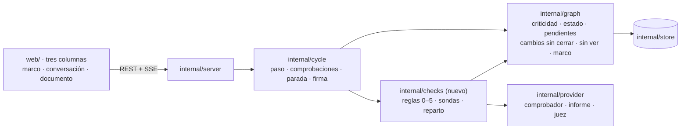
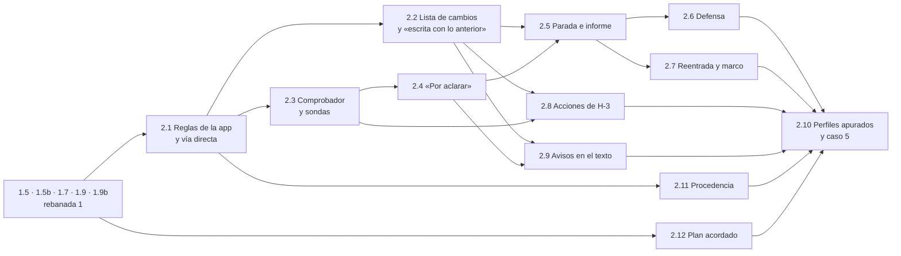

# Backlog · rebanada 2

**Respuesta:** 12 piezas, de la 2.1 a la 2.12 (la 2.10 cierra la rebanada). Al terminar, **tupaqnin protege, no solo registra**: los 10 perfiles apurados de las simulaciones se frenan donde dice el diseño (con los frenos que fijamos antes de la 2.10), y el caso 5 suma el «por aclarar» sobre qué cuenta como «campo» y la cita cuyo pasaje no sostiene lo que se afirma (H-1). **Horas: 43–62 `[inferencia]`**; el plan le da dos días (31-oct y 1-nov). No se recorta: el número va a Eber (`_handoff-29oct.md` §3, punto 5).

**Decisiones:** B-36 a B-54 (abajo). **El 30-oct se revisaron contra lo ya fijado:** 11 se infieren (su columna cita la fuente y no piden respuesta), B-46 y B-48 se infieren en parte, B-52 se retiró por contradecir R-1, y las 7 que quedaban (B-36, B-44, B-46 en los casos, B-48 en (b), B-51, B-53 y B-54) **las adoptó Eber el 30-oct**. No queda ninguna decisión abierta; las adoptadas ya están en el diseño. Eran B-21 a B-35: se renumeraron el 30-oct porque B-21 a B-24 ya existen en `backlog-r1.md` y el código las cita; la 2.1 trae además una precisión de B-15 para que la adoptes. **Listo de nuestro lado:** los tres esquemas de salida nuevos (`salida-comprobador`, `salida-informe` y `salida-juez-defensa`, en `docs/diseno/bloque-3/`). **Falta de nuestro lado:** redibujar sobre la disposición del 30-oct (`pantallas.md` v0.4, «Precisiones del 30-oct») los bocetos de P4 («por aclarar»), P6, los avisos en el texto, la línea de vuelta y la preparación de la defensa, que son del 29-oct; fijar el paso y el freno de cada uno de los 10 guiones del perfil apurado (2.10) y pasarlos al repo de código. `stretch` (B-43) y `claim_origin` (R-1) entran en `salida-principal.schema.json`, y `evidence_required` y las líneas del plan en `salida-entendi.schema.json`, **al empezar la 2.1**, sobre la versión actual de cada esquema (con `reply` y el rol reducido): antes romperían las pruebas que comparan las copias de la rebanada 1. `salida-informe.schema.json` ya quedó con B-41 (30-oct).

**Presupuesto de complejidad (regla 2.4):** 0 estados nuevos (todos están en `bloque-1-estados.md`). Señales nuevas: dos campos en la salida del principal (`stretch`, B-43; `claim_origin` en cada entrada de `new_text`, R-1); en el candidato del comprobador, `question` y `options` (B-44) y tres referencias que fichas §7 no nombra (`section`, `protected` y `citation`), para que la app reparta sin interpretar texto; un pendiente del agente «sin comprobar» (B-50); `unsourced_claim` (R-1, ya en estados §1); `evidence_required` y, por sección del plan, `focus` y `evidence_from` en la salida del «Entendí» (B-51, B-53); tres valores más de `stop_reason` (B-37). Eventos nuevos: dos, `plan_confirmed` (2.12) y `claim_accepted` (2.11); los candidatos del comprobador se guardan en `probe` (con `kind: candidate`). Un campo nuevo en `request`: `evidence_required` {`value`, `state`: `proposed` · `confirmed`}, con la forma del rol (B-51). Una columna nueva: `edge.data` (migración `0004`, B-45). Tres tipos de turno nuevos para el proveedor falso: `checker`, `stop_report` y `judge_defense`.

**Resuelto por inferencia (30-oct):** el «por aclarar» que elige contra una decisión tuya o confirmada lo fija estados §2 («Tuya → Reemplazada: eliges otra opción (nace una tuya)»); la 2.4 lo aplica.

**Abierto (nos toca):** la tabla de frenos de la 2.10 todavía no tiene el paso exacto de cada guion, y faltan 6 de los 10. La completamos antes de la 2.10.

## Qué cubre cada pieza

| Del plan (§1 y H-3) | Pieza |
|---|---|
| Comprobaciones completas: las 6 reglas de la app | 2.1 (0, 2, 3 con tu marca, 5 y tu edición) · 2.2 (4, aviso) |
| Comprobaciones completas: el comprobador · A-2 · sondas (B2-7) | 2.3 |
| «Por aclarar» | 2.4 |
| Triaje y vía directa | 2.1 |
| Parada con informe | 2.5 |
| Preparación de la defensa | 2.6 |
| Avisos entre secciones y por nueva versión de una fuente, con su lista de cambios (A-1) · E-4 | 2.2 |
| Reentrada · la línea de vuelta y el «sin ver» exacto (B3-9) | 2.7 |
| Cambiar el destinatario o un criterio · marcar una decisión como crítica · efecto del rol y del destinatario sobre lo firmado (K-13) · descargar el `.md` | 2.8 (marcar crítica: 2.1) |
| Avisos en el texto (espec. §8) | 2.9 |
| Procedencia de cada afirmación y «afirmación sin fuente» (R-1) · «¿en qué te basaste?» calculado por la app (R-2) · escribir de memoria marcado, solo si lo eliges (R-4) | 2.11 |
| Plan acordado antes de escribir (R-6) | 2.12 |
| «Listo cuando»: los perfiles apurados se frenan donde dice el diseño | 2.10 |

**Fuera de la rebanada 2:** la regla 6 (edición sospechosa, G-1), las propuestas, deshacer, objetar y revocar (rebanada 4); el juez de verificación con su lote de corrección, los lectores, la búsqueda web y «excede lo revisado» (A-5), que necesita el inventario de una ronda (rebanada 3).

## Arquitectura (lo que suma la 2)

**Reglas de la arquitectura** (las de backlog-r1 siguen): las comprobaciones no lanzan pasos nuevos; lo que encuentran entra al siguiente triaje (flujos §1, «sin bucles»). Ninguna detiene al agente; solo los pendientes y los cambios sin cerrar bloquean la firma (estados §1). Todo lo que se puede calcular lo calcula Go; el comprobador, el principal en el informe y el juez solo juzgan o redactan, con su salida fija.

**Rutas nuevas de la rebanada 2** (las de la 1 siguen; todas bajo `/api/projects/{projectID}`):

| Pantalla | Ruta | Escribe (evento) |
|---|---|---|
| P4 | `GET /open-questions/{label}` · `POST /open-questions/{label}/answer` `{option, reason}` | `state_changed` · `answer_without_reason` · `act_timed` |
| P4 | `POST /cards/{label}/answer` `{option: null, reason}` en la tarjeta de tu edición crítica (R4) | `state_changed` · `decision_seen` (`card`) |
| P6 | `GET /stop-report` (el último, con si lo viste) · `POST /stop-report/seen` · `POST /stop-report/continue` `{text}` → `{turn_id}` | `stop_report` (visto) · `decision_seen` (`report`) · `human_message` |
| P6 | `POST /audience-questions/{label}/answer` `{answer: yes · no}` | `state_changed` · `audience_question_declined` |
| Documento | `GET /sections/{label}/changes` · `POST /changes/{label}/close` `{result: updated · reviewed_unchanged, reason}` | `usage_change` |
| Documento | `GET /export.md` (secciones en el orden de `position`, K-17) | — |
| Documento | `PUT /sections/{label}/role` `{role}` (ya existe desde la 1.2; aquí se prueba con K-13 de punta a punta) | `role_changed` · `state_changed` |
| «Entendí» | `POST /plan/confirm` (2.12) · «Corregir» usa las rutas que ya existen: `PUT /sections/{label}/role`, `PUT /sections/{label}/details` (1.9b) y `PUT /request/evidence` `{required}` (2.11) | `plan_confirmed` · `section_details_changed` · `role_changed` · `state_changed` |
| Pedido | `PUT /request/audience` `{audience}` · `PUT /criteria/{label}` `{text}` · `POST /sources` suma `replaces` (etiqueta de la fuente que reemplaza) | `audience_changed` · `state_changed` · `source_new_version` |
| Marco | `PUT /decisions/{label}/critical` `{marked}` · `GET /frame` suma `return_line` y el «sin ver» exacto | `marked_critical` |
| Documento | `POST /sections/{label}/claims/accept` `{passage, reason}` (2.11) · `GET /sections/{label}/history` suma la procedencia de cada párrafo (R-2) | `claim_accepted` |

## Elecciones técnicas de este backlog (para Eber)

*El diseño no las fija y el agente las necesita. La última columna es tu respuesta.*

| # | Propuesta | En vez de | Elegiría la otra si… | Decisión de Eber (literal) |
|---|---|---|---|---|
| B-36 | **Las comprobaciones de tus ediciones corren por lote, no en cada guardado:** las reglas de la app (sin modelo), en cada guardado que cambia la huella; el comprobador, una sola vez sobre lo que editaste desde la última pasada, cuando envías un mensaje, pides firmar o pasan 60 s sin cambios `[inicial]` | Llamar al comprobador en cada guardado (el editor guarda cada ~30 s: muchas llamadas por sección y costo de Meta) | Las pruebas muestran que una contradicción tuya llega tarde a lo que te toca | Adoptada: «Ok, volvamos a los 7 pendientes de respuesta, aprobemos todas las propuesta» (30-oct) |
| B-37 | **La parada reemplaza la regla de los 5 pasos de B-17.** El agente encadena pasos hasta que la app decide parar (fichas §2, Parada). Queda un **tope de seguridad de 12 pasos por turno** `[inicial]`: si se alcanza, la app para igual y pide el informe, con la línea «tope de pasos». Los otros cortes de B-17 siguen (un paso sin trabajo, un paso que queda como pendiente del agente) y también terminan en informe. En el código: `MaxChainSteps` pasa a 12 y `chain_test.go` se ajusta. **Precisión (30-oct):** el motivo se guarda en `stop_reason` de `step_ended` (B-24 de la rebanada 1: `no_work` · `agent_pending` · `step_limit`), que suma `section_ready` · `unseen_decisions` · `human_only`; `step_limit` pasa a ser el tope de 12 | Sin tope (el agente puede gastar el saldo del link en un solo turno) · seguir con 5 (la parada casi nunca llegaría por sus motivos) | El caso 5 necesita más de 12 pasos entre paradas | **Se infiere (30-oct), no requiere decisión:** B-17 («la parada con informe llega en la 2») y fichas §2, Parada («*app* decide cuándo parar»). El tope de 12 es un valor `[inicial]`; los valores de `stop_reason` siguen B-24 |
| B-38 | **«La lee alguien más que tú» = el campo «para quién» tiene texto.** Vacío, es solo para ti y no hay defensa salvo que la sección tenga rol `conclusion`, la marca «aquí se concluye» (R-8; `recommendation` cuenta igual) (R6: cualquier lector que no seas tú) | Una casilla «solo para mí» en «Afinar» (un campo más en el pedido) · que un modelo lea el destinatario | En las pruebas la gente escribe «yo» o «para mí» en «para quién» | **Se infiere (30-oct), no requiere decisión:** R6 («ante terceros = cualquier lector que no seas tú») y fichas §2 (el destinatario lo dices en el pedido): sin destinatario no hay tercero |
| B-39 | **Decisiones sin ver que cuentan para la parada (≥ 5 `[inicial]`):** las vigentes que nacieron del agente desde la última parada y no tienen `decision_seen`, críticas o no. Tus decisiones no cuentan | Solo las críticas (menos paradas, pero lo no crítico se acumula sin que lo veas) | Las paradas por este motivo resultan demasiado seguidas en el caso 5 | **Se infiere (30-oct), no requiere decisión:** fichas §2, Parada («decisiones que no viste (≥ 5)» y qué cuenta como vista); tus decisiones las viste al tomarlas |
| B-40 | **El informe cuenta como visto al abrirlo en el panel:** `POST /stop-report/seen` marca el `stop_report` y registra `decision_seen` (`report`) por cada decisión que el informe muestra. Plegado no cuenta | Contarlo visto al llegar al stream (no distingue si lo leíste) | — | **Se infiere (30-oct), no requiere decisión:** fichas §2, Parada (vista «en un informe de parada… no al desplazarte») |
| B-41 | **Lo calculable del informe lo arma la app; el principal solo redacta.** La app llena «verificado», «no verificado» y «por aclarar y tarjetas» desde el grafo (citas con `comes_from`, citas sin él, objetos abiertos); el principal escribe «primero la respuesta», «hecho», «siguiente» y el esquema de lo no visto. Si lo adoptas, esos tres campos salen de `salida-informe.schema.json` y fichas §7 se precisa | Que el principal escriba todo el informe, como dice hoy fichas §7 (puede listar como verificado algo que no lo está) | Las pruebas muestran que el informe armado por partes se lee mal | **Se infiere (30-oct), no requiere decisión:** bloque-3 §2 («todo lo que tiene valor de evidencia lo calcula Go»). Fichas §7 y `salida-informe.schema.json` ya se precisaron |
| B-42 | **«Escrito sin decisión» por la app (regla 2):** un paso del agente que trae `new_text` en una sección con rol `conclusion` (la marca «aquí se concluye», R-8; `recommendation` cuenta igual) y no declara ninguna decisión nueva ni usada con `used_in` a esa sección deja el pendiente. En las demás secciones lo marca el comprobador (fichas §3). Tus ediciones no lo disparan: tu edición crítica abre la tarjeta R4 | Comparar el texto antes y después para decidir si el cambio es «de fondo» (frágil y sin definición) | El caso 5 da falsos positivos en «Conclusiones» por correcciones de forma del agente | **Se infiere (30-oct), no requiere decisión:** fichas §3 («la app lo detecta seguro en… rol conclusión; en otras… el comprobador») y R4 para tus ediciones |
| B-43 | **El tramo va en un campo de la salida del principal:** `stretch` {`direct` · `discover` · `build` · `verify`}, junto a `triage_line`. La regla 0 lo lee: si es `direct` y el paso toca una cifra, una cita, una sección con rol `conclusion` (R-8) o un criterio, la app lo reclasifica a `build`, lo dice en la línea de triaje y lo pasa por las comprobaciones. Cambia `salida-principal.schema.json` (lo hacemos nosotros) | Leer el tramo del texto libre de `triage_line` | — | **Se infiere (30-oct), no requiere decisión:** fichas §2, Triaje (el principal propone el tramo y la app comprueba la vía directa): la app no lo puede leer de texto libre |
| B-44 | **El comprobador redacta la pregunta y las opciones del «por aclarar»** que nace de una contradicción o de un término dudoso: dos opciones o más, cada una con su contraste, su consecuencia y su riesgo (estados §4), en la misma llamada. Ya está en `salida-comprobador.schema.json` | Una pregunta de plantilla con dos opciones fijas (pobre: sin contraste ni riesgo) · otra llamada al principal (más costo, y el principal es quien no lo vio) | Con esfuerzo `low`, las opciones del comprobador salen sesgadas o vacías en las pruebas | Adoptada: «Ok, volvamos a los 7 pendientes de respuesta, aprobemos todas las propuesta» (30-oct) |
| B-45 | **Lo que usa una sección guarda lo que usó en el `data` de su arista** (`used_in`, `covers`, `uses`), con una migración `0004` que suma `edge.data` y un argumento `data` en `AddEdge` y `ChangeEdge` (P-7 ya lo cerró B-8: el evento de la arista lleva sus datos). **Solo cuenta como cambio el contenido, no el estado:** de una decisión, su `statement`, `instead_of` y `would_choose_if`, o que pase a `superseded` o `revoked`; de una cifra, su `value`; de una fuente, su huella. Confirmar una decisión, marcarla crítica o responder su tarjeta no avisa. Ese cambio entra a `open_changes` de la sección con su etiqueta `chg-n` | Una tabla aparte de «usos» (el modelo de datos no la tiene) | Calcularlo así se vuelve lento con el caso 5 | **Se infiere (30-oct), no requiere decisión:** A-1 («la sección guarda lo que usa con su versión»); dónde se guarda es implementación |
| B-46 | **Cambiar un criterio:** crea su versión nueva, los casos del «Entendí» de ese criterio se conservan sin pedir otro «Entendí», y la sonda va contra el texto vigente de las secciones con una decisión que `applies` a ese criterio; si ninguna, contra todas las secciones con texto | Rehacer el «Entendí» completo (una llamada `high` y vuelves a confirmar todo) | El criterio cambia tanto que los casos viejos confunden | **Se infiere en parte (30-oct):** la versión nueva y la sonda contra las secciones afectadas ya las fijan estados §6 y fichas §3. **Decides solo:** si se conservan los casos del «Entendí» de ese criterio · **Adoptada (los casos se conservan):** «Ok, volvamos a los 7 pendientes de respuesta, aprobemos todas las propuesta» (30-oct) |
| B-47 | **El `.md` descargado marca lo no firmado** con una línea de cita del catálogo bajo el título de cada sección sin firmar («> Sin firmar» / «> Not signed»), sin ids ni historia. Las secciones firmadas no llevan marca | Un comentario HTML invisible (no se ve al leerlo) · un anexo al final | — | **Se infiere (30-oct), no requiere decisión:** K-10 (b) («marca visiblemente las secciones sin firmar»); el texto exacto es implementación |
| B-48 | **Dos anclas distintas para la reentrada.** (a) **Línea de vuelta:** aparece si tu último evento (cualquiera hecho por ti) tiene ≥ 3 días `[inicial]`; «qué cambió» cuenta los cambios de estado posteriores a él. (b) **Vuelta corta:** «lo detectado» es todo lo ocurrido desde el último `stop_report`, **tus ediciones incluidas**: `edit`, `state_changed`, `usage_change`, `source_new_version`, los pendientes y «por aclarar» nuevos y los avisos | Una sola «última visita» para las dos (con tu último evento, tu propia edición nunca queda «después»: falla el freno del 8B) · registrar la apertura del proyecto (un evento nuevo) | Las pruebas muestran que el último informe es demasiado viejo como ancla | **Se infiere en parte (30-oct):** (a) ya está en espec. §9 («desde tu último evento»). **Decides solo (b):** qué es «tu última sesión» en la vuelta corta (fichas §2); el diseño no define «sesión» · **Adoptada (b): la vuelta corta usa el último informe de parada:** «Ok, volvamos a los 7 pendientes de respuesta, aprobemos todas las propuesta» (30-oct) |
| B-49 | **Tarjeta de tu edición crítica (R4):** se abre cuando tu edición quita o cambia el ancla de una cifra o una cita cuya decisión (`covers`, o la decisión de la cita) es crítica, sea cual sea el estado de esa decisión. Pide solo el «porque» (`option: null`, solo en estas tarjetas); la decisión no cambia de estado: el «porque» queda en la tarjeta y en la historia, y la sección sigue con su pendiente hasta responder | Detectarlo por texto «vinculado» a la decisión (la arista `used_in` no tiene ancla) · cambiar el estado de la decisión al responder (el diseño no lo pide) | Tus ediciones de forma (una coma junto a la cifra) abren demasiadas tarjetas | **Se infiere (30-oct), no requiere decisión:** R4 («solo pide el «porque»… bloquea la firma, no el cambio») y fichas §3 (tarjeta válida) |
| B-50 | **Si el comprobador falla dos veces, la sección queda con un pendiente del agente «sin comprobar»** hasta el siguiente juicio válido sobre ella; bloquea la firma, no el trabajo. Sus resultados llegan después del paso: se aplican contra el texto vigente, y un candidato cuyo pasaje ya no aparece en la sección se descarta, con su `probe` | Que el paso siga sin juicio y nada lo marque (un texto que nadie contrastó con tu premisa se podría firmar) · bloquear el paso hasta que el comprobador responda (detiene al agente, contra DEC-003) | Meta falla seguido y la firma queda trabada sin razón de fondo | **Se infiere (30-oct), no requiere decisión:** fichas §7 («reintenta una vez; si vuelve a fallar, queda visible sin frenar el trabajo»), como el pendiente del principal |
| B-51 | **¿El documento pide evidencia? Lo propone el «Entendí»:** `evidence_required` (sí o no) en su salida y en su tarjeta, con una línea de por qué; lo cambias con «Corregir». Decide si «afirmación sin fuente» bloquea la firma (R-1) | Una casilla en «Afinar» (un campo más en el pedido, que casi nadie abre) · que siempre bloquee | El «Entendí» se equivoca seguido en las pruebas | Adoptada: «Ok, volvamos a los 7 pendientes de respuesta, aprobemos todas las propuesta» (30-oct) |
| B-52 | **El origen de cada párrafo lo calcula la app desde las citas,** no lo declara el agente por párrafo: es «de tu material» si contiene la afirmación (`claim_anchor`) de una cita cuyo pasaje está literal en una fuente que el principal leyó (`delivery` `via = read`); si no, «sin verificar». Usa `citations` y `delivery`, que ya existen: ningún campo nuevo en la salida del principal. Precisa R-1 («el agente lo declara por párrafo») | Un campo `claim_origin` en cada entrada de `new_text` (el agente podría declarar «tu material» sin pasaje, y la app igual tiene que comprobarlo) | Los párrafos de transición llenan de pendientes un documento con evidencia `[hipótesis: se prueba con el caso 5]` | **Retirada (30-oct):** contradice R-1, ya adoptada («el agente lo declara por párrafo en su salida»). La 2.11 sigue R-1 |
| B-53 | **La línea «qué concluye o aborda» de cada sección del plan pasa a su `focus` (K-17) cuando confirmas o corriges el plan;** al confirmar sin corregir lo adoptas como tuyo (como un rol propuesto que confirmas, K-2) y la historia guarda que lo escribió el agente; K-17 dice que `focus` es tuyo y en literal, así que esto la precisa. Sin respuesta, la sección no tiene `focus` y el principal sigue el plan de su «Entendí». Un solo campo para lo que la sección debe abordar | Un campo aparte del agente (`purpose`) junto al tuyo: dos textos parecidos por sección | Quieres ver por separado lo que propuso el agente y lo que pediste tú | Adoptada: «Ok, volvamos a los 7 pendientes de respuesta, aprobemos todas las propuesta» (30-oct) |
| B-54 | **Con el plan confirmado, el agente no crea secciones:** la app rechaza solo esa parte de su salida (una sección `new-n`), con un mensaje para él; la propone en `reply` y tú la creas con «+ Sección» (1.9b). Antes de confirmar, se crea como hoy. Precisa R-6 («llega como propuesta»), porque las propuestas son de la rebanada 4. El agente no se detiene | Que nazca en borrador con la marca «fuera del plan» y una línea en «Te toca» (una señal más, y quitar secciones no existe) · esperar a la rebanada 4 | Crear a mano lo que el agente propone resulta pesado en el caso 5 | Adoptada: «Ok, volvamos a los 7 pendientes de respuesta, aprobemos todas las propuesta» (30-oct) |

## Piezas

### 2.1 · Reglas de la app, triaje y vía directa

| Campo | Contenido |
|---|---|
| **Qué** | Después de cada paso del agente y de cada edición tuya, la app corre sus reglas sin modelo: vía directa, cifra sin decisión, escrito sin decisión, criticidad y códigos internos. Una vía directa que toca algo de riesgo se reclasifica a Construir. Tu edición sobre una decisión crítica abre su tarjeta, que solo pide el «porque». Marcas una decisión como crítica con un clic |
| **Implementa** | Fichas §3 (vía directa, escrito sin decisión, criticidad con tu marca, códigos internos, tarjeta válida) · flujos §1 (reglas 0 a 5, y tus ediciones) · fichas §2 (Triaje) y §8.3 · R4 · T-2 · T-5 (cuarto motivo) · B-36 · B-42 · B-43 |
| **Leer** | Fichas §2 (Triaje, Comprobaciones, Tu turno), §3 y §8.3 · flujos §1 · estados §1 a §3 · espec. §1.5 y §3 (regla 4) · `docs/diseno/bloque-3/salida-principal.schema.json` · glosario §8 |
| **Interfaz** | Paquete nuevo `internal/checks`: `RunRules(ctx, tx, projectID string, change Change) ([]Finding, error)`, donde `Change` es un paso aplicado o una edición tuya con su versión base; corre las reglas 0 a 5 en ese orden, en la transacción del cambio, y sus pendientes salen de las funciones de `internal/graph` (una por comprobación, B-15) · **regla 0:** lee `stretch` (B-43); la reclasificación se escribe en `step_ended` y se ve en la línea de triaje · **regla 2:** B-42 · **regla 5:** etiquetas del proyecto en el texto (después de normalizar, como la regla 4); deja el pendiente del agente «códigos internos». En un paso del agente, un `new-n` en el texto ya lo rechaza la regla 4 (`apply.go`); la regla 5 lo ve solo en tus ediciones · **cómo se guarda y se cierra cada pendiente nuevo (precisa B-15; si la adoptas, se copia a B-15):** «códigos internos» se calcula del texto vigente y se cierra cuando la etiqueta ya no aparece; «escrito sin decisión» (regla 2) queda en el `step_ended` del paso y se cierra con el siguiente paso del agente en esa sección que declara una decisión con `used_in` a ella; los del comprobador («relato del proceso», «escrito sin decisión» fuera de conclusiones, «fuente que no sostiene» por A-2) quedan en su `probe` con el pasaje y se cierran cuando ese pasaje ya no aparece literal en la sección · **tus ediciones:** reglas 1 a 5 en cada guardado que cambia la huella (B-36); tu edición crítica abre la tarjeta R4 como dice B-49; `AnswerCard` acepta `option: null` solo en esas tarjetas, y la apertura de tarjetas deja de limitarse a `state = agent` solo para ellas · `PUT /decisions/{label}/critical` con `marked_critical` y `human_marked_critical` en la decisión; `Critical` lo cuenta y la transacción hace lo de espec. §1.5 · `salida-principal.schema.json` con `stretch` (nos toca; la copia embebida se sincroniza como en la 0.7) |
| **Listo cuando** | Prueba: un paso `direct` que toca una cifra queda como `build` en `step_ended` y pasa por todas las reglas · prueba: `dec-3` en el texto de un paso, o `new-2` en tu edición, deja el pendiente «códigos internos»; «Formulario F-40» no · prueba: un paso en «Conclusiones» sin decisión declarada deja «escrito sin decisión»; uno con decisión `used_in` a esa sección, no · prueba: tu edición que cambia una cifra cubierta por una decisión crítica abre la tarjeta R4, que se cierra solo con «porque» · prueba: marcar una decisión la vuelve crítica y abre su tarjeta si es del agente; desmarcarla registra `marked_critical` · prueba: ninguna regla detiene la cadena de pasos |
| **Depende de** | 1.5 (estado y pendientes) · B-36 · B-42 · B-43 · B-49 |
| **No hacer** | La regla 6, edición sospechosa (rebanada 4). «Fue un error · deshacer» en la tarjeta R4 (rebanada 4, G-1). Lanzar pasos desde una comprobación |
| **Si algo no está** | `[EL DISEÑO NO LO DICE]` en el retorno y una línea en `elecciones-agente.md` |

### 2.2 · Lista de cambios, avisos y «escrita con lo anterior»

| Campo | Contenido |
|---|---|
| **Qué** | Si cambia algo que una sección usa (una decisión, una cifra o una fuente), la sección recibe el aviso y el cambio entra a su lista: la firmada pasa a «cambió» y la no firmada a «escrita con lo anterior». No se firma hasta cerrar cada cambio, por un paso del agente que lo declara o por ti, con «porque» si fue revisado sin cambio |
| **Implementa** | A-1 · E-4 · fichas §3 (aviso a otras secciones, cierre de un cambio) · estados §1 («escrita con lo anterior») · espec. §3 (regla 7) y §4 («cambió» por componentes) · B-45 |
| **Leer** | Estados §1 · fichas §3 · flujos §1 (cambios en lo que usa una sección) · espec. §1.1 (`section.open_changes`, `source.replaces`), §1.3 (`usage_change`, `source_new_version`), §3 y §4 · `docs/diseno/bloque-1/bloque-1-decisiones.md` (A-1, E-4) |
| **Interfaz** | **Regla 4 de flujos §1 (avisos):** en cada transacción que cambia la versión de una decisión o una cifra, o crea la versión nueva de una fuente, la app busca por las aristas las secciones que la usan con otra versión (B-45) y agrega el cambio (`chg-n`) a su `open_changes`, con `usage_change` `entered`; una firmada pasa a `changed_since_signoff`, una en `draft` (o `ready`) a `stale` · **fuente nueva:** `POST /sources` con `replaces` es la **versión nueva del mismo objeto** (`UpdateObject` sobre esa fuente, con su texto y su huella nuevos), así las aristas `uses` siguen apuntando a ella; registra `source_new_version`; una idéntica no (B-9) · **regla 7 de la puerta (espec. §3):** `handled_changes` del principal; un cierre que no cumple se rechaza solo ese cierre, con mensaje para el agente · **tú:** `POST /changes/{label}/close` con `updated` (después de editar esa sección) o `reviewed_unchanged` con un «porque» válido (T-1) · lista vacía: `stale` vuelve a `draft`; editar otra cosa no la libera · `SectionStatus` y la firma (1.7) bloquean con cambios sin cerrar, en cualquier estado · la capa 3 del arranque ya lee `open_changes` (0.9): comprobar que los ids lleguen al principal |
| **Listo cuando** | Prueba: cambiar la decisión de «Síntesis» que usa «Conclusiones» deja en «Conclusiones» un `chg-n` y la pasa a `stale` (o a `changed_since_signoff` si estaba firmada) · prueba: subir el cálculo con `replaces` avisa a cada sección que lo usa; subirlo idéntico no · prueba: un paso que declara `updated` sin tocar la sección se rechaza en ese cierre · prueba: `reviewed_unchanged` con «ok» no cierra · prueba: con la lista vacía, la sección vuelve a `draft`; con un cambio abierto, pedir firmar lo lista y no abre la firma |
| **Depende de** | 2.1 · 1.7 (la firma bloquea) · B-45 |
| **No hacer** | Aceptar propuestas que declaran el cambio (rebanada 4: hasta entonces, B-11 y B-14 rechazan el paso sobre lo firmado). Comparar texto para decidir si algo «cambió» |
| **Si algo no está** | `[EL DISEÑO NO LO DICE]` en el retorno |

### 2.3 · Comprobador y sondas contra la contradicción

| Campo | Contenido |
|---|---|
| **Qué** | Después de cada paso (y de tus ediciones, por lote), una sola llamada a otro modelo, con contexto limpio, juzga lo que la app no puede calcular: si lo nuevo contradice lo confirmado o tu premisa, si aplica un término tuyo a un caso dudoso, si cuenta el proceso en vez de hablarle al destinatario y si el pasaje de una cita sostiene lo que se afirma. Devuelve candidatos con los pasajes literales; la app los reparte |
| **Implementa** | Fichas §3 (contradice, término dudoso, relato del proceso, escrito sin decisión fuera de conclusiones, la fuente dice lo que se afirma) y §7 (fila «Comprobador») · flujos §1 (comprobador y reparto) · B2-7 · A-2 · R1 · B-44 |
| **Leer** | Fichas §3, §7 y §8.2 («Fijar el sentido de tus términos») · flujos §1 · `docs/diseno/bloque-2/bloque-2.md` §5 · `docs/diseno/bloque-3/salida-comprobador.schema.json` · espec. §1.3 (`probe`) · `docs/diseno/bloque-1/bloque-1.md` §4 (el encargo, reducido) |
| **Interfaz** | `internal/checks`: `Probes(ctx, projectID string, change Change) ([]Probe, error)` arma las sondas desde el grafo: **siempre** el pedido, el «Entendí» confirmado con sus casos, los criterios, la premisa, todas tus decisiones y todas las críticas vigentes; **además**, las confirmadas y las de secciones firmadas vinculadas a lo que tocó el cambio (fichas §3) · `CallChecker(...)`: Spark 1.3 `low`, una llamada con el encargo reducido de fichas §7, el pasaje nuevo y, por cada cita nueva, el par {afirmación, pasaje literal de la fuente, id y huella} (A-2); la prueba de que el principal leyó ese pasaje es la fila de `delivery` con `via = read` de la 1.9, sin otro registro · instrucciones en `internal/cycle/prompts/checker.en.md`, borrador que revisa Eber · forma fija y un reintento (fichas §7); si vuelve a fallar, B-50 · `TurnKind` suma `checker`, para que el proveedor falso elija su grabación (P-29) · los candidatos se guardan en `probe` con `kind: candidate` · **reparto** (flujos §1): sonda `contradicts` o `doubt` y candidatos `contradiction` y `doubtful_term` → «por aclarar» (2.4); si el principal no lo había propuesto, el aviso dice «la última entrega contradice X · no lo declaró el agente»; `process_narrative`, `written_without_decision` y `source_not_supporting` → pendiente del agente, como en B-15 · cada sonda, un evento `probe` con lo protegido, el veredicto, el pasaje y si el principal lo había declarado · el comprobador corre fuera de la transacción del paso (nunca hay una transacción abierta mientras se espera al modelo, espec. §2); sus resultados se aplican en otra transacción, como dice B-50 |
| **Listo cuando** | Prueba con una salida grabada: una sonda `contradicts` sobre la premisa abre un «por aclarar» con «no lo declaró el agente» · prueba: `doubt` también lo abre · prueba: las sondas incluyen siempre todas las críticas vigentes, aunque el paso no las toque · prueba: una cita con su pasaje literal en la fuente pero que no sostiene la afirmación deja «fuente que no sostiene» · prueba: «tras la revisión del martes» deja «relato del proceso» · prueba: si el texto cambió mientras se esperaba al comprobador, un candidato cuyo pasaje ya no está se descarta y los demás se aplican (B-50) · prueba: dos fallos de forma dejan «sin comprobar» y la firma de esa sección se bloquea · las salidas grabadas del comprobador se graban con `make microtest`, que corre Eber |
| **Depende de** | 2.1 · B-36 · B-44 · B-50 |
| **No hacer** | «Excede lo revisado» (A-5, rebanada 3: necesita el inventario). Que el comprobador cree aristas o decida. Varias llamadas por paso |
| **Si algo no está** | `[EL DISEÑO NO LO DICE]` en el retorno |

### 2.4 · «Por aclarar»

| Campo | Contenido |
|---|---|
| **Qué** | Lo que solo tú puedes decidir (alcance, premisa, destino, el sentido de tus términos, una contradicción) llega como una pregunta con sus opciones, cada una con su contraste, su consecuencia y su riesgo. El agente sigue con lo demás, con variantes rotuladas. Respondes con una opción y un «porque»; mientras está abierto, no se firma lo que depende de él |
| **Implementa** | Estados §4 y §6 (premisa contradicha) · fichas §2 (Tu turno), §8.2 («Lo que solo tú haces», «Cómo respondes») · D21 · P5 · inventario 4e · P4 («por aclarar») |
| **Leer** | Estados §2, §4 y §6 · fichas §8.2 · espec. §1.1 (`open_question`), §1.2 (`blocks`) · `docs/diseno/bloque-3/salida-principal.schema.json` (`proposed_open_questions`) · `docs/diseno/bloque-3/pantallas.md`: primero «Precisiones del 30-oct» (mandan sobre los bocetos y sobre `boceto-ui.html`), después P4 |
| **Interfaz** | Nace de `proposed_open_questions` del principal (lo que B-17 guardaba sin aplicar) o del reparto de 2.3 (B-44); crea el `open_question` `open` y sus aristas `blocks` a lo que declara `depends_on` (en un candidato del comprobador: la sección y, si hay, la decisión protegida) · **sobre una sección firmada,** abrirlo la pasa a `changed_since_signoff` (estados §1) · la decisión bloqueada no cambia de estado (pasar a `in_open_question` es objetar, rebanada 4) · una contradicción con la premisa la pasa a `contradicted`; al resolverse, la mantienes (vuelve a `current`) o la cambias (versión nueva de la premisa, con la sonda de B-46 contra el texto vigente) · `POST /open-questions/{label}/answer` `{option, reason}`: `option` es el índice de la opción en la lista (desde 0) y el «porque» debe ser válido (T-1, B-20 a); si no, `answer_without_reason` y sigue abierto · al resolver: `resolved`, las variantes no elegidas a la historia como descartadas, las aristas `blocks` terminan (`EndEdge`), y lo que dependía vuelve a `draft` (o sigue en `stale` o `changed_since_signoff`); la app no crea decisiones: el principal recibe el «por aclarar» resuelto en lo que cambió (bloque 2) y escribe con lo elegido; **salvo** cuando el «por aclarar» bloquea una decisión tuya o confirmada: su primera opción es «mantener: <enunciado>» y elegir otra la reemplaza por una decisión tuya, con la opción elegida como enunciado y tu «porque» (estados §2; como B-16) · `SectionStatus` lo cuenta como pendiente · cada respuesta, `act_timed` · `GET /todo` lo lista · web: la tarjeta de «por aclarar» en la conversación y en «Te toca» del marco, con las variantes plegadas |
| **Listo cuando** | Prueba: un `proposed_open_questions` con `depends_on` a una sección la deja en `draft` y bloquea su firma · prueba: «B, como dije» sin elegir y «ok» lo dejan abierto · prueba: elegir con «porque» lo resuelve, termina las aristas `blocks` y la sección vuelve a `draft` · prueba: un «por aclarar» sobre una sección firmada la pasa a `changed_since_signoff` · prueba: resolver la premisa contradicha cambiándola crea su versión nueva y la sonda contra el texto vigente · prueba: con un «por aclarar» abierto el agente sigue encadenando pasos · en el navegador (lo prueba Eber): el «por aclarar» de «campo» del caso 5, con el proveedor falso |
| **Depende de** | 2.3 · 1.4 (tarjeta y «porque») · 1.7 (la firma bloquea) |
| **No hacer** | Objetar (E-1, rebanada 4). Precargar la respuesta desde el chat (fuera del hackathon, H-3) |
| **Si algo no está** | `[EL DISEÑO NO LO DICE]` en el retorno |

### 2.5 · Parada con informe

| Campo | Contenido |
|---|---|
| **Qué** | El agente encadena pasos hasta que la app decide parar: la sección quedó sin pendientes, acumulaste 5 decisiones sin ver o solo queda lo que tú decides. Entonces escribe el informe fijo, primero la respuesta, y propone firmar si no queda nada. Sigues con «sigue», «abordémoslo» o firmando |
| **Implementa** | Fichas §2 (Parada) y §7 (fila «informe de parada») · fichas §8.2 (Ritmo) · D6 · D19 · B-37 · B-39 · B-40 · B-41 · P6 |
| **Leer** | Fichas §2 (Parada), §7 y §8.2 · estados §8 · espec. §1.3 (`stop_report`, `decision_seen`) · `docs/diseno/bloque-3/salida-informe.schema.json` · `docs/diseno/bloque-3/pantallas.md` (P6) · supervisión P-18 (los mensajes respondidos «desde la última parada») |
| **Interfaz** | `internal/cycle`: después de aplicar cada paso y sus comprobaciones, `ShouldStop(ctx, projectID, touched []string) (StopReason, bool)`: «sección sin pendientes» se evalúa solo sobre las secciones que tocó la cadena desde la última parada y que tienen texto; a esos motivos se suman los cortes que siguen de B-17 y el tope de B-37; cada uno se guarda en `stop_reason` (B-37) · un paso que solo trae `reply` no cuenta como trabajo (R-5) · el `stop_report` guarda la sección que se evalúa; si propone firmar, es esa sección (lo decide Go) · `TurnKind` suma `stop_report` · al parar, una llamada al principal con el esquema del informe y la lista de decisiones sin ver (B-39) que calcula `internal/graph` · B-41 (lo calculable lo arma la app) · `stop_report` guarda el informe completo; el informe propone firmar solo si la sección no tiene pendientes ni cambios sin cerrar (lo calcula Go, no el modelo) · P-18: el arranque cuenta los mensajes respondidos desde la última parada · rutas de P6 de la tabla · «sigue» y «abordémoslo» son mensajes tuyos (`human_message`) con el texto del botón; «Firmar» abre P7 · web: P6 en la conversación, plegado bajo su primera línea; «Te toca» del marco muestra «informe sin ver» hasta abrirlo |
| **Listo cuando** | Prueba: con 5 decisiones sin ver la cadena para y pide el informe · prueba: una sección sin pendientes para la cadena · prueba: si solo quedan tarjetas y «por aclarar», para · prueba: a los 12 pasos para con «tope de pasos» · prueba: el informe no propone firmar si queda un cambio sin cerrar, aunque el modelo lo pida · prueba: abrir el informe registra `decision_seen` (`report`) por cada decisión que muestra · prueba: con el proveedor falso, el recorrido muestra P6 y «sigue» abre otro turno |
| **Depende de** | 2.2 · 2.4 · B-37 · B-39 · B-40 · B-41 |
| **No hacer** | «Continúa hasta terminar» y el modo en la barra (rebanada 4). Que la parada proponga un análisis de sensibilidad (fuera del hackathon; pedirlo sí funciona, H-3) |
| **Si algo no está** | `[EL DISEÑO NO LO DICE]` en el retorno |

### 2.6 · Preparación de la defensa

| Campo | Contenido |
|---|---|
| **Qué** | En la parada que propone firmar una sección que lee alguien más que tú, o que tiene rol `conclusion` («aquí se concluye», R-8), el juez hace una sola ronda con el destinatario en mente: 3 a 5 preguntas probables y lo que el trabajo no cubre. Llegan como preguntas abiertas, nunca como bloqueo: «¿lo abordamos?» |
| **Implementa** | Fichas §2 (Parada), §7 (fila «Juez», en la parada) y §8.2 («Preparar la defensa») · estados §9 · K-1 · R6 · B-38 · inventario 5b y 5c |
| **Leer** | Fichas §2, §7 y §8.2 · estados §9 · espec. §1.1 (`audience_question`) y §1.2 (`about`) · `docs/diseno/bloque-3/salida-juez-defensa.schema.json` · `docs/diseno/bloque-3/pantallas.md` (P6, la defensa) |
| **Interfaz** | En la parada de 2.5, si el informe propone firmar la sección y B-38 o su rol lo piden: una llamada al juez, Spark 1.3 `high`, con su encargo reducido (texto vigente de la sección, pedido con su destinatario, criterios y decisiones críticas) · cada pregunta y cada «no cubre» crea un `audience_question` `open` con su arista `about` · `POST /audience-questions/{label}/answer`: `yes` → `addressed`: queda como instrucción tuya en el siguiente triaje (estados §9), sin abrir un turno; `no` → `declined` con `audience_question_declined` («no abordado, decidido por ti»); sin respuesta, sigue abierta en el informe · no bloquea la firma ni la firma las descarta · cambiar el destinatario (2.8) solo cambia la siguiente preparación · instrucciones en `internal/cycle/prompts/judge-defense.en.md`, borrador que revisa Eber · `TurnKind` suma `judge_defense` |
| **Listo cuando** | Prueba con una salida grabada: una sección con rol conclusión crea 3 a 5 preguntas con `about` · prueba: con «para quién» vacío y rol «otro» no se llama al juez · prueba: «no» registra `audience_question_declined`; «sí» deja la pregunta como instrucción en lo que recibe el principal en su siguiente turno, sin abrir uno · prueba: con preguntas abiertas, la firma se abre igual |
| **Depende de** | 2.5 · B-38 |
| **No hacer** | El juez de verificación con su lote de corrección (rebanada 3). La defensa de cada sección al final de «continúa hasta terminar» (rebanada 4, K-7) |
| **Si algo no está** | `[EL DISEÑO NO LO DICE]` en el retorno |

### 2.7 · Reentrada y marco completo

| Campo | Contenido |
|---|---|
| **Qué** | Al volver tras 3 días o más, arriba del marco ves una línea (dónde quedaste · qué cambió · qué te toca) y el informe pendiente a un clic. En vueltas más cortas, primero el informe pendiente y lo que la app detectó desde tu última visita, aunque lo hayas hecho tú. El marco marca exactamente lo que no viste y abre la historia de cada decisión |
| **Implementa** | Fichas §2 (Reentrada, El marco) y §8.2 (Reentrada) · espec. §9 (línea de vuelta, filtro «solo lo que no viste») · M-2 · B3-9 (precisada: la línea de vuelta y el «sin ver» exacto) · 1.6 («abrirla desde el marco», que quedó para la 2) · inventario 8a y 8b |
| **Leer** | Fichas §2 y §8.2 · espec. §9 · `docs/diseno/bloque-3/pantallas.md`: primero «Precisiones del 30-oct» (U-3: el esqueleto del marco es la única navegación; P-48), después la disposición general y el boceto de la línea de vuelta; `boceto-ui.html` es del 29-oct y no manda · `docs/diseno/bloque-3/bloque-3-decisiones.md` (B3-9) |
| **Interfaz** | **Anclas de B-48:** la línea de vuelta usa tu último evento; la vuelta corta, el último `stop_report` · `Frame` suma `return_line` si pasaron ≥ 3 días `[inicial, parámetro]`: la última sección y tu último acto, el número de cambios de estado desde tu último evento (con enlace a la historia) y el número de tus pendientes · «sin ver» exacto: una decisión crítica sin ningún `decision_seen` lleva el punto; el filtro «solo lo que no viste» ordena por número de aristas `used_in` y luego por el orden del documento · desplegar una decisión ya registra `decision_seen` (`frame`, 1.5b); su enlace abre la historia de su párrafo (P5) · **vuelta corta:** si hay un `stop_report` sin ver, la conversación abre con él arriba y, debajo, lo detectado desde el último `stop_report` (B-48 b, tus ediciones incluidas) · la línea de vuelta nunca bloquea y no aparece en la firma |
| **Listo cuando** | Prueba: con el último evento tuyo de hace 4 días, `Frame` trae la línea con los tres números correctos; con uno de hace 1 hora, no · prueba: una edición tuya después del último informe aparece en lo detectado de la vuelta corta · prueba: una decisión crítica con `decision_seen` de cualquier vía no lleva punto · prueba: el filtro ordena por secciones afectadas · prueba: ≤ 300 ms con el caso 5 · en el navegador (lo prueba Eber): cambiar la fecha en una prueba de desarrollo muestra la línea |
| **Depende de** | 1.5b · 2.5 (el informe sin ver) · B-48 |
| **No hacer** | La vuelta al terminar «continúa hasta terminar» (rebanada 4). «Reconstruye antes de mirar» (M-3) y la tesis por modelo (M-4): hoja de ruta. Abrir el marco desde la firma |
| **Si algo no está** | `[EL DISEÑO NO LO DICE]` y una línea en `elecciones-agente.md` |

### 2.8 · Acciones de H-3: destinatario, criterio y descarga

| Campo | Contenido |
|---|---|
| **Qué** | Cambias el destinatario o un criterio después de enviar el pedido y descargas el documento en `.md` con lo no firmado marcado. Cambiar el destinatario no toca lo firmado; cambiar un criterio dispara la sonda de contradicción sobre lo escrito |
| **Implementa** | H-3 (rebanada 2) · fichas §2 (Tu turno: cambias el rol; crear una sección pasó a la 1.9b) · estados §6 (criterio, rol) · K-13 (destinatario) · K-10 b · B-46 · B-47 |
| **Leer** | Fichas §2 (Tu turno) · estados §6 · espec. §1.1 · `docs/diseno/bloque-3/funcionalidades.md` (hueco 6) · `docs/diseno/_plan-hackathon.md` (H-3) |
| **Interfaz** | `PUT /request/audience` con `audience_changed`; no cambia ningún estado de sección · `PUT /criteria/{label}` crea la versión nueva del criterio (solo tuya) y encola la sonda de B-46 en el comprobador (2.3) · el rol: la lógica ya está en 1.4 (K-13 con K-6); aquí se prueba de punta a punta · cambiar el destinatario no mueve lo firmado · `GET /export.md`: las secciones en el orden de `position` (K-17) con su título y texto vigente, sin «qué debe abordar», la marca de B-47 en las no firmadas, sin ids ni historia; nombre del archivo desde `project.name` |
| **Listo cuando** | Prueba: cambiar el destinatario de un proyecto con una sección firmada la deja `signed` · prueba: cambiar a conclusión el rol de una sección firmada con una decisión del agente la pasa a `changed_since_signoff` y abre su tarjeta (K-13) · prueba: cambiar un criterio crea su versión nueva y la siguiente llamada al comprobador lleva la sonda contra el texto de las secciones afectadas (B-46) · prueba: el `.md` de un proyecto con una sección firmada y otra no marca solo la segunda y no contiene ninguna etiqueta |
| **Depende de** | 2.2 · 2.3 · B-46 · B-47 |
| **No hacer** | Crear o reordenar secciones (ya en la 1.9b, K-17). Quitarlas (fuera del hackathon). Exportar a otros formatos |
| **Si algo no está** | `[EL DISEÑO NO LO DICE]` en el retorno |

### 2.9 · Avisos en el texto

| Campo | Contenido |
|---|---|
| **Qué** | En el documento ves, en su lugar, lo que pide tu atención: qué sección cambió o quedó escrita con lo anterior y por qué, el pasaje de un «por aclarar» o de un pendiente del agente, y la cifra o cita vinculada. Un clic lleva a la tarjeta, al cambio o a la historia |
| **Implementa** | Espec. §8 (rebanada 2: «avisos en el texto») · fichas §5 (qué se ve) · `pantallas.md` (disposición general, zona Derecha, y el boceto de los avisos) |
| **Leer** | `docs/diseno/bloque-3/pantallas.md`, primero «Precisiones del 30-oct» (mandan sobre `boceto-ui.html`, que es del 29-oct) · estados §1 · fichas §5 |
| **Interfaz** | `GET /sections/{label}` suma, por aviso: tipo (`changed` · `stale` · `open_question` · `agent_pending`), el pasaje literal donde va (si lo hay) y la etiqueta a la que lleva · web: una banda bajo el título y «qué debe abordar» de la sección (K-17) con su estado y la lista de cambios sin cerrar, con «Actualizado» y «Revisado, no requiere cambio» (este pide «porque»); el pasaje de un «por aclarar» o de un pendiente, subrayado en el editor, con su enlace · textos desde `en.json` y `es.json`; ningún id a la vista |
| **Listo cuando** | Prueba: `GET /sections/{label}` de una sección `stale` trae su cambio con su etiqueta · prueba: un pendiente «códigos internos» trae su pasaje · en el navegador (lo prueba Eber): cerrar un cambio desde la banda libera la sección; un pasaje subrayado lleva a su «por aclarar» |
| **Depende de** | 2.2 · 2.4 |
| **No hacer** | Las propuestas en el texto (rebanada 4). La alerta de edición sospechosa (rebanada 4) |
| **Si algo no está** | `[EL DISEÑO NO LO DICE]` y una línea en `elecciones-agente.md` |

### 2.11 · Procedencia de cada afirmación

| Campo | Contenido |
|---|---|
| **Qué** | Cada párrafo dice de dónde sale: de tu material (con su pasaje, que la app comprobó) o «sin verificar». En un documento que pide evidencia, un párrafo sin origen verificado deja «afirmación sin fuente», que bloquea la firma hasta que lo respaldas, lo aceptas como conocimiento general con tu «porque» o lo quitas. «¿En qué te basaste?» lo responde la app |
| **Implementa** | `../diseno/_propuesta-30oct-fuentes-y-flujo.md`: R-1, R-2 y la tercera opción de R-4 (escribir de memoria marcado, solo si lo eliges) · estados §1 (`unsourced_claim`) · glosario §11 (`claim_origin`) · B-51 |
| **Leer** | La propuesta del 30-oct (§2, §3, R-1, R-2, R-4) · estados §1 · espec. «Precisiones del 30-oct» (lectura a demanda) · `docs/diseno/bloque-3/salida-principal.schema.json` (`citations`) · `docs/diseno/bloque-3/salida-entendi.schema.json` |
| **Interfaz** | **Origen declarado y comprobado (R-1):** cada entrada de `new_text` declara `claim_origin` (`material` · `model_knowledge`; `external` llega con la búsqueda, rebanada 3). Un párrafo `material` trae en `citations` el pasaje de lo que afirma, y la app lo comprueba: literal en una fuente leída en el proyecto (`delivery` `via = read`). Si no se comprueba, el párrafo se muestra «sin verificar», como `model_knowledge` · **¿pide evidencia? (B-51):** `evidence_required` en la salida del «Entendí»; la app lo guarda en `request` como `proposed`; «Corregir» (`PUT /request/evidence`) lo deja `confirmed` con tu valor · **`unsourced_claim`:** solo con `evidence_required`; **no se guarda: se calcula** del texto vigente, como «códigos internos» (2.1): un pendiente por párrafo sin origen verificado que no tenga aceptación. Se cierra cuando un paso trae la cita que lo respalda, cuando el párrafo ya no está o cuando lo aceptas con `POST /sections/{label}/claims/accept` `{passage, reason}` y un «porque» válido (T-1): queda un evento `claim_accepted` con el pasaje literal y tu «porque», que vale mientras ese pasaje siga literal en la sección. Sin `evidence_required`, la marca «sin verificar» se ve y no bloquea · **R-4:** sin material, el «Entendí» ofrece también «escribir de memoria, marcado sin verificar»; elegirla queda como tu mensaje · **R-2:** la historia del párrafo (P5) y el marco muestran la procedencia desde el grafo: fuente y pasaje, o «del conocimiento del modelo, sin verificar» · web: la marca «sin verificar» junto al párrafo, con textos de `en.json` y `es.json` |
| **Listo cuando** | Prueba: un párrafo `material` con una cita cuyo pasaje está en una fuente leída queda verificado; sin cita, o con la fuente sin leer, se muestra «sin verificar» · prueba: con `evidence_required`, un párrafo sin cita deja `unsourced_claim` y bloquea la firma; sin él, solo la marca · prueba: aceptar con «ok» no cierra; con «porque» válido, sí, deja `claim_accepted` y el pendiente no vuelve mientras el pasaje siga igual · prueba: quitar el párrafo cierra el pendiente · prueba: la historia de un párrafo trae su fuente y su pasaje · en el navegador (Eber, con Meta): «pobreza…» sin material ofrece las tres opciones y, con «de memoria», todo queda marcado |
| **Depende de** | 2.1 (pendientes y su cierre) · 1.9 (lectura a demanda) · B-51 |
| **No hacer** | Fuente externa y conflictos entre fuentes (R-9, rebanada 3). Detectar referencias nombradas sin cita y marcarlas «candidatas» (R-2: necesita un campo en la salida, va con la búsqueda en la rebanada 3). Que un modelo decida el origen |
| **Si algo no está** | `[EL DISEÑO NO LO DICE]` y una línea en `elecciones-agente.md` |

### 2.12 · Plan acordado antes de escribir

| Campo | Contenido |
|---|---|
| **Qué** | El plan del «Entendí» dice, por sección, qué concluye o aborda y de dónde saldrá la evidencia, y dónde se concluye. Lo confirmas o corriges en la misma tarjeta; no bloquea: si no respondes, el agente sigue con lo propuesto. Con el plan confirmado, una sección nueva la propone el agente en la conversación y la creas tú |
| **Implementa** | R-6 · U-6 (completa lo que la 1.9 dejó como lista de secciones) · K-17 (`focus`) · B-53 · B-54 |
| **Leer** | La propuesta del 30-oct (R-6, U-6, §3) · `pantallas.md` «Precisiones del 30-oct» · K-17 en `bloque-1-decisiones.md` · `docs/diseno/bloque-3/salida-entendi.schema.json` |
| **Interfaz** | `salida-entendi.schema.json`: cada sección del plan suma `focus` (≤ 60 palabras) y `evidence_from` (qué fuentes, o «falta material»); el esquema lo actualizamos nosotros · la tarjeta del «Entendí» muestra esas líneas; «Confirmar» llama a `POST /plan/confirm` (evento `plan_confirmed`; es lo que B-54 consulta) y «Corregir» cambia título, `focus` y la marca con las rutas de la 1.9b; corregir también es responder (R-6: «confirmas o corriges»), así que la primera corrección registra `plan_confirmed` · **B-53:** al confirmar, cada `focus` pasa a su sección con `section_details_changed`, cuyo registro dice «propuesto por el agente, confirmado por ti»; lo que corriges va con tu texto · **B-54:** con el plan confirmado, una sección `new-n` se rechaza con mensaje para el agente; antes, se crea como hoy |
| **Listo cuando** | Prueba: el «Entendí» trae `focus` y `evidence_from` por sección · prueba: confirmar copia cada `focus` a su sección; sin confirmar, ninguna lo tiene · prueba: corregir una línea deja tu texto literal · prueba: con el plan confirmado, una `new-n` de sección se rechaza con su mensaje y el resto del paso se aplica; sin confirmar, se crea · en el navegador (Eber, con Meta): el caso 5 muestra el plan con sus líneas |
| **Depende de** | 1.9 (tarjeta del «Entendí») · 1.9b (`focus` y «+ Sección») · B-53 · B-54 |
| **No hacer** | Propuestas de sección (rebanada 4). Bloquear el trabajo hasta que confirmes el plan |
| **Si algo no está** | `[EL DISEÑO NO LO DICE]` y una línea en `elecciones-agente.md` |

### 2.10 · Perfiles apurados y el caso 5 de la rebanada 2

| Campo | Contenido |
|---|---|
| **Qué** | Es el «Listo cuando» de la rebanada: los 10 recorridos del perfil apurado (cortados donde empieza lo de las rebanadas 3 o 4) y el tramo del caso 5 que toca a la 2 pasan como pruebas con salidas grabadas, y el humano apurado se frena donde dice el diseño |
| **Implementa** | Plan §1 (rebanada 2, «Listo cuando») · H-1 (rebanada 2) · `pantallas.md` («Recorrido del jurado», paso 7) |
| **Leer** | Los 10 guiones `caso-NN-B` de `docs/casos-prueba/simulacion-v4.1/guiones/` (solo para entender al humano apurado; el diseño vigente manda) · `docs/casos-prueba/regresion-v4.2/resultado.md` · `docs/demo/caso-5/README.md` |
| **Interfaz** | Una prueba de recorrido por guion, con el proveedor falso y salidas grabadas que reproducen lo que hace el agente en el guion; el humano responde como en el guion. Cada prueba afirma el freno de la tabla de abajo · `make demo-check` suma el tramo de la 2 con Meta, y lo corre Eber |
| **Listo cuando** | Las 10 pruebas pasan con el freno que fija la tabla de abajo · con Meta, en el navegador: el «por aclarar» de «campo» (D1) aparece y la firma de esa sección queda bloqueada hasta responderlo |
| **Depende de** | 2.1 a 2.9 · 2.11 · 2.12 · la tabla de frenos completa (nos toca) · los 10 guiones copiados al repo de código (Eber) |
| **No hacer** | Corregir el diseño si un recorrido no pasa: el retorno dice en qué paso y con qué salida |
| **Si algo no está** | Si un guion pide algo de las rebanadas 3 o 4, se recorta el recorrido ahí y se dice en el retorno |

**Frenos esperados.** Los fijamos nosotros, con el paso de cada guion, **antes** de que empiece la 2.10; el implementador no los decide. Las filas de abajo salen de `simulacion-v4.1/resultado.md` y `regresion-v4.2/resultado.md` y todavía no tienen el paso exacto; faltan 2B, 3B, 4B, 6B, 7B y 10B (en 3B, 6B y 10B también el agente fija un término tuyo):

| Guion | Dónde entraba la deuda | Dónde se frena en la 2 |
|---|---|---|
| 1B | Tarjeta con «ok»; el agente fija el sentido de un término tuyo | La tarjeta sigue abierta (ya en la 1) · el término en caso dudoso abre un «por aclarar» y bloquea la firma (2.3, 2.4) |
| 5B | El agente cuenta el piloto D1 como «campo» | «Por aclarar» sobre «campo» antes de escribir con él (2.3, 2.4) |
| 8B | El agente fija «calle comercial»; la vuelta tras tu propia edición | «Por aclarar» del término · la vuelta corta muestra tu edición en lo detectado (2.7) |
| 9B | «Pago por uso» fijado por el agente; códigos y relato en el texto firmado | «Por aclarar» del término · «códigos internos» y «relato del proceso» como pendientes que bloquean la firma (2.1, 2.3) |

## Horas `[inferencia]`

2.1: 4–6 · 2.2: 5–7 · 2.3: 5–7 · 2.4: 4–6 · 2.5: 4–6 · 2.6: 2–3 · 2.7: 3–5 · 2.8: 2–3 · 2.9: 3–4 · 2.10: 4–5 · 2.11: 4–6 · 2.12: 3–4. **Total: 43–62 h** (36–52 sin las piezas del 30-oct).

**Lectura honesta (30-oct, sin propuesta de recorte):** el plan le da a la rebanada 2 dos días (31-oct y 1-nov), ≈ 16–18 h. A la rebanada 1 le quedan la 1.9b (3–4 h) y la 1.8 (2–3 h). Hasta el 4-nov a mediodía quedan ≈ 30–36 h útiles `[inferencia]`; solo las rebanadas 1 y 2 suman ≈ 48–69 h, antes de la 3, la 4 y «Entrega» (14–18 h). No cabe en secuencia: con agentes en paralelo parte se solapa (2.6, 2.8, 2.9, 2.11 y 2.12 son casi independientes). La decisión es de Eber.

## Retorno de cada pieza

El mismo de `backlog.md`: qué hace en 5 líneas · archivos · pruebas · lo que no hizo · `[EL DISEÑO NO LO DICE]` · dudas para Eber (máximo 3, con contraste).
