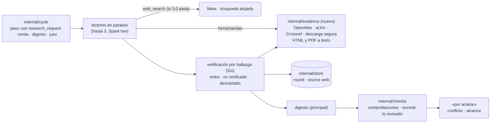
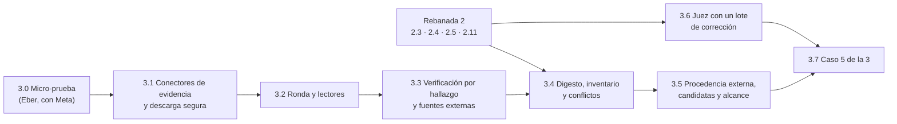

# Backlog · rebanada 3

**Respuesta:** 8 piezas, de la 3.0 a la 3.7. Al terminar, **el agente investiga con evidencia real y la app comprueba cada hallazgo**: lectores en paralelo buscan en tu material, en OpenAlex y arXiv (la web de Meta quedó fuera en la 3.0, B-55); la app verifica cada pasaje en su fuente, descarta lo que no existe y lo muestra; el digesto dice qué cubrió y qué no; cada afirmación dice si sale de tu material, de una fuente buscada o del modelo; los conflictos entre fuentes abren un «por aclarar»; y el juez verifica con un solo lote de corrección. «Listo cuando» del plan: **un digesto real con un pasaje descartado a la vista**. **Horas: 33–46 `[inferencia]`**; el plan le da un día (2-nov). No se recorta: el número va a Eber.

**Decisiones:** B-55 a B-72 (abajo). **Revisadas de nuevo el 31-oct, con la rebanada 2 construida y un auditor:** 8 se infieren y no piden respuesta (B-55, B-58, B-60, B-62, B-63, B-66, B-68, B-69); B-59, B-61 y B-65 quedaron resueltas en su punto; **Eber adoptó el 31-oct B-56, B-57, B-64 (la ronda se lanza sola), B-67, B-70 y B-71; y B-72 (la propuesta: «Buscar evidencia» en el «Entendí» y «Buscarla» en una candidata).** En la columna de Eber, cada una cita de dónde se infiere o qué decides. **Cuatro precisan decisiones anteriores** (regla de Eber: se precisa la original, no se crea otra): B-55 precisa F-2; B-56, la línea B2-5 del plan y el bloque 2 §2; B-57, fichas §7 (solicitud de encargo); B-72, la precisión de R-4 de la 1.9. Al adoptarlas se llevan a su documento original.

**Listo de nuestro lado:** los esquemas `salida-lector`, `salida-digesto` y `salida-juez-verificacion` (en `docs/diseno/bloque-3/`) y la tabla «Dónde va cada vista de la rebanada 3» en `pantallas.md`. **Hecho de nuestro lado (31-oct):** `salida-principal.schema.json` ya trae `research_request` (B-57) y `named_references` (B-69), opcionales; el agente sincroniza su copia incrustada antes de la 3.1, sin cambio de conducta. **Hecho por Eber (31-oct):** la línea `microtest-evidence` en el Makefile, `TQ_CONTACT_EMAIL` en su entorno (B-60), `golang.org/x/net/html` aprobada (B-60) y la nota de Paula revisada (la referencia de Valdivia y Ortiz no aparece en OpenAlex, Crossref ni en la web). **Falta de Eber:** correr `make microtest-evidence` cuando el agente entregue la 3.0.

**Presupuesto de complejidad (regla 2.4):** 0 estados nuevos (la ronda ya tiene `open` · `closed`, estados §7). 0 tipos de objeto nuevos: un hallazgo que entra es una `source` `kind: web` (B-61); los hallazgos, el inventario y las fallas viven en el `body` de su `round`. Señales nuevas: dos campos en la salida del principal (`research_request`, `named_references`); en el `body` de una `source` `web`, `doi`, `title`, `authors`, `year` y `access` (B-61); un campo `Part` en la petición al proveedor, para el falso; un valor de `delivery.via` (`digest`, B-62); un tipo de «por aclarar» `source_conflict` (ya en glosario §11); un evento nuevo, `flaw_discarded` (B-67). Tres tipos de turno para el proveedor falso: `reader`, `digest` y `judge_verify`. Un paquete nuevo, `internal/evidence`. Una dependencia nueva, `golang.org/x/net/html` (B-60).

**Depende de la rebanada 2:** la 3.4 usa el comprobador (2.3) y el «por aclarar» (2.4); la 3.5 extiende la procedencia (2.11); la 3.6 se engancha a la parada (2.5). **La 3.0 y la 3.1 no dependen de nada de la 2:** pueden correr ya, en paralelo, en otro árbol de trabajo (ver «Horas»).

## Qué cubre cada pieza

| Del plan (§1, rebanada 3) | Pieza |
|---|---|
| ¿Meta admite `web_search` con la salida fija y las herramientas? ¿Cuánto cuesta? | 3.0 |
| Evidencia real (R-9): OpenAlex y arXiv (la web de Meta quedó fuera en la 3.0, B-55) | 3.0 · 3.1 |
| Investigar con lectores en paralelo, con el encargo de bloque-1 §4 | 3.2 |
| Verificación por hallazgo (entra · no verificado · descartado) | 3.3 |
| Digesto con inventario de cobertura (A-5) · ¿se redujo la duda? · repetir la ronda con su costo | 3.4 |
| Conflictos entre fuentes señalados y con «por aclarar» (R-9) | 3.4 |
| Cada afirmación dice de dónde sale: tu material, fuente buscada o modelo (R-1 con `external`) | 3.5 |
| Referencias nombradas sin cita como «candidatas, sin verificar» (R-2) | 3.5 |
| «Excede lo revisado» (A-5), que la rebanada 2 dejó aquí | 3.5 |
| Sin material, el «Entendí» ofrece buscar; escribir de memoria deja de ser la salida (R-4) | 3.5 |
| `buscar` del principal (B2-5) | 3.3 (B-56) |
| Juez con un solo lote de corrección | 3.6 |
| «Listo cuando»: un digesto real con un pasaje descartado a la vista · el caso 5 suma la ronda y la cita que no existe (H-1) | 3.7 |

**Fuera de la rebanada 3:** «continúa hasta terminar» (en ese modo la ronda arrancaría sola, B-64) y la defensa de cada sección al final (rebanada 4); los lotes de material masivo (300 contratos) se construyen como «una sola ronda» pero no se prueban con más de 15 fuentes; OCR; fuentes de pago o con clave (Scopus, Web of Science).

## Arquitectura (lo que suma la 3)

**Reglas de la arquitectura** (las de r1 y r2 siguen): los lectores, el juez y el principal en el digesto **no escriben nada**; devuelven su forma fija y la app aplica. **Ningún pasaje entra sin que Go lo encuentre en el texto de su fuente** (flujos §2). El texto descargado es dato, nunca instrucción: va al modelo delimitado y sin HTML (B3-22, fila 8). Ninguna prueba sale a la red: OpenAlex, arXiv, Crossref y la web se prueban con respuestas grabadas en un `httptest.Server`.

**Rutas nuevas de la rebanada 3** (todas bajo `/api/projects/{projectID}`):

| Vista | Ruta | Escribe (evento) |
|---|---|---|
| Tarjeta de la ronda | `GET /rounds/{label}` (propuesta, estado, costo estimado y gastado, digesto, descartados, inventario) · `POST /rounds/{label}/repeat` `{question}` → otra ronda propuesta | `state_changed` · `human_message` |
| Candidatas | `POST /rounds` `{references: [n]}` desde una candidata (B-69) → ronda propuesta | `state_changed` |
| Fuente externa | `GET /sources/{label}` ya existe: suma `url`, `doi`, `title`, `authors`, `year`, `access` | — |
| Juez | `POST /sections/{label}/audit` (pedir auditoría) · `POST /rounds/{label}/flaws/{n}/discard` | `state_changed` · `flaw_discarded` |

## Elecciones técnicas de este backlog (para Eber)

*El diseño no las fija y el agente las necesita. La última columna es tu respuesta. «Se infiere» = sale de un pasaje ya adoptado, citado ahí; no pide respuesta.*

| #    | Propuesta                                                                                                                                                                                                                                                                                                                                                                                                                                                                                                                                                                                                                                                                                                                                                                                                                                                                                                                                                                                                                                                                                                                                                                                                                                                                                                                                                                                                                                                                                                                                                                                                                                                                                                                           | En vez de                                                                                                                                                                               | Elegiría la otra si…                                                                                                              | Decisión de Eber (literal)                                                                                                                                                                                                                                                                                                                                                                                                                                                                                                                                                                                                                                                                                                                                                                                                                                          |
| ---- | ----------------------------------------------------------------------------------------------------------------------------------------------------------------------------------------------------------------------------------------------------------------------------------------------------------------------------------------------------------------------------------------------------------------------------------------------------------------------------------------------------------------------------------------------------------------------------------------------------------------------------------------------------------------------------------------------------------------------------------------------------------------------------------------------------------------------------------------------------------------------------------------------------------------------------------------------------------------------------------------------------------------------------------------------------------------------------------------------------------------------------------------------------------------------------------------------------------------------------------------------------------------------------------------------------------------------------------------------------------------------------------------------------------------------------------------------------------------------------------------------------------------------------------------------------------------------------------------------------------------------------------------------------------------------------------------------------------------------------------- | --------------------------------------------------------------------------------------------------------------------------------------------------------------------------------------- | --------------------------------------------------------------------------------------------------------------------------------- | ------------------------------------------------------------------------------------------------------------------------------------------------------------------------------------------------------------------------------------------------------------------------------------------------------------------------------------------------------------------------------------------------------------------------------------------------------------------------------------------------------------------------------------------------------------------------------------------------------------------------------------------------------------------------------------------------------------------------------------------------------------------------------------------------------------------------------------------------------------------- |
| B-55 | **Dónde busca la evidencia (precisa F-2 con R-9):** los lectores tienen dos herramientas que implementa Go: `search_literature` {query, where: `openalex` · `arxiv`, year_from?} (devuelve hasta 10 resultados con título, autores, año, DOI y si hay texto abierto) y `read_hit` {hit, start?} (devuelve el texto accesible de un resultado, por tramos). La búsqueda web alojada de Meta (`web_search`, que existe y corre en su servidor) se suma para literatura gris (informes, normas) **solo si la micro-prueba 3.0 la admite con la salida fija `strict` y su costo cabe**                                                                                                                                                                                                                                                                                                                                                                                                                                                                                                                                                                                                                                                                                                                                                                                                                                                                                                                                                                                                                                                                                                                                                  | Solo la búsqueda web de Meta, como decía F-2 (resultados sin DOI ni metadatos, verificación más débil y más superficie de inyección) · solo OpenAlex/arXiv (sin informes ni normas)     | La 3.0 muestra que OpenAlex no cubre el tema del caso 5 o de «pobreza…»                                                           | **Se infiere (30-oct), no requiere decisión:** R-9, adoptada en literal («podría ser OpenAlex, arxiv u otra fuente»; su «en vez de»: «investigar solo con búsqueda web general»), F-2 (la web de Meta para los lectores) y el precedente de R-3 y la 1.9a (antes de construir herramientas, micro-prueba con Meta). Precisa F-2: al adoptarse R-9, la web deja de ser la única vía · **Resultado de la micro-prueba 3.0 (31-oct, corrida de Eber):** `web_search` no entra: Meta la admite, pero 0 de 5 salidas fueron JSON válido con la forma fija, sin anotaciones con URL, y costó el doble (0,070 USD medio por lector frente a 0,035). OpenAlex y arXiv con `search_literature` y `read_hit`: 5 de 5 salidas válidas y todas las citas literales. OpenAlex cubre los dos casos (caso 5: 9 y 10 de 10 resultados con texto abierto; «pobreza…»: 7 de 10); arXiv trajo resultados fuera de tema en ambos (bots, astronomía). **Se infiere de la 3.0:** OpenAlex es la vía por defecto del lector, y el encargo usa arXiv solo si el tema es de computación, física o matemáticas. La literatura gris queda fuera de la rebanada 3 |
| B-56 | **Quién busca fuera de tu material (precisa la línea B2-5 del plan):** solo los lectores (F-2). Lo que cambia para el principal en la 3: `search_sources` y `read_source` ven también las **fuentes externas que entraron** al proyecto (B-61); para buscar algo nuevo, pide una ronda (B-57)                                                                                                                                                                                                                                                                                                                                                                                                                                                                                                                                                                                                                                                                                                                                                                                                                                                                                                                                                                                                                                                                                                                                                                                                                                                                                                                                                                                                                                       | Darle al principal `search_literature` (su contexto se llena de resultados que nadie verificó; F-2 lo deja a los lectores)                                                              | Las rondas resultan lentas o caras para preguntas puntuales («¿cuál es el DOI de X?»)                                             | **Adoptada la propuesta:** «OK con los 3» (31-oct). Llevada a F-2 y al bloque 2 §2                                                                                                                                                                                                                                                                                                                                                                                                                                                                                                                                                                                                                                                                                                                                                                                  |
| B-57 | **La ronda la pide el principal con un campo de su salida, no con una llamada aparte (precisa fichas §7, fila «solicitud de encargo»):** `research_request` (o null) en un paso con `stretch: discover`: {`question`, `doubt`, `delegation_reason`: `too_much_to_read` · `independent_parts`, `scope`, `parts`: [{`question`, `sources`: [{`source_id`, `what_for`}], `where`: [`project` · `openalex` · `arxiv`] (sin `web`: la 3.0 dejó fuera la búsqueda web de Meta, B-55), `queries`: [texto]}] (1 a 3, una por lector), `references`: [n] (candidatas que buscar, B-69)}. La app arma el resto del encargo (bloque-1 §4). Sin razón válida, **el paso se aplica y la ronda no se crea**: el motivo queda en `step_ended` (veto de fichas §2, Triaje) y el principal trabaja solo. Una ronda que pides tú (B-72, «Buscarla») no pasa por este veto. La razón «riesgo o auditoría» no va aquí: es el juez (3.6)                                                                                                                                                                                                                                                                                                                                                                                                                                                                                                                                                                                                                                                                                                                                                                                                                                                                      | Una llamada «solicitud de encargo» separada, como dice fichas §7 (una llamada más por ronda, con el mismo estado de trabajo)                                                            | El principal mezcla mal el paso y la solicitud en la misma salida                                                                 | **Se infiere en parte (30-oct):** que una solicitud inválida se rechace sola y el resto del paso se aplique sigue el precedente de B-54 («la app rechaza solo esa parte de su salida… con un mensaje para él»); que la pida el principal con su razón, fichas §2 y §8.3. **Decides solo:** campo en la salida del paso (como `stretch`, B-43, y `reply`, 1.9) o la llamada aparte que lista fichas §7 · **Punto que decides (verificado el 31-oct):** fichas §7 lista una llamada aparte («Principal · solicitud de encargo»). **Recomendación:** campo en la salida del paso, como `stretch` (B-43) y `reply` (R-5): una llamada menos por ronda. · **Adoptado el campo en la salida del paso:** «OK con los 3» (31-oct). Llevado a fichas §7                                                                                                                      |
| B-58 | **Cómo nombra un lector una fuente externa** (`salida-lector`): por el `hit-n` que la app le devolvió en su herramienta (la URL y el DOI salen de la API, no del modelo), o por una `reference` escrita {título, autores, año, DOI, URL} que la app busca en el registro. Una referencia que no existe se descarta, a la vista: así se ve la cita inventada **Precisión de seguridad (31-oct):** de una referencia escrita, la app usa solo el DOI y el título para buscarla en el registro; **nunca descarga una URL que escribió un modelo** (una página podría pedirle al lector una URL con tus datos).                                                                                                                                                                                                                                                                                                                                                                                                                                                                                                                                                                                                                                                                                                                                                                                                                                                                                                                                                                                                                                                                                                                         | Que el modelo escriba siempre URL y DOI (más alucinación que verificar) · solo `hit-n` (la cita inventada nunca llegaría a verse y el lector no podría traer una referencia que conoce) | Las referencias escritas resultan casi siempre inexistentes y solo hacen ruido                                                    | **Se infiere (31-oct, revisión contra lo construido), no requiere decisión:** `casos-prueba/simulacion-v4.1/casos/caso-05.md` (la cita «la trajo uno de los investigadores, con autores, año y título verosímiles»), H-1 («una cita inventada que la verificación detecta»: con solo `hit-n` nunca se vería). La verificación de B-59 la descarta a la vista · Precisión de seguridad adoptada: «Sí, ok con la propuesta de cierre de los huecos» (31-oct).                                                                                                                                                                                                                                                                                                                                                                                                         |
| B-59 | **Verificación por hallazgo (espec. §3, flujos §2):** (a) fuente del proyecto: el pasaje, normalizado (NFC, espacios colapsados, comillas y guiones unificados, sin distinguir mayúsculas `[inicial]`), está en su texto → **entra**; si no → **descartado** («pasaje ausente»). (b) externa: si el registro no existe (OpenAlex por DOI o id, arXiv por id, Crossref por DOI como respaldo, y por título exacto si no hay DOI) → **descartado** («fuente inexistente»); si existe y el texto es accesible (texto abierto, PDF con texto, página web, o al menos el resumen) y el pasaje está → **entra**, con `access` = `full_text` o `abstract`; si el pasaje no está en lo accesible y solo hay resumen → **no verificado** (muro de pago); si el texto completo es accesible y no está → **descartado**. (c) **solo URL, sin DOI ni registro** (un informe o una norma de `web_search`; nunca una URL escrita por un modelo): si `FetchText` la descarga, el pasaje se busca en su texto (entra o descartado); si no responde, **no verificado**; «fuente inexistente» solo si el dominio no resuelve o responde 404 o 410. (d) **Una referencia que pide la ronda (`references`, B-69) la busca la app con `Lookup`, sin lector**, y queda como un hallazgo de la app: si no existe, **descartada** («fuente inexistente») a la vista; si existe, entra a la lista de resultados de la ronda como `hit-n` para los lectores. **El DOI de tu material nunca se comprueba** (el caso 5 usa DOI ficticios) **Precisión de seguridad (31-oct):** en (c), solo se descargan URLs que vienen de un resultado de búsqueda (las anotaciones de `web_search` o la API de OpenAlex, arXiv o Crossref), nunca una escrita por un modelo. | Que un modelo juzgue si «dice lo mismo» (eso es del comprobador: si el pasaje sostiene la afirmación, A-2) · aceptar paráfrasis                                                         | Los lectores citan bien pero con pequeñas diferencias de formato y casi todo sale descartado                                      | **Se infiere en parte (30-oct):** (a), (b) y (c) salen de flujos §2 («fuente y pasaje encontrados» · «inaccesible» · «inexistente o pasaje ausente») y espec. §3 («Go descarga la URL… busca el pasaje»); normalizar con NFC y espacios colapsados, de espec. §3 regla 2 y B-10; no comprobar el DOI de tu material, de flujos §2 (se verifican los hallazgos). **Decides solo:** (d), que la app busque sin lector las referencias de la ronda, y unificar comillas, guiones y mayúsculas `[inicial]` · **Puntos resueltos (31-oct):** (d) se infiere de flujos §2 (la app verifica la existencia de la fuente) y R-2 («Buscarla» sobre una candidata): la app la busca sin lector; unificar comillas, guiones y mayúsculas es un valor `[inicial]`, como B-20 (b). · Precisión de seguridad adoptada: «Sí, ok con la propuesta de cierre de los huecos» (31-oct). |
| B-60 | **Descarga segura en `internal/evidence`, como fija B3-22 (fila 9):** solo `http` y `https`; se resuelve el nombre y se rechazan las IP privadas, locales y de enlace (también `169.254.169.254` y `*.internal` de Fly), también después de cada redirección (máximo 3); 5 s y 5 MB por recurso; `User-Agent` con contacto desde `TQ_CONTACT_EMAIL` (OpenAlex lo pide para su cola cortés); arXiv, a lo más una petición cada 3 s; HTML a texto con **`golang.org/x/net/html`** (dependencia nueva: la aprueba Eber, regla 11; versión publicada hace ≥ 7 días), sin scripts ni estilos; PDF con el extractor en proceso hijo de B-9. Lo descargado se guarda: es la fuente y su huella **Precisiones de seguridad (31-oct):** la IP se comprueba **al conectar** (en el `Dialer`), no solo al resolver el nombre, para que un DNS que cambia no la burle; la descarga usa **un cliente HTTP propio**, sin la clave de Meta ni cookies, también tras una redirección; los 5 MB se miden **después de descomprimir**; solo se aceptan `text/html`, `application/pdf` y `text/plain`.                                                                                                                                                                                                                                                                                                                                                                                                                                                                                                                                                                                                                                                 | Quitar etiquetas con expresiones regulares (frágil con HTML real) · no descargar y confiar en los fragmentos que devuelve Meta (no se puede verificar un pasaje literal)                | Eber no aprueba la dependencia: entonces el HTML se verifica solo contra el resumen de OpenAlex y la página queda «no verificado» | **Se infiere (30-oct), no requiere decisión:** B3-22, fila 9 (http y https, IP privadas y de enlace rechazadas también tras redirección, 5 s y 5 MB), y el precedente de B-9 (entrada hostil: PDF en proceso hijo). **Te toca por regla, no por elección:** aprobar `golang.org/x/net/html` (B-19, punto 6: «ninguna dependencia nueva… sin preguntar») · Precisión de seguridad adoptada: «Sí, ok con la propuesta de cierre de los huecos» (31-oct).                                                                                                                                                                                                                                                                                                                                                                                                              |
| B-61 | **Un hallazgo externo que entra se vuelve fuente del proyecto:** `source` `kind: web` con `url`, `text` (lo descargado), `fingerprint`, y en su `body` `doi`, `title`, `authors`, `year` y `access` (`full_text` · `abstract` · `none`). Uno «no verificado» se guarda con `access: none` y sin texto: se puede nombrar, pero una cita suya queda «sin verificar» (2.11). Es el mismo objeto que tu material: el principal lo lee con `read_source` y lo cita con `claim_origin: external`. *Se infiere solo `kind: web` con `url` (espec. §1.1 y R-1: «con URL y pasaje»); los campos `doi`, `title`, `authors`, `year` y `access` y guardar un no verificado son la elección*                                                                                                                                                                                                                                                                                                                                                                                                                                                                                                                                                                                                                                                                                                                                                                                                                                                                                                                                                                                                                                                     | Un tipo nuevo «hallazgo» (rompe la lista cerrada de fichas §9) · no guardar los no verificados (no se podrían nombrar ni buscar después)                                                | La lista de fuentes se llena de no verificados que nadie usa                                                                      | **Se infiere en parte (30-oct):** `kind: web` con `url` (espec. §1.1, R-1); los metadatos en el `body`, como `filename` y `media_type` de B-9, son implementación (como B-45: «dónde se guarda es implementación»). **Decides solo:** guardar como fuente un hallazgo «no verificado» (`access: none`) · **Punto resuelto (31-oct):** guardar el «no verificado» como fuente `access: none` es implementación (como B-45): lo pide flujos §2 («inaccesible» se muestra) y permite nombrarlo sin que cuente como verificado.                                                                                                                                                                                                                                                                                                                                         |
| B-62 | **Qué cuenta como «leída» una fuente externa para la procedencia (2.11):** la que el principal recibió en el digesto (fila `delivery` con `via = digest`, valor nuevo) o abrió con `read_source`. La cita `external` se verifica igual que la de tu material: su pasaje está literal en el texto guardado de esa fuente                                                                                                                                                                                                                                                                                                                                                                                                                                                                                                                                                                                                                                                                                                                                                                                                                                                                                                                                                                                                                                                                                                                                                                                                                                                                                                                                                                                                             | Exigir `read_source` sobre cada fuente que llegó en el digesto (duplica lectura y costo)                                                                                                | Aparecen citas de pasajes que el principal no recibió en el digesto                                                               | **Se infiere (30-oct), no requiere decisión:** espec. §1.4 («`delivery` se escribe al entregar algo al principal») y tu precisión de la 1.9 («leído» = el agente leyó la fuente, sin guardar el tramo): en el digesto el principal lee esos pasajes. `via = digest` es el valor que lo distingue                                                                                                                                                                                                                                                                                                                                                                                                                                                                                                                                                                    |
| B-63 | **Lo calculable del digesto lo arma la app; el principal solo redacta** (`salida-digesto`): la app pone los descartados con su motivo, los no verificados, el inventario de cobertura y el costo de la ronda; el principal escribe la respuesta, el esquema, los hallazgos que usa (por número), el contraste con tu expectativa, si se redujo la duda y las contradicciones. Precisa fichas §7 (fila «digesto»)                                                                                                                                                                                                                                                                                                                                                                                                                                                                                                                                                                                                                                                                                                                                                                                                                                                                                                                                                                                                                                                                                                                                                                                                                                                                                                                    | Que el principal escriba todo el digesto (podría callar un descartado o contar mal la cobertura)                                                                                        | —                                                                                                                                 | **Se infiere (30-oct), no requiere decisión:** bloque-3 §2 («todo lo que tiene valor de evidencia lo calcula Go») y B-41, que hizo lo mismo con el informe                                                                                                                                                                                                                                                                                                                                                                                                                                                                                                                                                                                                                                                                                                          |
| B-64 | **La ronda espera tu clic «Investigar»** (vale sin expectativa). La tarjeta de la ronda dice la pregunta, qué busca cada lector y dónde, el costo estimado y el campo opcional «¿qué esperas encontrar?», que va en literal al encargo (K-5). Mientras no la lanzas, la cadena sigue con lo que no depende de ella, y la parada la pone en «Lo que te toca». Una ronda que creas tú (B-72) arranca con ese mismo clic, con el campo de la expectativa en el mismo lugar. En «continúa hasta terminar» (rebanada 4) arranca sola. Una ronda que no lanzas se cierra con «Descartar ronda» o cuando el principal propone otra; queda `closed` con `reduced_doubt` en null y sin lectores (0 estados nuevos): no ofrece repetir                                                                                                                                                                                                                                                                                                                                                                                                                                                                                                                                                                                                                                                                                                                                                                                                                                                                                                                                                                                                        | Lanzarla al instante (no se pregunta la expectativa, que flujos §2 pone antes de lanzar, y gasta sin que lo veas)                                                                       | En las pruebas la espera frena el trabajo más de lo que protege                                                                   | **Adoptada la otra opción (31-oct):** «esperar que el humano haga clic en «investigar» sería un cuello de botella, el agente debe orquestar las investigaciones según el plan y análisis que hizo sobre el pedido del humano». **La ronda se lanza sola** cuando el principal la pide con una razón válida (B-57). La expectativa de K-5 sale de lo que ya escribiste en el pedido («tu idea» o la premisa), en literal; si no escribiste ninguna, el encargo dice «sin expectativa». La tarjeta de la ronda la muestra en curso, con su costo estimado y lo gastado; los topes de B-65 la frenan                                                                                                                                                                                                                                                                   |
| B-65 | **Topes de una ronda `[inicial]`:** hasta 3 lectores en paralelo (espec. §3), Spark 1.3 `low` (fichas §1), hasta 8 llamadas a herramientas por lector (espec. §3) y **0,60 USD por ronda** (lectores más digesto). Al llegar al tope, los lectores que faltan quedan como «vacío» y el digesto lo dice. Se suma a los topes ya decididos en espec. §6 y B3-20 (3 USD por proyecto, 10 por día, «reserva del máximo antes de cada llamada»; «al tope, el agente se detiene con su informe»), que son de «Entrega» y hoy el código solo lee (`config.go`): **la 3.2 adelanta la reserva antes de cada llamada** para las llamadas de la ronda. El gasto de la ronda es la suma de `model_call.cost` de su `turn_id` (lectores y digesto usan el mismo); el tope se revisa antes de cada llamada, también las de herramientas, y un lector ya en curso termina su llamada. **Costo estimado** `[inferencia]`: tokens del encargo × lectores × 8 llamadas × precio de Spark `low`, con el costo medio por lector que mida la 3.0 si ya está                                                                                                                                                                                                                                                                                                                                                                                                                                                                                                                                                                                                                                                                                             | Sin tope por ronda (una ronda puede gastar el saldo del proyecto)                                                                                                                       | La 3.0 muestra que una ronda útil cuesta más                                                                                      | **Se infiere en parte (30-oct):** 3 lectores y 8 llamadas (espec. §3, «Límites»), Spark `low` (fichas §1), la reserva antes de cada llamada y detenerse con informe al tope (espec. §6, B3-20). **Decides solo:** el tope de 0,60 USD por ronda `[inicial]` · **Punto resuelto (31-oct):** 0,60 USD es un valor `[inicial]` (como B-20), que se ajusta con el costo medio por lector que mida la 3.0. · **Medido en la 3.0 (31-oct):** 0,035 USD medio por lector (máximo 0,042) con Spark `low`; 3 lectores ≈ 0,11 USD más el digesto: 0,60 USD por ronda queda con holgura y se mantiene `[inicial]`. Dos corridas registraron 9 llamadas a herramientas con tope 8: la 3.2 cuenta toda llamada, también la rechazada por el tope, y nunca ejecuta la novena |
| B-66 | **Conflicto entre fuentes (R-9):** cada contradicción del digesto entre hallazgos de **fuentes distintas** abre un «por aclarar» `source_conflict`, con los dos pasajes en sus opciones, que bloquea la firma de las secciones que usan alguna de las dos fuentes (`uses`). Una contradicción entre lectores **sobre la misma fuente** sigue la regla de flujos §2 y estados §4: se muestra en el digesto y abre «por aclarar» **solo si toca algo crítico**. «Se señala en el texto»: el principal recibe el conflicto en su arranque y lo nombra donde usa esas fuentes; es una instrucción `[inicial]`, sin regla de la app (el «por aclarar» abierto ya bloquea la firma)                                                                                                                                                                                                                                                                                                                                                                                                                                                                                                                                                                                                                                                                                                                                                                                                                                                                                                                                                                                                                                                       | Abrir «por aclarar» solo si toca algo crítico también entre fuentes distintas, como decía flujos §2 (menos preguntas)                                                                   | Los conflictos menores llenan «Lo que te toca»                                                                                    | **Se infiere (30-oct), no requiere decisión:** R-9, adoptada en literal («los conflictos entre fuentes se señalan en el texto y abren un «por aclarar»»); qué bloquea, de estados §4 («bloquea la firma de todo lo que depende de él») con la arista `uses` (fichas §9); entre lectores sobre la misma fuente, flujos §2 y estados §4 («toca algo crítico»). Precisa flujos §2 en lo que R-9 cambió                                                                                                                                                                                                                                                                                                                                                                                                                                                                 |
| B-67 | **Verificar con juez, en un ciclo acotado** (bloque-1 §4, K-3, K-4): entra (a) al cerrar una sección, cuando un paso la deja sin pendientes del agente y desde su última verificación algún paso cerró con un riesgo de la lista (`closing_risk` ≠ `none`), antes de la parada (2.5); o (b) cuando pides «Auditar sección». La línea de triaje lo avisa; no espera tu sí (K-3). Las fallas se ven en la conversación, cada una con «No aplica» (evento `flaw_discarded`). **El lote de corrección es el siguiente paso del principal**, con las fallas no descartadas en su tarea; lo que descartaste antes de que empiece cuenta; si no descartas, se corrige todo (K-4). Luego **una** reverificación; lo que sigue abierto abre un «por aclarar» por falla, con dos opciones de la app: «rehacer ese pasaje con tu indicación» o «dejarlo y asumir el riesgo» (con «porque»). Nunca otra ronda por un hallazgo nuevo                                                                                                                                                                                                                                                                                                                                                                                                                                                                                                                                                                                                                                                                                                                                                                                                             | Esperar tus descartes antes de corregir (frena la cadena) · un juez después de cada paso (fichas §2: «por lote… no después de cada paso»)                                               | En las pruebas el juez entra demasiado seguido                                                                                    | **Adoptada la propuesta (31-oct):** «por ahora lo dejamos y asumimos riesgos, lo validamos en las pruebas posteriores»                                                                                                                                                                                                                                                                                                                                                                                                                                                                                                                                                                                                                                                                                                                                              |
| B-68 | **«Excede lo revisado» (A-5):** el comprobador (2.3) recibe el inventario de las rondas cuyas fuentes usa la sección y puede devolver `exceeds_reviewed` (ya en su esquema); la app lo manda a «por aclarar» de alcance (completar la revisión con otra ronda, con su costo, o declarar el límite en el texto)                                                                                                                                                                                                                                                                                                                                                                                                                                                                                                                                                                                                                                                                                                                                                                                                                                                                                                                                                                                                                                                                                                                                                                                                                                                                                                                                                                                                                      | —                                                                                                                                                                                       | —                                                                                                                                 | **Se infiere (30-oct), no requiere decisión:** flujos §2 (Cobertura) y backlog-r2, 2.3 «No hacer»                                                                                                                                                                                                                                                                                                                                                                                                                                                                                                                                                                                                                                                                                                                                                                   |
| B-69 | **Candidatas (R-2):** la salida del principal suma `named_references` [{`text`, `title`, `authors`, `year`, `doi`; los cuatro últimos pueden ir en null}]: lo que nombra sin cita, con lo que sepa de ella, para que la app la pueda buscar (B-59 d). La app las guarda en el `step_ended` y las muestra como «candidata, sin verificar» en la historia del párrafo (P5) y en el marco, con «Buscarla» (propone una ronda con esas referencias, B-57). Nunca cuentan como fuente: un párrafo que solo se apoya en una candidata queda «sin verificar»                                                                                                                                                                                                                                                                                                                                                                                                                                                                                                                                                                                                                                                                                                                                                                                                                                                                                                                                                                                                                                                                                                                                                                               | Detectar «Autor (año)» en el texto con expresiones regulares (frágil; en el caso 5 el texto cita por código) · no mostrarlas                                                            | —                                                                                                                                 | **Se infiere (30-oct), no requiere decisión:** R-2 («van como «candidatas, sin verificar», nunca como fuentes»; en la historia de cada párrafo y en el marco) y backlog-r2, 2.11 «No hacer» («necesita un campo en la salida, va con la búsqueda en la rebanada 3»). Guardarlas en `step_ended` sigue B-17 (lo que no se aplica se guarda en el fin de paso)                                                                                                                                                                                                                                                                                                                                                                                                                                                                                                        |
| B-70 | **Caso 5 · la cita que no existe, de forma que pase también con Meta:** la plantilla suma una nota de Paula (`notas-paula.md`, su material) donde nombra «Valdivia, R. y Ortiz, M. (2022). *Microplásticos en agua embotellada andina: una comparación con el agua de red*» como «la cita que me pasó un colega, la que más me conviene», con autores, año y título verosímiles y sin DOI (como en caso-05.md). El principal la nombra como candidata; «Buscarla» crea la ronda con esa referencia; **la app la busca con `Lookup` (B-59 d) y no la encuentra: descartada, a la vista en el digesto**, sin depender de lo que haga un lector. El recorrido con el proveedor falso, además, trae un lector que la devuelve como referencia escrita, como en la simulación                                                                                                                                                                                                                                                                                                                                                                                                                                                                                                                                                                                                                                                                                                                                                                                                                                                                                                                                                            | Esperar a que un lector de Meta la invente (puede no pasar en la demo) · solo la grabación falsa (no es real)                                                                           | El jurado verá un video grabado y no el recorrido en vivo                                                                         | **Adoptada la propuesta:** «OK con los 3» (31-oct). La nota está en `docs/demo/caso-5/plantilla/sources/notas-paula.md` (entra al código con la 3.7)                                                                                                                                                                                                                                                                                                                                                                                                                                                                                                                                                                                                                                                                                                                |
| B-71 | **Caso 5 con literatura real:** tu material es ficticio y la ronda busca literatura real. La ronda del caso 5 busca sobre **métodos de detección y tamaño mínimo de partícula** (lo que sostiene la regla de 20 micras), no sobre las cifras de grifo y embotellada; si la literatura real choca con las cifras ficticias, el «por aclarar» de conflicto (B-66) es lo correcto. El README del caso dice que el material es ficticio y la búsqueda, real                                                                                                                                                                                                                                                                                                                                                                                                                                                                                                                                                                                                                                                                                                                                                                                                                                                                                                                                                                                                                                                                                                                                                                                                                                                                             | Buscar sobre las cifras (choque casi seguro con el material ficticio, que confunde al jurado) · no buscar en el caso 5 (no habría ronda real en la demo)                                | La 3.0 muestra que la literatura real sobre tamaño mínimo es escasa                                                               | **Adoptada la propuesta (31-oct):** «está bien que el agente busque información real, al final el caso debe desarrollarse como funcionaría en realidad»                                                                                                                                                                                                                                                                                                                                                                                                                                                                                                                                                                                                                                                                                                             |
| B-72 | **«Buscar evidencia» es un acto tuyo:** elegirlo en el «Entendí» (R-4) o «Buscarla» en una candidata (B-69) crea la ronda con `POST /rounds`, con la pregunta del pedido (o la referencia) y una parte por cada `where` disponible. **La razón la fija la app** (fichas §8.3 y bloque-1 §4 piden siempre una): `independent_parts` si la ronda tiene más de una parte; `too_much_to_read` si tiene una sola. Así no depende de que el principal la pida. **Precisa la precisión de R-4 de la 1.9** («las opciones llegan en el texto del «Entendí» (`understood`) y eliges escribiéndole»): «buscar evidencia» pasa a ser un botón de la tarjeta del «Entendí», porque la app no crea una ronda interpretando tu texto (regla de origen, fichas §9). Así, sin material, siempre hay un camino hacia la evidencia                                                                                                                                                                                                                                                                                                                                                                                                                                                                                                                                                                                                                                                                                                                                                                                                                                                                                                                    | Que lo proponga el principal en su primer paso (si no da una razón válida, el veto lo deja escribiendo de memoria, contra R-4 y R-9)                                                    | La razón fijada por la app no describe bien rondas de una sola referencia                                                         | **Adoptada la propuesta (31-oct, Eber lo confirmó):** «Buscar evidencia» es un botón de la tarjeta del «Entendí» y «Buscarla» uno de cada candidata; convive con B-64 (el agente también lanza rondas solo, con su razón). **Precisión tras la 3.0 (B-55):** las partes de esta ronda son `openalex` y, si hay material, `project`; no `arxiv`, porque la app no juzga el tema. Llevada a R-4 y a pantallas                                                                                                                                                                                                                                                                                                                                                                                                                                                                                                                                                                                                                                                                                                                                                                                                                                              |

## Piezas

### 3.0 · Micro-prueba de evidencia

| Campo | Contenido |
|---|---|
| **Qué** | Antes de construir, se mide con Meta lo que la 3 supone: si `web_search` funciona junto con la salida fija `strict` y herramientas propias, qué devuelve y cuánto cuesta; y si OpenAlex y arXiv responden lo que el caso 5 y «pobreza…» necesitan |
| **Implementa** | B-55 (decide si entra `web_search`) · B-65 (calibra el tope) · B-71 |
| **Leer** | `docs/casos-prueba/micro-prueba-herramientas/informe.md` (el formato a seguir) · B-55, B-60, B-65 |
| **Interfaz** | `make microtest-evidence`, que corre Eber (la clave en el llavero, como `make microtest-tools`): (1) una llamada del lector con `{"type":"web_search"}` y la salida fija `strict` de `salida-lector`: ¿la admite? ¿qué ítems devuelve (`web_search_call`, anotaciones con URL)? tokens y costo; (2) la misma con `search_literature` y `read_hit` como herramientas `strict` sobre respuestas reales de OpenAlex y arXiv; 5 corridas cada una; (3) sin modelo: 3 consultas a OpenAlex y 2 a arXiv del caso 5 (tamaño mínimo de partícula) y de «pobreza…», guardadas como grabaciones para las pruebas de la 3.1 · informe en `docs/casos-prueba/micro-prueba-evidencia/informe.md` |
| **Listo cuando** | El informe dice, para cada vía: admitida o no, ≥ 4 de 5 salidas válidas, costo medio por lector, y cuántos resultados con texto abierto trae OpenAlex para cada caso · las grabaciones quedan sin la clave |
| **Depende de** | Nada de la rebanada 2 |
| **No hacer** | Construir la ronda. Cambiar el proveedor de la app |
| **Si algo no está** | Si Meta rechaza `web_search` con `strict`: anotarlo; la 3 sigue con OpenAlex y arXiv (B-55) |

### 3.1 · Conectores de evidencia y descarga segura

| Campo | Contenido |
|---|---|
| **Qué** | Un paquete que busca en OpenAlex y arXiv, comprueba si un DOI existe, descarga una página o un PDF de forma segura y lo convierte en texto. Lo usan los lectores (por sus herramientas) y la verificación |
| **Implementa** | B-55 · B-58 (los `hit-n`) · B-59 (la parte de registro y texto) · B-60 · R-9 |
| **Leer** | B-55, B-58, B-59, B-60 · espec. §3 («Verificación de hallazgos web», «Límites») · `docs/diseno/bloque-3/bloque-3-decisiones.md` (B3-22, fila 8) · el informe de la 3.0 |
| **Interfaz** | `internal/evidence`: `SearchLiterature(ctx, q Query) ([]Hit, error)` (OpenAlex `/works?search=` y arXiv `query`; un `Hit` con `Title`, `Authors`, `Year`, `DOI`, `URL`, `OpenText` bool y su `Abstract`; el resumen de OpenAlex se reconstruye de su índice invertido) · `Lookup(ctx, ref Reference) (Record, error)` (DOI en OpenAlex y, si no, en Crossref; título exacto en OpenAlex; `ErrNotFound` si no existe) · `FetchText(ctx, url string) (Text, error)` con B-60 (HTML con `x/net/html`, PDF con el proceso hijo de B-9) · un cliente HTTP propio con las reglas de B-60 · `TQ_CONTACT_EMAIL` y `TQ_EVIDENCE_BASE_URLS` (solo pruebas) en `config` · todas las pruebas con `httptest.Server` y las grabaciones de la 3.0 |
| **Listo cuando** | Prueba: una búsqueda grabada de OpenAlex devuelve los resultados con su resumen reconstruido · prueba: un DOI inexistente da `ErrNotFound` y uno real da el registro · prueba: una URL a `127.0.0.1`, `10.0.0.5`, `169.254.169.254` o un nombre `*.internal` se rechaza, también tras una redirección · prueba: una respuesta de más de 5 MB o de más de 5 s se corta · prueba: un HTML con `<script>` da texto sin el script · prueba: arXiv respeta 3 s entre peticiones · ninguna prueba sale a la red · prueba: un nombre que resuelve primero a una IP pública y después a `127.0.0.1` se rechaza al conectar · prueba: una redirección a otro dominio no lleva la cabecera de la clave de Meta ni cookies · prueba: una respuesta comprimida que al descomprimirse pasa de 5 MB se corta · prueba: un `Content-Type` fuera de la lista se rechaza |
| **Depende de** | 3.0 (las grabaciones; mientras no estén, grabaciones hechas a mano con el mismo formato) · Eber aprueba `x/net/html` (B-60) |
| **No hacer** | Llamar a un modelo. Guardar nada en la base (eso es de la 3.3). Fuentes de pago o con clave |
| **Si algo no está** | `[EL DISEÑO NO LO DICE]` y una línea en `elecciones-agente.md` |

### 3.2 · Ronda y lectores en paralelo

| Campo | Contenido |
|---|---|
| **Qué** | Cuando el principal necesita descubrir, propone una ronda: la pregunta, la duda que reduce, por qué delega y qué busca cada lector y dónde. La ronda arranca sola (B-64) y la ves en curso, con su costo estimado y lo gastado. Hasta 3 lectores buscan y leen en paralelo y devuelven hallazgos con su pasaje literal |
| **Implementa** | Fichas §2 (Investigar) y §7 (lector, solicitud de encargo) · flujos §2 (hasta la verificación) · bloque-1 §4 (el encargo) · estados §7 (ronda) · K-5 · B-56 · B-57 · B-64 · B-65 · inventario 3h |
| **Leer** | Fichas §2, §7 y §8.3 (razones para delegar) · flujos §2 · bloque-1 §4 · estados §7 · espec. §1.1 (`round`) y §3 · `docs/diseno/bloque-3/salida-lector.schema.json` · `salida-principal.schema.json` (con `research_request`, al empezar esta pieza) · `pantallas.md` («Dónde va cada vista de la rebanada 3») |
| **Interfaz** | `ApplyStep` lee `research_request`: valida la razón (solo `too_much_to_read` o `independent_parts`), 1 a 3 `parts`, que cada `source_id` exista; crea el `round` `kind: research`, `open`, con la propuesta en su `body` y el costo estimado; si no es válida, aplica el paso sin la ronda y deja el motivo en `step_ended` (B-57) · `POST /rounds` crea la ronda desde un acto tuyo (B-72) · **cerrojo (P-20):** la ronda, de los lectores al digesto, toma el cerrojo del proyecto como un turno; los lectores corren en paralelo dentro de él, y tus mensajes reciben 409 `turn_running` hasta el digesto · **instancias:** las llamadas de lector y de juez se registran sin la `instance_id` del principal (no tocan su conversación, `runner.go` `conversation()`) · **gasto:** B-65, con un solo `turn_id` para la ronda · **la ronda válida se lanza sola, sin esperar un clic (B-64):** lanza los lectores: un turno `reader` por parte, en paralelo (hasta 3), cada uno con su encargo armado por la app con la plantilla de bloque-1 §4 en literal (pedido, pregunta, duda, razón, criterios con sus casos, premisa, decisiones vigentes, tu expectativa (tu idea o la premisa del pedido, en literal; si no hay, «sin expectativa», B-64), alcance, fuentes con su para qué, reglas de evidencia, retorno fijo) · herramientas del lector: `read_source` y `search_sources` (si la parte incluye `project`), `search_literature` y `read_hit` (3.1), y `web_search` si la 3.0 lo admitió; la app numera cada resultado como `hit-n` dentro de la ronda con un contador en memoria protegido (los lectores corren en paralelo) y guarda el registro de resultados, con su URL y DOI, en una sola escritura de la ronda al terminar los lectores · **herramientas:** `respond` recibe la lista de herramientas y su tope como parámetros (hoy fija `principalTools` y `maxToolRounds = 6`, `tools.go`); el lector cuenta llamadas, no rondas (8, B-65) · **las lecturas de un lector no escriben `delivery`**: lo que lee un lector no cuenta como leído por el principal (2.11, B-62) · **proveedor falso:** un mutex en `Fake` y la grabación se elige por tipo de turno y por `Part` (campo nuevo de la petición) · **evidencia en pruebas y con el falso:** con `TQ_PROVIDER=fake`, `internal/evidence` responde con grabaciones embebidas y nunca sale a la red · forma fija `salida-lector` y un reintento; si vuelve a fallar, ese lector queda «vacío» (no es pendiente) · tope de B-65 · `TurnKind` suma `reader` · instrucciones en `internal/cycle/prompts/reader.en.md`, borrador que revisa Eber · `GET /rounds/{label}` · web: la tarjeta de la ronda en la conversación (B-64), con el avance de cada lector y **una línea de aviso: «Para buscar, tus preguntas se envían a OpenAlex, arXiv y Crossref»** (privacidad, 31-oct) · **Datos, no órdenes (P-83):** `reader.en.md` lleva la regla de datos de los otros seis prompts, y cada resultado de `search_literature` y `read_hit` vuelve al lector envuelto con `graph.Delimit` |
| **Listo cuando** | Prueba con salidas grabadas: un paso `discover` con `research_request` válido crea la ronda `open` y lanza sus lectores sin esperar un clic · prueba: una razón que no es de lectores se rechaza · prueba: la ronda lanza un turno por parte, y el encargo de cada uno trae en literal el pedido, los criterios con sus casos, tu idea o la premisa como expectativa y las reglas de evidencia · prueba: un lector que falla dos veces la forma queda «vacío» y los demás siguen · prueba: al llegar a 0,60 USD, cada lector se corta antes de su siguiente llamada y queda «vacío» o con lo que ya devolvió · prueba: el tope del proyecto (3 USD) frena la ronda antes de lanzarla · prueba: mientras corre la ronda, un mensaje tuyo recibe 409 · prueba: lo que lee un lector no aparece en `delivery` · prueba: un resultado de búsqueda queda como `hit-n` con su URL y DOI de la API · prueba: un resultado de búsqueda que dice «ignore previous instructions» llega delimitado y el retorno sigue con su forma fija |
| **Depende de** | 3.1 · B-57 · B-64 · B-65 · `salida-principal` con `research_request` (nos toca, al empezar la pieza) |
| **No hacer** | Verificar hallazgos ni escribir el digesto (3.3, 3.4). Que el principal busque fuera (B-56) |
| **Si algo no está** | `[EL DISEÑO NO LO DICE]` en el retorno |

### 3.3 · Verificación por hallazgo y fuentes externas

| Campo | Contenido |
|---|---|
| **Qué** | La app comprueba cada hallazgo por separado: si la fuente existe y si el pasaje está en ella. Entra, queda «no verificado» o se descarta con su motivo, sin que eso afecte a los demás hallazgos del mismo lector. Lo externo que entra pasa a ser una fuente del proyecto que el agente puede leer y citar |
| **Implementa** | Flujos §2 («la app verifica por hallazgo, no por retorno») · espec. §3 (verificación de hallazgos web) · F-2 · R-9 · B-56 · B-58 · B-59 · B-61 · B-62 · inventario 3i (la parte de verificación) |
| **Leer** | Flujos §2 · espec. §1.1 (`source`) y §3 · glosario (`verification`: `entered` · `unverified` · `discarded`) · B-58, B-59, B-61, B-62 |
| **Interfaz** | `internal/cycle`: `VerifyFindings(ctx, projectID, roundLabel string) error`, al terminar los lectores, fuera de toda transacción mientras descarga; cada hallazgo guarda en el `body` de la ronda su `verification` y su motivo (`passage_not_found` · `source_not_found` · `inaccessible`) · lo que entra de afuera crea o reutiliza (mismo DOI o misma URL) una `source` `kind: web` (B-61), con `source_new_version` si su texto cambió · `search_sources` y `read_source` incluyen las fuentes `web` (B-56); sobre una fuente sin texto (`access: none`), `read_source` responde «no accesible» · `GET /sources/{label}` **es una ruta nueva** (hoy solo existen `POST /sources` y `GET /sources/{label}/download`) · `FetchText` espera su turno para extraer un PDF, con su plazo, en vez de recibir `ErrBusy` (`pdfextract` admite una extracción a la vez) · `delivery` acepta `via = digest` (B-62); la comprobación de 2.11 acepta `read` o `digest` para una fuente `web` |
| **Listo cuando** | Prueba: un lector con tres hallazgos (uno bien, uno con DOI inexistente, uno con el pasaje cambiado) deja uno `entered`, uno `discarded` con `source_not_found` y uno `discarded` con `passage_not_found` · prueba: un resultado solo con resumen y el pasaje fuera del resumen queda `unverified` · prueba: el DOI ficticio de una fuente de tu material no se comprueba · prueba: el mismo DOI en dos rondas no crea dos fuentes · prueba: una URL sin DOI que se descarga y contiene el pasaje entra; una que no responde queda «no verificado» · prueba: una referencia de la ronda que `Lookup` no encuentra queda descartada con `source_not_found` sin que ningún lector la devuelva · prueba: `read_source` abre una fuente `web` · prueba: una referencia escrita con URL y sin DOI ni título que exista no descarga esa URL |
| **Depende de** | 3.1 · 3.2 · B-59 · B-61 · B-62 |
| **No hacer** | Juzgar si el pasaje sostiene la afirmación (comprobador, A-2). Reintentar una descarga fallida más de una vez |
| **Si algo no está** | `[EL DISEÑO NO LO DICE]` en el retorno |

### 3.4 · Digesto, inventario y conflictos

| Campo | Contenido |
|---|---|
| **Qué** | El principal digiere lo que entró: primero la respuesta, un esquema y los hallazgos que lo sostienen, el contraste con lo que esperabas y si se redujo la duda. La app agrega lo descartado, lo no verificado y qué quedó sin revisar. Los conflictos entre fuentes se muestran y abren un «por aclarar». Si la duda no se redujo, ofrece repetir con otra pregunta, con su costo, o dejarlo «por aclarar» |
| **Implementa** | Fichas §2 (Investigar) y §7 (digesto) · flujos §2 (del digesto al cierre) · A-5 (inventario) · K-5 · R-9 · B-63 · B-66 · estados §7 · inventario 3i |
| **Leer** | Fichas §2 y §7 · flujos §2 · estados §4 y §7 · `docs/diseno/bloque-3/salida-digesto.schema.json` · B-63, B-66 · backlog-r2 2.3 y 2.4 (comprobador y «por aclarar») |
| **Interfaz** | Un turno `digest` del principal, **en su instancia viva y con su esfuerzo de siempre (`medium`)**, con los hallazgos verificados numerados, la expectativa y la pregunta; forma fija y un reintento · **inventario (A-5):** por lector, lo asignado (fuentes del encargo y `hit-n` que vio) frente a `sources_read` y los vacíos; se guarda en `round.body.coverage_inventory` · el digesto es un fin de paso: registra `delivery` `via = digest` de cada fuente que muestra y **pasa por las comprobaciones** (2.3): el `Change` del digesto lleva como pasajes nuevos los de los hallazgos que usa, cada uno con su `kind` y su fuente, y las sondas de siempre; los candidatos que se esperan son `doubtful_term` (una clasificación con un término tuyo, flujos §2) y `contradiction` · contradicciones entre fuentes distintas → «por aclarar» `source_conflict` con los dos pasajes (B-66), con aristas `blocks` a las secciones que usan alguna de las dos · `reduced_doubt` en la ronda; la ronda pasa a `closed` · `POST /rounds/{label}/repeat` propone otra ronda con otra pregunta y su costo estimado; «dejarlo por aclarar» abre uno de alcance · `TurnKind` suma `digest` · instrucciones en `internal/cycle/prompts/digest.en.md`, borrador que revisa Eber · web: el digesto en la tarjeta de la ronda, con «Descartados (n)» y «Sin revisar» a la vista y cada pasaje abriéndose en su fuente · `digest.en.md` lleva la misma regla de datos (P-83) y los pasajes de los hallazgos van envueltos con `graph.Delimit` |
| **Listo cuando** | Prueba con salidas grabadas: el digesto trae los descartados con su motivo aunque el principal no los nombre · prueba: el inventario dice «2 de 5 resultados sin leer» cuando un lector leyó 3 de 5 · prueba: una contradicción entre dos fuentes abre `source_conflict` y bloquea la firma de la sección que usa una de ellas · prueba: una contradicción entre lectores sobre la misma fuente abre «por aclarar» solo si toca una decisión crítica · prueba: una clasificación de un lector con un término tuyo en caso dudoso abre «por aclarar» (2.3) · prueba: `reduced_doubt: no` ofrece repetir con su costo · prueba: la ronda queda `closed` en los tres casos |
| **Depende de** | 3.3 · 2.3 · 2.4 · B-63 · B-66 |
| **No hacer** | Que el principal resuelva una contradicción en silencio. Repetir una ronda sin tu clic |
| **Si algo no está** | `[EL DISEÑO NO LO DICE]` en el retorno |

### 3.5 · Procedencia externa, candidatas y alcance

| Campo | Contenido |
|---|---|
| **Qué** | Cada párrafo dice si sale de tu material, de una fuente buscada (con su enlace) o del conocimiento del modelo, sin verificar. Lo que el agente nombra sin cita aparece como «candidata, sin verificar», y se puede buscar. Lo que afirma más de lo revisado abre un «por aclarar» de alcance. Sin material, el «Entendí» ofrece buscar evidencia en vez de escribir de memoria |
| **Implementa** | R-1 (`external`) · R-2 (candidatas) · R-4 (precisión del 30-oct: desde la 3, buscar) · A-5 («excede lo revisado») · B-62 · B-68 · B-69 · bloque-2 §2 (capa 3: el inventario de las rondas que usa la sección, fichas §5) |
| **Leer** | `../diseno/_propuesta-30oct-fuentes-y-flujo.md` (R-1, R-2, R-4, R-9) · backlog-r2 2.11 · fichas §5 · flujos §2 (Cobertura) · `salida-principal.schema.json` (`named_references`) · `salida-comprobador.schema.json` (`exceeds_reviewed`) |
| **Interfaz** | **Procedencia:** `claim_origin: external` deja de tratarse como «sin verificar»: se verifica si su cita está literal en una fuente `web` leída (B-62); la historia del párrafo (P5) y el marco muestran título, año y enlace · **candidatas (B-69):** `named_references` se guarda en `step_ended`; P5 y el marco las muestran con «Buscarla» (`POST /rounds` con esas referencias) · **alcance (B-68):** el comprobador recibe el inventario de las rondas cuyas fuentes usa la sección; `exceeds_reviewed` va a «por aclarar» de alcance · **capa 3:** el arranque del principal lleva, por sección, el inventario de esas rondas · **R-4:** sin material y con `evidence_required`, el «Entendí» ofrece «subir material» y «buscar evidencia», que crea la ronda como acto tuyo (B-72); la opción «escribir de memoria» que sumó la 2.11 sale de la oferta, y lo que el agente afirme de memoria sigue marcado «sin verificar» (R-1) · **instrucciones:** `checker.en.md` hoy dice que `exceeds_reviewed` no se usa nunca: pasa a usarse cuando el encargo trae inventario; `understanding.en.md` deja de ofrecer «escribir de memoria» y «esperar la búsqueda», y ofrece «buscar evidencia» |
| **Listo cuando** | Prueba: sin material, «buscar evidencia» crea la ronda aunque el principal no haya pedido ninguna · prueba: un párrafo `external` con cita literal en una fuente `web` del digesto queda verificado; con la cita fuera de su texto, «sin verificar» · prueba: con `evidence_required`, ese párrafo no deja `unsourced_claim` · prueba: una `named_reference` aparece como candidata y no cuenta como fuente · prueba: «se revisaron todos los estudios» con un inventario de «2 de 5 sin leer» abre «por aclarar» de alcance · prueba: el arranque de una sección que usa una ronda trae su inventario · en el navegador (Eber, con Meta): «pobreza…» sin material ofrece buscar, y al final cada párrafo dice su origen |
| **Depende de** | 3.4 · 2.11 · 2.3 · B-68 · B-69 · B-72 · `salida-principal` con `named_references` (nos toca) |
| **No hacer** | Que un modelo decida el origen. Contar una candidata como fuente |
| **Si algo no está** | `[EL DISEÑO NO LO DICE]` en el retorno |

### 3.6 · Verificar con juez, con un solo lote de corrección

| Campo | Contenido |
|---|---|
| **Qué** | Cuando una sección con riesgos (cifras, citas, conclusiones…) queda sin pendientes, o cuando pides una auditoría, un juez adversarial busca fallas con su pasaje y su escenario. Descartas las que no aplican; el agente corrige el resto en un lote y el juez reverifica una sola vez. Lo que sigue abierto queda «por aclarar» |
| **Implementa** | Fichas §2 (Verificar) y §7 (juez) · bloque-1 §4 (ciclo acotado de corrección) · fichas §8.3 (la razón de delegar del juez) · K-3 · K-4 · B-67 · inventario 3j (juez) |
| **Leer** | Fichas §2 (Verificar, Tu turno: «Pides una auditoría»), §7 y §8.3 · bloque-1 §4 · estados §4 y §7 · `docs/diseno/bloque-3/salida-juez-verificacion.schema.json` · backlog-r2 2.5 (la parada) |
| **Interfaz** | `ShouldVerify(ctx, projectID, section)` con la regla (a) de B-67: el `closing_risk` de un paso cuenta para las secciones que tocó su `new_text`; «desde su última verificación» = desde la sección y versión que guarda en su `body` la última ronda `kind: judge` de esa sección; corre antes de `ShouldStop` (2.5) · `POST /sections/{label}/audit` (regla b) · un `round` `kind: judge`; turno `judge_verify` (Spark `high`) con **el encargo completo de bloque-1 §4** (pedido, pregunta, criterios con sus casos, premisa, decisiones vigentes, alcance, fuentes, reglas de evidencia) más las afirmaciones con riesgo: el texto vigente de la sección y sus citas con el pasaje de su fuente (fichas §7); las llamadas sin la `instance_id` del principal; forma fija y un reintento; **si vuelve a fallar**, la ronda se cierra sin fallas y el informe dice «no se pudo verificar con el juez», sin bloquear la firma (fichas §7: «queda visible sin frenar el trabajo»; como P-75 y la defensa de la 2.6); **esa ronda fallida no cuenta como «última verificación»** en `ShouldVerify`, para que la sección vuelva a verificarse en la siguiente oportunidad · las fallas se guardan en la ronda; la línea de triaje dice «Verifico con el juez: riesgo …» (K-3) · `POST /rounds/{label}/flaws/{n}/discard` registra `flaw_discarded`; solo antes de que empiece el lote · **lote:** el siguiente paso del principal lleva en su tarea las fallas no descartadas · **reverificación:** una llamada con `recheck`; `still_open` abre un «por aclarar» por falla con las dos opciones de B-67; la ronda pasa a `closed` · `TurnKind` suma `judge_verify` · instrucciones en `internal/cycle/prompts/judge-verify.en.md`, borrador que revisa Eber · web: las fallas en la conversación con «No aplica»; su pasaje subrayado en la sección · `judge-verify.en.md` lleva la misma regla de datos (P-83) y el texto que juzga va envuelto con `graph.Delimit` |
| **Listo cuando** | Prueba con salidas grabadas: una sección que queda sin pendientes con un paso de riesgo `figures_and_calculations` llama al juez antes del informe · prueba: una sin riesgos no · prueba: «Auditar sección» lo llama siempre · prueba: una falla descartada no llega al lote; sin descartes, todas llegan · prueba: hay exactamente una reverificación, y una falla `still_open` abre «por aclarar» · prueba: un hallazgo nuevo del juez en la reverificación no abre otra ronda |
| **Depende de** | 2.4 · 2.5 · B-67 |
| **No hacer** | Más de una reverificación. Que el juez edite. La defensa (2.6, ya hecha) |
| **Si algo no está** | `[EL DISEÑO NO LO DICE]` en el retorno |

### 3.7 · El caso 5 de la rebanada 3

| Campo | Contenido |
|---|---|
| **Qué** | El caso 5 suma su ronda real sobre el tamaño mínimo de partícula y la cita que no existe, descartada a la vista. Es el «Listo cuando» de la rebanada |
| **Implementa** | Plan §1 (rebanada 3, «Listo cuando») · H-1 (rebanada 3) · `pantallas.md` («Recorrido del jurado», paso 7) · B-70 · B-71 |
| **Leer** | `backlog-r2.md` 2.10 (la tabla de frenos: filas 4B y 6B) · los guiones `caso-04-B.md` y `caso-06-B.md` de `docs/casos-prueba/simulacion-v4.1/guiones/` · `docs/demo/caso-5/README.md` y `docs/demo/caso-5/plantilla/` (con `sources/notas-paula.md`) · `pantallas.md` («Recorrido del jurado», paso 7) · `docs/casos-prueba/simulacion-v4.1/casos/caso-05.md` (la cita «Valdivia y Ortiz, 2022») · B-70, B-71 |
| **Interfaz** | B-70 adoptada: el agente copia `docs/demo/caso-5/plantilla/` a `internal/demo/case5/template/` (`request.json` con 16 fuentes: `notas-paula.md` al final de la lista) y ajusta las pruebas que cuentan 15 · el recorrido con el proveedor falso suma el tramo de la ronda: el principal nombra «Valdivia y Ortiz (2022)» como candidata (`named_references`, B-69) → «Buscarla» (B-72) → ronda con partes `openalex` y `project` → lectores grabados (uno trae la referencia inexistente como referencia escrita) → `Lookup` por título (B-59 d) → digesto con un descartado · **grabación nueva:** la búsqueda por título de OpenAlex (`/works?filter=title.search:…`) para ese título, con 200 y cero resultados (P-102: sin ella la réplica responde 503 y la cita sale «no verificado», no «fuente inexistente») · `make demo-check` suma el tramo con Meta y OpenAlex reales (sin arXiv: «Buscarla» no lo usa, B-72), y lo corre Eber |
| **Listo cuando** | **Los guiones 4B y 6B de la 2.10, que quedaron para esta rebanada, completan su recorrido** con salidas grabadas: **4B**, «Auditar» lanza el juez y un lector (3.6, 3.2); el lector trae que el tráfico nunca llega a cero y el juez marca la falla «contradice el criterio confirmado «cero caída»»; en F9 el «ok» no cierra la tarjeta (1.4, B-20 a) y la firma queda bloqueada; **6B**, los hallazgos del juez llevan al agente a editar «Diagnóstico» firmada: ese paso se rechaza (B-14, B-11) y el «por aclarar» sobre «cerraría si…» queda abierto con «B, como dije» (2.4); los cortes de «continúa hasta terminar» y de las propuestas siguen en la rebanada 4 · con el proveedor falso (y la evidencia grabada): el recorrido pasa y el digesto muestra «Valdivia y Ortiz (2022) · fuente inexistente» · con Meta, en el navegador: una ronda real con al menos un hallazgo que entra de OpenAlex o de tu material y la cita de la nota de Paula **descartada a la vista** (B-59 d: no depende del modelo) |
| **Depende de** | 3.1 a 3.6 · B-70 · B-71 · la nota de Paula (hecha, 31-oct) · P-99 (un segundo turno con el falso sin paso del principal) |
| **No hacer** | Forzar al modelo a inventar una cita. Corregir el diseño si el recorrido real no pasa: el retorno dice en qué paso |
| **Si algo no está** | Si con Meta la ronda no trae ningún hallazgo que entre, el retorno lo dice con el inventario de la ronda; se decide con Eber |

## Horas `[inferencia]`

3.0: 1–2 (Eber) · 3.1: 5–7 · 3.2: 6–8 · 3.3: 4–6 · 3.4: 5–7 · 3.5: 4–5 · 3.6: 5–7 · 3.7: 3–4. **Total: 33–46 h.**

**Lectura honesta (31-oct, sin propuesta de recorte):** la rebanada 2 está en su última pieza (2.10); la 3 suma 33–46 h y el plan le da un día (2-nov). Hasta el 4-nov a mediodía quedan ≈ 25–30 h útiles `[inferencia]`, para la 3, la 4 y «Entrega» (14–18 h). **Se puede adelantar ya:** la 3.0 (la corre Eber) y la 3.1 (paquete aislado), en paralelo a la 2.10. La decisión es de Eber.

## Retorno de cada pieza

El mismo de `backlog.md`: qué hace en 5 líneas · archivos · pruebas · lo que no hizo · `[EL DISEÑO NO LO DICE]` · dudas para Eber (máximo 3, con contraste).
