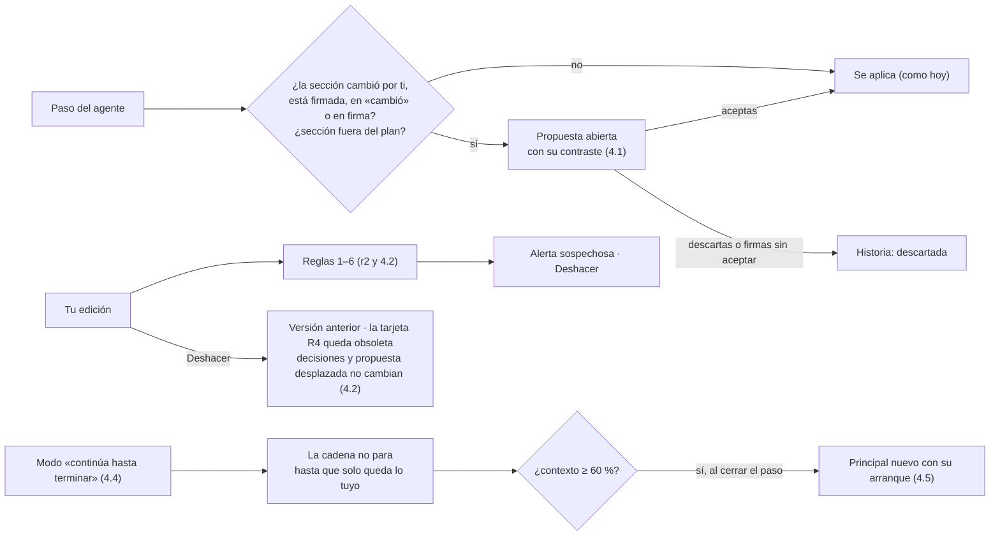
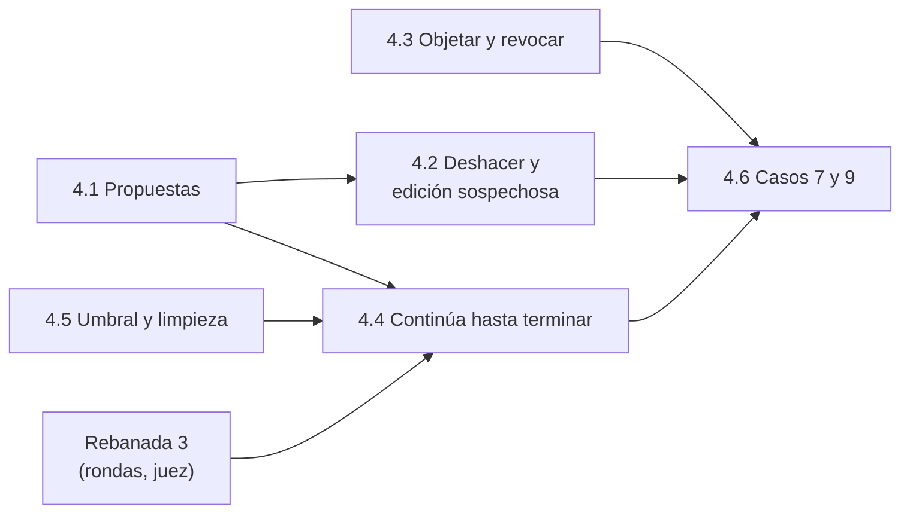

# Backlog · rebanada 4

**Respuesta:** 6 piezas, de la 4.1 a la 4.6. Al terminar, **tupaqnin aguanta los casos difíciles**: el agente sigue escribiendo aunque tú edites o firmes (sus cambios te llegan como propuesta, con su contraste), toda edición tuya se deshace con un clic y la app te avisa si una parece accidental, puedes objetar o revocar una decisión, puedes dejar al agente «continuar hasta terminar» mientras no estás, y su contexto se limpia solo antes de llenarse. «Listo cuando» del plan: **los casos 7 y 9 pasan**, y también los tramos que la 2.10 y la 3.7 dejaron cortados (3B, 6B, 7B, 8B, 9B y 10B). **Horas: 27–38 `[inferencia]`**; el plan le da un día (3-nov). **Orden adoptado (1-nov):** «Entrega» va antes; la 4 se construye detrás de su commit por pieza (cada pieza entra solo con sus pruebas en verde; la que no llegue no se integra y la que falle en Chrome se revierte), en el orden 4.1 → 4.5 → 4.4 → 4.2 → 4.3 → 4.6, y lo que no llegue queda apagado, sin recortar el diseño.

**Criterio que guía esta rebanada** (Eber, B-64, 31-oct): «esperar que el humano haga clic… sería un cuello de botella, el agente debe orquestar». El agente nunca espera tu clic, salvo en lo que el diseño reserva para ti: aceptar o descartar una propuesta, deshacer, objetar, revocar, firmar y responder «por aclarar».

**Decisiones:** B-73 a B-86 (abajo), **ya validadas contra r1 (construida), r2 (construida), r3 (en construcción) y el diseño**: 11 se infieren y no piden respuesta; 1 se infiere en parte y pide un punto (B-82); 2 son tuyas (B-79, que es un recorte de G-1, y B-83). **Eber adoptó las tres propuestas (1-nov).** La columna de Eber dice de dónde se infiere cada una o qué decidió.

**Listo de nuestro lado:** la tabla «Dónde va cada vista de la rebanada 4» en `pantallas.md` y la tabla de frenos de la 4.6 (abajo, 1-nov): el paso y el freno de los guiones 7A, 7B, 9A y 9B y de los tramos cortados de 3B, 6B, 7B, 8B, 9B y 10B, con 4 huecos, decididos por Eber el 1-nov. **Falta de Eber:** sincronizar al repo, antes de la 4.1, `docs/construccion/backlog-r4.md`, `docs/construccion/supervision.md`, `docs/diseno/bloque-1/` (estados, fichas, decisiones), `docs/diseno/bloque-3/bloque-3-especificacion.md`, `docs/diseno/_plan-hackathon.md` y `docs/casos-prueba/piloto-v4/` (la copia selectiva no lo lleva); sumar en la tabla de `AGENTS.md` la línea de `backlog-r4.md` y correr `demo-check` con el caso 9 al final (4.6).

**Presupuesto de complejidad (regla 2.4):** 0 estados nuevos (propuesta, decisión y sección ya tienen los suyos en estados §1, §2 y §5). 0 eventos nuevos: `mode_set`, `edit_undone` y `suspicious_edit_alert` ya están en el conjunto cerrado (espec. §1.3) y `startup` ya admite `threshold`. 0 campos nuevos en las salidas de los modelos. Un valor nuevo de `stop_reason`: `mode_finished` (B-83). Una ruta nueva por acto (abajo).

**Depende de la rebanada 3:** la 4.4 (el modo) lanza rondas y juez solos, y la 4.6 (casos 7 y 9) usa rondas de lectores. **No dependen de la 3:** la 4.1, la 4.2, la 4.3 y la 4.5; pueden empezar ya, en otro árbol de trabajo, si Eber quiere solapar.

## Qué cubre cada pieza

| Del plan (§1 y H-3) y de lo que dejaron r1–r3 | Pieza |
|---|---|
| Propuestas y edición simultánea (espec. §2, estados §5) · reemplazan los rechazos de B-11, B-14 y P-40 | 4.1 |
| Los pasos del agente como propuesta mientras firmas (K-16) · propuestas abiertas al firmar | 4.1 |
| Sección nueva del agente fuera del plan como propuesta (R-6; B-54 era el paso intermedio) | 4.1 |
| Aceptar una propuesta que declara un cambio lo cierra (A-1; r2 2.2 «No hacer») | 4.1 |
| Deshacer y edición sospechosa (G-1) · «fue un error · deshacer» en la tarjeta R4 (r2 2.1) · volver a «firmada» al deshacer (r1 1.5) | 4.2 |
| Objetar (E-1) · revocar, en la misma tarjeta (H-3) | 4.3 |
| «Continúa hasta terminar» · el modo en la barra (H-3) · defensa de cada sección en la parada final (K-7) · la vuelta al terminar (M-2, r2 2.7) | 4.4 |
| Umbral (~40 % libre) y limpieza del contexto del principal (B2-3, B2-5) | 4.5 |
| «Listo cuando»: los casos 7 y 9 pasan · los tramos cortados de la 2.10 y la 3.7 | 4.6 |

**Fuera de la rebanada 4 y del hackathon:** calibrar el umbral por modelo (queda constante, B2-5); quitar secciones (K-17); la tarjeta precargada desde el chat y que la parada proponga un análisis de sensibilidad (H-3); ejecutar código para cálculos (F-1: el caso 7 entra con su cálculo como fuente).

## Arquitectura (lo que suma la 4)

**Reglas de la arquitectura** (las de r1 a r3 siguen): lo tuyo manda (fichas §2): el agente nunca pisa tu edición ni lo firmado; llega como propuesta. Toda escritura sigue pasando por `store.Write` con su evento. Nada de esta rebanada detiene al agente: una propuesta abierta no frena la cadena; solo bloquea la firma de su sección hasta que firmas (y entonces se descarta, estados §5).

**Rutas nuevas de la rebanada 4** (todas bajo `/api/projects/{projectID}`; entran en la tabla de rutas del control de dueño de backlog-entrega B-87, y `TestB3_22_6` las recorre):

| Vista | Ruta | Escribe (evento) |
|---|---|---|
| Propuesta | `GET /proposals?section={label}` · `POST /proposals/{label}/accept` · `POST /proposals/{label}/discard` | `state_changed` (y lo que aplica el paso aceptado) |
| Deshacer | `POST /sections/{label}/undo` · `POST /alerts/{n}/answer` `{deliberate: true}` | `edit_undone` · `suspicious_edit_alert` |
| Objetar y revocar | `POST /decisions/{label}/object` `{reason}` · `POST /decisions/{label}/revoke` `{reason}` | `state_changed` · `usage_change` |
| Modo | `PUT /mode` `{mode: normal · run_to_completion, message}` (glosario) | `mode_set` |

## Elecciones técnicas de este backlog (para Eber)

*El diseño no las fija y el agente las necesita. Validadas el 31-oct contra r1–r3: «Se infiere» cita el pasaje adoptado que la sostiene.*

| # | Propuesta | En vez de | Elegiría la otra si… | Decisión de Eber (literal) |
|---|---|---|---|---|
| B-73 | **Cuándo un paso del agente se vuelve propuesta, y qué pasa con el resto del paso.** Un `new_text` va a propuesta (en vez de aplicarse) si su sección (a) cambió por tu edición desde la versión que leyó el agente (reemplaza el rechazo y reintento de B-11), (b) está firmada o en «cambió» (reemplaza el rechazo de P-40), o (c) está en firma (reemplaza el rechazo de B-14, K-16). «Cambió por tu edición» = hay un evento `edit` con `actor: human` y versión nueva mayor que la `base_version` del paso. La carrera en la escritura (P-89: el texto cambió entre la validación y la escritura) sigue con rechazo y un reintento; el reintento ya produce la propuesta. (d) **Al revés (espec. §2, cuarta fila):** si guardas tu edición sobre una versión que el agente cambió después, **se aplica la tuya** (hoy responde 409 `version_conflict`) y lo que el agente escribió entre medias pasa a **una sola propuesta** (operación `replace_all`) con su versión vigente completa y las cifras y citas que esos pasos aplicaron (se quitan del texto vigente y vuelven al aceptarla; adoptado 1-nov), aunque haya sido más de un paso: al aceptarla reemplaza el texto de la sección, sin anclas; si la sección cambió después de tu guardado, aceptarla pide un paso nuevo al agente, como B-75 (reaplicar pasos sueltos fallaría por anclas que solo existen en el texto del agente; auditoría 1-nov). Es «la propuesta que tu edición desplazó» de G-1. Un cambio del propio agente entre medias no la vuelve propuesta: sigue el rechazo y el reintento de B-11, como hoy (`errStale`; adoptado 1-nov). El resto del paso se aplica como hoy; las cifras y citas cuya ancla solo está en el texto propuesto, y el cierre «actualizado» de un cambio de esa sección (`handled_changes`), se guardan con la propuesta y se aplican al aceptarla (no se rechazan) | Seguir rechazando y reintentando (lo de r1–r3: el agente rehace trabajo y, en una sección firmada, no puede proponer nada) | — | **Se infiere (31-oct), no requiere decisión:** espec. §2 (las cuatro filas: «queda como propuesta» y «se aplica la tuya; lo del agente que quedó debajo pasa a propuesta»), estados §5 («nace por un cambio del agente sobre una sección firmada o en «cambió», o por un paso… sobre un texto que editaste al mismo tiempo»), K-16, G-1 (la propuesta desplazada) y la precisión de B-14 en r1 («se rechaza solo ese `new_text`… el resto del paso se aplica»), que aquí pasa de rechazo a propuesta |
| B-74 | **El contraste de una propuesta lo arma la app al crearla y lo guarda en su `contrast` (espec. §1.1):** el texto vigente frente al propuesto (lo que se quita y lo que entra), las decisiones nuevas del paso para esa sección con su «en vez de», y la línea de triaje y la nota del paso. Ningún campo nuevo en la salida del principal | Un campo `contrast` por cada `new_text` en la salida del principal (más tokens y otra cosa que validar) | Las propuestas sin una explicación del agente se entienden mal en las pruebas | **Se infiere (31-oct), no requiere decisión:** estados §5 («siempre llega con su contraste») con bloque-3 §2 («lo que tiene valor de evidencia lo calcula Go»), como B-41 (informe) y B-63 (digesto) |
| B-75 | **Aceptar y descartar:** aceptar aplica la propuesta con su ancla, su operación y su versión base (T-4); si el ancla ya no es única en la versión vigente, la app no la aplica a ciegas: pide un paso nuevo al agente para esa sección (la propuesta pasa a `discarded` con ese motivo). **«Pedir un paso nuevo» (adoptado 1-nov):** la app deja un aviso al principal en «lo que cambió», como `PendingRejections`, y si no hay un turno corriendo abre uno, como la ronda de B-64; si lo hay, el aviso entra en el paso siguiente. **Al aceptar:** el texto se registra como `edit` con `actor: agent` y `data.accepted_by: human` (el texto es del agente: «Deshacer» se apaga, B-79, y B-73 a sigue contando solo tus ediciones). Aceptar una propuesta en una sección firmada la pasa a «cambió» (estados §5). Si la propuesta declara un cambio de la lista atendido (`handled_changes`), aceptarla lo cierra (A-1). Descartar no pide «porque» | Pedir «porque» al descartar (estados §5 no lo pide; un «porque» es para lo que decides sobre una decisión) | — | **Se infiere (31-oct), no requiere decisión:** T-4 («si el ancla ya no es única… pide un paso nuevo al agente en vez de aplicarla a ciegas»), estados §1 y §5, A-1 («aceptar la propuesta que declara el cambio lo cierra») y r2 2.2 «No hacer» |
| B-76 | **Al firmar, las propuestas abiertas de esa sección se listan y, si firmas sin aceptarlas, pasan a `discarded`** con el motivo `signed_without`, a la vista en la historia. No bloquean pedir la firma | Que una propuesta abierta bloquee la firma (estados §1 no la cuenta como pendiente) | — | **Se infiere (31-oct), no requiere decisión:** fichas §2, Firma («lista las propuestas abiertas») y §8.2 («las que no aceptes pasan a la historia como descartadas»); estados §5 («firmas sin aceptarla (la app te la lista antes)») |
| B-77 | **Una sección nueva del agente con el plan confirmado llega como propuesta de sección** (título, «aquí se concluye» propuesto y su primer texto). Aceptarla crea la sección como la crea hoy un paso antes del plan; descartarla no crea nada. Reemplaza el rechazo de B-54 | Seguir con B-54 (la propone en `reply` y tú la creas con «+ Sección») | — | **Se infiere (31-oct), no requiere decisión:** R-6, adoptada («una sección nueva fuera del plan llega como propuesta»), y B-54 («precisa R-6… porque las propuestas son de la rebanada 4») |
| B-78 | **«Fue un error · deshacer» y volver a «firmada»:** la tarjeta R4 (B-49) suma ese botón; al usarlo, tu edición se deshace (4.2) y la tarjeta pasa a `obsolete`. Si tras deshacer la huella de la sección vuelve a ser la firmada y no quedan pendientes ni cambios sin cerrar, la sección vuelve a `signed` sin firmar de nuevo | — | — | **Se infiere (31-oct), no requiere decisión:** G-1 (3), estados §1 («si la deshaces y el texto queda idéntico a la versión firmada, vuelve a «firmada»…») y §3 (tarjeta → obsoleta) |
| B-79 | **Qué es «una edición» y qué deshace «Deshacer»:** cada guardado que cambia la huella es una edición (como hoy). «Deshacer» revierte **tu última edición de esa sección** mientras siga siendo la versión vigente; pulsarlo otra vez revierte la anterior, mientras sean tuyas y seguidas. Si después escribió el agente o aceptaste una propuesta, «Deshacer» se apaga y dice por qué. Deshacer es un evento nuevo que restaura la versión anterior (espec. §2). Con B-49 (adoptada en r2 y construida), una edición tuya no reemplaza decisiones (su tarjeta R4 solo pide el «porque»): deshacer pasa esa tarjeta a `obsolete` y no toca decisiones. **Ojo:** estados §2 y §3 todavía tienen transiciones por «tu edición» («Tuya → Reemplazada: … deshaces la edición que la creó»; «la decisión vuelve a como estaba») que, con B-49, la app no produce; si en otra versión una edición tuya llegara a cambiar decisiones, deshacer las devolvería a su estado anterior. Esa diferencia viene de B-49, no de esta rebanada: precisados en estados §2 y §3 el 1-nov. La propuesta que tu edición desplazó (B-73 d) **sigue abierta** y la puedes aceptar (estados §5); deshacer no cambia su estado | Poder deshacer cualquier edición pasada aunque haya cambios encima (habría que fusionar textos) · solo la última edición del proyecto | En las pruebas quieres deshacer algo de hace varias ediciones | **Decides tú, y es un recorte:** espec. §2 («cada edición tuya se revierte con un clic»), fichas §8.2 («toda edición tuya se deshace con un clic») y fichas §5 (versiones «que permitan deshacer una edición del humano con un clic») piden poder deshacer **toda** edición tuya. La propuesta limita «Deshacer» a tus últimas ediciones seguidas, sin cambios del agente encima. Confirmas el recorte o pides la versión completa (deshacer una edición vieja creando una versión que revierte solo esa edición, con su riesgo de choque). **Adoptada la propuesta (1-nov):** el recorte |
| B-80 | **Reglas de la edición sospechosa (regla 6), las cuatro de G-1, sin modelo y sin bloquear; solo los umbrales son `[inicial]`:** (1) tu edición borra un párrafo entero (un bloque, como en B-10) o más de la mitad del texto de la sección; (2) quita texto que sostiene una decisión (el ancla de una cifra o una cita vinculada, o un bloque cuya historia, B-10, muestra una decisión), una cifra vinculada o algo firmado (20 caracteres o más quitados del texto de una sección firmada); (3) cae en una sección distinta de la que estabas trabajando: tu edición anterior, de hace 10 min o menos, fue en otra sección, **y además quita 20 caracteres o más** (sola alertaría cada vez que cambias de sección, como hará el jurado; auditoría 1-nov); (4) pega un fragmento nuevo de 80 caracteres o más que ya existe literal (normalizado como en B-10) en otra sección o en una fuente del proyecto. La alerta dice qué pasó, con «Deshacer» y «Fue a propósito»; si no respondes, tu edición sigue rigiendo y la alerta queda registrada sin respuesta | Que un modelo juzgue la intención (G-1 lo descarta) | Las alertas salen tan seguido que se vuelven ruido (G-1): se suben los umbrales | **Se infiere (31-oct), no requiere decisión:** las cuatro reglas son las de G-1 (2) y fichas §3, en literal; espec. §2 («borra texto con decisiones vinculadas») cae en la (2). Los umbrales son `[inicial]` |
| B-81 | **Objetar (E-1):** desde la decisión desplegada (marco o tarjeta), «Objetar» con tu motivo la lleva a `in_open_question` y abre un «por aclarar» cuyas opciones arma la app desde la propia decisión: «mantener: ‹enunciado›» y «la otra: ‹en vez de›», cada una con su contraste («elegiría la otra si»), su consecuencia (las secciones que la usan) y su riesgo (el motivo de criticidad). Eliges con «porque» (2.4): **«mantener» la pasa a `human`, con tu «porque»** (estados §2: «PorAclarar → Tuya: la eliges a ella, con «porque»»); «la otra» hace nacer una decisión tuya que la reemplaza, también si era del agente (estados §2). El «por aclarar» guarda el estado anterior de la decisión, para la historia. Sobre una sección firmada, la pasa a «cambió» | Que un modelo redacte las opciones (B-44 lo hace cuando el problema lo encontró el comprobador; aquí el contraste ya está en la decisión) | La decisión no trae «elegiría la otra si» y las opciones quedan pobres | **Se infiere (31-oct), no requiere decisión:** E-1 («objetar… la lleva a «por aclarar»: eliges tú, con «porque»»), estados §2 y §4 (opciones con contraste, consecuencia y riesgo) y fichas §7 (toda decisión trae su contraste) |
| B-82 | **Revocar:** solo una decisión tuya o confirmada (estados §2); queda `revoked`, sin sucesora; las secciones que la usan reciben su aviso (2.2: «cambió» o «escrita con lo anterior»). Pide «porque», como todo acto tuyo que cambia lo decidido (T-1) | Revocar sin «porque» (la historia no diría por qué desapareció una decisión que sostenía secciones) | — | **Se infiere en parte (31-oct):** quién puede y qué pasa, de estados §2 («revocar es solo tuyo… al reemplazar o revocar, las secciones que la usan reciben su aviso») y H-3 («revocar, en la misma tarjeta que objetar»). **Decides solo:** que pida «porque» (el diseño lo pide para tarjetas y «por aclarar»; aquí se propone extenderlo). **Adoptada la propuesta (1-nov):** pide «porque» |
| B-83 | **«Continúa hasta terminar» y sus límites:** se activa en la barra, con la advertencia de una línea de fichas §8.2 y un campo para tu mensaje (va en literal a `mode_set`, y el principal lo tiene en su capa 3). Con el modo activo, la cadena no para por «sección lista» ni por «decisiones sin ver»; para solo cuando no queda trabajo del agente (`human_only` o `no_work`), al llegar al tope del proyecto (B3-20) o al **tope del modo: 60 pasos `[inicial]`**. Cuando un turno llega a su tope de 12 pasos (B-37), la app abre el siguiente sola mientras el modo siga. Al terminar, `mode_finished` (en el informe de parada, en `mode_set` y en el stream, porque el motivo se conoce después de `step_ended`, como `project_cap`; Eber, 2-nov) con la causa en `data.cause` (`human_only` · `no_work` · `mode_cap` · `project_cap` · `demo_cap` (topes del link, del día o total, con `data.cap`; backlog-entrega B-89) · `agent_pending` · `provider_error` · `restart` (la app reinició con el modo activo y nada corriendo, P-114): un fallo del agente o de Meta también termina el modo), la parada final con su informe y el modo vuelve a «normal». Un mensaje tuyo durante el modo **se encola** (hoy recibiría 409 `turn_running`) y entra al paso siguiente; no apaga el modo; lo apagas en la barra. Pedir firmar durante el modo **se encola** como tus mensajes (hoy `RequestSignoff` responde 409 `turn_running`) y se abre al terminar el paso en curso; después la cadena sigue con las demás secciones, y sus pasos sobre la que firmas llegan como propuesta (K-16). Dentro del modo, el corte de 12 pasos no escribe informe ni `step_limit`. Activar el modo con el agente parado arranca un turno | Sin tope propio del modo (solo el del proyecto, 3 USD) · que tu mensaje apague el modo | El caso 7 necesita más de 60 pasos | **Adoptada la propuesta (1-nov)** |
| B-84 | **Qué hace el agente con «si surge algo, tú decides» (caso 7):** nada distinto. Lo que solo tú decides (alcance, premisa, destino, el sentido de tus términos) queda «por aclarar», con variantes rotuladas que el agente avanza sin elegir (fichas §8.2), y el modo sigue con lo demás. El aviso de activación lo dice en una línea: «Lo que solo tú decides te esperará como «por aclarar»» | Que el modo permita al agente elegir y marcarlo «decidido por el agente» (contradice fichas §8.2: «el agente no lo decide por ti») | — | **Se infiere (31-oct), no requiere decisión:** fichas §8.2 («Decidir alcance, premisa o destino. El agente no lo decide por ti… puede avanzar variantes rotuladas sin elegir ninguna») y §2, Parada («la parada no se da hasta que solo quede lo tuyo»). La línea del aviso es implementación |
| B-85 | **Parada final y vuelta al terminar el modo:** la parada final prepara la defensa de cada sección que la necesita (K-7), en una sola parada; al abrir el proyecto después, arriba del marco va la línea de vuelta (M-2) aunque no hayan pasado 3 días, y el informe queda a un clic en «Lo que te toca». Las rondas y el juez corren solos dentro del modo, como ya hacen (B-64, B-67) | — | — | **Se infiere (31-oct), no requiere decisión:** K-7, M-2 («al terminar «continúa hasta terminar»… primero una línea… y enseguida el marco»), espec. §9 («o si terminó «continúa hasta terminar» desde tu última visita»), B-48 (a) y B-64 |
| B-86 | **Umbral y limpieza del contexto (B2-3):** la app mide los tokens de entrada de la última llamada del principal frente a la ventana del modelo (`model_call`), al cerrar cada paso y después de tus ediciones (bloque-2 §4); la decisión la toma `ensureInstance` al empezar el paso siguiente: si pasa del **60 % usado** `[inicial]` (constante por modelo en `models.go`; calibrar queda fuera, B2-5), arranca un principal nuevo con `startup` `reason: threshold`. Nunca a mitad de un paso; si hay una firma en curso en el proyecto, la limpieza espera a que termine y, mientras tanto, la cadena no lanza pasos nuevos: **el turno termina y suelta el turno del proyecto**; al cerrarse la firma, la app limpia y, si el modo sigue, reabre la cadena (adoptado 1-nov) (con el modo activo, B-83, seguiría llenando la ventana; auditoría 1-nov). Si un paso llena la ventana (error de largo del proveedor: `[inicial]` un 400 cuyo `code`, `param` o mensaje contiene «context»; se reconoce **dentro de `internal/provider`**, antes de descartar el cuerpo, y sale como un error tipado (`ErrContextFull`): el mensaje sigue sin guardarse ni registrarse, T-10), se descarta sin aplicarse, se limpia y se reintenta una vez desde el arranque; si vuelve a fallar, queda como pendiente del agente | Resumir la conversación (bloque 2: «no se resume: lo literal ya está en la memoria») | — | **Se infiere (31-oct), no requiere decisión:** bloque-2 §4 (umbral ~40 % libre, orden, nunca a mitad de paso ni en firma, el paso que llena la ventana) y B2-5 (rebanada 4, umbral constante) |

## Piezas

### 4.1 · Propuestas

| Campo | Contenido |
|---|---|
| **Qué** | Cuando el agente quiere cambiar algo que tú acabas de editar, algo firmado o una sección que estás firmando, o crear una sección fuera del plan, no lo aplica: te lo deja como propuesta, con su contraste. La aceptas o la descartas cuando quieras; el agente sigue trabajando |
| **Implementa** | Espec. §2 (tabla) · estados §1 y §5 · fichas §2 (Firma) · K-16 · R-6 · T-4 · A-1 (cierre al aceptar) · B-73 · B-74 · B-75 · B-76 · B-77 · inventario 4o y 7h |
| **Leer** | Espec. §1.1 (`proposal`), §2 y §4 · estados §1 y §5 · fichas §2 (Firma) y §8.2 · defaults T-4 · backlog-r1 B-11 y B-14 (lo que se reemplaza) · backlog-r2 B-54 y 2.2 · `docs/construccion/supervision.md` P-40 · `pantallas.md` («Dónde va cada vista de la rebanada 4») |
| **Interfaz** | En `ApplyStep`, los `new_text` de una sección que cumplen B-73 crean **una propuesta por sección y por paso** (adoptado 1-nov) `open` (`section_id`, `base_version`, `anchor`, `operation`, `text`, `contrast`, y en el `body` los campos que suma espec. §1.1: `figures`, `citations`, `handled_changes`, `new_section` de B-77 y la operación `replace_all` de B-73 d) en la transacción del paso, en vez del rechazo actual (`errStale`, `inSignoff`, la regla de P-40, y B-54) · el contraste de B-74 se arma al crear la propuesta y se guarda en su `contrast` (espec. §1.1); si la versión vigente cambió desde entonces, la vista lo dice · el principal ve sus propuestas abiertas en su capa 3 (`memory.go` ya las pone en el arranque) **y, en una conversación viva, en «lo que cambió»** (`changeItems`, como el aviso de `PendingRejections`), con su estado (abierta, aceptada, descartada), para no repetirlas · **tu guardado sobre una versión del agente (B-73 d):** `putSection` deja de responder 409 `version_conflict` cuando lo que hay encima es del agente: aplica tu texto y crea la propuesta desplazada; la web deja de mostrarlo como conflicto · `GET /proposals`, `accept` y `discard` (B-75; aceptar registra `edit` con `actor: agent` y `data.accepted_by: human`; «pedir un paso nuevo» como dice B-75) · al firmar, B-76 · web: la propuesta en la sección (derecha) como texto marcado con «Aceptar» y «Descartar», y una línea en «Lo que te toca» |
| **Listo cuando** | Prueba: tú editas «Modelo de cobro» y el paso del agente sobre la versión anterior queda como propuesta; tu edición rige (caso 9) · prueba: un paso sobre una sección firmada deja una propuesta y la sección sigue `signed`; aceptarla la pasa a `changed_since_signoff` · prueba: un paso sobre una sección en firma deja una propuesta y la firma sigue · prueba: aceptar con el ancla ya repetida no aplica nada y pide un paso nuevo · prueba: aceptar una propuesta que declara `chg-1` atendido lo cierra · prueba: firmar con una propuesta abierta la deja `discarded` (`signed_without`) · prueba: con el plan confirmado, una sección `new-n` del agente queda como propuesta de sección · prueba: el resto del paso (decisiones, vínculos) se aplica igual · prueba: el agente escribe sobre la v3 y tú guardas desde la v3: rige tu texto y lo del agente queda como propuesta (espec. §2, cuarta fila) · prueba: un «actualizado» de `chg-1` en un paso que fue a propuesta no se rechaza y se aplica al aceptarla · prueba: el principal recibe en la misma conversación que su propuesta quedó abierta · prueba: un paso del agente sobre una versión que cambió otro paso suyo sigue con el rechazo y el reintento de B-11, sin propuesta · prueba: aceptar registra `edit` con `actor: agent` y `accepted_by: human`, y «Deshacer» queda apagado |
| **Depende de** | Rebanadas 1 y 2 (hechas) · B-73 a B-77 |
| **No hacer** | Fusionar textos automáticamente. Que una propuesta bloquee la cadena |
| **Si algo no está** | `[EL DISEÑO NO LO DICE]` y una línea en `elecciones-agente.md` |

### 4.2 · Deshacer y edición sospechosa

| Campo | Contenido |
|---|---|
| **Qué** | Tu última edición de una sección (y las anteriores, si son tuyas y seguidas) se deshace con un clic: vuelve la versión anterior y, si coincide con lo firmado, la firma; las decisiones y la propuesta desplazada no cambian (B-49, B-79). Si una edición parece accidental, la app te avisa sin bloquear: «¿Fue a propósito? · Deshacer» |
| **Implementa** | G-1 · fichas §3 (alerta de edición sospechosa) · flujos §1 (regla 6) · estados §1, §2 y §3 (deshacer) · espec. §2 (deshacer, edición sospechosa) · B-78 · B-79 · B-80 · inventario 4b, 4n y 4p · backlog-r2 2.1 «No hacer» (R4 «fue un error») · backlog-r1 1.5 «No hacer» (volver a «firmada») |
| **Leer** | G-1 en `bloque-1-decisiones.md` · fichas §3 y §8.2 («Si tu edición fue un error») · flujos §1 · estados §1 a §3 y §5 · espec. §2 y §4 · backlog-r2 B-36 y B-49 |
| **Interfaz** | `POST /sections/{label}/undo` (B-79): `edit_undone` con la versión restaurada, en una transacción; la tarjeta R4 abierta por esa edición pasa a `obsolete` (con B-49 una edición no reemplaza decisiones); la propuesta que esa edición desplazó sigue `open`; la sección vuelve a `signed` si cumple B-78; la versión restaurada pasa por las reglas 1 a 5 como cualquier edición (flujos §1) · **regla 6** en `internal/checks`, solo en tus ediciones, con las reglas de B-80: `suspicious_edit_alert` con el motivo · `POST /alerts/{n}/answer`: `n` es el número de orden (`seq`) del evento de la alerta, y la respuesta agrega otro `suspicious_edit_alert` con `{answer_to: n, deliberate: true}` (la historia solo se agrega) · tarjeta R4 con «Fue un error · deshacer» (B-78) · web: «Deshacer» junto a la sección (apagado con su razón, B-79) y la alerta como banda bajo el título |
| **Listo cuando** | Prueba: editar y deshacer deja la sección en su versión anterior con `edit_undone` · prueba: deshacer una edición que abrió una tarjeta R4 la deja `obsolete` y no cambia la decisión · prueba: tras deshacer, la propuesta desplazada (4.1) sigue abierta y se puede aceptar · prueba: editar una sección firmada y deshacer la deja `signed` sin firmar de nuevo · prueba: con un paso del agente después de tu edición, «Deshacer» se niega con su razón · prueba: borrar un párrafo entero, quitar el ancla de una cifra vinculada, quitar 20 caracteres de otra sección a los 5 min de la anterior o pegar 80 caracteres que ya están en una fuente dejan `suspicious_edit_alert`; una corrección de una coma, o editar otra sección sin quitar texto, no · prueba: «Fue un error · deshacer» en la tarjeta R4 la deja `obsolete` |
| **Depende de** | 4.1 (la propuesta desplazada) · B-78 · B-79 · B-80 |
| **No hacer** | Que la alerta bloquee o que un modelo juzgue la intención. Deshacer pasos del agente (se descartan como propuesta o se corrigen con un mensaje) |
| **Si algo no está** | `[EL DISEÑO NO LO DICE]` en el retorno |

### 4.3 · Objetar y revocar

| Campo | Contenido |
|---|---|
| **Qué** | Desde cualquier decisión puedes objetar (vuelve a ser una pregunta que decides tú, con sus dos opciones y su contraste) o, si es tuya o confirmada, revocarla. Las secciones que la usan reciben su aviso |
| **Implementa** | E-1 · estados §2 y §4 · fichas §8.2 («Lo que solo tú haces») · H-3 (revocar junto con objetar) · B-81 · B-82 · inventario 4l y 4m |
| **Leer** | E-1 · estados §1, §2 y §4 · fichas §8.2 · backlog-r2 2.2 (avisos) y 2.4 («por aclarar») |
| **Interfaz** | `POST /decisions/{label}/object` `{reason}`: la decisión pasa a `in_open_question`; nace el «por aclarar» de B-81 con su arista `blocks` a la decisión y a las secciones que la usan; una sección firmada que la usa pasa a `changed_since_signoff` (estados §1); lo mismo un «por aclarar» por falla del juez (B-67) que bloquea una sección firmada (adoptado 1-nov, 6B) · al responderlo (2.4): «mantener» la pasa a `human` con tu «porque»; «la otra» crea una decisión tuya que la reemplaza, sea del agente o no (estados §2). Hoy `applyKept` (`openquestion.go`) solo reemplaza decisiones `human` o `confirmed` y con «mantener» no hace nada: para las objeciones se quita esa condición y «mantener» cambia el estado · `POST /decisions/{label}/revoke` `{reason}` (B-82): solo `human` o `confirmed`; `revoked`; avisos de 2.2 · web: «Objetar» y «Revocar» en la decisión desplegada del marco y en su tarjeta |
| **Listo cuando** | Prueba: objetar una decisión del agente abre el «por aclarar» con las dos opciones y la deja `in_open_question`; elegir «la otra» con «porque» crea una decisión tuya · prueba: «mantener» con «porque» la deja `human` · prueba: objetar una decisión de una sección firmada la pasa a «cambió» · prueba: un «por aclarar» por falla del juez sobre una sección firmada la pasa a `changed_since_signoff` · prueba: revocar una decisión del agente se rechaza; una tuya queda `revoked` y la sección que la usa recibe su aviso · prueba: revocar sin «porque» válido no hace nada (B-82) |
| **Depende de** | 2.2 · 2.4 · B-81 · B-82 |
| **No hacer** | Que el agente objete o revoque |
| **Si algo no está** | `[EL DISEÑO NO LO DICE]` en el retorno |

### 4.4 · «Continúa hasta terminar»

| Campo | Contenido |
|---|---|
| **Qué** | Puedes dejar al agente trabajar solo: no se detiene a informarte hasta que solo quede lo que tú decides. Antes de activarlo, una línea te advierte lo que eso significa. Lo que solo tú decides te espera como «por aclarar». Al terminar, ves dónde quedó todo, la defensa de cada sección y el informe a un clic |
| **Implementa** | Fichas §2 (Parada) y §8.2 («Continúa hasta terminar», «Reentrada») · K-7 · M-2 · espec. §9 (línea de vuelta) · H-3 (el modo en la barra) · B-83 · B-84 · B-85 · inventario 3l, 3m, 5a y 8a · backlog-r2 2.5, 2.6 y 2.7 (lo que dejaron para aquí) |
| **Leer** | Fichas §2 y §8.2 · bloque-2 §2 (capa 3: el modo «en vuelo») · espec. §1.3 (`mode_set`) y §9 · backlog-r2 B-37, B-39 y B-48 · backlog-r3 B-64 y B-67 · `pantallas.md` (la barra y «Dónde va cada vista de la rebanada 4») |
| **Interfaz** | `PUT /mode` `{mode: normal · run_to_completion, message}` con `mode_set` y tu mensaje en literal · `RequestSignoff` con el modo activo se encola en vez de responder 409 · `mode_finished` con `data.cause` (B-83) · `ShouldStop` (2.5) con el modo activo ignora `section_ready` y `unseen_decisions` y aplica los topes de B-83; al tope de 12 pasos de un turno abre el siguiente sola · al terminar: `mode_finished` en el informe, `mode_set` y el stream, la parada final con su informe y la defensa de cada sección que la necesita (K-7, con la lógica de 2.6), y el modo vuelve a `normal` (`mode_set`) · `Frame` muestra la línea de vuelta si terminó el modo desde tu último evento (B-85) · el principal recibe el modo y tu mensaje en su capa 3 (ya lo lee `memory.go`) · instrucciones del principal: lo de B-84, en `principal.en.md` · web: el modo en la barra de la conversación, con la advertencia y el campo del mensaje |
| **Listo cuando** | Prueba con salidas grabadas: con el modo activo, una sección que queda lista no para la cadena y 5 decisiones sin ver tampoco · prueba: la cadena para cuando solo quedan tarjetas y «por aclarar», con `mode_finished` y la defensa de cada sección que la necesita · prueba: a los 12 pasos se abre otro turno solo; a los 60 para · prueba: un mensaje tuyo durante el modo se encola (no 409), entra al siguiente paso y el modo sigue · prueba: activar el modo con el agente parado arranca un turno · prueba: con el modo activo, una firma en curso y el contexto sobre el umbral, la cadena no lanza pasos hasta que la firma termina: el turno termina y suelta el turno del proyecto, y al cerrar la firma se limpia y la cadena se reabre · prueba: pedir firmar con el modo activo se encola (no 409) · prueba: un `provider_error` con el modo activo termina el modo con `mode_finished` y `data.cause: provider_error` · prueba: tras el fin del modo, `Frame` trae la línea de vuelta aunque no hayan pasado 3 días · prueba: un alcance nuevo (caso 7: la mina cierra antes que la planta) queda «por aclarar» con dos variantes y el modo sigue |
| **Depende de** | 4.1 · 4.5 · rebanada 3 (rondas y juez en el modo) · B-83 · B-84 · B-85 |
| **No hacer** | Que el modo salte una comprobación o la firma. Que el agente decida lo tuyo |
| **Si algo no está** | `[EL DISEÑO NO LO DICE]` en el retorno |

### 4.5 · Umbral y limpieza del contexto

| Campo | Contenido |
|---|---|
| **Qué** | Antes de que el contexto del agente se llene, la app lo limpia al cerrar un paso y arranca un agente nuevo con su memoria. No se nota, salvo en la historia. Un paso que llena la ventana se repite una vez desde cero |
| **Implementa** | Bloque-2 §4 (B2-3) y §6 (caso 7: «llega al umbral») · B2-5 · B-86 |
| **Leer** | Bloque-2 §3, §4 y §6 · espec. §1.4 (`model_call`, uso de contexto) · `internal/cycle/runner.go` (`ensureInstance`, `conversation()`) · `internal/memory/startup.go` (`StartupThreshold`) |
| **Interfaz** | Después de cada paso y sus comprobaciones (orden de bloque-2 §4), `NeedsReset(ctx, projectID) bool` con B-86; si hay que limpiar, el siguiente paso abre instancia nueva con `startup` `threshold` (la razón ya existe en `memory/startup.go`) · el error de largo del proveedor se reconoce en `internal/provider` como `ErrContextFull` (antes de descartar el cuerpo, T-10) y lleva al reintento de B-86 · con una firma en curso sobre el umbral, el turno termina y el cierre de la firma limpia y reabre la cadena si el modo sigue · la ventana y el umbral, constantes por modelo en `models.go`; las pruebas fijan una ventana chica con un valor solo de pruebas |
| **Listo cuando** | Prueba: con una ventana de prueba chica, el paso que cruza el 60 % termina y el siguiente arranca con `startup` `threshold` y su arranque (≤ 15 %) · prueba: con una firma en curso en el proyecto, la limpieza espera a que termine · prueba: un 400 con «context» se reconoce como ventana llena · prueba: tras una edición tuya con el contexto ya sobre el 60 %, el siguiente paso arranca con `startup` `threshold` · prueba: un paso que devuelve error de largo se descarta, se limpia y se reintenta una vez; al segundo fallo queda pendiente del agente · prueba: tras la limpieza, el principal tiene en su arranque las tarjetas y avisos que abrió el último paso |
| **Depende de** | Rebanada 0 (arranque) · B-86 |
| **No hacer** | Resumir la conversación. Calibrar por modelo |
| **Si algo no está** | `[EL DISEÑO NO LO DICE]` en el retorno |

### 4.6 · Los casos 7 y 9, y los tramos cortados

| Campo | Contenido |
|---|---|
| **Qué** | Es el «Listo cuando» de la rebanada: los casos 7 (planta solar, «continúa hasta terminar» todo el día) y 9 (especificación de pagos, edición al mismo tiempo que el agente) pasan con sus dos perfiles, y los tramos que la 2.10 y la 3.7 cortaron por ser de esta rebanada también |
| **Implementa** | Plan §1 (rebanada 4, «Listo cuando») · backlog-r2 2.10 (columna «Corte»: 3B F3, 7B F3, 8B desde F10, 9B F3 y F9, 10B F11) · backlog-r3 3.7 (6B: el paso sobre lo firmado, que allí «se rechaza», ahora queda como propuesta, B-73) |
| **Leer** | Los guiones `caso-07-B`, `caso-09-A` y `caso-09-B` de `docs/casos-prueba/simulacion-v4.1/guiones/` (9B en su versión de `regresion-v4.2`), `caso-07-A` de `docs/casos-prueba/piloto-v4/guiones/` (es la única versión; Eber la copia al repo) y `caso-03-B`, `caso-06-B`, `caso-08-B` (en su versión de `regresion-v4.2`) y `caso-10-B` para sus tramos y los cortes de la 2.10 · la tabla de frenos de la 4.6 (abajo) · `docs/casos-prueba/simulacion-v4.1/casos/caso-07.md` y `caso-09.md` |
| **Interfaz** | Una prueba de recorrido por guion, con el proveedor falso, la evidencia grabada y salidas grabadas que reproducen al agente del guion; el humano responde como en el guion; cada prueba afirma el freno de la tabla · el cálculo de sensibilidad del caso 7 entra como fuente (F-1), no se ejecuta código · `make demo-check` suma un tramo del caso 9 con Meta, que corre Eber (el 7, con hasta 60 pasos, puede llegar al tope de 3 USD del proyecto) |
| **Listo cuando** | Las pruebas de 7A, 7B, 9A y 9B pasan con el freno que fija la tabla, y los tramos cortados de 3B, 6B, 7B, 8B, 9B y 10B también · con Meta, en el navegador: el modo corre y para solo cuando queda lo tuyo, y una edición tuya al mismo tiempo que el agente deja una propuesta |
| **Depende de** | 4.1 a 4.5 · rebanada 3 · la tabla de frenos (abajo, 1-nov) |
| **No hacer** | Corregir el diseño si un recorrido no pasa: el retorno dice en qué paso y con qué salida |
| **Si algo no está** | Si un guion pide algo fuera del hackathon (ejecutar código, quitar secciones), se corta ahí y se dice en el retorno |

## Tabla de frenos de la 4.6

**Frenos esperados (fijados el 1-nov; el implementador no los decide).** Salen de los guiones 7A (`piloto-v4`), 7B, 9A, 3B, 6B y 10B (`simulacion-v4.1`) y 8B y 9B (`regresion-v4.2`), leídos contra el diseño vigente y B-73 a B-86. Siguen las convenciones de la 2.10 («firma bloqueada» = `POST /sections/{l}/signoff` lista los pendientes y no crea la firma). **El modo** se activa con `PUT /mode` (la barra, B-83) y el mensaje del humano en literal; un pedido por el chat («no pares», «termina todo tú») no lo activa: la prueba usa la barra donde el guion muestra la advertencia. **Rondas:** en 7A, 9A y 9B son reales, con lectores y digesto grabados (3.2, 3.4); en el modo arrancan solas (B-64). En los tramos cortados siguen sustituidas como en la 2.10. **Cálculos:** donde el guion corre código, el cálculo entra como fuente (F-1) y la salida grabada lo cita. «Fin del modo» = `step_ended` con `stop_reason: mode_finished` y `data.cause: human_only`, la parada final con su informe y la defensa de cada sección que la necesita (K-7), y `mode_set` de vuelta a `normal` (B-83, B-85).

| Guion | Paso | Qué pasa en el guion | Freno (mecanismo · pieza) | Lo que afirma la prueba | Corte |
|---|---|---|---|---|---|
| 7A | F3 | «Continúa hasta terminar… Si surge algo, tú decides» | Modo con advertencia y mensaje (B-83, B-84 · 4.4) | `mode_set` `run_to_completion` con el mensaje en literal; la advertencia de fichas §8.2 con la línea de B-84. «Tú decides» no cambia tarjetas ni «por aclarar» | — |
| 7A | F4–F5 | Delega en 3 lectores (plan, curva, cotizaciones); nadie responde «¿qué esperas encontrar?»; el lector del plan trae «cierre: 2037» | La ronda arranca sola (B-64 · 4.4) · alcance → «por aclarar» con variantes (2.4 · B-84, fichas §8.2) | La ronda se lanza sin clic, con la expectativa vacía; digesto sin contraste. Tras F5: un «por aclarar» de alcance con dos opciones (12 años y vender equipos · 25 años y vender a la red) que bloquea «Valor después del cierre»; la cadena sigue | — |
| 7A | F6–F8 | «Evaluación» con las dos variantes rotuladas; irradiación satelital con tarjeta crítica; 1 000 escenarios | Tarjeta crítica (1.4) · el modo no para por decisiones sin ver (B-83 · 4.4) · umbral (B-86 · 4.5; bloque-2 §6, «llega al umbral») | Tras F7: tarjeta de irradiación abierta y ningún `step_ended` de parada. Con la ventana chica de prueba, el paso de F8 cruza el 60 % y el siguiente arranca con `startup` `threshold`; el modo sigue `run_to_completion` | F8: no se ejecuta código: la sensibilidad entra como fuente (F-1) |
| 7A | F9 | Juez: precios nominales descontados a tasa real; una corrección y una reverificación; 18 % se mantiene | Juez en ciclo acotado, corre solo, sin clic (B-67 · 3.6; B-85) | Una falla visible, un lote de corrección y una reverificación; el principal declara «tasa real» como decisión, con tarjeta crítica (cubre una cifra) | — |
| 7A | F10–F12 | «Recomendación» depende del horizonte; no abre la ronda de otras minas; para cuando solo queda lo de Diego | Un «por aclarar» bloquea varias secciones (2.4) · sin `research_request` no hay ronda (B-57) · fin del modo (B-83, B-85 · 4.4) | El «por aclarar» de F5 bloquea también «Recomendación» (no nace otro). Ninguna ronda nueva. Fin del modo, con «siguiente: comparar con otras minas» en el informe | — |
| 7A | F13 | Vuelve a las 18:10, el mismo día | Línea de vuelta tras el modo (B-85, M-2 · 4.4) | `Frame` trae la línea de vuelta aunque no pasaron 3 días; el informe, a un clic en «Lo que te toca» | — |
| 7A | F15–F16 | «12 años y vender equipos, porque…»; «el 10 % es nominal»; responde la tarjeta de irradiación con su razón | «Por aclarar» y tarjetas con «porque» (2.4, 1.4) · avisos (2.2) · con el modo en `normal`, la cadena para como en la r2 (2.5) | El «por aclarar» se cierra; elegir «nominal» en la tarjeta de la tasa crea una decisión tuya que reemplaza la del agente, y «Evaluación» y «Recomendación» pasan a `stale`; el recálculo y la reverificación corren en modo normal | El «porque» de «nominal»: hueco 2 |
| 7A | F19 | Reescribe él mismo «Recomendación» | Edición sospechosa, regla 1 (B-80 · 4.2) · comprobador sobre tu edición (B-36 · 2.3) | `suspicious_edit_alert` (quita más de la mitad del texto), sin bloquear; sin respuesta, su texto rige y la alerta queda sin responder; «Deshacer» encendido (B-79) | El juez sobre su edición: hueco 3 |
| 7B | F3 | «Continúa hasta terminar… tú decides»; «ok» a la advertencia | Modo (B-83, B-84 · 4.4) | Como 7A F3 | — |
| 7B | F4–F9 | Construye sin delegar; tarjeta de irradiación; 1 000 escenarios; cierre en 2037 con dos variantes; no abre la ronda; juez sin fallas | El modo no para por decisiones sin ver ni por «por aclarar» (B-83, B-84) · juez corre solo, sin clic (B-85) · sin `research_request` no hay ronda (B-57) | Ningún `step_ended` de parada antes de F10. Tras F7, un «por aclarar» de alcance con dos opciones que bloquea «Valor después del cierre», «Evaluación» y «Recomendación» (4.4, «Listo cuando»). El juez no devuelve fallas: no hay lote de corrección | F4 y F6: el modelo y la sensibilidad entran como fuente (F-1). El juez de F9, que la 2.10 omitía, corre |
| 7B | F10 | Tres secciones sin pendientes; solo quedan la tarjeta y el cierre | «Sección lista» no para en el modo · fin del modo (B-83, B-85) | Las secciones listas no paran la cadena. Fin del modo; el informe empieza por «No se puede recomendar todavía…» y propone firmar las tres | — |
| 7B | F11 | Vuelve a las 18:10 | Línea de vuelta (B-85, M-2) | Como 7A F13 | — |
| 7B | F13–F17 | «ok» a irradiación; «firma tú»; «la a, 12 años, ok»; firma tres secciones; intenta «Evaluación» | Frenos de la 2.10 (1.4, 2.4, 1.7) | Los de la fila 7B de la 2.10; en F15, «la a, 12 años, ok» elige una opción y da un dato: **cierra el «por aclarar»** del cierre, como fija la 2.10 ya construida (`reason.go`, `TestH1_Rushed07B`; Eber, 2-nov) | — |
| 9A | F3–F5 | Delega en 4 lectores (la ronda admite 3); responde «ni idea, quiero ver»; 11 citas respaldan y 1 está tras un inicio de sesión | La ronda se lanza sola (B-64 · 3.2) · verificación por hallazgo (B-59 · 3.3) | La ronda arranca sin clic, con 3 lectores (`MaxRoundParts`) y «sin expectativa» (no hay premisa; «ni idea, quiero ver» queda como tu mensaje, no como expectativa); 11 hallazgos entran | Dónde buscan: hueco 1 |
| 9A | F8–F9 | Plan mensual contra C1; la comisión es de Natalia; elige (a) con «porque» y saca el plan | Contradicción con el criterio y «por aclarar» con opciones (2.3, 2.4) · avisos (2.2) | Tras F8: la contradicción con C1 y un «por aclarar» de comisión; la cadena sigue. Tras F9: cerrado con «porque»; dos secciones `stale` | — |
| 9A | F10 | Juez: «unos S/ 35» es S/ 33,3 | Juez (B-67 · 3.6) | Una falla, una corrección y una reverificación que pasa | — |
| 9A | F11 | Lee C1 como compatible con un paquete prepagado | Término dudoso o contradicción con el criterio → «por aclarar» (2.3, 2.4; como 9B en la 2.10) | Un «por aclarar» que bloquea «Modelo de cobro» (no una tarjeta) | — |
| 9A | F12 | Edita una frase mientras el agente reescribe la sección | Propuesta por tu edición (B-73 a · 4.1) · reglas de tu edición (B-80 · 4.2) | El paso con `base_version` anterior a su edición deja una propuesta `open` (una por sección y paso) con su `contrast`; rige su texto; el resto del paso se aplica; el principal la ve abierta en «lo que cambió»; ningún `suspicious_edit_alert` | — |
| 9A | F13–F15 | «No» al paquete, con «porque»; «qué se le muestra al negocio» queda «por aclarar»; elige (a) con «porque» | «Por aclarar» (2.4) | Ambos se cierran con su «porque»; el paso que retira el párrafo del paquete se aplica (su `base_version` ya trae la edición) | — |
| 9A | F16–F17 | «según D-04», «la segunda decisión», «tras descartar…»; corrige «la segunda decisión» | Códigos internos y relato del proceso (2.1, 2.3; segundo freno de 9B en la 2.10) | `internal_codes` (con un `dec-n` real, T-2) y `process_narrative` como pendientes de «Modelo de cobro»; mientras sigan, su firma queda bloqueada; su edición no deja alerta | — |
| 9A | F18 | Firma «Modelo de cobro» sin haber abierto la propuesta de F12 | Propuestas abiertas al firmar (B-76 · 4.1) | Pedir la firma lista la propuesta; firmar sin aceptarla la deja `discarded` con `signed_without`, a la vista en la historia; Wonder coincide → `signed` | — |
| 9B | F3–F6 | Activa el modo; deja vacía la expectativa; 4 lectores (la ronda admite 3); 11 de 12 páginas respaldan | Modo (B-83 · 4.4) · la ronda arranca sola (B-64) · B-59 | `mode_set` con su mensaje; la ronda se lanza sin clic, con la expectativa vacía; digesto sin contraste | Dónde buscan: hueco 1 |
| 9B | F7–F8 | Variantes del modelo «por aclarar»; plan mensual contra C1; paquete prepagado | Freno de la 2.10 (2.3, 2.4) · el modo no para (B-83) | Lo de la fila 9B de la 2.10 tras F8, sin parada | — |
| 9B | F9–F10 | Edita la frase sin mirar; no abre la propuesta | Propuesta por tu edición (B-73 a · 4.1) · una propuesta no bloquea la firma (estados §1, B-76) | La reescritura del principal queda `open` (reemplaza el rechazo de B-11 que afirma la 2.10); rige su texto; ningún `suspicious_edit_alert`; la cadena sigue | — |
| 9B | F11–F12 | Códigos y relato del proceso; las otras 4 secciones con variantes; solo queda lo de ella | 2.1, 2.3 · fin del modo (B-83, B-85; defensa con 2.6) | `process_narrative` e `internal_codes` como pendientes y su limpieza por el principal. Fin del modo; la defensa trae las preguntas probables de ingeniería | — |
| 9B | F13–F14 | «ok» a todo; «Firmar» | 1.4, 2.4, 1.7 (2.10) | Firma bloqueada por los «por aclarar» del modelo y del paquete; la propuesta abierta no está entre los pendientes | — |
| 9B | F15–F17 | Responde con «porque»; firma: no coincide y luego coincide | 2.4 · firma (1.7) · B-76 | Cerrados; al pedir la firma se lista la propuesta de F9; al firmar queda `discarded` con `signed_without`; `signed` en el segundo intento | — |
| 3B | F3–F11 | Elige el modo y se va; el agente sigue hasta que solo queda lo de Rosa | Modo (B-83 · 4.4) · juez corre solo, sin clic (B-85) | `mode_set`; ni el «por aclarar» de alcance de la 2.10 (F5), ni la tarjeta D-a (F6), ni el «por aclarar» de destino (F8) paran la cadena; el juez de F10 deja su falla y su lote; fin del modo. Desde F12, los frenos de la 2.10 | F4–F7: lectores sustituidos (2.10). F9: la suma va en la salida grabada (F-1). El corte de F10 (juez) ya no aplica: la r3 está construida |
| 3B | F13–F15 | «Firmo»; «agrégalo»; revoca D-a con «porque» | Firma bloqueada (1.7) · revocar solo lo tuyo o confirmado (B-82 · 4.3) | La firma lista los pendientes (Wonder no entra). Revocar D-a se rechaza: es del agente y el «ok» de F12 no la confirmó; D-a no cambia y sigue abierto el «por aclarar» de alcance | — |
| 6B | F4 | Marca (3) «no es error»; «corrige y reescribe todo»; acepta el modo | `flaw_discarded` (B-67 · 3.6) · modo (B-83) | (3) descartada; `mode_set` con su mensaje | — |
| 6B | F5 | El lote de corrección edita «Diagnóstico», firmada | Propuesta sobre lo firmado (B-73 b · 4.1) | El paso deja una propuesta `open` con los dos párrafos y su contraste; «Diagnóstico» sigue `signed` (no pasa a `changed_since_signoff`); el resto del paso se aplica. Reemplaza el rechazo que afirma la 3.7 | — |
| 6B | F6 | Reverificación del juez | Una sola reverificación (B-67) | Corre una vez sobre el texto vigente; las fallas (1) y (2) abren su «por aclarar» y «Diagnóstico» pasa a `changed_since_signoff` (hueco 4) | — |
| 6B | F7–F11 | Tarjeta de la junta; el párrafo «desocupar» contra su premisa → «por aclarar» con variantes; para | 1.4 · 2.3, 2.4 · fin del modo (B-83) | Ni la tarjeta ni el «por aclarar» paran la cadena; fin del modo; la propuesta sigue `open` y está en «Lo que te toca» | — |
| 6B | F12–F19 | No abre «Diagnóstico»; «ok» a la tarjeta; «B, como dije»; intenta firmar «Propuesta» | 1.4, 2.4 (3.7) · firma bloqueada (1.7) | Tarjeta y «por aclarar» abiertos; la firma de «Propuesta» queda bloqueada por la tarjeta, sin Wonder; al cerrar, «Diagnóstico» `changed_since_signoff` (desde F6) con la propuesta y su «por aclarar» abiertos | F15–F18 (Wonder sobre «Diagnóstico»): su firma queda bloqueada por el «por aclarar» (1.7), sin Wonder |
| 8B | F10–F11 | «ok, déjalo listo, no pares»; «ok»; el agente ajusta 2 secciones y cambia «Trazo», que está en «cambió» | Modo por la barra (B-83) · propuesta sobre una sección en «cambió» (B-73 b · 4.1) | El chat no responde la pregunta de F9 (sigue abierta); `mode_set` con su mensaje; cada paso sobre «Trazo» deja una propuesta `open` y «Trazo» sigue `changed_since_signoff`; en las otras 2 los pasos se aplican, con variantes | — |
| 8B | F12–F14 | Solo queda lo de ella; preguntas probables del equipo; informe | Fin del modo (B-83, B-85; defensa con 2.6) | Fin del modo, con las preguntas probables en la defensa y el informe que empieza por su cambio en Grau | — |
| 8B | F15–F17 | «ok, lo vemos en la reunión»; «Firmo Trazo, ok» | 2.4 · firma bloqueada (1.7) | Nada cambia; la firma queda bloqueada por los «por aclarar», sin Wonder; las propuestas siguen `open` (la firma no se abrió, B-76 no aplica) | — |
| 10B | F11–F12 | «Dale, termina todo tú, no me pares»; «ok» | Modo por la barra (B-83) · juez corre solo, sin clic (B-67, B-85) | `mode_set` con su mensaje; el juez marca que «Conclusiones» aún cita 31 %; el lote lo corrige a 12 % (se aplica: no está firmada) y la reverificación pasa | — |
| 10B | F13 | Solo queda el parámetro | Fin del modo (B-83, B-85) | «Área de influencia» lista no paró la cadena; fin del modo, con «siguiente: firmar «Área de influencia»» | — |
| 10B | F14–F17 | Firma «Área»; «ok» a la pregunta de origen; responde; intenta «Calidad del río» | Firma (1.7) | Tras F15, ninguna firma; tras F16, `signed`; en F17, firma bloqueada por el «por aclarar» | — |

**Tamaño de los recorridos completos** `[inferencia]`:
- **7A:** ≈ 24 salidas grabadas (13 del principal, 3 lectores y su digesto, 4 del juez, 1 de la defensa, 1 del comprobador, 1 de Wonder). El humano: encargo (F1), modo con su mensaje (F3), respuesta al «por aclarar» y a la tarjeta de la tasa con «porque» (F15), tarjeta de irradiación (F16), firma con explicación y respuesta de origen (F18), su reescritura (F19).
- **7B:** ≈ 15 (9 del principal, 1 del juez, 1 de la defensa, 3 de Wonder y 1 del comprobador). El humano: encargo, modo (F3), «ok» (F13), «firma tú» (F14), «la a, 12 años, ok» (F15), tres firmas con explicación y origen (F16), pedir la firma de «Evaluación» (F17).
- **9A:** ≈ 20 (11 del principal, 3 lectores y su digesto, 3 del juez, 2 del comprobador, 1 de Wonder). El humano: encargo y corrección del «Entendí» (F1–F2), «ni idea, quiero ver» como mensaje (F4), (a) con «porque» (F9), su edición (F12), paquete y desglose con «porque» (F13, F15), su edición de «la segunda decisión» (F17), firma con explicación y origen (F18).
- **9B:** ≈ 20 (11 del principal, 3 lectores y su digesto, 2 del comprobador, 1 de la defensa, 2 de Wonder). El humano: encargo y «ok» (F1–F2), modo (F3), su edición (F9), tres «ok» (F13), «Firmar» (F14), respuestas con «porque» (F15), dos explicaciones y respuesta de origen (F16–F17).

**Huecos de los guiones, decididos por Eber (1-nov): se adopta la opción mínima de cada uno.**
1. **Caso 9, dónde buscan los lectores** (9A F3–F6; 9B F4–F6, F14 y F15). B-55 dejó fuera la web de Meta y las páginas de precios no están en OpenAlex ni arXiv; «no se puede comprobar» (la página tras inicio de sesión) solo sale de B-59 c, que pide `web_search`. **Opción mínima:** la ronda va con partes `project` sobre el material que ya usa la 2.10 (`apps-de-reservas.md`, 4 apps por lector, 3 lectores), y la 12.ª app la nombra el principal como candidata (B-69: «candidata, sin verificar», nunca fuente). Así no nace «por aclarar» de esa fuente: 9A F6 y la tercera respuesta de 9B F15 no se piden, y la firma de 9B F14 lista solo el modelo y el paquete.
2. **7A F15, «El 10 % es nominal»:** el guion no dice con qué acto ni con qué «porque». **Opción mínima:** Diego responde la tarjeta de «tasa real» (F9) eligiendo «la otra» con un «porque» que fija la prueba (una decisión tuya la reemplaza, 1.4). La otra vía, objetar (B-81), suma un «por aclarar» que el guion no muestra.
3. **7A F19, juez sobre su reescritura:** B-67 lanza el juez tras un paso del agente o con «Auditar sección»; ninguno cubre una edición tuya. **Opción mínima:** la prueba afirma el comprobador y la alerta y para ahí; el juez, solo si pulsa «Auditar sección» (el guion no lo hace).
4. **6B F6, reverificación con la corrección en propuesta:** B-67 no dice si la reverificación lee el texto vigente o la propuesta abierta, ni qué hace un «por aclarar» por falla en una sección firmada. **Opción mínima:** lee el texto vigente, como hoy; las fallas (1) y (2) siguen y abren su «por aclarar» por falla (B-67); la prueba afirma solo eso, y la sección firmada pasa a `changed_since_signoff` (adoptado 1-nov; vale para todo «por aclarar» por falla del juez que bloquea una sección firmada, 4.3). **Para que ocurra (Eber, 2-nov):** la ronda del juez (B-67) cubre la sección que cerró el paso **y cada sección firmada donde ese paso o su lote de corrección dejó una propuesta** (B-73 b); su reverificación lee el texto vigente de cada una. Toca la puerta de firma: pasa por un verificador independiente.

**Cuenta:** 40 filas. Recorridos completos: 7A, 7B, 9A y 9B; tramos: 3B, 6B, 8B y 10B (los de 7B y 9B van dentro de su recorrido). La r4 frena con propuesta en 6B, 8B, 9A y 9B; con el modo y su fin en 3B, 6B, 7A, 7B, 8B, 9B y 10B; con la edición sospechosa y el umbral en 7A; con revocar en 3B; con las propuestas descartadas al firmar en 9A y 9B. 4 huecos, decididos (1-nov).

## Horas `[inferencia]`

4.1: 6–8 · 4.2: 5–7 · 4.3: 3–4 · 4.4: 5–7 · 4.5: 3–5 · 4.6: 5–7. **Total: 27–38 h.**

**Lectura honesta (1-nov, adoptada):** quedan de la 3 la 3.6, la 3.5, P-99, P-100 y la 3.7 (12–17 h), «Entrega» (14–18 h, sin backlog aún) y la 4 (27–38 h): 53–73 h antes del 4-nov al mediodía, sin contar despliegue, video ni README. **Orden:** «Entrega» antes que la 4; la 4 detrás de su commit por pieza (cada pieza entra solo con sus pruebas en verde; la que no llegue no se integra y la que falle en Chrome se revierte), en el orden 4.1 → 4.5 → 4.4 → 4.2 → 4.3 → 4.6. No es un recorte: lo que no llegue queda apagado. La 4.1, la 4.2, la 4.3 y la 4.5 no dependen de la 3.

## Retorno de cada pieza

El mismo de `backlog.md`: qué hace en 5 líneas · archivos · pruebas · lo que no hizo · `[EL DISEÑO NO LO DICE]` · dudas para Eber (máximo 3, con contraste).
