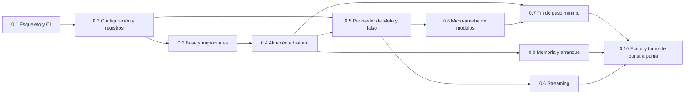

# Backlog · rebanada 0

**Respuesta:** 10 piezas. Al terminar, **una llamada de punta a punta guarda un paso y su evento en la historia** (plan §1): escribes en el editor, envías un mensaje, el principal recibe su arranque, devuelve su salida fija, la app la valida y la historia guarda el fin de paso con la nota y lo diferido. Todavía no se aplica el texto del agente ni corren las comprobaciones: eso es la rebanada 1.

**Cómo se usa:** el agente toma **una pieza por vez**, en el orden del esquema, y no empieza una cuyas dependencias no estén integradas. Cada pieza dice qué leer; si lo que necesita no está ahí, no lo inventa (campo «Si algo no está»). Al terminar, devuelve el **Retorno** común (al final). Tú integras la pieza solo si puedes explicar qué hace sin mirar el código (plan §3).

*Todas las rutas son desde la raíz del repo. «Espec.» = `docs/diseno/bloque-3/bloque-3-especificacion.md`; «defaults» = `docs/diseno/bloque-3/defaults-tecnicos.md`; «esquema» = `docs/diseno/bloque-3/salida-principal.schema.json`; «glosario» = `docs/diseno/glosario.md`.*

## Elecciones técnicas de este backlog (para Eber)

*El diseño no las fija y el agente las necesita. La última columna es tu respuesta.*

| #   | Propuesta                                                                                                                                                                                                                                                                                                                                                                                                                                                                                                                                                                        | En vez de                                                                                                                                                              | Elegiría la otra si…                                                                                                | Decisión de Eber (literal) |
| --- | -------------------------------------------------------------------------------------------------------------------------------------------------------------------------------------------------------------------------------------------------------------------------------------------------------------------------------------------------------------------------------------------------------------------------------------------------------------------------------------------------------------------------------------------------------------------------------- | ---------------------------------------------------------------------------------------------------------------------------------------------------------------------- | ------------------------------------------------------------------------------------------------------------------- | -------------------------- |
| B-1 | **El streaming va por SSE (`text/event-stream`)**, con un latido cada 15 s (espec. §6). Lo que va del navegador al servidor son POST normales. Enviar un mensaje responde al instante con el id del turno; el turno corre en segundo plano y el stream reenvía todo desde el inicio del turno, así no se pierde nada si se abre tarde                                                                                                                                                                                                                                            | WebSocket: hace falta en las dos direcciones a la vez, y aquí no                                                                                                       | Fly corta SSE largos en la prueba de 0.6                                                                            | Adoptamos propuesta        |
| B-2 | **La forma de la salida se valida en Go con `github.com/santhosh-tekuri/jsonschema/v6`** (draft 2020-12), con una copia del esquema dentro del binario y una prueba de que es idéntica a la de `docs/`                                                                                                                                                                                                                                                                                                                                                                           | Escribir el validador a mano, o validar solo con el modo estricto de Meta                                                                                              | La micro-prueba 0.8 muestra que Meta cumple todo el esquema en modo estricto (aun así, la app valida: es la puerta) | Adoptamos propuesta        |
| B-3 | **En la rebanada 0, «sin cambio no hay escritura» compara el texto en NFC y con los finales de línea normalizados;** la huella `tq-md/1` lo reemplaza en la rebanada 1 (espec. §8)                                                                                                                                                                                                                                                                                                                                                                                               | Adelantar la huella a la rebanada 0 (≈ 2–3 h más hoy)                                                                                                                  | El editor mínimo produce «cambios» falsos al abrir y guardar sin editar                                             | Adoptamos propuesta        |
| B-4 | **La prueba desplegada del streaming (0.6) usa una ruta que solo existe al compilar con `-tags=devroutes`.** El binario de la demo no la trae                                                                                                                                                                                                                                                                                                                                                                                                                                    | Una ruta protegida por una variable de entorno                                                                                                                         | —                                                                                                                   | Adoptamos propuesta        |
| B-5 | **El tope del arranque (≤ 15 % de la ventana) se mide con el conteo de tokens de Meta** (`dev.meta.ai/docs/token-counting`); el proveedor falso cuenta 1 token cada 4 caracteres                                                                                                                                                                                                                                                                                                                                                                                                 | Estimar siempre por caracteres                                                                                                                                         | El conteo de Meta no existe o cuesta una llamada por arranque que no cabe en los topes                              | Adoptamos propuesta        |
| B-6 | **El proveedor se elige con `TQ_PROVIDER` = `meta` (por defecto) o `fake`.** Con `fake`, `META_API_KEY` no es obligatoria. Es la única variable que se suma a las de T-9                                                                                                                                                                                                                                                                                                                                                                                                         | Una etiqueta de compilación, que obliga a dos binarios                                                                                                                 | —                                                                                                                   | Adoptamos propuesta        |
| B-7 | **El principal conserva su conversación mientras haya una viva: su último paso fue hace menos de 2 h `[inicial]`.** La conversación es, en orden, lo que se envió y lo que respondió cada llamada de esa instancia (`model_call.input_items` y `raw_items`, tal cual), y se reenvía en cada turno; así sobrevive a un reinicio del servidor. Si no hay una viva, el turno empieza con un arranque `new_session` (bloque-2 §3: «otro día»)                                                                                                                                        | Un arranque en cada mensaje (más tokens y pierde lo que el principal consultó) · o atar la conversación a la pestaña del navegador                                     | Las sesiones reales se cortan en menos de 2 h: se baja el plazo                                                     | Adoptamos propuesta        |
| B-8 | **Una arista se cambia o se termina; nunca se copia igual.** `ChangeEdge(edgeID, toID, anchor)` crea la versión siguiente con el **mismo id**, y la clave de `edge` pasa a `(project_id, id, version)` en una migración `0002` (T-8). `EndEdge(edgeID)` la deja sin versión vigente y no crea copia. Cada operación registra su evento `edge` (`created`, `changed` o `superseded`, glosario §4) y la app llena `data` con el id, el tipo, los extremos y la versión de la arista, para que la historia reconstruya el grafo (estados §8). Reemplaza a `SupersedeEdge` de la 0.4 | Lo que hay: `SupersedeEdge` deja vigente una copia idéntica con un id nuevo, así que la arista reemplazada sigue rigiendo y su historia queda partida en ids distintos | Ninguna arista cambia de extremo en el hackathon: entonces basta `EndEdge`, sin migración                           | Adoptamos propuesta     |

**Despliegue (H-2, adoptada):** el público es el 3-nov. La prueba desplegada de 0.6 se hace en el despliegue de prueba no público del 30-oct (H-5, adoptada). Hasta entonces, 0.6 se prueba en local.

## Piezas

### 0.1 · Esqueleto y CI

| Campo | Contenido |
|---|---|
| **Qué** | El primer commit del repo público: compila, prueba y sirve `/healthz` y una página mínima, sin lógica del ciclo |
| **Implementa** | B3-10 a B3-13 y B3-14 (voz preparada) |
| **Leer** | `docs/diseno/bloque-3/repo-estructura.md` completo (árbol §1, contenido §2, `.gitignore` §4, criterios §6) |
| **Interfaz** | `GET /healthz` → `200 {"status":"ok"}` · `GET /` → página embebida · `internal/voice`: `type Transcriber interface { Transcribe(ctx context.Context, audio io.Reader, lang string) (string, error) }`, sin implementación |
| **Listo cuando** | En local: `make test` y `make vet` pasan, y `make run` cumple el criterio 2 de `repo-estructura.md` §6. Los criterios 1, 3, 4 y 5 los comprueba Eber al hacer su commit y su push |
| **Depende de** | — |
| **No hacer** | Ni SQLite, ni cliente de Meta, ni código en `web/`. No hacer commit ni push: los hace Eber (§5). No escribir `README.md` ni `HACKATHON.md` más allá de lo que dice §3 |
| **Si algo no está** | `[EL DISEÑO NO LO DICE]` en el retorno; no inventar contenido del README |

### 0.2 · Configuración y registros

| Campo | Contenido |
|---|---|
| **Qué** | La app lee su configuración del entorno y registra en JSON sin filtrar contenido |
| **Implementa** | T-9 y T-10 |
| **Leer** | Defaults T-9 y T-10 · espec. §6 (topes de gasto) |
| **Interfaz** | `internal/config`: `Load() (Config, error)`; `Config{Provider, MetaAPIKey, Port, DataDir string; SpendCapProjectUSD, SpendCapDayUSD, SpendCapTotalUSD float64}`. Variables: `TQ_PROVIDER` (B-6), `META_API_KEY` (obligatoria salvo con `fake`), `PORT` (8080), `TQ_DATA_DIR` (`./data`), `TQ_CAP_PROJECT_USD` (3), `TQ_CAP_DAY_USD` (10), `TQ_CAP_TOTAL_USD` (60), con los valores de espec. §6 por defecto. Si falta una variable obligatoria, el error nombra cuál · un `*slog.Logger` JSON a la salida estándar |
| **Listo cuando** | Prueba: con `TQ_PROVIDER=meta` y sin `META_API_KEY`, `Load` falla y nombra la variable · prueba: con `fake`, no hace falta la clave · prueba: el registro de una petición no contiene su cuerpo (la de los errores del proveedor va en 0.5) |
| **Depende de** | 0.1 |
| **No hacer** | Archivo de configuración. Registrar texto de documentos, mensajes, la clave o cuerpos crudos de error |
| **Si algo no está** | Una opción nueva que no esté en T-9 se marca `[EL DISEÑO NO LO DICE]`; no se agrega por cuenta propia |

### 0.3 · Base y migraciones

| Campo | Contenido |
|---|---|
| **Qué** | La base SQLite con todas las tablas del modelo de datos, creada sola al arrancar |
| **Implementa** | Espec. §1 (diagrama: `project`, `object`, `version`, `edge`, `event`, `delivery`, `model_call`, `label_counter`) y §7 · T-7 y T-8 |
| **Leer** | Espec. §1 (diagrama y viñetas) y §7 · defaults T-7 y T-8 · glosario §1 |
| **Interfaz** | `internal/store/migrations/0001_init.sql` (embebido) · `store.Open(ctx, dataDir string) (*DB, error)`: aplica las migraciones pendientes, cada una en su transacción, y deja dos `*sql.DB`: escritura (`SetMaxOpenConns(1)`) y lectura. Las `PRAGMA` (`journal_mode=WAL`, `foreign_keys=ON`, `busy_timeout`) se aplican al abrir cada conexión · fechas como texto `2006-01-02T15:04:05.000Z`, en una columna `created_at` de `project`, `version`, `event`, `delivery` y `model_call` · todas las tablas hijas llevan `project_id` (clave compuesta, espec. §1: «todo pertenece a un proyecto») · `edge` tiene su propio id interno, sin etiqueta · además del diagrama, solo la tabla `schema_version` (T-8) |
| **Listo cuando** | Prueba: abrir dos veces la misma carpeta no reaplica migraciones (`schema_version`) · prueba: cada conexión tiene WAL y `foreign_keys` · `object` tiene `UNIQUE(project_id, label)` y `event` tiene `UNIQUE(project_id, seq)` |
| **Depende de** | 0.2 |
| **No hacer** | Tablas que no estén en el diagrama. Herramientas de migración externas. Guardar la criticidad o el estado «lista» (espec. §1.1 y §1.5) |
| **Si algo no está** | Un tipo de columna o un índice que el diagrama no da: elegir el mínimo y listarlo en el retorno como `[EL DISEÑO NO LO DICE]` |

### 0.4 · Almacén e historia

| Campo | Contenido |
|---|---|
| **Qué** | Leer y escribir objetos, versiones, aristas y eventos: cada escritura con su evento en la misma transacción, condicionada por versión, con etiquetas cortas y aislada por proyecto |
| **Implementa** | Espec. §1 (tablas 1.1 a 1.3, etiquetas) y §2 (escritura condicionada) · T-2 · T-7 |
| **Leer** | Espec. §1 completo y §2 (primera viñeta) · glosario §2, §3, §4 y §8 · defaults T-2 · `docs/diseno/bloque-1/bloque-1-estados.md` §8 (la historia) |
| **Interfaz** | `db.Write(ctx, projectID string, fn func(tx *Tx) error) error`: una transacción en el escritor único. En `Tx`: `CreateObject(t ObjectType, state string, body any, ev EventInput) (Object, error)` (asigna id interno de 128 bits en base32 y etiqueta con `label_counter`) · `UpdateObject(id string, expectedVersion int, state string, body any, ev EventInput) (Object, error)`, que devuelve `ErrVersionConflict` si `rowsAffected != 1` y `ErrNoChange` si nada cambió (B-3) · `AddEdge(t EdgeType, fromID, toID, anchor string, ev EventInput) (Edge, error)` · `SupersedeEdge(edgeID string, ev EventInput) (Edge, error)` (marca `current = false` y crea la versión nueva) · `AppendEvent(ev EventInput) (Event, error)`, con `seq` = el siguiente del proyecto. Lecturas: `GetObject(ctx, projectID, idOrLabel)`, `ListObjects(ctx, projectID, t)`, `EdgesFrom/To`, `EventsSince(ctx, projectID, seq)`. Tipos cerrados: `ObjectType`, `EdgeType` y `EventType` con los valores del glosario; cada tipo sabe qué estados admite (tabla 1.1) |
| **Listo cuando** | Pruebas con el código en el nombre (T-11): versión vieja → `ErrVersionConflict` y nada escrito · objeto y evento en la misma transacción (si falla el evento, no queda el objeto) · etiqueta inmutable y sin reutilizar (`dec-1`, `dec-2`; reemplazar crea `dec-3`) · un estado que el tipo no admite se rechaza · leer con el `projectID` de otro proyecto no encuentra nada · `seq` crece sin huecos por proyecto |
| **Depende de** | 0.3 |
| **No hacer** | Transiciones de estado de bloque-1-estados §1–§7 (rebanada 1). Borrar o editar eventos: no existe esa función. Transacciones abiertas mientras se espera al modelo (espec. §2) |
| **Si algo no está** | Un campo de `body` que la tabla 1.1 no nombra: `[EL DISEÑO NO LO DICE]`, no se agrega |

### 0.5 · Proveedor de Meta y proveedor falso

| Campo | Contenido |
|---|---|
| **Qué** | Un cliente de la Responses API de Meta que guarda cada ítem de salida crudo y lo reenvía byte a byte, y un proveedor falso que repite ítems grabados |
| **Implementa** | Espec. §7 (cliente) y §1.4 (`model_call`) · T-10 y T-11 |
| **Leer** | Espec. §1.4 y §7 · defaults T-10 y T-11 · `https://dev.meta.ai/docs/protocols/responses`, `/docs/models`, `/docs/reasoning`, `/docs/pricing-rate-limits` |
| **Interfaz** | `internal/provider`: `type Provider interface { Respond(ctx context.Context, req Request, onDelta func(Delta)) (Response, error) }` (`onDelta` puede ser nil) · `Request{ProjectID, TurnID, InstanceID string; Role AgentRole; Model, Effort, Instructions string; Input []json.RawMessage; Schema json.RawMessage}` · `Response{RawItems []json.RawMessage; Text string; Usage Usage}` · `Usage{InputTokens, OutputTokens, ContextWindow int; CostUSD float64}` · siempre `store: false` e `include: ["reasoning.encrypted_content"]` · `ProviderError{Code, Type string}`, sin el cuerpo crudo · `NewFake(fixtures ...Fixture)` devuelve las grabaciones en el orden dado, una por llamada; `LoadFixture(path string) (Fixture, error)`; `Fixture{Name string; Deltas []string; Items []json.RawMessage; Usage Usage; DeltaDelay time.Duration}` en JSON en `internal/provider/testdata/` · una grabación hecha a mano, `stream-90s.json` (≈ 90 deltas a 1 s), para 0.6 · `CountTokens(ctx, model string, input []json.RawMessage) (int, error)` (B-5; el falso cuenta 1 cada 4 caracteres) · cada llamada escribe una fila en `model_call` (instancia, rol, modelo y esfuerzo, tokens, ventana, ítems de entrada y de salida tal cual, costo) · los modelos van como constantes en `internal/provider/models.go`, tomados de la documentación de Meta, incluidas `PrincipalModel` y `PrincipalEffort`: cambiar el modelo del principal es cambiar esa constante y desplegar · con `TQ_PROVIDER=fake`, la app carga las grabaciones de `internal/provider/testdata/app/` en orden de nombre (al menos `01-principal-valid.json` y `02-principal-invalid.json`) y, al acabarse, vuelve a la primera |
| **Listo cuando** | Prueba: los ítems crudos de una respuesta, reenviados en la siguiente, son idénticos byte a byte · prueba: un error del proveedor no deja su cuerpo en el error devuelto ni en el registro (T-10) · prueba: el falso emite los deltas al ritmo de `DeltaDelay` · prueba: cada llamada deja su `model_call` · con `-tags=meta` y la clave, una llamada real responde |
| **Depende de** | 0.2 (y 0.4 para escribir `model_call`) |
| **No hacer** | Topes y reserva de gasto (rebanada «Entrega», espec. §6). Búsqueda web (rebanada 3). Reintentos automáticos de la forma: los decide 0.7 |
| **Si algo no está** | Si la documentación de Meta no confirma un campo (`include`, `store`, conteo de tokens), se marca `[EL DISEÑO NO LO DICE]` y se pregunta; no se adivina el nombre de un modelo |

### 0.6 · Streaming

| Campo | Contenido |
|---|---|
| **Qué** | Lo que dice el modelo llega al navegador mientras lo escribe, sin cortarse en respuestas largas |
| **Implementa** | Espec. §6 (streaming) y la hipótesis de `docs/diseno/bloque-3/bloque-3.md` §6 («el streaming largo de Wonder no se corta en Fly») · B-1 · B-4 |
| **Leer** | Espec. §6 (streaming, seguridad) · `docs/diseno/bloque-3/bloque-3.md` §6 |
| **Interfaz** | `GET /api/projects/{projectID}/turns/{turnID}/stream` → SSE: eventos `delta`, `step` (resultado del fin de paso), `error` (solo código y un mensaje del catálogo, nunca el error crudo) y un latido cada 15 s · un solo escritor por conexión · `WriteTimeout` sin límite en esta ruta e `IdleTimeout` fijado · el stream guarda lo emitido del turno y lo reenvía desde el inicio a quien se conecte (B-1) · con `-tags=devroutes`, `GET /api/dev/stream-test` emite `stream-90s.json` con el proveedor falso |
| **Listo cuando** | Prueba local: 90 s de streaming con el proveedor falso llegan completos y con latidos · prueba: un cliente que se conecta a los 20 s recibe también lo emitido antes · desplegado en el despliegue de prueba (H-5, 30-oct): la misma prueba llega completa |
| **Depende de** | 0.5 |
| **No hacer** | Acceso por invitación y cookies (rebanada «Entrega»). Desplegar en público antes del 3-nov (H-2) |
| **Si algo no está** | `[EL DISEÑO NO LO DICE]` en el retorno |

### 0.7 · Fin de paso mínimo

| Campo | Contenido |
|---|---|
| **Qué** | La app valida la forma de la salida del principal y guarda el fin de paso en la historia. Todavía no aplica el texto ni crea objetos |
| **Implementa** | Espec. §3, regla 1 · fichas §7 (reintento y pendiente del agente) · T-6 · B-2 |
| **Leer** | Espec. §3 (regla 1, y el párrafo de largo de la nota) · esquema completo · `docs/diseno/bloque-1/bloque-1-fichas.md` §7 (primer párrafo y fila «Principal, en cada paso») · espec. tabla 1.3 (`step_ended`, `output_retry`) · defaults T-6 |
| **Interfaz** | `internal/cycle`: `EndStep(ctx, projectID, turnID string, attempt int, output json.RawMessage) (StepResult, error)` · `StepResult{Status: accepted · retry · agent_pending; Errors []string}` · el esquema embebido en `internal/cycle/schema/principal_output.schema.json` · `EndStep` no llama al modelo: si no cumple y `attempt == 1`, guarda `output_retry` (`attempt: 1`) y devuelve `retry` con los errores (ruta JSON y mensaje, sin ids internos); quien corre el turno (0.10) vuelve a llamar una vez con el mensaje `RetryMessage(errors)`: «Your output did not match the required schema: <errores>. Return the complete output again.» Si `attempt == 2` y no cumple: `output_retry` con `result: "agent_pending"` y `agent_pending` · si cumple: evento `step_ended` con `triage_line`, `closing_risk`, la nota completa y lo diferido |
| **Listo cuando** | Prueba: la copia embebida del esquema es idéntica a `docs/diseno/bloque-3/salida-principal.schema.json` · pruebas con salidas grabadas (válida, sin `operation`, `replace` con ancla vacía, `reviewed_unchanged` sin `reason`): la válida deja `step_ended`; las otras, el reintento y luego el pendiente · prueba: una nota de 500 palabras no se rechaza y queda completa |
| **Depende de** | 0.4 y 0.8 (los ítems grabados) |
| **No hacer** | Reglas 2 a 7 de §3, crear decisiones, aristas o etiquetas desde la salida, comprobaciones (rebanadas 1 y 2) |
| **Si algo no está** | `[EL DISEÑO NO LO DICE]` en el retorno |

### 0.8 · Micro-prueba de modelos

| Campo | Contenido |
|---|---|
| **Qué** | Saber, antes de construir encima, qué cumple Meta de la salida fija y grabar respuestas reales para el proveedor falso |
| **Implementa** | La nota de la micro-prueba 0.8 de los defaults · T-11 (ítems grabados) · la hipótesis «la salida fija basta» de `bloque-3.md` §6, solo en su forma |
| **Leer** | Defaults (nota «Para la micro-prueba 0.8») · esquema completo · `https://dev.meta.ai/docs/models` y `/docs/protocols/responses` |
| **Interfaz** | `go test -tags=meta ./internal/provider/microtest/...` · graba en `internal/provider/testdata/` · escribe `docs/casos-prueba/micro-prueba-0.8/informe.md` |
| **Listo cuando** | El informe dice, por palabra clave del esquema (`if`/`then`, `minLength`, `pattern`, `anyOf`, `const`, propiedades opcionales), si el modo estricto la admite · 10 llamadas de Spark con un pedido de juguete: cuántas salidas cumplen el esquema completo en Go · uso de tokens y costo por llamada · ventana de cada modelo (para B2-2 y B2-3) · al menos 3 respuestas grabadas: una válida, una inválida y una con streaming |
| **Depende de** | 0.5 y la clave de Meta |
| **No hacer** | Ajustar el esquema de `docs/` según el resultado: eso lo decide Eber. Probar Wonder en firma (rebanada 1) |
| **Si algo no está** | Si Meta no tiene modo estricto, el informe lo dice y la validación queda solo en Go (B-2) |

### 0.9 · Memoria del principal y arranque

| Campo | Contenido |
|---|---|
| **Qué** | La memoria de 3 capas calculada desde el grafo y la historia, el arranque por tarea con su tope medido, `read(id)` con lo entregado registrado, y el reinicio por cambio de modelo |
| **Implementa** | B2-1, B2-2 y B2-5 (lo de la rebanada 0) · espec. §1.4 y §5 · T-2 (traducción en un solo lugar) · B-5 |
| **Leer** | `docs/diseno/bloque-2/bloque-2.md` §2, §3 y §4 (las viñetas de cambio de modelo) · `docs/diseno/bloque-2/decisiones.md` B2-1, B2-2, B2-5 y B2-6 · espec. §1.4 y §5 · glosario §7 y §8 · defaults T-2 y T-6 |
| **Interfaz** | `internal/graph`: `Labeler` con `ToLabel(id)` y `ToID(label)`: el único lugar que traduce · `internal/memory`: `WorkingState(ctx, projectID) (State, error)` con `Essentials`, `Index` e `InFlight` (bloque-2 §2) · `Startup(ctx, projectID string, reason StartupReason, window int, count TokenCounter) (Brief, error)`, con `type TokenCounter func(ctx context.Context, input []json.RawMessage) (int, error)`, ya ligado al modelo (lo arma 0.10 desde `CountTokens` de 0.5 y `PrincipalModel`), con `reason` `new_session` · `model_change` · `threshold`: arma núcleo, tarea en turno, índice recortado, lo que cambió y tus mensajes, en ese orden; recorta en el orden de bloque-2 §3 si pasa del 15 %; escribe las filas de `delivery` (`via = startup`) y el evento `startup` con la instancia nueva · `Read(ctx, projectID, instanceID, label string) (Item, error)`: texto vigente con su versión, y una fila de `delivery` (`via = read`) · `ChangesSinceDelivery(ctx, projectID) ([]Change, error)` |
| **Listo cuando** | Prueba: lo que el humano dijo entra en literal, nunca resumido · prueba: el arranque del proyecto sembrado (`internal/memory/testdata/seed.go`: 1 pedido con destinatario, 2 criterios con sus casos, 1 premisa, 3 secciones, 6 decisiones de las que 2 críticas, 1 tarjeta abierta, 2 mensajes tuyos, uno sin respuesta) pesa ≤ 15 % de la ventana y, al pasarse, recorta en el orden de §3 sin tocar el núcleo ni la tarea en turno · prueba: ningún id interno aparece en el `Brief` · prueba: con otro `PrincipalModel`, el turno siguiente crea una instancia nueva y un `startup` con `model_change`, y de la anterior solo pasan su nota y lo diferido · prueba: tras `Read`, «lo que cambió» ya no incluye ese objeto en esa versión · la nota entra con sus primeras 80 palabras, marcada «recortada» |
| **Depende de** | 0.4 (y 0.5 para medir con B-5) |
| **No hacer** | Umbral y limpieza (rebanada 4), `search` (rebanada 3), sondas (rebanada 2). Guardar la memoria como fuente: es una consulta; si se cachea, se recalcula cuando no cuadra (espec. §5) |
| **Si algo no está** | Un elemento de una capa sin tipo en el grafo: `[EL DISEÑO NO LO DICE]`; no se crea un estado ni una tabla |

### 0.10 · Editor mínimo y turno de punta a punta

| Campo | Contenido |
|---|---|
| **Qué** | Escribes una sección, envías un mensaje, ves al principal escribir y ves su fin de paso. Es el «Listo cuando» de la rebanada |
| **Implementa** | Plan §1 (rebanada 0, «editor mínimo») · espec. §2 (guardado) y §7 (pila) · T-1 (catálogo `en`/`es`) · B3-14 (entrada única de texto) |
| **Leer** | Espec. §2 (viñeta «Guardado») y §7 · defaults T-1 · `docs/diseno/bloque-3/repo-estructura.md` (voz preparada) · `docs/diseno/bloque-3/bloque-3.md` §4 (qué ves, solo como referencia de lo que viene) · fichas §7, fila «Principal, en cada paso» |
| **Interfaz** | API: `POST /api/projects` → `{project_id}` · `POST /api/projects/{projectID}/sections` → `{label, version}`: crea una sección vacía en `draft` · `GET /api/projects/{projectID}/sections` · `PUT /api/projects/{projectID}/sections/{label}` con `{base_version, text}` → `200` (nueva versión), `204` (sin cambio, B-3) o `409` (versión vieja) · `POST /api/projects/{projectID}/messages` con `{text}` → `{turn_id}` al instante (B-1); en segundo plano: guarda `human_message`; si no hay una conversación viva (B-7), arma el arranque `new_session` (0.9) y abre una instancia nueva; si la hay, reenvía su conversación más los cambios desde lo entregado; si `PrincipalModel`/`PrincipalEffort` difiere del `model_and_effort` del último `model_call` de la instancia, arranque `model_change` con una instancia nueva; llama al principal con las instrucciones en inglés y el esquema (0.5), cierra con `EndStep` (0.7), hace el reintento si `EndStep` lo pide, y emite por el streaming (0.6) · tipos de TypeScript generados con `tygo` · `web/`: React + Vite + TipTap 3; todo texto de pantalla sale de `web/src/i18n/en.json` y `es.json`; un componente `MessageInput` (solo texto) · instrucciones al principal en `internal/cycle/prompts/principal.en.md`, borrador que revisa Eber: la salida fija de fichas §7, responder en el idioma del pedido y nunca traducir anclas, pasajes ni lo del humano (T-1) |
| **Listo cuando** | Con el proveedor falso, en el navegador: creas un proyecto, escribes una sección, envías un mensaje y ves los `delta`, la línea de triaje y la nota; la historia tiene, en orden, `human_message`, `startup`, `step_ended` · un segundo mensaje dentro de las 2 h no crea otro `startup` y reenvía la conversación · una salida inválida grabada provoca un reintento y luego el pendiente · el guardado ocurre al salir del campo, cada ~30 s, al ocultar la pestaña y antes de enviar · abrir y guardar sin editar no crea versión · lo mismo con `TQ_PROVIDER=meta` y Spark |
| **Depende de** | 0.6, 0.7 y 0.9 |
| **No hacer** | El marco, tarjetas, firma, propuestas, una sola pestaña editora (rebanada 1), aplicar el texto del agente. Ningún cálculo con valor de evidencia en React: lo calcula Go (`bloque-3.md` §2). Ningún texto de pantalla escrito a mano |
| **Si algo no está** | Una pantalla o un texto que el diseño no da: el mínimo, con su clave de catálogo, y `[EL DISEÑO NO LO DICE]` en el retorno |

## Retorno de cada pieza (igual para todas)

1. **Qué hace, en 5 líneas** que Eber pueda repetir sin mirar el código.
2. **Archivos** creados o cambiados.
3. **Pruebas:** nombre de cada una y qué regla prueba; salida de `make test` y `make vet`.
4. **Lo que no hizo** de la pieza, y por qué.
5. **`[EL DISEÑO NO LO DICE]`:** cada hueco que encontró, dónde y qué eligió como mínimo provisional, si eligió algo.
6. **Dudas para Eber**, como máximo 3, con su contraste.
