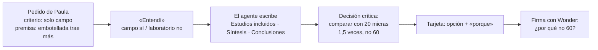

# Caso 5 · plantilla de la demo

**Respuesta:** la carpeta `plantilla/` se copia tal cual a `internal/demo/case5/` en el repo de código. Trae el pedido de Paula (`request.json`) y 15 fuentes: 14 artículos ficticios y su cálculo de la comparación. Con ella, la rebanada 1 llega a la decisión crítica «comparar solo con el mismo tamaño mínimo» (1,5 veces, no 60) y a su firma.

## Qué trae

| Archivo | Para qué |
|---|---|
| `request.json` | `name`, `text`, `audience`, `criteria[]`, `premise`, `exploratory` y `sources[]` (`filename`, `kind`: `file` o `calculation`) |
| `sources/t1…t6` | 6 estudios de campo de agua de grifo: 4 con filtro de 100 micras, 2 con 20 |
| `sources/b1…b6` | 6 estudios de campo de agua embotellada: 3 con filtro de 1 micra, 3 con 20 |
| `sources/l1-…` | 1 estudio de laboratorio: lo excluye el criterio (caso claro para el «Entendí») |
| `sources/d1-…` | 1 piloto en laboratorio con agua de una planta real: el caso dudoso de «campo» (rebanada 2, «por aclarar») |
| `sources/calculo-comparacion.md` | El cálculo de Paula (F-1): 60 veces con conteos crudos; 1,5 veces con el mismo tamaño mínimo (5 estudios) |

Las cifras cuadran: grifo 64 ÷ 6 = 10,67; embotellada 3.840 ÷ 6 = 640; 640 ÷ 10,67 = 60. Con 20 micras: (18 + 22) ÷ 2 = 20; (28 + 32 + 30) ÷ 3 = 30; 30 ÷ 20 = 1,5. Cada cifra está literal en una fuente, así que el texto del agente no deja «cifra sin decisión» si la vincula.

## Qué debe pasar en la rebanada 1 (pantallas.md, pasos 1 a 6)

1. El «Entendí» propone cómo aplica «campo»: un caso que cuenta (un muestreo de grifos reales) y otro que no (L1).
2. El agente escribe las tres secciones y declara la regla de comparación con su contraste («en vez de» comparar los conteos crudos).
3. La regla es crítica porque la usan «Síntesis» y «Conclusiones» (dos secciones, fichas §3). La cifra 1,5 es un dato copiado del cálculo (A-3).
4. Tarjeta, historia de la cifra y firma. Al explicar, falta el porqué de la regla: Wonder lo nombra y trae un caso nuevo.

## Para el evaluador (no se muestra al usuario)

- **Dónde nace la deuda:** Paula cree que la embotellada trae unas 20 veces más. Los conteos crudos dicen 60 y le darían la razón; la comparación válida dice 1,5. Si firma sin entender por qué no 60, su comité la desarma.
- **D1** es el caso dudoso de «campo»; en la simulación el agente lo contaba como campo. Llega con la rebanada 2.
- **Fuera de esta plantilla:** la cita que no existe («Valdivia y Ortiz, 2022») y la ronda web son de la rebanada 3.

## Hipótesis por probar

- El idioma: la plantilla va en español, como el caso. Si el jurado es en inglés, se traduce `plantilla/` entera (≈ 1 h) y el agente responde en inglés (T-1). Se prueba con el primer recorrido con Meta.
- Que el agente llegue a la firma en 5 pasos o menos (B-17). Se prueba en la 1.8.
