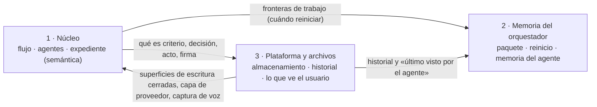

# Encuadre del diseño v2 en tres bloques

*El [doc 12](../investigacion/12-flujo-de-funcionamiento.md) es la base vigente. El diseño v1 de esta carpeta, el planteamiento, el ROADMAP y AGENTS.md son anteriores al hackathon ([doc 11](../investigacion/11-hackathon-meta.md)) y están desactualizados. DEC-002, DEC-003 y las lecciones de los casos siguen vigentes.*

## Los tres bloques

| Bloque | Qué cubre | Secciones del doc 12 | Otras fuentes |
|---|---|---|---|
| **1 · Núcleo** | Flujo de funcionamiento y sus etapas; gestión de agentes (qué agentes, cuántos, de qué tipo, principal y subagentes); contacto humano; verificación; puerta de firma; modelo y esfuerzo por rol | §0–§7, §10 (la puerta de firma hoy solo está en el diseño v1 §3) | Literatura (04, 07–09), casuísticas (01, 04), casos 01–02 y diagnóstico, gentle-pi |
| **2 · Memoria del orquestador** | Cómo evita el principal degradarse con contexto largo: memoria del agente (no la ve el usuario), paquete de arranque, contexto chico, reinicio. Engram tal cual o uno propio basado en su código | §9.1–§9.7, decisión 7 | Engram, gentle-pi, literatura de contexto largo |
| **3 · Plataforma y archivos** | Dónde corre tupaqnin (hackathon como primera versión y hoja de ruta); directorios y archivos que ve el usuario; memoria y gestión de cambios de lo que construyen usuario y agente | §8, §9.8, decisión 9 | Doc 10 (Obsidian), doc 11 (app web) |

**Trayectoria de la plataforma:** Claude Code y OpenCode/Pi (herramientas de CLI que gran parte del público no usa) → plugin de Obsidian → app web, porque el público también cocrea diseños y planos y necesitará conectar con otras aplicaciones (p. ej. AutoCAD). No está cerrado.

## Fronteras entre bloques

| Frontera | Del bloque que define | Al bloque que implementa o consume |
|---|---|---|
| Expediente | 1: qué es un criterio, una decisión, un acto, una firma | 3: dónde se guarda y cómo se versiona |
| Dos memorias | 3: historial de cambios de los archivos y «último visto por el agente» | 2: los consume para el paquete de arranque y para detectar cambios; no los guarda |
| Contexto | 1: fronteras del flujo (fin de tramo, acto cerrado) y delegación de lecturas (D2, D5) | 2: reinicia en esas fronteras |
| Escritura y modelos | 1: cuatro lugares de escritura; modelo y esfuerzo por rol | 3: los hace cumplir; capa de proveedor |
| Puerta de firma | 1: qué se explica y cuándo bloquea | 3: captura de audio en el navegador |

## Orden de trabajo

1. **Bloque 3**, empezando por lo que bloquea el día 1 del hackathon: fuente de verdad (archivos o base de datos), estructura que ve el usuario e historial.
2. **Bloque 1**, por etapas del flujo.
3. **Bloque 2**, que depende de las fronteras del bloque 1 y del historial del bloque 3.

Cada módulo se cierra cuando Eber responde un caso de aplicación sin mirar el texto, no contradice un módulo ya cerrado, no depende de Claude Code ni de `tq`, y tiene fijada su línea «en el hackathon».
