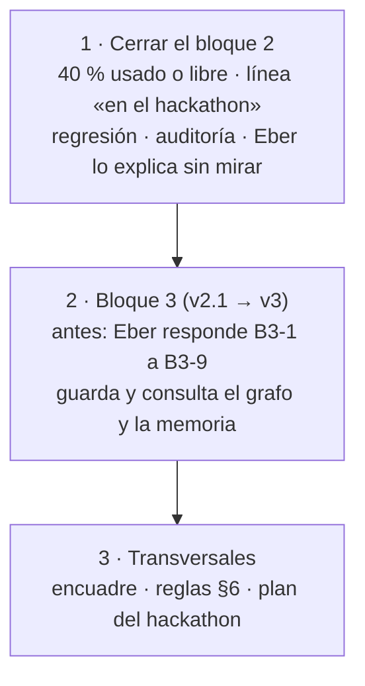

# Handoff · cerrar el bloque 2 y pasar al bloque 3

**Respuesta corta:**
- **Bloque 1:** cerrado en contenido (v4.9, validado).
- **Bloque 2:** rehecho desde cero (v2.0, validado). Para cerrarlo faltan una respuesta de Eber, la línea «en el hackathon», la regresión de relevo, una auditoría y la prueba de cierre.
- **Bloque 3:** espera que Eber responda B3-1 a B3-9. Después absorbe el grafo del proyecto y la memoria del principal.

## 1. Orden

## 2. Qué se avanzó en esta sesión

**Bloque 1 · v4.9**
- **Archivos:** fichas v1.8, estados v1.7, flujos v1.7.
- **Auditoría externa:** analizada y aplicada.
- **Barridos de coherencia:** exhaustivos, con validadores independientes.
- **`bloque-1.md` legible:** sin códigos y con la respuesta primero.
- **El marco (M-1 a M-4):** vista calculada por la app, ordenada por el argumento, oculta durante la firma; la línea de retorno es M-2.
- **Grafo del proyecto (N-1, fichas §9):** motor único. Ningún modelo crea aristas interpretando texto libre.
- **N-2:** el grafo del dominio queda en la hoja de ruta.
- **Firma simplificada:** queda solo K-6. K-12 y K-10(a) se retiraron; K-14 y K-15 se descartaron.

**Bloque 2 · v2.0**
- **Qué es:** la memoria del principal, nuestra versión de Engram. Eber eligió **A**: la app calcula la memoria desde el grafo y el agente solo escribe una nota marcada.
- **B2-1 · Qué guarda:** es una consulta del grafo más los eventos que no son nodos. Tiene 3 capas: lo esencial en literal, el índice y lo en vuelo. Es lo que el bloque 1 llama «estado de trabajo».
- **B2-2 · El arranque:** uno solo, que trae la memoria, la tarea en turno, lo que cambió y tus últimos mensajes en literal. El principal consulta con `buscar` y `leer(id)`.
- **B2-3 · Umbral y limpieza:** el principal conserva la conversación hasta el umbral (~40 % `[inicial]`). Al llegar, se limpia el contexto en el fin de paso, nunca durante una firma. No se resume. Un cambio de modelo siempre reinicia. Si lo que recuerda choca con la memoria, manda la memoria.
- **B2-4 · Delegar:** un contexto largo no es razón para delegar. El bloque 1 queda con 3 razones.
- **`bloque-2/decisiones.md`:** limpio, solo con lo vigente; lo anterior está en el commit `713e79d`. Ahí está registrada la elección de A, con B y C descartadas. **Este cambio no está en un commit todavía.**

## 3. Qué falta en el bloque 2

| # | Qué | Quién | Nota |
|---|---|---|---|
| 1 | **¿El ~40 % es contexto usado o libre?** | Eber | Lo único abierto. Cambia una línea en §4 y otra en §6 de `bloque-2.md`, y la nota de `decisiones.md` |
| 2 | **Línea «en el hackathon»** (la exige el encuadre) | Claude propone, Eber adjudica | Fila con contraste: qué entra entre memoria de 3 capas y arranque, `buscar`/`leer(id)`, umbral medido o solo el reinicio por cambio de modelo. Frases literales de Eber en `_plan-hackathon.md` |
| 3 | **Regresión de relevo** (paso 4b) | Subagentes | Casos 3, 7 y 10, con y sin nota del agente, en `docs/casos-prueba/` (base: `relevo-b2-v1/`). Si falla la nota, se reabre B2-1 y entra la opción C |
| 4 | **Auditoría** (paso 5) | 1 auditor independiente | Máximo 6 hallazgos, una corrección y una reverificación |
| 5 | **Prueba de cierre** (paso 6) | Eber | Explica el bloque sin mirar, con un caso: el caso 7, Diego en «continúa hasta terminar» cuando se llena el contexto |
| 6 | **Limpieza menor** | Claude | `encargo.md`: el paso 1 dice «M1–M7» y el 4b dice «v1.2» |

Quedan «sin probar» y no frenan el cierre: el umbral real (requiere los modelos reales) y la primera línea como entrada del índice.

## 4. Qué falta en el bloque 3 (v2.1 → v3)

**Antes:** Eber responde B3-1 a B3-9 en `bloque-3/bloque-3-decisiones.md`. B3-8 desplegaba la rebanada 0 el 28-oct, así que hay que revisar esa fecha. B3-9 es el marco como panel izquierdo.

- **Modelo de datos (especificación §1):**
  - `VINCULO` con los 11 tipos de arista de fichas §9;
  - `OBJETO` suma la pregunta del destinatario y el rol de la sección;
  - `EVENTO` suma la duración de los actos (K-11), el cambio de rol (K-13), la nota del agente y el registro de lo entregado al principal.
- **Capa de consultas del grafo:** marco, propagación (A-1), criticidad, cobertura (A-5), subgrafo de la firma y **memoria del principal** (B2-1). Va en SQLite con consultas recursivas, sin una base de grafos aparte.
- **Del bloque 2:**
  - `buscar` y `leer(id)`: revisar que calcen con las herramientas de B3-1;
  - la medición del contexto con el uso que reporta cada respuesta;
  - el umbral por modelo;
  - qué ve el humano cuando cambia el modelo;
  - exportar a Engram, que va a la hoja de ruta.
- **Pendientes del barrido:**
  - «cambió» compara todo lo que la sección usa, no solo lo crítico;
  - la edición sospechosa (G-1);
  - los cambios sin cerrar y el inventario;
  - la marca y la exportación sin firmar (K-10b);
  - **lo que guarda la firma breve: ya no aplica K-12**, solo A-4.
- **Interfaz:** ¿se fusionan el panel de secciones y el marco?
- **Horas:** rehacer las horas (§8) y llevar `bloque-3.md` y la especificación a la v4.9 del bloque 1.

## 5. Transversales

- **`_encuadre-bloques.md`:** «Expediente» pasa a ser «Grafo del proyecto» (el 1 lo define, el 3 lo guarda y el 2 lo consume). Su diagrama está en LR y debe ir en TD.
- **`_reglas-de-trabajo.md` §6 y su copia `claude/reglas-de-diseno-tupaqnin.md` en el proyecto de claude.ai:** el estado está desactualizado.
- **`_plan-hackathon.md`:**
  - H-1 y H-2 abiertas;
  - las horas no cuadran;
  - dónde van el umbral y `buscar`;
  - el corte es el 31-oct y la entrega el 4-nov.

## 6. Qué leer, en este orden

1. `_reglas-de-trabajo.md`
2. Este handoff
3. `bloque-2/bloque-2.md`, `bloque-2/decisiones.md` y `bloque-2/encargo.md`
4. `bloque-1/bloque-1.md` y `bloque-1/bloque-1-fichas.md` (§7 contratos, §8.3 delegar, §9 grafo)
5. Para el bloque 3: `bloque-3/bloque-3.md`, `bloque-3-especificacion.md` y `bloque-3-decisiones.md`
6. Si hace falta el porqué: `bloque-1/bloque-1-decisiones.md` y `bloque-1/bloque-1-revision.md`

## 7. Reglas que no se pueden olvidar

- **Eber primero.** Toda propuesta va como fila en decisiones, con contraste («en vez de», «elegiría la otra si…») y la columna de Eber vacía. Que Eber no rechace nada es una alarma.
- **No crear una decisión para aclarar otra.** Si dos chocan, queda una (como K-6).
- **No guardar decisiones superadas** en los archivos de decisiones: git las conserva.
- **Edición:**
  - respaldo en `$HOME` del dispositivo (`respaldo-28oct*`);
  - reemplazos exactos con `~/lib_edit.py` (si uno no calza, no se escribe nada);
  - verificar el archivo después de escribir;
  - renderizar los Mermaid con `mmdc`, siempre en TD.
- **Validar cada bloque** con revisores independientes, una corrección y una reverificación.
- **Desde el chat no se borra nada.** Eber hace los commits.
- **`bloque-1.md` es lo que lee Eber:** sin códigos en el cuerpo, primero la respuesta, máximo 2 páginas por idea.
