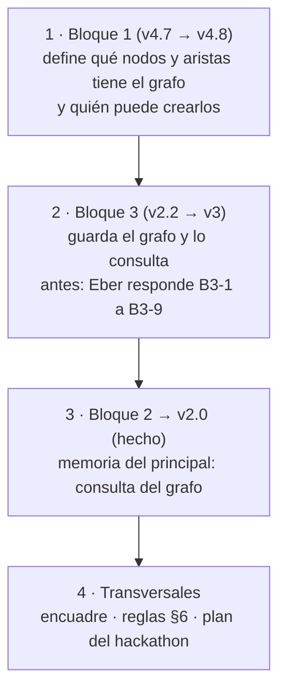

# Handoff · actualizar los tres bloques

**Avance (27-oct, noche):**
- **Bloque 1 · v4.9, validado.** Integra N-1, N-2 y K-13. La firma quedó simple: K-12 y la parte (a) de K-10 se retiraron, K-14 y K-15 se descartaron, y solo queda K-6. V3 sigue abierta.
- **Bloque 2 · v2.0, rehecho desde cero.** Es la memoria del principal (nuestra versión de Engram): B2-1 a B2-4 adoptadas; las 19 anteriores quedan como historia. Falta confirmar si el umbral de ~40 % es de contexto usado. B2-4 ya se aplicó al bloque 1 (tres razones para delegar). M6 (exportar a Engram) pasa al bloque 3 como hoja de ruta.
- **Lo que sigue es el bloque 3.** Antes, Eber responde B3-1 a B3-9.

**Respuesta corta (al abrir este handoff):** el bloque 1 está en la v4.7, validado, pero le faltan 4 decisiones ya adoptadas (K-12, K-13, N-1 y N-2). La más grande es N-1: **el grafo del proyecto es el motor único** de todo lo que se calcula. Los bloques 3 y 2 siguen alineados con la v4.4. El orden es: **bloque 1 → bloque 3 → bloque 2 → transversales**, un bloque por sesión, cada uno con su validación.

## 1. Por qué ese orden



Es la frontera del encuadre: el bloque 1 define la semántica, el bloque 3 la guarda y el bloque 2 la consume. Si se actualiza primero el 3 o el 2, se rehacen cuando el 1 fije las aristas.

## 2. Qué decisión mueve qué

| Decisión (adoptada) | Bloque 1 | Bloque 3 | Bloque 2 |
|---|---|---|---|
| **N-1** grafo del proyecto como motor único | Nombrarlo; 3 aristas nuevas; regla de origen; contratos | Tipos de vínculo; capa de consultas; índices | El estado de trabajo es una consulta del grafo |
| **N-2** grafo del dominio solo en la hoja de ruta | 1 línea en §6 | — | — |
| **K-12** firma breve con decisiones críticas | Flujo de firma, fichas, contrato de Wonder | Qué guarda esa firma | — |
| **K-13** cambiar el rol o el destinatario después de firmar | Estados §1 y §6, «Tu turno» | Evento de cambio de rol | — |
| **K-1, K-2, K-8, K-10, K-11, A-1, A-5** (ya en el bloque 1) | Hecho | Objeto pregunta del destinatario, campo rol, marca «sin firmar», tiempos de actos, lista de cambios, inventario | Capas 1–3: «Pedido», rol, preguntas, cambios sin cerrar, inventario |
| **M-1 a M-4** el marco | Hecho | Hecho en §9; pasa a ser consulta del grafo | El marco reutiliza las capas 1 y 2 |
| **B2-4** (antes V3) | Hecho en fichas §8.3 | — | Hecho |

## 3. Qué actualizar en cada bloque

**Bloque 1 · v4.8** (fichas v1.7; estados y flujos v1.6)
- **N-1:**
  - en `bloque-1.md`, un párrafo y un esquema chico: «todo lo que ves sale de un mismo grafo»;
  - en fichas, una sección «Grafo del proyecto»: nodos, aristas, quién crea cada una y la regla de que solo nacen de salidas con forma fija y de tus actos;
  - en fichas §7, las aristas nuevas en los contratos: decisión → criterio que aplica; decisión → supuesto o premisa del que depende; pregunta del destinatario → sección;
  - la pregunta de origen la elige la app desde la arista «depende del supuesto» y Wonder la formula;
  - el marco, la propagación (A-1), la criticidad y la cobertura (A-5) pasan a ser consultas del grafo.
- **K-12:** rama de la firma breve con decisiones críticas: explicas solo esas, sin pregunta de origen ni caso. Va en flujos §3, fichas (Firma, §7 Wonder, §8.1, §8.2) y `bloque-1.md` «Cuánto cuesta firmar».
- **K-13:** el rol se puede cambiar («Tu turno»); estados §6 (transición) y §1 (disparador hacia «cambió»).
- **N-2:** hoja de ruta en §6.
- **B2-4** (antes V3): hecho, quedan tres razones para delegar.
- **Validación:** dos revisores independientes y una reverificación, como en la v4.7.

**Bloque 3 · v3** (antes: Eber responde B3-1 a B3-9)
- **Modelo de datos (especificación §1):**
  - `VINCULO` con los tipos completos: cifra–decisión, decisión–sección, dato–fuente, cita–fuente, depende de «por aclarar», reemplaza, aplica (decisión–criterio), depende del supuesto, pregunta–sección;
  - `OBJETO` suma la pregunta del destinatario; la sección guarda su rol (K-2 responde la «pregunta al bloque 1»);
  - `EVENTO` suma la duración de cada acto obligatorio (K-11) y el cambio de rol (K-13).
- **Capa de consultas del grafo (nueva):** marco, propagación, criticidad, cobertura, subgrafo para la firma y estado de trabajo, con SQLite y consultas recursivas, sin base de grafos aparte. Hipótesis de rendimiento.
- **Pendientes del barrido:**
  - «cambió» compara todas las decisiones, cifras y fuentes que la sección usa, no solo las críticas;
  - la edición sospechosa completa, con las 4 reglas de G-1;
  - la lista de cambios sin cerrar y el inventario;
  - la marca y la exportación de secciones sin firmar (K-10);
  - lo que guarda la firma breve (K-12).
- **Interfaz:** decidir si el panel de secciones y el marco se fusionan, y en qué lugar va el marco (B3-9).
- **Rehacer las horas** (§8) y actualizar `bloque-3.md` (dice v4.4).

**Bloque 2 · hecho: v2.0, rehecho desde cero** (plan original, como historia)
- **El estado de trabajo es una consulta del grafo (N-1).** El marco usa las mismas capas 1 y 2.
- **Capa 1:**
  - «Encargo y destinatario» pasa a «Pedido y destinatario» (K-8);
  - rol de cada sección;
  - preguntas del destinatario con su estado (K-1).
- **Capa 3:** cambios sin cerrar por sección e inventario de las rondas usadas, porque el principal declara sus ids.
- **Arranque:** los ids que piden los contratos nuevos del principal: «por aclarar» propuesto, reemplaza, citas, cambios atendidos, rol, aristas.
- **Referencias:** `encargo.md` todavía enlaza el bloque 3 viejo; las versiones dicen v4.4.
- **Prueba:** repetir la prueba de relevo en los casos que tocan estos cambios (3, 7 y 10).

**Transversales**
- **`_encuadre-bloques.md`:** la frontera «Expediente» pasa a llamarse «Grafo del proyecto» (el bloque 1 lo define, el bloque 3 lo guarda y consulta, el bloque 2 lo consume). Su diagrama está en LR y la regla pide TD.
- **`_reglas-de-trabajo.md` §6 y su copia en el proyecto de claude.ai:** el estado está desactualizado desde la v4.3.
- **`_plan-hackathon.md`:**
  - faltan H-1 y H-2;
  - las horas no cuadran: el bloque 3 solo pide 35–48 h, más la capa del grafo;
  - la rebanada 0 era el 28-oct.

## 4. Decisiones abiertas que frenan el trabajo

| Antes de… | Eber responde |
|---|---|
| El bloque 3 | B3-1 a B3-9 (`bloque-3/bloque-3-decisiones.md`) |
| El bloque 2 | V1 a V3 (`bloque-2/decisiones.md`) |
| El plan | H-1, H-2 (`_plan-hackathon.md`) |

## 5. Reglas que el próximo chat no puede olvidar

- **Primero `_reglas-de-trabajo.md`**, después este handoff.
- **Toda propuesta va como fila en decisiones,** con contraste y la columna de Eber vacía. Que Eber no rechace ninguna es una alarma (§3.3).
- **Al editar:** reemplazos exactos (si uno no calza, no se escribe nada), respaldo antes de empezar, el archivo se verifica después de escribir y los diagramas Mermaid se renderizan, siempre en TD.
- **Validar cada bloque** con revisores independientes, una corrección y una reverificación.
- **Desde el chat no se borra nada.** Eber hace los commits.
- **`bloque-1.md` es lo que lee Eber:** sin códigos en el cuerpo, primero la respuesta y el detalle en fichas.

## 6. Mapa

```text
docs/diseno/
├── _handoff-28oct.md      este archivo (vigente)
├── _handoff-27oct.md      anterior (historia)
├── _reglas-de-trabajo.md  reglas (§6 desactualizado)
├── _encuadre-bloques.md   los tres bloques y sus fronteras
├── _plan-hackathon.md     rebanadas y calendario (H-1, H-2 abiertas)
├── bloque-1/              v4.7 · decisiones (hasta N-2) · fichas v1.6 · estados y flujos v1.5 · revisión
├── bloque-2/              v2.0 · memoria del principal (B2-1 a B2-4)
└── bloque-3/              v2.1 · especificación v2.2 · decisiones (B3-1 a B3-9 abiertas) · revisión
```
