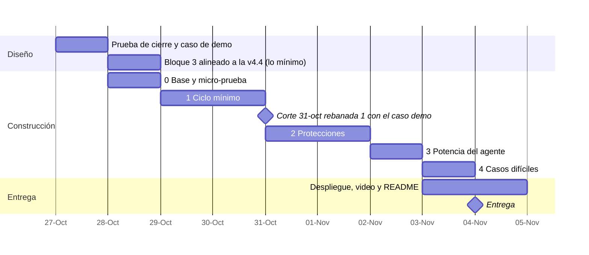

# Plan del hackathon · todo el bloque 1, en rebanadas que funcionan

**Supuestos:** 7–9 h al día, construcción con agentes de código, entrega el **4 de noviembre a mediodía** (con margen respecto de las 21:00 de Lima). Hay unas 60–65 h útiles `[inferencia]`.

**Principio:** se implementa **todo** el bloque 1, pero en rebanadas que funcionan de punta a punta. Al terminar cada rebanada hay una demo que funciona. Lo que no llegue a funcionar se esconde detrás de un interruptor; no se borra.

## 1. Rebanadas

| # | Qué entra | Qué permite mostrar | Listo cuando… |
|---|---|---|---|
| **0 · Base** | Micro-prueba de modelos · esqueleto en Go con SQLite · capa de proveedor (Responses API) · editor mínimo · objetos y estados (`bloque-1-estados.md`) · historia solo de agregado · arranque y fin de paso del bloque 2 | — | Una llamada de punta a punta guarda un paso y su evento en la historia |
| **1 · Ciclo mínimo** | Encargo y «Entendí» (con casos y destinatario) · construir con decisiones y su contraste · cifras vinculadas y datos copiados vinculados a su fuente (A-3) · cálculo como fuente (F-1) · tarjeta con «porque» · historia por párrafo · firma con Wonder (o Spark `xhigh`), caso nuevo y E-2/E-3 · firma sin decisiones críticas (A-4) | El caso de demo completo, de la primera línea a la firma bloqueada y luego firmada | El caso de demo pasa sin intervención manual |
| **2 · Protecciones** | Comprobaciones completas (las 6 reglas de la app y el comprobador) · «por aclarar» · triaje y vía directa · parada con informe · preparación de la defensa · avisos entre secciones y por nueva versión de una fuente, con su lista de cambios (A-1) · comprobador con el par afirmación–pasaje (A-2) · reentrada · E-4 | Que tupaqnin protege, no solo registra | Los perfiles apurados de las simulaciones se frenan donde el diseño dice |
| **3 · Potencia del agente** | Investigar con lectores en paralelo y web (F-2), verificación por hallazgo y digesto con inventario de cobertura (A-5) · juez con un solo lote de corrección | Subagentes con contexto idóneo | Un digesto real con un pasaje descartado a la vista |
| **4 · Casos difíciles** | Propuestas y edición simultánea · deshacer y edición sospechosa (G-1) · «continúa hasta terminar» · objetar (E-1) | Robustez | Los casos 7 y 9 pasan |

**Memoria del principal (bloque 2) en el hackathon.** Indicaciones de Eber, en literal: «Aún no limitemos lo que podamos avanzar en la implementación. Apuntemos a construirlo completo» (26-oct) y «Sí entra a la implementación, pero debe ser la versión más efectiva (lo más pequeño para ser eficiente)» (27-oct). Ubicación adoptada (B2-5, 28-oct): rebanada 0, memoria de 3 capas, arranque, fin de paso con el campo «diferido» (B2-6), `leer(id)` y reinicio por cambio de modelo; rebanada 2, las sondas contra la contradicción (B2-7), con las demás comprobaciones; rebanada 3, `buscar`; rebanada 4, umbral (~40 % libre) y limpieza. El arranque de la rebanada 0 es por tarea y con su tope medido (B2-2). Sus horas entran en la reconciliación pendiente.

## 2. Calendario

**Costo de A-1 a A-5** `[inferencia]`: ≈ 5–7 h en las rebanadas 1–2 y ≈ 1–2 h en la 3. Entra en la reconciliación de horas pendiente.

**Lectura honesta:** las rebanadas 0–2 son lo que más importa y caben con holgura moderada. Las rebanadas 3 y 4 caben solo si los agentes de código rinden bien. Por eso van al final, detrás de interruptores. La demo nunca depende de ellas.

## 3. Cómo se construye con agentes de código

- **Un encargo por pieza,** con la plantilla del bloque 1 §4: la ficha de la etapa, sus estados, su flujo y los contratos (fichas §7) en literal, la pregunta que responde y el retorno fijo (código, pruebas y lo que no hizo).
- **Pruebas primero,** con los casos simulados como guion. Cada rebanada se prueba con el caso de demo y con los perfiles apurados que ya tenemos.
- **Tú revisas cada pieza con la misma regla que tupaqnin:** si no puedes explicar lo que hace el código sin mirarlo, no se integra.

## 4. Decisiones para Eber

| # | Propuesta | En vez de | Elegiría la otra si… | Decisión de Eber |
|---|---|---|---|---|
| H-1 | **Caso de demo: el caso 2 adaptado para un jurado internacional.** En inglés y en dólares, sin jerga local: «national household survey» en vez de ENAHO, «public daycare» en vez de cunas. El gancho se entiende sin contexto: «I almost signed off on US$ 32 million without knowing where it came from». Usa solo la rebanada 1 (cifra que sale de un supuesto, una fuente que el agente no puede cambiar, firma bloqueada y luego firmada), así que llega al corte del 31 | El caso 5 (cita inventada), que se entiende igual de bien pero depende de la rebanada 3 (web y lectores) | La rebanada 3 llegara antes del 2-nov: entonces se suma un momento del caso 5 («the citation didn't exist») como cierre | |
| H-2 | **Calendario y rebanadas de este documento,** con el corte del 31-oct y los interruptores. Incluye la fecha del primer despliegue (B3-17 la dejó aquí): la especificación del bloque 3 §6 pide una prueba desplegada del streaming en la rebanada 0, y el calendario pone el despliegue el 3-nov | Construir módulo por módulo | — | |
