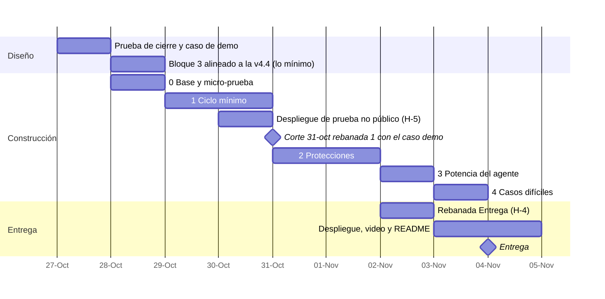

# Plan del hackathon · todo el bloque 1, en rebanadas que funcionan

**Supuestos:** 7–9 h al día, construcción con agentes de código, entrega el **4 de noviembre a mediodía** (con margen respecto de las 21:00 de Lima). Hay unas 60–65 h útiles `[inferencia]`.

**Principio:** se implementa **todo** el bloque 1, pero en rebanadas que funcionan de punta a punta. Al terminar cada rebanada hay una demo que funciona. Lo que no llegue a funcionar se esconde detrás de un interruptor; no se borra.

## 1. Rebanadas

| # | Qué entra | Qué permite mostrar | Listo cuando… |
|---|---|---|---|
| **0 · Base** | Micro-prueba de modelos · esqueleto en Go con SQLite · capa de proveedor (Responses API) · editor mínimo · objetos y estados (`bloque-1-estados.md`) · historia solo de agregado · arranque y fin de paso del bloque 2 | — | Una llamada de punta a punta guarda un paso y su evento en la historia |
| **1 · Ciclo mínimo** | Encargo y «Entendí» (con casos y destinatario) · construir con decisiones y su contraste · cifras vinculadas y datos copiados vinculados a su fuente (A-3) · cálculo como fuente (F-1) · tarjeta con «porque» · historia por párrafo · firma con Wonder (o Spark `xhigh`), caso nuevo y E-2/E-3 · firma sin decisiones críticas (A-4) | El tramo del caso 5 que le toca (H-1), de la primera línea a la firma bloqueada y luego firmada | Ese tramo del caso 5 pasa sin intervención manual |
| **2 · Protecciones** | Comprobaciones completas (las 6 reglas de la app y el comprobador) · «por aclarar» · triaje y vía directa · parada con informe · preparación de la defensa · avisos entre secciones y por nueva versión de una fuente, con su lista de cambios (A-1) · comprobador con el par afirmación–pasaje (A-2) · reentrada · E-4 | Que tupaqnin protege, no solo registra | Los perfiles apurados de las simulaciones se frenan donde el diseño dice |
| **3 · Potencia del agente** | Investigar con lectores en paralelo y web (F-2), verificación por hallazgo y digesto con inventario de cobertura (A-5) · juez con un solo lote de corrección | Subagentes con contexto idóneo | Un digesto real con un pasaje descartado a la vista |
| **4 · Casos difíciles** | Propuestas y edición simultánea · deshacer y edición sospechosa (G-1) · «continúa hasta terminar» · objetar (E-1) | Robustez | Los casos 7 y 9 pasan |
| **Entrega** (H-4) | Acceso con link y cuentas (B3-3, B3-18) · inicio y tus proyectos · topes por link y avisos (B3-20) · seguridad mínima (B3-22) · copia y restauración (B3-17) | Que el jurado entra con su link y nadie ve lo ajeno | Con el link entras, creas un proyecto y vuelves a él; con la cookie de otro visitante o con otra cuenta no ves nada; la copia se restaura |

**Acciones que H-3 suma a las rebanadas.** **1:** lo gastado en la barra · cambiar el rol · tu edición cancela la firma en curso (K-16). **2:** cambiar el destinatario o un criterio · marcar una decisión como crítica · el efecto del rol y del destinatario sobre lo firmado (K-13) · descargar el `.md` · crear una sección a mano (K-17). **4:** el modo en la barra · revocar, junto con objetar · los pasos del agente como propuesta mientras firmas (K-16). **Fuera del hackathon:** la tarjeta precargada desde el chat, y que la parada proponga un análisis de sensibilidad (pedirlo sí funciona).

**Memoria del principal (bloque 2) en el hackathon.** Indicaciones de Eber, en literal: «Aún no limitemos lo que podamos avanzar en la implementación. Apuntemos a construirlo completo» (26-oct) y «Sí entra a la implementación, pero debe ser la versión más efectiva (lo más pequeño para ser eficiente)» (27-oct). Ubicación adoptada (B2-5, 28-oct): rebanada 0, memoria de 3 capas, arranque, fin de paso con el campo «diferido» (B2-6), `leer(id)` y reinicio por cambio de modelo; rebanada 2, las sondas contra la contradicción (B2-7), con las demás comprobaciones; rebanada 3, `buscar`; rebanada 4, umbral (~40 % libre) y limpieza. El arranque de la rebanada 0 es por tarea y con su tope medido (B2-2). Sus horas entran en la reconciliación pendiente.

## 2. Calendario

**Costo de A-1 a A-5** `[inferencia]`: ≈ 5–7 h en las rebanadas 1–2 y ≈ 1–2 h en la 3. Entra en la reconciliación de horas pendiente.

**Lectura honesta (actualizada el 28-oct):** ya no hay holgura. Con «Entrega» (14–18 h, H-4) y A-1 a A-5, el bloque 3 solo ocupa entre dos tercios y casi todas las 60–65 h (espec. §8), antes de la lógica del ciclo. La reconciliación de horas es lo siguiente. Mientras tanto, las rebanadas 3 y 4 siguen detrás de interruptores. Con el caso 5 (H-1), la meta es el caso completo; su gancho («la cita no existía») necesita la 3, y el reparto se adapta según avance la implementación.

## 3. Cómo se construye con agentes de código

- **Un encargo por pieza,** con la plantilla del bloque 1 §4: la ficha de la etapa, sus estados, su flujo y los contratos (fichas §7) en literal, la pregunta que responde y el retorno fijo (código, pruebas y lo que no hizo).
- **Pruebas primero,** con los casos simulados como guion. Cada rebanada se prueba con el caso de demo y con los perfiles apurados que ya tenemos.
- **Tú revisas cada pieza con la misma regla que tupaqnin:** si no puedes explicar lo que hace el código sin mirarlo, no se integra.

## 4. Decisiones para Eber

| #    | Propuesta                                                                                                                                                                                                                                                                                                                                                                                                                                                                                                                                                                                                                                                                                                                                                                                                                                                                                                                                                                                                                                                                                                                                                                                                                                                                                                                                                                                                                                                                                                                                                                                                          | En vez de                                                                                                                                                                        | Elegiría la otra si…                                                                                                    | Decisión de Eber                                                                                                                                                                                                                                                                                                                                                                                                                                    |
| ---- | ------------------------------------------------------------------------------------------------------------------------------------------------------------------------------------------------------------------------------------------------------------------------------------------------------------------------------------------------------------------------------------------------------------------------------------------------------------------------------------------------------------------------------------------------------------------------------------------------------------------------------------------------------------------------------------------------------------------------------------------------------------------------------------------------------------------------------------------------------------------------------------------------------------------------------------------------------------------------------------------------------------------------------------------------------------------------------------------------------------------------------------------------------------------------------------------------------------------------------------------------------------------------------------------------------------------------------------------------------------------------------------------------------------------------------------------------------------------------------------------------------------------------------------------------------------------------------------------------------------------ | -------------------------------------------------------------------------------------------------------------------------------------------------------------------------------- | ----------------------------------------------------------------------------------------------------------------------- | --------------------------------------------------------------------------------------------------------------------------------------------------------------------------------------------------------------------------------------------------------------------------------------------------------------------------------------------------------------------------------------------------------------------------------------------------- |
| H-1 | **Caso de demo: el caso 5, «la cita que más me convenía no existía».** Paula, doctoranda, escribe el estado del arte sobre microplásticos en agua potable para su comité de tesis. Es ficticio, en inglés, y se entiende sin contexto local. Muestra cuatro cosas: un agente que investiga con lectores en paralelo, una cita inventada que la verificación detecta, una cifra que sale de una regla de comparación (1,5 veces, no 60) y un término de Paula («campo») que solo ella fija. **La meta es el caso 5 completo.** Como guía, se arma por partes: la rebanada 1 cubre la cifra que sale de la regla, con los artículos subidos como fuentes, y la firma bloqueada y luego firmada (corte del 31-oct); la 2 suma el «por aclarar» de «campo» y la cita cuyo pasaje no está en su fuente (A-2); la 3 suma la ronda web y la cita que no existe (DOI). El reparto se adapta según avance la implementación | El caso 2 (memo de cunas), cuyo objetivo exige datos operativos que no hay · o el caso 2 replanteado como nota de prefactibilidad | — | «No. usaremos el caso 5 para la demo» (28-oct) · «apuntemos a terminar todo el caso 5. lo adaptamos según cómo avancemos con la implementación» (28-oct). Antes, sobre el caso 2: «No, este caso debe ser acondicionado. [...] El caso que se muestre para demo debe ser algo más creíble trabajando con agentes» |
| H-2  | **Calendario y rebanadas de este documento,** con el corte del 31-oct y los interruptores. Incluye la fecha del primer despliegue (B3-17 la dejó aquí): la especificación del bloque 3 §6 pide una prueba desplegada del streaming en la rebanada 0, y el calendario pone el despliegue el 3-nov                                                                                                                                                                                                                                                                                                                                                                                                                                                                                                                                                                                                                                                                                                                                                                                                                                                                                                                                                                                                                                                                                                                                                                                                                                                                                                                   | Construir módulo por módulo                                                                                                                                                      | —                                                                                                                       | Adoptamos propuesta                                                                                                                                                                                                                                                                                                                                                                                                                                 |
| H-3  | **Rebanada para las 10 acciones del inventario que no tenían una** (`bloque-3/funcionalidades.md`, hueco 6). **Rebanada 1:** lo gastado en la barra (B3-20) · cambiar el rol, con el mismo control con que lo confirmas (inventario 2e) · tu edición cancela la firma en curso (K-16). **Rebanada 2:** cambiar el destinatario · cambiar un criterio, porque dispara la comprobación de contradicción · marcar una decisión como crítica (T-5 ya cuenta tu marca) · el efecto del rol y del destinatario sobre lo firmado (K-13, con E-4) · descargar el `.md` con lo no firmado marcado (K-10 b) · crear una sección a mano (K-17). **Rebanada 4:** el modo en la barra, junto con «continúa hasta terminar» · revocar, en la misma tarjeta que objetar (E-1) · los pasos del agente como propuesta mientras firmas (K-16). Hasta la 4, los turnos los abre tu mensaje y en la firma no envías pasos, así que el choque es raro `[inferencia]`. **Fuera del hackathon:** la tarjeta precargada desde el chat (el agente te pide responder en la tarjeta, y la hipótesis de bloque-1 §6 queda sin probar) y que la parada proponga un análisis de sensibilidad (bloque-1 §6). **Pedirlo sí funciona,** como cualquier pedido en el chat: es «un encargo más, si el humano lo pide» (tu decisión del 26-oct). Suma ≈ 4–6 h `[inferencia]`                                                                                                                                                                                                                                                                                                                                                                                                      | Dejarlas sin rebanada: se construyen si sobra tiempo, o no se construyen                                                                                                         | Las rebanadas 1 y 2 no llegan a tiempo: lo de la 2 pasa detrás de un interruptor, salvo descargar, que es obligatorio   | Adoptamos propuesta · precisión del 28-oct, pedida por Eber: pedir un análisis de sensibilidad sigue funcionando |
| H-4  | **Sumar la rebanada «Entrega» a la tabla §1, antes del primer despliegue público.** Entran el acceso por invitación y los topes (B3-3), el inicio con tus proyectos (B3-18), los avisos de tope (B3-20), la copia con su restauración y la seguridad (espec. §6). **Listo cuando:** con el link entras, creas un proyecto y vuelves a él; con la cookie de otro visitante no ves nada; la copia se restaura (B3-17). Va el 2-nov, en paralelo con la 3: sin invitación no hay despliegue público, como ya advierte el `fly.toml` del repo. ≈ 14–18 h `[inferencia]`: las 5–6 de la espec. §8, el inicio con cuentas (B3-18) y la seguridad mínima (B3-22). La fecha exacta sigue en H-2                                                                                                                                                                                                                                                                                                                                                                                                                                                                                                                                                                                                                                                                                                                                                                                                                                                                                                                            | Dejarla solo en la especificación §8: no tiene fecha en el calendario y compite sin aviso con las rebanadas 3 y 4                                                                | H-2 pone el despliegue público antes del 2-nov: entonces «Entrega» va primero                                           | Adoptamos propuesta                                                                                                                                                                                                                                                                                                                                                                                                                                 |
| H-5  | **Un despliegue de prueba, no público, el 29 o 30-oct, después de la pieza 0.6.** Es otra app de Fly (`tupaqnin-prueba`), compilada con `-tags=devroutes` (B-4), con el proveedor falso (sin clave ni gasto) y sin proyectos ni datos. Prueba cuatro cosas que el despliegue público del 3-nov (H-2) dejaría para el último día: que Fly no corte el streaming de 90 s (0.6, B-1), que la imagen compile (P-1 de la supervisión), que la app escriba en el volumen (P-5) y el ensayo de restauración (B3-17). Después se borra                                                                                                                                                                                                                                                                                                                                                                                                                                                                                                                                                                                                                                                                                                                                                                                                                                                                                                                                                                                                                                                                                     | Probar todo eso recién el 3-nov: si Fly corta el streaming, ya no hay tiempo de cambiar el transporte (B-1)                                                                      | Las cuatro pruebas se pueden hacer en local con la misma imagen y el mismo tipo de volumen                              | OK, adoptamos                                                                                                                                                                                                                                                                                                                                                                                                                                       |
