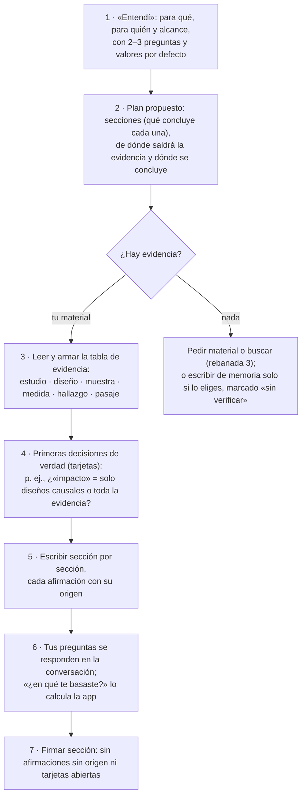

# Fuentes, procedencia y flujo del agente

**Respuesta:** el agente no necesita las fuentes en cada paso: las necesita al entender, al reunir evidencia, al afirmar algo y al firmar. Debe decidir él cuándo leer, con `leer` y `buscar` sobre tu material, y la app le exige leer en esos puntos. El problema de fondo que mostraron las corridas es otro: **la app no distingue de dónde sale cada afirmación** (tu material, una fuente externa o lo que el modelo «sabe»), el agente **responde tus preguntas escribiendo secciones** y **crea secciones y decisiones sin un plan acordado**. Abajo, lo observado, la secuencia que tupaqnin debería seguir y 13 propuestas para adjudicar.

## 1. Lo observado (30-oct, con Meta)

| Corrida | Qué pasó |
|---|---|
| Caso 5 (con 15 fuentes) | La cadena escribió las tres secciones en 80 s (0,11 USD), genéricas: ninguna cifra, ni 1,5 ni 60, ninguna decisión. Nunca vio el texto de las fuentes, solo su primera línea |
| «Pobreza y desarrollo cerebral» (sin material, sin criterios) | El «Entendí» falló (B-23). Al pedirle avanzar, escribió una síntesis de la literatura **de memoria** («Los estudios longitudinales y de neuroimagen asocian…»), sin ninguna fuente y sin aviso |
| La misma, al preguntarle «¿en qué estudios te basaste?» | No respondió en la conversación: **creó secciones nuevas** («Aclaración sobre estudios y referencias», «Plan para respaldar con fuentes», «Criterios para aceptar fuentes», «Lagunas…»). Dijo que no se basó en «fuentes registradas en el proyecto»: confundió tu material con la literatura en la que se apoyó. «Aclaración…» quedó lista para firmar |
| La misma | 10 secciones que nadie acordó; **8 tarjetas críticas** que son planes editoriales («La sección reunirá las lagunas por bloque…»), con un «elegiría la otra si» que repite la justificación; todas las secciones con rol «conclusión» |

## 2. ¿Cuándo necesita el agente las fuentes?

| Etapa | ¿Las necesita? | Qué lee | Quién decide |
|---|---|---|---|
| «Entendí» | Sí, un vistazo | Una ficha de cada fuente (título, tipo, largo, primeras líneas, calculada por la app) y lo que le haga falta para decir «lo que leí» | La app le da las fichas; él decide qué abrir |
| Plan | Poco | Las fichas | Él |
| Reunir evidencia | **Sí, a fondo** | Los tramos de cada fuente que tocan la pregunta | Él, con `leer` y `buscar` |
| Escribir una afirmación con cifra o cita | **Sí, el pasaje exacto** | El pasaje que cita; la app comprueba que está literal | La app lo exige |
| Responder una pregunta tuya | Según la pregunta | Lo que la respuesta necesite | Él |
| Revisar o reescribir sin afirmaciones nuevas | No | — | — |
| Firma (Wonder) | Sí | Los pasajes que la sección cita | La app se los entrega |

**Conclusión:** «en cada paso» gasta y no ayuda; «nunca» produce lo que vimos. Lo correcto es que el agente decida, con dos herramientas, y que la app le exija leer donde una afirmación lo necesita.

## 3. La secuencia que tupaqnin debería seguir (ejemplo: «Investigación sobre los estudios de impacto de pobreza en el desarrollo cerebral»)

En este ejemplo, sin material, el paso correcto después del «Entendí» es el 2 y luego **detenerse en «¿Hay evidencia?»**: proponerte subir estudios, esperar la búsqueda o escribir de memoria con todo marcado «sin verificar», si tú lo eliges. No escribir una síntesis de memoria como si estuviera respaldada.

## 4. Propuestas para adjudicar

*Cada fila: la decisión en una frase; en vez de qué; cuándo elegiría la otra. La última columna es tu respuesta.*

### 4.1 Fuentes y procedencia

| #   | Propuesta                                                                                                                                                                                                                                                                                                                                                                                                                                                                                                                                                                                                                               | En vez de                                     | Elegiría la otra si…                                                                          | Decisión de Eber (literal)                                                                                                                                                                                                                                        |
| --- | --------------------------------------------------------------------------------------------------------------------------------------------------------------------------------------------------------------------------------------------------------------------------------------------------------------------------------------------------------------------------------------------------------------------------------------------------------------------------------------------------------------------------------------------------------------------------------------------------------------------------------------- | --------------------------------------------- | --------------------------------------------------------------------------------------------- | ----------------------------------------------------------------------------------------------------------------------------------------------------------------------------------------------------------------------------------------------------------------- |
| R-1 | **Cada afirmación declara su origen, en tres clases:** tu material (archivo que subiste, con pasaje literal que la app comprueba) · fuente externa (encontrada por el agente, con URL y pasaje; rebanada 3) · conocimiento del modelo (sin verificar). El agente lo declara por párrafo en su salida; la app comprueba los pasajes y marca los párrafos «sin verificar». En un documento que pide evidencia (estado del arte, investigación), un párrafo sin origen verificado deja el pendiente «afirmación sin fuente», que bloquea la firma hasta que lo respaldas, lo aceptas como conocimiento general con tu «porque» o lo quitas | Comprobar solo cifras y citas (lo de hoy)     | El documento no pide evidencia (una carta, un plan): ahí la marca se muestra, pero no bloquea | Adoptamos                                                                                                                                                                                                                                                         |
| R-2 | **«¿En qué te basaste?» lo responde la app, no el modelo:** en la historia de cada párrafo y en el marco, la procedencia sale del grafo (pasajes y fuentes, o «del conocimiento del modelo, sin verificar»). Si el agente nombra referencias de memoria, van como «candidatas, sin verificar», nunca como fuentes                                                                                                                                                                                                                                                                                                                       | Que el modelo redacte la lista de referencias | —                                                                                             | Adoptamos                                                                                                                                                                                                                                                         |
| R-3 | **El agente decide cuándo leer, con dos herramientas sobre tu material:** `leer(fuente, tramo)` y `buscar(texto)` (bloque-2 §3). En el índice ve una ficha de cada fuente que calcula la app. La app exige leer en tres puntos: el «Entendí» informa lo que leyó; una cifra o cita debe estar literal en un pasaje que leyó; Wonder recibe los pasajes que la sección cita. Antes, una micro-prueba con Meta de llamadas a herramientas en modo estricto (≈ 30 min)                                                                                                                                                                     | B-22: darle todas las fuentes en cada paso    | La micro-prueba falla: entonces B-22 como respaldo, con el tope del 25 %                      | Adoptamos                                                                                                                                                                                                                                                         |
| R-4 | **Sin evidencia, el agente no escribe una síntesis de memoria:** si el pedido necesita evidencia y no hay material ni búsqueda, el «Entendí» lo dice y propone: subir material, esperar la búsqueda (rebanada 3) o escribir de memoria marcado «sin verificar», solo si lo eliges. **Precisión (30-oct, tu pregunta):** esa tercera opción es un recurso hasta la rebanada 3. Desde la 3, el agente busca evidencia real (R-9) y usa lo que sabe para decidir qué y dónde buscar; lo que aún afirme de memoria queda marcado «sin verificar» (R-1). **Precisión de la 1.9 (validación, 30-oct; adoptada por Eber):** las opciones llegan en el texto del «Entendí» (`understood`) y eliges escribiéndole; como el marcado por párrafo es de la rebanada 2 (R-1), en la 1.9 se ofrecen solo «subir material» y «esperar la búsqueda»; «de memoria, marcado» llega con R-1 | Escribir igual (lo que pasó)                  | El pedido no necesita evidencia                                                               | Adoptamos. El "escribir de memoria marcado" estaría disponible solo hasta la rebanada 3, ¿verdad? Luego el agente debe ser capaz de señalar qué afirmación corresponde a qué fuente y qué otra es de su conocimiento/memoria marcando sin verificar (o algo así). |

### 4.2 Conversación, plan y decisiones

| #   | Propuesta                                                                                                                                                                                                                                                                                                                                        | En vez de                                                      | Elegiría la otra si…                                          | Decisión de Eber (literal) |
| --- | ------------------------------------------------------------------------------------------------------------------------------------------------------------------------------------------------------------------------------------------------------------------------------------------------------------------------------------------------ | -------------------------------------------------------------- | ------------------------------------------------------------- | -------------------------- |
| R-5 | **Las respuestas a tus preguntas van en la conversación, no en el documento:** la salida del principal suma `reply` (lo que te contesta). Un paso que solo responde no escribe texto. Las notas de proceso (planes, criterios, lagunas) no son secciones, salvo que las pidas                                                                    | Que todo paso escriba en el documento (lo de hoy)              | —                                                             | Adoptamos.                 |
| R-6 | **Plan acordado antes de escribir:** después del «Entendí», el agente propone en una tarjeta las secciones (título y qué concluye cada una), de dónde saldrá la evidencia y en cuáles se concluye. Confirmas o corriges con un botón. No bloquea: si no respondes, sigue con lo propuesto. Una sección nueva fuera del plan llega como propuesta | Que el agente invente secciones paso a paso (10 en la corrida) | El documento es tan corto que el plan sobra                   | Adoptamos.                 |
| R-7 | **Una tarjeta es una elección real que cambia lo que el documento afirma** (alcance, criterio, método, interpretación), con un «elegiría la otra si» que dice cuándo gana la alternativa. Los planes editoriales no son decisiones. Como mucho 2 decisiones nuevas por paso `[inicial]`                                                          | 8 tarjetas de planes editoriales                               | —                                                             | Adoptamos.                 |
| R-8 | **El rol se reduce a una marca en el plan: «aquí se concluye».** Solo las secciones que concluyen o recomiendan la llevan; la usa la criticidad como hoy. Desaparecen los menús «conclusión · recomendación · otro» por sección                                                                                                                  | Un menú de tres opciones por sección                           | La diferencia entre concluir y recomendar cambia algo para ti | Adoptamos.                 |

### 4.4 Rebanada 3: evidencia real

| # | Propuesta | En vez de | Elegiría la otra si… | Decisión de Eber (literal) |
|---|---|---|---|---|
| R-9 | **En la rebanada 3, el agente basa sus respuestas en evidencia real** (estudios, papers, libros) y usa su conocimiento para saber qué y dónde buscar (OpenAlex, arXiv u otras fuentes), y cómo consolidar, contrastar y articular la respuesta. Cada afirmación dice si sale de tu material, de una fuente que buscó o de su conocimiento (R-1), y los conflictos entre fuentes se señalan en el texto y abren un «por aclarar». Precisa F-2 y A-5 (bloque 1) y la rebanada 3 del plan | Investigar solo con búsqueda web general | — | «Para la rebanada 3 agente debe basar sus respuestas en evidencia real, como estudios, papers, libros, etc; y usar su conocimiento para saber qué y dónde buscar (podría ser OpenAlex, arxiv u otra fuente), cómo consolidar, contrastar, articular, etc la respuesta. En su respuesta señalar qué afirmaciones se basan en la fuente dada por el humano, cuales sobre la fuente buscada, y si hay conflicto entre fuentes señalarlos.» (30-oct) |

### 4.3 Interfaz

| #   | Propuesta                                                                                                                                                                                                                                                                                | En vez de                      | Elegiría la otra si…                                               | Decisión de Eber (literal) |
| --- | ---------------------------------------------------------------------------------------------------------------------------------------------------------------------------------------------------------------------------------------------------------------------------------------- | ------------------------------ | ------------------------------------------------------------------ | -------------------------- |
| U-1 | **Título del proyecto:** el «Entendí» propone uno; lo editas en la cabecera con un clic, y la lista de proyectos lo usa                                                                                                                                                                  | «Proyecto sin título»          | —                                                                  | Adoptamos.                 |
| U-2 | **Datos del modelo a la vista:** en la cabecera de la conversación, «Meta · Muse Spark 1.3 · esfuerzo medio · contexto usado 4 % de 1 M · gastado 0,24 de 3 USD»; cada mensaje del agente con esfuerzo distinto lo indica; en la firma, «Muse Wonder 1.0»                                | Solo el gasto                  | —                                                                  | Adoptamos.                 |
| U-3 | **Una sola navegación:** el esqueleto del marco (izquierda) elige la sección; la columna derecha muestra solo esa sección (título, estado, pendientes, «Firmar sección»). Se quitan las pestañas de arriba                                                                               | Dos navegadores de lo mismo    | Ocultas el marco y necesitas cambiar de sección desde el documento | Adoptamos.                 |
| U-4 | **Una sola familia tipográfica:** el documento se distingue por tamaño, interlineado y ancho de línea, no por otra letra                                                                                                                                                                 | Una serif solo en el documento | —                                                                  | Adoptamos para el MVP.     |
| U-5 | **La conversación guarda su historia:** al abrir un proyecto ves todos los mensajes, respuestas del agente, notas y tarjetas respondidas, desde la historia                                                                                                                              | Solo el último turno           | —                                                                  | Adoptamos.                 |
| U-6 | **«Lo que entendí» como una sola tarjeta clara:** (1) lo que entendí, en un párrafo; (2) cómo lo juzgaré (casos, si hay criterios); (3) plan propuesto (R-6) con la marca «aquí se concluye» (R-8); un botón «Confirmar» y uno «Corregir». Al confirmar se pliega en una línea. **Precisión (validación, 30-oct; adoptada por Eber):** en la 1.9 el «plan» es la lista de secciones del «Entendí» (R-6 completo es de la rebanada 2) y el botón se llama «Confirmar»: no condiciona el arranque, porque la cadena arranca sola (B-17) | Casos y menús de rol sueltos   | —                                                                  | Adoptamos.                 |

## 5. Tamaño y dónde entra `[inferencia]` (ubicación aplicada el 30-oct)

| Bloque | Horas | Propuesta de ubicación |
|---|---|---|
| R-5, R-7, R-8, U-1 a U-6 (conversación, decisiones, rol, interfaz) | 8–11 | **Pieza 1.9, ya:** es lo que el jurado ve en la demo |
| R-3 y R-4 (leer y buscar en tu material, sin evidencia no inventa) | 4–6 (+0,5 micro-prueba) | **1.9 también:** sin esto el caso 5 no llega a la regla de 1,5 veces |
| R-1, R-2 (procedencia por párrafo, «en qué te basaste») | 4–6 | Rebanada 2, con las comprobaciones (handoff del 29-oct) |
| R-6 (plan acordado) | 3–4 | Rebanada 2 |

No es un recorte: es alcance nuevo que aparece al usar la app con el modelo real. Eber decide dónde entra.
