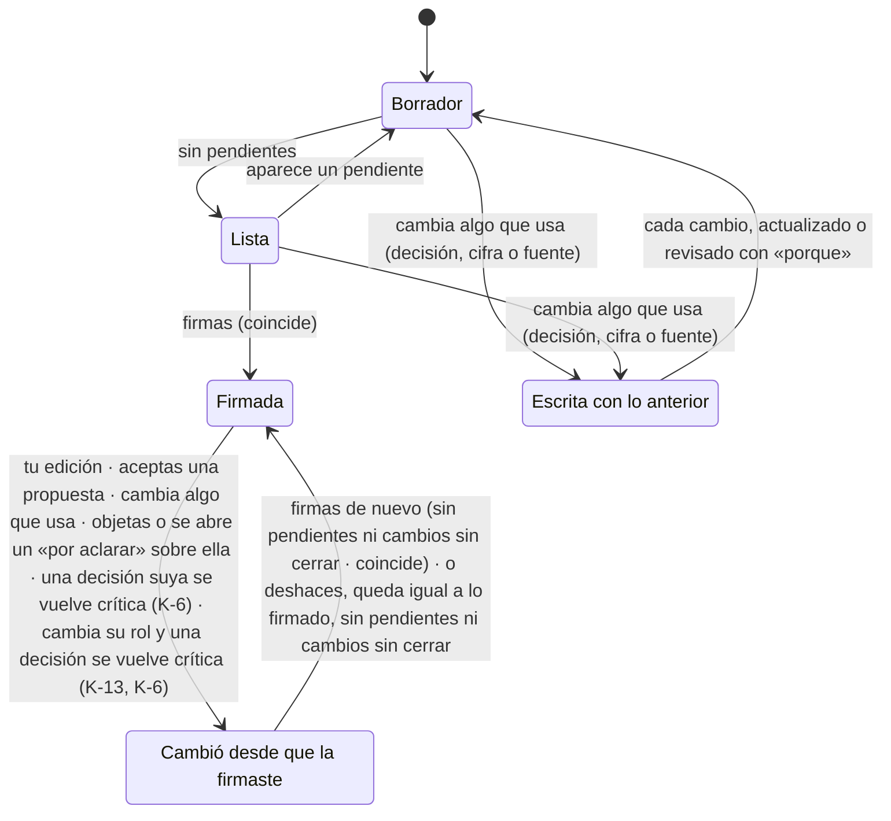
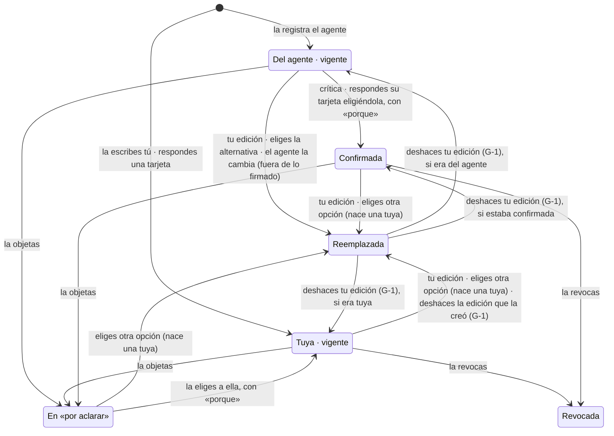

# Bloque 1 · Estados de los objetos

*Qué estados tiene cada objeto del ciclo, qué los hace cambiar y quién. Regla común: la app calcula los cambios por regla; los que implican decidir los haces tú. Ningún estado detiene al agente: lo más que hace uno es bloquear la firma.*

## 1. Sección

- **Pendientes** (esta es la lista única; fichas y flujos remiten a ella) = «por aclarar» abiertos, tarjetas abiertas y pendientes del agente: cifra o escrito sin decisión, códigos internos, relato del proceso, fuente que no sostiene lo afirmado, «falta en el texto» señalado por Wonder en la firma y un retorno del principal sin la forma fija tras su reintento. Son pendientes dentro de la sección, no estados de ella. «Lista» se calcula: no queda ninguno. Los cambios sin cerrar en lo que usa la sección no son pendientes: son la lista de «escrita con lo anterior» (abajo), y también bloquean la firma.
- **Un cambio del agente sobre una sección firmada no la mueve:** llega como propuesta. La sección pasa a «cambió» solo si la aceptas.
- **Tu edición sobre lo firmado sí la mueve** de inmediato, porque tu edición rige. Si la deshaces y el texto queda idéntico a la versión firmada, vuelve a «firmada» sin firmar de nuevo, siempre que no queden pendientes ni cambios sin cerrar (G-1).
- **En «cambió desde que la firmaste»:**
  - los pendientes y «falta en el texto» la mantienen en «cambió», sin volver a «borrador», para que la marca no se pierda;
  - los pasos del agente siguen llegando como propuesta hasta la nueva firma;
  - para volver a «firmada» hay que firmar de nuevo, sin pendientes y con la lista de cambios vacía; deshacer solo la devuelve si además no hay pendientes y la lista de cambios está vacía.
- **La pausa de la firma (E-2) no es un estado:** es un evento de la historia. La sección queda donde estaba, «lista» o «cambió».
- **«Escrita con lo anterior» bloquea la firma (E-4) y se libera por cambio, no por actividad (A-1):**
  - la sección guarda lo que usa con su versión: decisiones y cifras de otras secciones, y fuentes por su huella;
  - si una cambia de versión, el cambio entra a la lista de la sección. Una fuente cambia de versión cuando, al subir un archivo, indicas que reemplaza a otra; volver a subir una fuente idéntica no cuenta;
  - cada cambio se cierra solo si un paso del agente que toca esa sección lo declara actualizado, si tú lo marcas «actualizado» después de editar, o si tú o el agente lo marcan «revisado, no requiere cambio» con un «porque»; ambos quedan en la historia;
  - vuelve a «borrador» cuando la lista queda vacía; corregir una coma u otra cosa no la libera;
  - en una sección firmada, el mismo cambio la lleva a «cambió desde que la firmaste» y entra igual a su lista: la nueva firma exige la lista vacía. Como ahí los pasos del agente llegan como propuesta, aceptar la propuesta que declara el cambio actualizado lo cierra.

## 2. Decisión

- **Una decisión del agente rige al nacer** (nadie bloquea). Si es crítica, abre una tarjeta; si no, queda en la historia.
- **El agente solo reemplaza sus propias decisiones,** y solo fuera de lo firmado. No reemplaza una decisión tuya, una confirmada ni una de una sección firmada: si su trabajo la contradice, salta la comprobación de contradicción y te pregunta. La app lo valida: rechaza una salida cuyo «reemplaza» apunte a una de esas decisiones (fichas §3).
- **«Reemplazada» guarda el vínculo** con la decisión que la sustituye. «Revocada» no tiene sucesora: revocar es solo tuyo.
- **Deshacer (G-1):** si deshaces la edición que reemplazó una decisión, esa decisión vuelve a su estado anterior y la que nació de tu edición pasa a «reemplazada». Una tarjeta abierta por esa edición pasa a «obsoleta» (§3).
- **Objetar (E-1):** lleva la decisión a «por aclarar». Eliges tú, con «porque».
- **Al reemplazar o revocar,** las secciones que la usan reciben su aviso: «cambió» si están firmadas, «escrita con lo anterior» si no.

## 3. Tarjeta

| Estado | Pasa a… | Cuándo |
|---|---|---|
| **Abierta** | Respondida | Eliges una opción y escribes un «porque». En la tarjeta de tu propia edición crítica (R4) no hay opción que elegir: basta el «porque» |
| Abierta | Abierta | «ok», «sí» o el campo vacío |
| Abierta | Obsoleta | En la tarjeta de tu edición crítica eliges «fue un error · deshacer»: tu edición se deshace y la decisión vuelve a como estaba (G-1) |
| Abierta | Obsoleta | La decisión cambió antes de que respondieras; la app la cierra y abre la que corresponda |
| **Respondida** | — | Queda en la historia con tu «porque» |

Una tarjeta abierta bloquea la firma de las secciones que usan su decisión.

## 4. «Por aclarar»

| Estado | Pasa a… | Cuándo |
|---|---|---|
| **Abierto** (una pregunta, con cada opción, su contraste, su consecuencia y su riesgo) | Resuelto | Eliges con «porque» |
| Abierto | Abierto | «ok», «sí», vacío o una respuesta que no elige |
| **Resuelto** | — | Las variantes no elegidas pasan a la historia como descartadas. Lo que dependía de él vuelve a «borrador», o sigue en «escrita con lo anterior» o en «cambió» si estaba así, y el agente lo escribe con lo elegido |

**Nace por:** una decisión de alcance, premisa o destino · un término tuyo en un caso dudoso · una contradicción con lo confirmado o con tu premisa · una contradicción entre lectores que toca algo crítico · una afirmación que excede lo revisado (alcance, A-5) · lo que queda abierto tras la reverificación · lo que eliges dejar «por aclarar» cuando una ronda no reduce la duda · una objeción tuya (E-1). Mientras está abierto, el agente avanza con variantes rotuladas sin elegir ninguna. Bloquea la firma de todo lo que depende de él.

## 5. Propuesta

Nace por un cambio del agente sobre una sección firmada o en «cambió», o por un paso del agente sobre un texto que editaste al mismo tiempo. Siempre llega con su contraste. Si deshaces tu edición, la propuesta que esa edición desplazó sigue abierta y puedes aceptarla (G-1).

| Estado | Pasa a… | Cuándo |
|---|---|---|
| **Abierta** | Aceptada | La aceptas; si la sección estaba firmada, pasa a «cambió» |
| Abierta | Descartada | La descartas, o firmas sin aceptarla (la app te la lista antes) |

## 6. Criterio, premisa y casos del «Entendí»

| Objeto | Estados | Notas |
|---|---|---|
| **Criterio** | Vigente → nueva versión (solo tú) | Una nueva versión dispara la comprobación de contradicción sobre lo escrito |
| **Caso del «Entendí»** | Sin confirmar → confirmado o corregido | Si no respondes, el trabajo sigue; lo que dependa de un caso sin confirmar puede saltar como «término en caso dudoso» |
| **Premisa** | Vigente → contradicha → la mantienes o la cambias (por «por aclarar») | En un proyecto exploratorio no hay premisa. Lo que respondes a «¿qué esperas encontrar?» es la expectativa de esa ronda: no cambia la premisa ni el carácter exploratorio (K-5) |
| **Rol de la sección** (conclusión · recomendación · otro) | Propuesto → confirmado (solo tú); lo puedes cambiar cuando quieras (K-13) | Lo propone el principal en el «Entendí», o en el paso que crea la sección; si no respondes, rige lo propuesto y queda visible (K-2). Si creas tú la sección con «+ Sección», el rol que eliges nace confirmado; si lo dejas vacío, lo propone el principal en su siguiente paso (K-17). Si cambias el rol y con eso una decisión de una sección firmada se vuelve crítica, esa sección pasa a «cambió» (K-13, K-6). Lo usan la criticidad, la vía directa y «escrito sin decisión» |

## 7. Ronda (investigación o juez)

Abierta → digesto o informe → cerrada. Al cerrar dice si se redujo la duda. **Repetir una ronda sobre la misma duda lo decides tú,** con su costo a la vista. En una ronda de juez, el principal hace un lote de corrección y el juez una sola reverificación.

## 8. Historia

Solo se agrega; nunca se edita. Con ella se reconstruye el estado de todo lo de arriba. Registra:
- **cada cambio de estado** de los objetos de arriba: qué, quién (tú, el agente o la app), por qué (contraste o «porque») y versión;
- **además:** fin de paso · modo activado (con tu mensaje) · tu mensaje · informe de parada (visto o no) · decisión vista (en un informe, en una tarjeta, en la historia abierta o al desplegarla en el marco) · edición con su versión base · edición deshecha · alerta de edición sospechosa (respondida o no) · caso de aplicación de la firma (bien o mal) · pausa de la firma · pregunta del destinatario respondida «no» («no abordado, decidido por ti»; sin respuesta no se registra decisión) · cambio en lo que usa la sección: entra, actualizado o revisado sin cambio (con «porque») · nueva versión de una fuente · firma breve («pregunta de origen: no aplica»: sin decisiones críticas, A-4) · cambio de rol o de destinatario (K-13) · cada arista del grafo que nace, cambia o se reemplaza (N-1) · respuesta a una tarjeta o «por aclarar» sin «porque» válido · tiempo de cada acto obligatorio (tarjeta, «por aclarar», firma), para medir las hipótesis (K-11).

La historia por párrafo se arma con estos eventos.

**Presupuesto:** sección 5 estados · decisión 6 · los demás 2 a 4. Las transiciones nuevas de la v1.3 (3 hacia «reemplazada») no agregan estados. A-1 tampoco: cambia cómo se sale de «escrita con lo anterior». La v1.5 agrega 2 objetos de 2 y 3 estados (rol de la sección, K-2; pregunta del destinatario, K-1) y 3 transiciones de deshacer (G-1). La v1.6 agrega 0 estados: una transición del rol (K-13) y 3 tipos de arista en el grafo (N-1).

**Para el bloque 2:** el índice de la capa 2 debe usar los 5 estados de la sección más el número de pendientes. «Por aclarar» no es un estado de la sección.

## 9. Pregunta del destinatario (K-1)

| Estado | Pasa a… | Cuándo |
|---|---|---|
| **Abierta** | Abordada | Respondes «sí»: es una instrucción tuya que entra al siguiente triaje |
| Abierta | No abordada | Respondes «no»: queda en la historia «no abordado, decidido por ti» |
| Abierta | Abierta | No respondes: sigue en el informe |

Nace en la preparación de la defensa (fichas §2, Parada). No es una propuesta: no bloquea la firma y la firma no la descarta.
