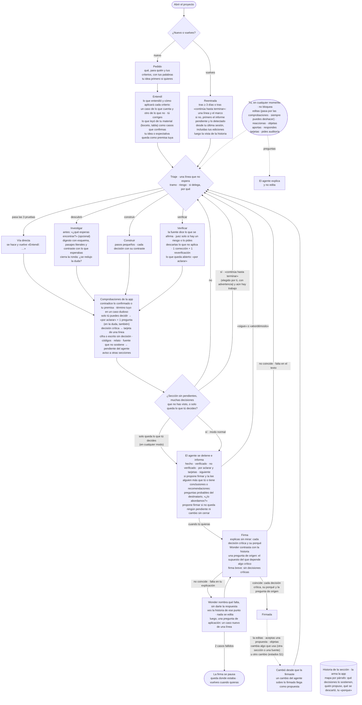
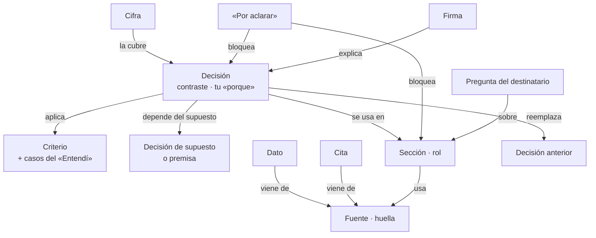

# Bloque 1 · Fichas por etapa y estados

*Qué componente hace cada cosa del ciclo. Para cada etapa: qué entra, quién decide, qué sale, qué ves y cuándo termina. Los valores marcados `[inicial]` son puntos de partida que se calibran construyendo, no decisiones.*

## 1. Componentes

| Componente | Qué es | Modelo y esfuerzo `[inicial]` · herramientas |
|---|---|---|
| **App** | Código. Orquesta por reglas, calcula las comprobaciones deterministas, arma los encargos, guarda todo, mantiene el grafo del proyecto (§9) y calcula desde él la historia por párrafo, el marco y las comprobaciones. En el hackathon es el orquestador | — |
| **Principal** | El agente que conduce: triaje, redacción, explicación, informe de parada | Spark 1.3 `medium`; `high` en el «Entendí» y en las decisiones críticas · `buscar` y `leer(id)` (bloque 2); no escribe directo: entrega su salida fija y la app la aplica (bloque 3). **Cálculos (F-1):** en el hackathon, el resultado de un cálculo entra como fuente con id (lo subes tú o viene en la plantilla); ejecutar código queda para la hoja de ruta |
| **Lector** | Subagente que lee o busca y devuelve pasajes literales | Spark 1.3 `low` · `leer(id)` sobre las fuentes del proyecto y **búsqueda web alojada de Meta (F-2)**; la app verifica cada pasaje en su fuente |
| **Juez** | Subagente adversarial: verificación con riesgo y preparación de la defensa | Spark 1.3 `high` |
| **Comprobador** | Llamada corta de modelo para las comprobaciones que no son deterministas | Spark 1.3 `low` |
| **Wonder** | Contraste de la firma: compara tu explicación con la historia y plantea el caso nuevo | Wonder 1.0 `high`; si no está disponible, Spark 1.3 `xhigh`, visible en pantalla |
| **Tú** | Decides, editas, respondes, firmas | — |

Los modelos y esfuerzos salen del doc 12 §10.1. Los confirma la micro-prueba de modelo, todavía pendiente.

**Regla de oro:** lo que se puede calcular, lo calcula la app. Un modelo solo juzga lo que necesita leer con sentido, y su juicio llega como candidato con los dos pasajes literales, nunca como veredicto (D9).

## 2. Fichas por etapa

Cada etapa termina en un **fin de paso**: el principal entrega su salida con el contrato de §7 (incluida su nota corta para el bloque 2) y la app actualiza el estado de trabajo y la historia. Lo que el principal necesita y no está en su arranque lo obtiene con `buscar` y `leer(id)`.

### Pedido y Entendí
- **Entra:** tu pedido, para quién es (destinatario), tus criterios, tu idea o expectativa si la das, y tu material (boceto, tabla).
- **Quién:** *app* guarda todo en literal; *principal* redacta el «Entendí»: lo que entendió, cómo aplicará cada criterio con un caso de lo que cuenta y otro de lo que no, y lo que leyó de tu material como casos.
- **Sale:** destinatario, criterios, premisa (o «exploratorio»), casos del «Entendí» confirmados por ti y el rol de cada sección (conclusión · recomendación · otro (R-8, 30-oct: se ofrecen solo `conclusion` · `other`, como la marca «aquí se concluye»)), que propone el principal y confirmas tú; si no respondes, rige lo propuesto y queda visible (K-2).
- **Ves:** el «Entendí», para corregirlo.
- **Termina:** cuando corriges o confirmas. No bloquea: si no respondes, el trabajo sigue y los casos quedan sin confirmar.

### Triaje
- **Entra:** el estado de trabajo y tu último mensaje o edición.
- **Quién:** *principal* propone el tramo, el riesgo y la razón para delegar, en la misma llamada que su paso; *app* comprueba la vía directa **después** del cambio: si toca una cifra, una cita, una sección de conclusión o recomendación o un criterio, la reclasifica como Construir y la pasa por las comprobaciones. Las otras dos pruebas (sin decisión abierta, retomable) las declara el principal. También veta una razón de delegar que no esté entre las tres. Si hay un riesgo de la lista, la línea de triaje avisa que el juez entrará en la verificación por lote, sin esperar tu sí (K-3).
- **Sale:** la línea de triaje.
- **Ves:** «Tramo · Riesgo · si delega, por qué».
- **Termina:** de inmediato; no espera.

### Investigar
- **Entra:** pregunta, duda que reduce, alcance y tu expectativa (opcional).
- **Quién:** *app* arma el encargo con la plantilla de bloque-1.md §4; *lectores* en paralelo (máximo 3 `[inicial]`); *principal* digiere; *app* comprueba que las fuentes existan (DOI y URL) y que cada pasaje aparezca literal en el texto de su fuente cuando es accesible; si no lo es (muro de pago, PDF ilegible), el hallazgo queda «no verificado».
- **Sale:** el digesto: esquema, hallazgos con pasaje literal, contraste con lo que esperabas y «¿se redujo la duda?».
- **Ves:** el digesto; cada hallazgo abre su pasaje.
- **Termina:** con el digesto. Repetir la ronda sobre la misma duda lo decides tú, con el costo a la vista.

### Construir
- **Entra:** sección, criterios con sus casos, decisiones vigentes y digestos (lo que no está en su arranque, con `leer`).
- **Quién:** *principal* redacta un paso pequeño, registra cada decisión con su contraste y vincula cada cifra a una decisión, salvo los datos copiados literal de una fuente, que la app vincula a su fuente (A-3). Declara qué cambios de lo que usa la sección actualizó o revisó (A-1).
- **Sale:** un cambio de texto, sus decisiones y sus vínculos.
- **Ves:** el cambio y sus decisiones (también en la historia).
- **Termina:** al pasar las comprobaciones.

### Verificar
- **Entra:** afirmaciones, cifras y citas con riesgo acumuladas en la sección; o tu pedido de auditoría. Se verifica **por lote** (al cerrar una sección o antes de la parada), no después de cada paso `[inicial]`.
- **Quién:** *comprobador* compara cada afirmación con su pasaje; *juez*, si hay un riesgo de la lista o lo pides; *tú* descartas lo que no aplica (si no descartas, se corrige todo lo señalado, K-4); *principal* corrige una vez; *juez* reverifica una vez.
- **Sale:** correcciones; lo que queda abierto pasa a «por aclarar».
- **Ves:** las fallas con su pasaje y su escenario, para descartar.
- **Termina:** después de la única reverificación.

### Comprobaciones (después de cada paso, también de tus ediciones)
- **Quién:** ver §3.
- **Sale:** tarjetas, «por aclarar», avisos a otras secciones, alertas de edición sospechosa y pendientes.
- **Termina:** de inmediato. Nada de esto detiene al agente; solo los pendientes bloquean la firma (las alertas no).

### Parada
- **Entra:** contador de decisiones que no viste (≥ 5 `[inicial]`), una sección sin pendientes, o que solo quede lo tuyo. Una decisión cuenta como **vista** cuando se te mostró en un informe de parada, en una tarjeta, en la historia abierta o al desplegarla en el marco (no al desplazarte por él); la app lo registra como evento.
- **Quién:** *app* decide cuándo parar; *principal* escribe el informe fijo; *juez* prepara la defensa, en la parada que propone la firma de esa sección (o en la parada final de «continúa hasta terminar», K-7), si la sección la lee alguien más que tú o tiene conclusiones o recomendaciones (una ronda, 3–5 preguntas `[inicial]`).
- **Sale:** el informe (hecho · verificado · no verificado · por aclarar y tarjetas · siguiente), las preguntas del destinatario como preguntas abiertas (estados §9) y, si no queda ningún pendiente ni cambio sin cerrar, el agente propone firmar.
- **Ves:** el informe, primero la respuesta. Al terminar «continúa hasta terminar», primero la línea y el marco, con el informe a un clic (M-2).
- **Termina:** cuando dices «sigue», «abordémoslo» o firmas. En «continúa hasta terminar», la parada no se da hasta que solo quede lo tuyo; en esa parada final, el juez prepara la defensa de cada sección que la necesita (K-7).

### Firma
- **Entra:** la sección, su historia y tu explicación sin mirar.
- **Quién:**
  - *app* bloquea si quedan pendientes (lista de estados §1) o si la sección tiene cambios sin cerrar en lo que usa, esté «escrita con lo anterior» o en «cambió» (E-4, A-1), y lista las propuestas abiertas;
  - **firma breve:** si la sección no tiene decisiones críticas (A-4), basta tu explicación breve: no hay contraste de Wonder ni pregunta de origen, y la historia lo registra. Si después aparece una decisión crítica, o una se vuelve crítica, la sección pasa a «cambió» y vuelve la firma completa (K-6);
  - el marco se oculta en la pantalla de firma: explicas sin mirar;
  - *Wonder* contrasta tu explicación con la historia, decisión por decisión, y formula la pregunta de origen sobre el supuesto que la app eligió en el grafo (§9);
  - si falta algo en tu explicación, *Wonder* nombra qué falta y, después de que revisas, plantea el caso nuevo;
  - *app* da «coincide» solo si nombraste cada decisión crítica y su porqué, respondiste la pregunta de origen (E-3) y, si hubo brecha, aplicaste bien el caso nuevo; tras 2 casos fallidos, la firma de esa sección se pausa (E-2).
- **Sale:** la sección firmada, con versión, explicación y resultado del contraste; o la brecha devuelta al triaje.
- **Ves:** lo que falta (sin la respuesta), la historia de ese punto y el caso nuevo.
- **Termina:** con la firma, o cuando lo dejas para después. **Sin firma (K-10):** puedes llevarte el documento igual; las secciones sin firmar quedan marcadas como tales.

### Reentrada
- **Entra:** lo cambiado desde tu última sesión, incluidas tus ediciones, el informe pendiente y el marco.
- **Quién:** *app* arma la vista (con el bloque 2, que le da al principal su arranque).
- **Ves:** si vuelves tras ≥ 3 días `[inicial]` o al terminar «continúa hasta terminar», primero una línea (dónde quedaste · qué cambió (n) · qué te toca) y enseguida el marco, con el informe pendiente a un clic, en «lo que te toca» (M-2). En vueltas más cortas, primero el informe pendiente, lo más importante arriba (P3). Luego, la historia.
- **Termina:** al verla. No bloquea.

### El marco (siempre a mano)
- **Para qué:** construir y recuperar tu marco mental de lo que se está construyendo: qué es y por qué es así. No es un historial de cambios (M-1).
- **Entra:** una consulta del grafo del proyecto (§9): lo mismo que las capas 1 y 2 del estado de trabajo (bloque 2), con la misma función de cálculo, más tus «porque», tus explicaciones de firma y los eventos «decisión vista».
- **Quién:** *app* lo calcula en cada fin de paso. Ningún modelo lo redacta.
- **Ves**, ordenado por el argumento y no por fecha, y solo lo vigente (lo reemplazado queda en la historia):
  1. **Para qué:** tu pedido, destinatario y premisa, en literal.
  2. **Cómo se juzga:** cada criterio con su caso que cuenta y el que no.
  3. **Esqueleto:** cada sección con su estado y su primera línea (M-4); debajo, sus decisiones críticas vigentes con enunciado, «en vez de», tu «porque», tu explicación de firma, las otras secciones que la usan y un punto si no la viste.
  4. **Lo que te toca:** tus pendientes, incluido el informe de parada sin ver.
- **Haces:** clic en una decisión → la historia de su párrafo (D7). Filtro «solo lo que no viste»: las decisiones que afectan más secciones primero; a igual número, en el orden del documento `[inicial]`. Lo que contradice tu premisa ya está en «lo que te toca», como «por aclarar».
- **Termina:** no termina ni bloquea. Se oculta solo en la pantalla de firma.
- **Hoja de ruta:** «reconstruye antes de mirar» (M-3) y la tesis de sección redactada por un modelo (M-4).

### Tu turno (en cualquier momento)
- **Editas:** rige de inmediato y pasa por las comprobaciones. Si toca una decisión crítica, su tarjeta solo pide el «porque» o te deja deshacer. Toda edición tuya se deshace con un clic; si la app la ve sospechosa, te muestra una alerta que no bloquea (G-1).
- **Preguntas:** *principal* explica y no edita.
- **Respondes tarjetas o «por aclarar»:** *app* acepta solo una opción con un «porque» escrito. «ok», «sí» o el campo vacío la dejan abierta.
- **Respondes en el chat con opción y «porque»:** *principal* identifica la tarjeta o el «por aclarar» que corresponde y *app* lo precarga con tus palabras; solo cuenta al pulsar «aplicar». Una pregunta («¿y si…?») no se precarga. **En el hackathon no hay precarga (H-3):** el principal te pide responder en la tarjeta.
- **Cambias el rol de una sección:** cuando quieras (K-13). Si con eso una decisión de una sección firmada se vuelve crítica, esa sección pasa a «cambió» y vuelve la firma completa (K-6). Cambiar el destinatario del pedido no afecta la firma: solo cambia la preparación de la defensa.
- **Marcas una decisión como crítica:** un clic; desde ahí cuenta como crítica (el cuarto motivo de criticidad). Desmarcarla también es tuyo.
- **Creas una sección (K-17):** con «+ Sección», escribes el título, marcas o no «aquí se concluye» (R-8) y, si quieres, escribes «qué debe abordar». Con la marca, el rol queda `conclusion` confirmado; sin ella, el rol no se fija y lo propone el principal en su siguiente paso, como en K-2. «Qué debe abordar» es tuyo, en literal: no es texto de la sección y el principal lo recibe cuando trabaja en ella (bloque-2 §3, tarea en turno). Nace vacía y en borrador. El título y «qué debe abordar» de cualquier sección los editas cuando quieras, y reordenas las secciones con «subir» y «bajar»; nada de eso cambia el estado ni entra en lo firmado; queda en la historia. Quitar secciones no entra en el hackathon.
- **Pides una auditoría:** pasa al tramo Verificar.

## 3. Comprobaciones: qué calcula la app y qué juzga un modelo

*Lo que calcula la app sale de consultas al grafo del proyecto (§9).*

| Comprobación | Quién | Cómo |
|---|---|---|
| Cifra sin decisión | **App** | Número nuevo en el texto sin vínculo a una decisión. No cuenta un **dato reproducido** (A-3): un número que aparece literal, con separadores normalizados, en una fuente usada en ese paso o en tu material; la app lo vincula a esa fuente. Redondeado o convertido ya no es literal |
| Vía directa | **App** | Después del cambio: si toca una cifra, una cita, una sección con rol conclusión o recomendación (K-2) o un criterio, la reclasifica como Construir y la pasa por las comprobaciones (D9). Las otras dos pruebas las declara el principal |
| Escrito sin decisión | **App** | Cambio de fondo sin decisión aplicada. Para empezar, la app lo detecta seguro en las secciones con rol conclusión o recomendación (K-2); en otras secciones lo marca el comprobador `[inicial]` |
| Criticidad | **App** | Cuatro motivos: cubre una cifra (no un dato reproducido, A-3), está en una sección con rol conclusión o recomendación (K-2), afecta 2 o más secciones (las que declara el principal **más** las secciones donde aparece una cifra vinculada a ella, por búsqueda de texto), o la marcaste tú |
| Aviso a otras secciones | **App** | Por los vínculos: decisión o cifra usada en otra sección, o nueva versión (otra huella) de una fuente usada (A-1). Cada cambio entra a la lista de la sección afectada |
| Cierre de un cambio (A-1) | **App** | Un cambio de la lista se cierra si un paso del agente que toca esa sección lo declara actualizado (en lo firmado o en «cambió», al aceptar la propuesta que lo declara), si tú lo marcas «actualizado» después de editar, o si tú o el agente lo marcan «revisado, no requiere cambio» con un «porque» válido. Una edición que no lo declara no cierra nada. Con cambios sin cerrar no se firma, en ningún estado |
| Edición simultánea | **App** | Por versión base: tu edición gana y el paso del agente queda como propuesta |
| Alerta de edición sospechosa (G-1) | **App** | Solo en tus ediciones: borra un párrafo entero o más de la mitad de la sección `[inicial]`; quita texto vinculado a una decisión, a una cifra o a algo firmado; cae en una sección distinta de la que trabajabas; o pega un texto que ya existe en otra parte del proyecto. Muestra una alerta con «Deshacer»; no bloquea |
| Tarjeta válida | **App** | Opción elegida (salvo en la tarjeta de tu propia edición, R4), más un «porque» que no esté vacío ni en la lista de asentimientos de tu idioma («ok», «sí»; «yes», «sure»; T-1) |
| «Reemplaza» válido | **App** | Rechaza la salida del principal (se reintenta, §7) si «reemplaza» apunta a una decisión tuya, confirmada o de una sección firmada |
| Códigos internos en el texto | **App** | Etiquetas cortas que existen en este proyecto (`dec-12`, `sec-3`, glosario §8) y cualquier id interno o provisional (`new-1`). Un código parecido que no es del proyecto («Formulario F-40») no cuenta (T-2) |
| Relato del proceso en el texto | **Comprobador** | «¿Este pasaje cuenta cómo se trabajó en vez de decir algo al destinatario?» |
| Contradice lo confirmado o tu premisa | **App + comprobador** | La app arma las sondas desde el grafo (bloque 2, B2-7): siempre el pedido, el «Entendí» confirmado con sus casos, los criterios, la premisa, todas tus decisiones y todas las decisiones críticas vigentes; además, las decisiones confirmadas y las de una sección firmada vinculadas a lo que tocó el paso; cada una con el pasaje nuevo, todas en una sola llamada. Si cambió un criterio o la premisa, la sonda va contra el texto vigente de cada sección afectada. El comprobador responde por sonda {contradice · no · duda}; en la duda, salta. Si el principal no lo había propuesto como «por aclarar», el aviso lo dice: «la última entrega contradice dec-x · no lo declaró el agente» |
| Término tuyo en un caso dudoso (R1) | **Comprobador** | ¿Se aplica un término de tu criterio a un caso que no está en el «Entendí» y que se resolvería con otra fuente? |
| La fuente dice lo que se afirma | **App + comprobador** | La app comprueba que la fuente exista y que el pasaje esté en ella (si es accesible; si no, «no verificado»). El comprobador juzga si el pasaje sostiene la afirmación, con el par afirmación–pasaje que recibe (A-2), y si una afirmación de alcance excede lo revisado según el inventario (A-5): ese candidato es del tipo «excede lo revisado» y la app lo manda a «por aclarar» de alcance |

## 4. Estados de los objetos

Detallados en [`bloque-1-estados.md`](bloque-1-estados.md): sección, decisión, tarjeta, «por aclarar», propuesta, criterio, premisa, caso del «Entendí», rol de la sección, ronda, historia y pregunta del destinatario. Resumen: la sección tiene 5 estados (borrador, lista, firmada, cambió desde que la firmaste, escrita con lo anterior); la decisión, 6; los demás objetos, 2 a 4. «Por aclarar» y las tarjetas son pendientes dentro de la sección, no estados de ella.

## 5. Lo que el bloque 1 entrega a los otros bloques

| A | Qué |
|---|---|
| **Bloque 2** | El **fin de paso** de cada etapa, para actualizar el estado de trabajo; los objetos de §4 en literal o por id. Los subagentes no leen el estado de trabajo: reciben su encargo (bloque-1.md §4). **El estado de trabajo y el marco (M-1) son consultas del grafo del proyecto (§9)**; el marco usa la misma función que calcula las capas 1 y 2: un cambio en esas capas cambia el marco. El arranque del principal es un recorte de la memoria por tarea, con tope (bloque 2, B2-2). La capa 3 debe incluir los cambios sin cerrar por sección y el inventario de las rondas cuyas fuentes usa la sección, porque el principal declara los ids de los cambios |
| **Bloque 3** | **Qué se guarda:** el grafo del proyecto (§9): los objetos de §4 con versión y sus aristas tipadas y versionadas (entre ellas cifra–decisión, dato–fuente, decisión–sección, decisión–criterio y decisión–supuesto), lo que usa cada sección con su versión (decisiones, cifras y fuentes por su huella) y su lista de cambios sin cerrar (A-1), el inventario de cada ronda (A-5), el rol de cada sección (K-2), las preguntas del destinatario (K-1), el tiempo de cada acto obligatorio (K-11), y la historia como eventos solo de agregado; versiones de cada sección que permitan **deshacer** una edición del humano con un clic y reaplicar la propuesta desplazada (G-1). **Qué se ve:** línea de triaje, tarjetas, «por aclarar», informe de parada, digesto, historia (lugar estratégico, D5), **el marco siempre a mano y la línea de vuelta (M-1, M-2)**, firma, la marca de las secciones sin firmar (K-10) y la alerta de edición sospechosa con «Deshacer». El bloque 3 se revisa contra esta lista |

## 6. Flujos propios

Comprobaciones, Investigar con subagentes y Firma están en [`bloque-1-flujos.md`](bloque-1-flujos.md). Si la prueba de cierre de Eber muestra dudas en otra etapa, se agrega su flujo (máximo tres en total).

## 7. Contratos de entrada y salida de los modelos

Lo que la app calcula depende de que los modelos devuelvan siempre la misma forma. Si un retorno no cumple su forma, la app lo reintenta una vez; si vuelve a fallar, queda visible sin frenar el trabajo: el de un lector, como vacío en el digesto; el del principal, como pendiente del agente.

| Quién | Recibe | Devuelve (forma fija) |
|---|---|---|
| **Principal, en cada paso** | Su conversación; tras un reinicio, el arranque (bloque 2, B2-2: un recorte del estado de trabajo por tarea, ≤ 15 % de la ventana, con lo que cambió y tus mensajes) + lo que consulte con `buscar` y `leer(id)` | línea de triaje · texto nuevo (con el ancla) · decisiones nuevas {id, enunciado, en vez de, elegiría si, supuesto: sí · no, secciones donde se usa, reemplaza: id de una decisión suya o vacío, aplica: ids de criterios, depende del supuesto: id de una decisión de supuesto o de la premisa} · decisiones usadas {id} (de otras secciones, en este paso) · rol propuesto {sección nueva: conclusión · recomendación · otro (R-8, 30-oct: se ofrecen solo `conclusion` · `other`, como la marca «aquí se concluye»)} (K-2) · «por aclarar» propuesto {pregunta, opciones con contraste, consecuencia y riesgo, de qué depende, variantes} · vínculos {cifra → id de decisión} · fuentes usadas {id} · citas {ancla de la afirmación, id de fuente, pasaje literal} (A-2) · cambios atendidos {id del cambio, actualizado · revisado sin cambio + «porque»} (A-1) · diferido {qué, por qué se difiere} (B2-6: la app lo lleva en el estado de trabajo hasta que un informe lo recoja) · nota corta para el bloque 2 · respuesta a tu mensaje {reply}, que va a la conversación y nunca al documento (R-5, 30-oct) |
| **Lector** | Encargo (bloque-1.md §4) | hallazgos {pasaje literal, fuente, tipo: hecho · supuesto · contradicción · vacío} · preguntas o criterios cubiertos {id} · fuentes leídas {id} (A-5) |
| **Juez** | Encargo (bloque-1.md §4) + las afirmaciones con riesgo y su texto; en la reverificación, las fallas no descartadas y la corrección | fallas {id, pasaje, riesgo, escenario} · en la reverificación, por falla {resuelta · sigue abierta} · en la parada: preguntas del destinatario {pregunta, id de sección} y lo que el trabajo no cubre {enunciado, id de sección} |
| **Comprobador** | Encargo (bloque-1.md §4) reducido: pasaje nuevo, o el texto vigente de cada sección afectada si cambió un criterio o la premisa + criterios con sus casos del «Entendí», premisa y las sondas que arma la app (§3), en literal + por cada cita nueva, el par {afirmación, pasaje literal de la fuente, id y huella} (A-2) + el inventario de lo no revisado, si una ronda que usa la sección dejó material sin revisar (A-5) | por sonda {id de lo protegido (criterio, premisa o decisión), contradice · no · duda, pasaje} · candidatos {tipo: contradicción · término dudoso · relato del proceso · escrito sin decisión · fuente que no sostiene · excede lo revisado, pasaje nuevo, pasaje con el que choca} |
| **Wonder** | Encargo (bloque-1.md §4) reducido: el texto vigente de la sección, su historia, la lista de decisiones críticas, tu explicación y, si ya hubo casos en esta firma, cada caso con tu respuesta + el supuesto de la pregunta de origen, elegido por la app en el grafo, y tu respuesta a esa pregunta si ya la diste (no se llama en la firma breve, A-4) | por decisión crítica {coincide · falta en tu explicación · falta en el texto, pasaje} · pregunta de origen y, sobre tu respuesta, {la responde · no} · si hay brecha: un caso nuevo, distinto de los anteriores, y luego {lo aplica bien · no} sobre tu respuesta |
| **Principal · «Entendí»** | Tu pedido, criterios, premisa y material | lo entendido · título del proyecto {project_title} (U-1) · por criterio {id, caso que cuenta, caso que no} · lo leído de tu material {caso} · rol propuesto por sección {id, conclusión · recomendación · otro (R-8, 30-oct: se ofrecen solo `conclusion` · `other`, como la marca «aquí se concluye»)} (K-2) |
| **Principal · solicitud de encargo** | Estado de trabajo | pregunta · duda que reduce · razón de delegar (una de las tres) · alcance · fuentes {id, para qué}. La app completa el resto de la plantilla (bloque-1.md §4) |
| **Principal · digesto** | Retornos de los lectores ya verificados + tu expectativa de la ronda, si la diste | esquema · hallazgos {pasaje, fuente, tipo} · contraste con tu expectativa · ¿se redujo la duda? {sí · en parte · no} · contradicciones entre lectores {pasaje A, pasaje B} |
| **Principal · informe de parada** | Estado de trabajo + la lista de decisiones sin ver, que calcula la app | primero la respuesta · hecho · verificado · no verificado · por aclarar y tarjetas · siguiente · si se acumularon decisiones sin ver: un esquema de ellas (D6) |

**Los subagentes y Wonder no leen el estado de trabajo:** todo les llega por su encargo (bloque-1.md §4), que la app arma con el estado de trabajo (bloque 2).

**Para el bloque 2:** el modo de trabajo («normal» o «continúa hasta terminar», con tu mensaje de activación) debe guardarse en «en vuelo», para que sobreviva a un reinicio del principal.

## 8. El ciclo en detalle

*Hasta la v4.5 este detalle estaba en `bloque-1.md`. Se movió aquí en la v4.6, sin cambios, para acortar el documento de idea (reglas §2.1); desde entonces se actualiza aquí. Rige igual que el resto de este anexo.*

### 8.1 Diagrama detallado del ciclo

### 8.2 Ritmo, lo que solo tú haces y cómo respondes

**Ritmo**
- **Por defecto,** el agente encadena pasos y se detiene solo cuando la sección queda sin pendientes, cuando acumula muchas decisiones que no has visto (te las explica con un esquema) o cuando solo queda lo que tú decides. Entonces te informa (primero la respuesta, después el detalle) y, si no queda ningún pendiente ni cambio sin cerrar, propone firmar. Firmas, o le dices «sigue», cuando quieras.
- **Preparar la defensa:** en la parada que propone la firma de una sección que va ante terceros (cualquier lector que no seas tú, también un equipo interno) o que tiene conclusiones o recomendaciones, el juez hace una sola ronda con el destinatario en mente. Sus 3–5 preguntas probables, y lo que el trabajo no cubre, llegan como preguntas abiertas (no son propuestas; estados §9), nunca como bloqueo: «¿lo abordamos?». Si respondes que no, queda en la historia «no abordado, decidido por ti»; si no respondes, siguen abiertas en el informe y la firma no las descarta. Te sirven también para preparar la firma.
- **«Continúa hasta terminar» (opcional):** el agente no se detiene a informar. Antes de activarlo, la app te advierte en una línea, por ejemplo: «Se pueden acumular varias secciones y decenas de decisiones que no habrás visto. Para firmar tendrás que entenderlas igual». No se salta ninguna comprobación ni la firma. Termina cuando solo queda lo que tú decides, y el agente se detiene con el informe fijo; en esa parada se prepara la defensa de cada sección que la necesita (K-7).
- **Reentrada:** al volver tras ≥ 3 días `[inicial]` o al terminar «continúa hasta terminar», ves primero una línea (dónde quedaste · qué cambió · qué te toca) y el marco, con el informe pendiente a un clic (M-2). En vueltas más cortas, ves primero el informe pendiente con lo más importante arriba, junto con lo que la app detectó desde tu última sesión, aunque el cambio lo hayas hecho tú. Después, la vista de la historia.

**Lo que solo tú haces**
- **Revocar** algo confirmado y **firmar.** Si objetas una decisión, pasa a «por aclarar» y eliges tú, con «porque».
- **Decidir alcance, premisa o destino.** El agente no lo decide por ti. Marca «por aclarar» todo lo que depende de esa decisión, te hace una sola pregunta y sigue con lo demás; puede avanzar variantes rotuladas sin elegir ninguna. La pregunta muestra cada opción con su contraste y su consecuencia, incluido el riesgo. Una sección con «por aclarar» no se puede firmar.
- **Fijar el sentido de tus términos.** Si hay que aplicar un término de tu criterio a un caso dudoso («¿esto cuenta como estudio de campo?»), queda «por aclarar». Un caso es dudoso si no figura en el «Entendí» y el agente lo resolvería con una fuente distinta de tus palabras: un catastro, una definición externa o su propio criterio. Si hay duda de si algo contradice tu criterio, se trata como contradicción.
- **Decidir si una ronda se repite.** Repetir una ronda sobre la misma duda es decisión tuya, con su costo a la vista.

**Cómo respondes**
- **Una tarjeta crítica, o la respuesta a un «por aclarar», vale solo si eliges una opción y escribes un «porque».** «ok», «sí» o el campo vacío la dejan abierta. El chat no confirma nada.
- **Preguntar no es pedir cambios:** si preguntas o pides una explicación, el agente explica y no toca el documento.
- **Tus ediciones rigen de inmediato** y pasan por las mismas comprobaciones que un paso del agente. Si tu edición toca una decisión crítica, su tarjeta solo te pide el «porque» para la historia: bloquea la firma, no el cambio. Si editaste el mismo texto mientras el agente trabajaba, su paso llega como propuesta, con su contraste.
- **Si tu edición fue un error:** toda edición tuya se deshace con un clic, y al deshacer, la propuesta del agente que quedó desplazada se puede volver a aplicar. Si la app ve una edición sospechosa (borraste un párrafo o gran parte de la sección, quitaste texto que sostiene una decisión, una cifra o algo firmado, editaste otra sección distinta de la que trabajabas, o pegaste un texto que ya existe en otra parte del proyecto), te muestra una alerta que no bloquea: «¿Fue a propósito? · Deshacer». Si no respondes, tu edición sigue rigiendo. La tarjeta de tu edición crítica también ofrece «fue un error · deshacer» (G-1).

**Tu premisa.** Si diste una idea o una expectativa, queda guardada en literal como premisa tuya, y si el trabajo la contradice, el agente te lo dice como contradicción. En un proyecto exploratorio no hace falta premisa. Lo que respondes a «¿qué esperas encontrar?» antes de investigar es solo de esa ronda. Lo que el agente lea de tu material (un boceto, una imagen, una tabla) también pasa por el «Entendí»: lo que lee con seguridad te lo presenta como un caso que confirmas.

**La firma.** Explicas la sección sin mirar: cada decisión crítica y su porqué, más una pregunta de origen sobre el supuesto del que depende algo crítico, que la app elige en el grafo. Sin decisiones críticas (A-4), basta una explicación breve. Si falta algo en el texto, vuelve al triaje. Si falta en tu explicación, Wonder nombra qué falta sin darte la respuesta. Puedes revisar la historia de ese punto, tus tarjetas y el digesto, y preguntarle al agente (explica, no edita). Después llega una pregunta de aplicación: un caso nuevo de una línea sobre ese mismo punto, que no está en la historia. Así la firma comprueba que puedes usar lo que entendiste, no repetirlo. «Coincide» exige también responder la pregunta de origen. Si fallas 2 casos, la firma de esa sección se pausa: queda donde estaba («lista» o «cambió»), vuelves cuando quieras y el resto del trabajo sigue. Al firmar, la app lista las propuestas abiertas sobre la sección; las que no aceptes pasan a la historia como descartadas.

**Lo firmado.** Si cambia algo que una sección usa (una decisión o cifra de otra sección, o una fuente), la firmada pasa a «cambió desde que la firmaste» y la no firmada a «escrita con lo anterior»; en ambos casos, no se firma hasta que cada cambio se actualice o se revise con «porque» (E-4, A-1); editar otra cosa no la libera. Un cambio del agente sobre una sección firmada llega como propuesta. Volver sobre algo firmado, por ejemplo para probar otro supuesto, es continuar el proyecto: la sección pasa a «cambió desde que la firmaste», con nueva ronda y nueva firma.

**Para quién se escribe:** todo texto del documento se escribe para su destinatario. Los códigos internos y el relato del proceso («según dec-4», «tras la revisión del martes») van a la historia, nunca al texto. Si aparecen, la app los marca como pendiente.

### 8.3 Triaje, riesgos, delegación y criticidad

En cada vuelta, el principal te muestra una línea que no espera respuesta, con tres cosas: el tramo, el riesgo y, si delega, por qué. Por ejemplo: «Tramo: descubrir · Riesgo: ninguno · Delego en 3 lectores: fuentes independientes». Lo corriges con una palabra.

| Pregunta | Tramo |
|---|---|
| ¿Pasa las 3 pruebas? Se entiende sin decisión abierta · no toca nada de la lista de riesgos ni tus criterios · se podría retomar con solo el pedido y el cambio | **Vía directa** |
| ¿Falta un criterio confirmado para esta parte? | **Descubrir** |
| ¿Hay criterio y falta escribir? | **Construir** |
| ¿Hay algo de la lista de riesgos sin comprobar, o una auditoría pedida? | **Verificar** |

**Lista cerrada de riesgos del documento:** cifras y cálculos · fuentes y citas · conclusiones y recomendaciones · contradice algo confirmado · efecto ante terceros · no se puede comprobar. El triaje anticipa el riesgo y el cierre de cada paso lo confirma («Riesgo: ninguno» o el que toca).

**Delegar solo con una razón nombrada.** Si no hay razón, el principal trabaja solo. Las razones son tres:
- hay que leer más de lo que cabe en una pasada → lectores;
- hay partes independientes → lectores en paralelo;
- hay un riesgo de la lista, o tú pides una auditoría → juez (entra sin esperar tu sí; la línea de triaje lo avisa, K-3). En la parada que propone la firma de una sección que va ante terceros (cualquier lector que no seas tú) o que tiene conclusiones o recomendaciones (riesgos de la lista), el juez también anticipa las preguntas del destinatario;

Un contexto largo del principal no es razón para delegar: lo resuelve su memoria, que limpia el contexto al llegar al umbral (bloque 2, B2-3 y B2-4).

El tamaño de la tarea nunca es razón.

**Criticidad** (la calcula la app, no la declara el agente): una decisión es crítica si cubre una cifra calculada o supuesta (no un dato reproducido de una fuente, A-3), está en una sección con rol conclusión o recomendación (K-2), afecta dos o más secciones, o tú la marcaste.

### 8.4 Quién hace qué, por etapa

| | Humano | Agente principal | Subagentes | App |
|---|---|---|---|---|
| **Pedido · Entendí** | Dice qué quiere; corrige cómo se aplicarán sus criterios | Devuelve lo que entendió, con un caso de lo que cuenta y otro de lo que no por criterio | — | Guarda criterios y premisa con tus palabras |
| **Triaje** | Corrige con una palabra | Clasifica; nombra el riesgo y la razón de delegar | — | Reclasifica como Construir una vía directa que toca cifras, citas, conclusiones o criterios |
| **Investigar** | Dice qué espera (opcional); lee el digesto | Formula la pregunta; digiere | **Lectores**, solo con razón | **Arma el encargo** (bloque-1.md §4) |
| **Construir** | Edita cuando quiere; lo suyo rige | Redacta; decisiones con contraste; vincula cifras | — | Pasa todo cambio, también el tuyo, por las comprobaciones |
| **Verificar** | Pide una auditoría; descarta lo que no aplica | Lo lanza si hay un riesgo, avisándolo en la línea de triaje (K-3); corrige una vez lo señalado | **Comprobador**: ¿el pasaje sostiene lo afirmado? · **Juez**, si hay un riesgo o lo pides: 1 reverificación | Comprueba que el pasaje exista en su fuente |
| **Parada** | Lee el informe; decide qué preguntas del destinatario abordar | Informe fijo; propone firmar | **Juez** con el destinatario en mente | Arma la historia |
| **Firma** | Explica sin mirar cada decisión crítica (firma breve: sin decisiones críticas); responde la pregunta de aplicación si hace falta; firma | — | **Wonder** contrasta, nombra qué falta sin dar la respuesta y plantea el caso nuevo | Devuelve al triaje lo que falta en el texto; lista las propuestas abiertas |

## 9. Grafo del proyecto (N-1)

*Todo lo que la app calcula sale de un mismo grafo: el marco, los avisos y cambios sin cerrar, la criticidad, la cobertura, la pregunta de origen, lo que recibe Wonder al firmar y el estado de trabajo del agente. Por eso no pueden contradecirse. No se muestra como grafo ni se edita a mano: lo ves a través del marco y la historia.*

**Decisión de supuesto:** la que fija un valor o una condición que no viene de una fuente, por ejemplo un porcentaje de uso; el principal la marca «supuesto: sí» (§7).

**Historia y grafo:** la historia son los eventos, que solo se agregan; el grafo es su estado vigente, que se reconstruye desde ella; la historia por párrafo combina ambos.

**Nodos** (tipos cerrados): pedido, criterio, caso del «Entendí», premisa, sección (con su rol), decisión, cifra, dato, cita, fuente, «por aclarar», tarjeta, propuesta, firma, pregunta del destinatario y ronda. Los que tienen estados están en `bloque-1-estados.md`; cifra, dato y cita son anclas dentro del texto de una sección. El pedido, con su destinatario, no necesita aristas: el criterio y la premisa guardan el id del pedido (un atributo). Tarjeta, propuesta y caso del «Entendí» guardan el id de su decisión, sección o criterio (un atributo, no una arista). La ronda se une por sus fuentes: la cobertura sale de las fuentes que usa la sección y del inventario de la ronda en que se asignaron.

**Aristas** (tipos cerrados; cada una con versión y su evento en la historia):

| Arista | De → a | Quién la crea | Para qué la usa la app |
|---|---|---|---|
| la cubre | cifra → decisión | principal (vínculos, §7) | cifra sin decisión · criticidad |
| se usa en | decisión → sección | principal (secciones donde se usa · decisiones usadas) + app (secciones donde aparece una cifra vinculada) | criticidad (2 o más secciones) · avisos (A-1) · marco |
| viene de | dato → fuente | app (dato reproducido, A-3) | no pide decisión |
| viene de | cita → fuente | principal (citas, §7); la app verifica el pasaje | respaldo (A-2) |
| usa | sección → fuente | principal (fuentes usadas, §7) | nueva versión de una fuente (A-1) |
| aplica | decisión → criterio | principal (campo nuevo, §7) | marco: qué criterio sostiene cada decisión · contradicción |
| depende del supuesto | decisión → decisión de supuesto o premisa | principal (campo nuevo, §7); la app comprueba que apunte a una decisión marcada «supuesto: sí» o a la premisa | pregunta de origen |
| bloquea | «por aclarar» → sección o decisión | app | firma |
| reemplaza | decisión → decisión anterior | principal (reemplaza, §7) o tus actos | historia · deshacer (G-1) |
| explica | firma → decisión | app, al firmar | «cambió» · marco (tu explicación) |
| sobre | pregunta del destinatario → sección | juez, en la parada (§7) | marco · defensa |

**Regla de origen:** una arista nace solo de un campo de salida fija (§7) que la app valida, de una regla de la app o de un acto tuyo. **Ningún modelo crea una arista interpretando texto libre;** las reglas de la app solo usan coincidencias literales (una cifra vinculada, un dato reproducido). Si un campo apunta a un id que no existe, la app lo rechaza y vuelve al agente.

**Consultas que salen del grafo:**
- **El marco** (§2): para qué, cómo se juzga, esqueleto y lo que te toca.
- **Cambios sin cerrar** (A-1): quién usa lo que cambió.
- **Criticidad:** cuántas secciones usa una decisión.
- **Cobertura** (A-5).
- **La reentrada** (M-2) y **las propuestas abiertas al firmar.**
- **Pregunta de origen:** la app elige el supuesto del que dependen más decisiones críticas de la sección, siguiendo «depende del supuesto», y Wonder la formula. Si no hay arista, Wonder elige como antes `[inicial]`.
- **Lo que recibe Wonder:** el subgrafo de la sección.
- **El estado de trabajo del agente** (bloque 2).
- **La historia por párrafo** (D7).

**Qué no es:**
- No es un grafo del tema extraído por un modelo: ese queda en la hoja de ruta, solo como ayuda del agente para buscar en material masivo (N-2).
- No es una base aparte: se guarda en la misma base (bloque 3).
