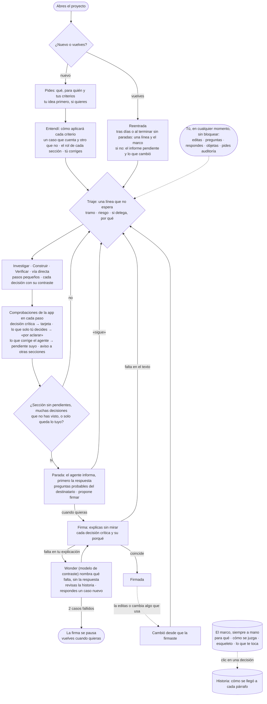

# Bloque 1 · El ciclo mínimo de tupaqnin

*Humano y agentes construyen una sección a la vez. Los agentes investigan, leen, redactan y verifican sin esperar al humano, pero se detienen solos al cerrar una sección para informar, anticipar lo que preguntará el destinatario y proponer la firma. El humano entra cuando quiere, decide lo que importa, ve siempre cómo se llegó a cada parte y al final explica y firma.*

## 1. El ciclo

- **El agente no te espera.** Encadena pasos y para solo cuando la sección queda sin pendientes, cuando acumula muchas decisiones que no has visto o cuando solo queda lo que tú decides. Si eliges «continúa hasta terminar» (la app te advierte antes), no para hasta que solo quede lo tuyo.
- **Tú no esperas al agente.** Editas, preguntas o respondes cuando quieras. Tu edición rige de inmediato y se deshace con un clic; preguntar no cambia el documento.
- **Solo tú** firmas, revocas lo confirmado, decides alcance, premisa o destino, fijas el sentido de tus términos y decides si se repite una ronda.
- **El marco, siempre a mano.** Muestra qué se construye y por qué, ordenado por el argumento y no por fecha: para qué, cómo se juzga, cada sección con sus decisiones críticas y tu «porque», y lo que te toca. Lo calcula la app; no lo narra el agente. Al volver tras días, o al terminar sin paradas, se abre con una línea de dónde quedaste. No es un historial de cambios: eso es la historia.
- **Un solo grafo detrás de todo.** Cada pedido, criterio, decisión, fuente y sección, y lo que une a cada uno con otro, queda registrado en un mapa de vínculos: el grafo del proyecto. El marco, los avisos, lo que es crítico y la pregunta de origen de la firma salen de él, por eso no se contradicen. Lo arma la app con lo que el agente entrega en un formato fijo, con sus propias reglas y con tus actos; ningún modelo lo arma leyendo texto libre.
- **Nada se firma sin que lo expliques,** y lo firmado no cambia en silencio: un cambio del agente llega como propuesta, y si cambia algo que la sección usa, vuelve a pedir tu firma.

## 2. Qué te pide el ciclo

*La mayoría de los actos son opcionales. Lo obligatorio para firmar una sección es responder sus tarjetas críticas y sus «por aclarar»; firmar es la única puerta, pero puedes llevarte el documento sin firmar.*

| Acto | ¿Te obliga? | Si no lo haces |
|---|---|---|
| Responder una **tarjeta crítica**: eliges una opción y escribes un «porque» | Sí, solo en decisiones críticas | El trabajo sigue; esa sección no se puede firmar |
| Elegir en un **«por aclarar»**: el agente trae cada opción con su contraste, consecuencia y riesgo | Sí, solo en lo que únicamente tú decides | El agente avanza variantes sin elegir; lo que depende de él no se puede firmar |
| **Firmar** una sección | Es la única puerta | Puedes llevarte el documento igual; las secciones sin firmar quedan marcadas |
| Confirmar los casos del «Entendí» | No | El trabajo sigue; un caso sin confirmar puede volver como pregunta |
| Consultar el marco | No | Está siempre a mano; al volver tras días, se abre solo |
| Leer el informe de parada y las preguntas del destinatario | No | No bloquean |
| Corregir la línea de triaje | No | No espera respuesta |
| Editar, preguntar, objetar, pedir una auditoría | No | Lo haces cuando quieras |

**Cuánto cuesta firmar.** Explicas sin mirar solo las **decisiones críticas** de la sección: las que cubren una cifra calculada o supuesta, están en una sección de conclusión o recomendación (ese rol lo propone el agente en el «Entendí» y lo confirmas tú), afectan dos o más secciones, o marcaste tú. Copiar un dato de una fuente no crea una. Además respondes una **pregunta de origen:** el supuesto del que depende algo crítico. Si tu explicación coincide con la historia, firmas. Solo si falta algo, Wonder te dice qué (sin darte la respuesta), revisas y respondes un caso nuevo de una línea; tras 2 fallos, la firma se pausa y vuelves cuando quieras. Una sección sin decisiones críticas se firma con una explicación breve. Si después aparece una decisión crítica en una sección firmada, vuelve a pedir la firma completa.

## 3. Quién hace qué

- **Tú:** pides, corriges el «Entendí», decides lo crítico con un «porque», editas cuando quieras y firmas.
- **Agente principal:** clasifica cada vuelta, redacta en pasos pequeños con su contraste, informa en la parada y, si preguntas, explica sin editar.
- **Subagentes y modelos de apoyo:** lectores que leen o buscan y devuelven pasajes literales; un juez que busca fallas si hay un riesgo o lo pides; un comprobador, llamada corta que revisa cada paso; Wonder, que contrasta tu explicación al firmar.
- **App:** mantiene el grafo del proyecto y, desde él, arma los encargos, corre las comprobaciones, calcula lo crítico, la historia y el marco, y no deja firmar con pendientes.

La tabla por etapa está en `bloque-1-fichas.md` §8.4.

## 4. El encargo a un subagente (contexto idóneo)

La app lo arma con una plantilla fija; el principal solo elige la pregunta, el alcance y la razón:

1. **Pedido del humano**, en literal.
2. **Pregunta** que responde, **qué duda** reduce y **por qué se delega**.
3. **Criterios, con su caso de lo que cuenta y lo que no, premisa, decisiones vigentes y tu expectativa de la ronda, si la diste**, en literal, con id y versión.
4. **Alcance**: qué leer, qué no, hasta dónde.
5. **Fuentes**: archivos y para qué sirve cada uno.
6. **Reglas de evidencia**: cita literal con fuente; `[inferencia]` cuando razona sin texto; no rellenar; nunca citar lo que no vio.
7. **Retorno fijo y corto.**
   - **Lector:** hallazgos con pasaje literal y fuente, separando hechos, supuestos, contradicciones y vacíos; qué preguntas o criterios (por id) cubrió. Sin recomendaciones.
   - **Juez:** falla · pasaje literal · riesgo que toca · escenario en pasos. Las sugerencias solo informan. En la parada: las 3–5 preguntas más probables del destinatario y qué no cubre el trabajo.

**Ciclo acotado de corrección:** descartas las fallas que no aplican (si no descartas, se corrige todo lo señalado), se hace un lote de corrección y una sola reverificación de lo señalado. Lo que sigue abierto queda «por aclarar»; nunca se abre otra ronda por un hallazgo nuevo.

## 5. Cómo ataca la deuda cognitiva

| Dónde nace la deuda | Qué hace el ciclo |
|---|---|
| El criterio se parafrasea o se lee mal | Se guarda con tus palabras; el «Entendí» muestra cómo se aplicará, con un caso de lo que cuenta y otro de lo que no; tus términos en casos dudosos los decides tú |
| El agente produce más rápido de lo que entiendes | Se detiene solo con un informe fijo; ir sin paradas es una elección informada |
| Investigación que no se digiere ni se puede defender | Pregunta previa; digesto con pasajes literales; hechos separados de supuestos y vacíos |
| Decisiones que el agente no declara o toma por ti | La app detecta lo escrito sin decisión; lo que solo tú decides queda «por aclarar» |
| El agente revierte en silencio lo decidido | Chequeo de contradicción (en la duda, salta); solo tú revocas; lo firmado cambia solo como propuesta |
| Aprobar sin comprender | El chat no confirma; tarjetas y «por aclarar» solo con opción y «porque» |
| Firmar repitiendo lo que te muestran | Explicas cada decisión crítica; Wonder nombra qué falta sin darte la respuesta y luego pide aplicarlo a un caso nuevo |
| Quedar sin respuesta ante el destinatario | La parada anticipa sus preguntas probables; tú decides cuáles abordar |
| Un error tuyo se toma como decisión | Toda edición se deshace con un clic; ante una edición sospechosa, una alerta que no bloquea |
| El proceso se cuela en el producto | Los códigos y el relato del proceso van a la historia; la app los detecta en el texto |
| No saber cómo se llegó | Historia armada por la app, como mapa por párrafo, siempre visible y en un lugar estratégico de la interfaz |
| Volver tras días y no recordar qué se construyó | El marco: el argumento vigente con tus palabras, ordenado por lo que sostiene qué, siempre a mano; al volver, primero una línea y el marco |
| Ceremonia y rondas que se multiplican | Delegar solo con razón; juez solo con un riesgo; una sola reverificación; repetir una ronda lo decides tú |

## 6. Qué entra y qué se prueba

| Entra en el ciclo mínimo | Hoja de ruta | Otros bloques |
|---|---|---|
| Todo lo de §1–§4 · los cálculos entran como fuente con id · búsqueda web solo para los lectores, con verificación del pasaje | Ejecutar código en un entorno aislado · oráculo con predicción · teach-back completo con predicción oculta · presupuesto de contacto humano · propuestas formales de revocación · firma del documento entero · voz fuera de la firma · modelo y esfuerzo configurables por el usuario · reconstruir de memoria antes de ver el marco · tesis de sección redactada por un modelo · grafo del tema extraído por el agente (distinto del grafo del proyecto), solo para buscar en material masivo | **Bloque 2:** memoria del agente, paquete de arranque, reinicio. **Bloque 3:** almacenamiento, versiones, git, interfaz de archivos |

Un análisis de sensibilidad no es parte del ciclo: se encarga si lo pides, o si lo aceptas cuando la parada lo propone.

**Hipótesis que se prueban construyendo.** Las reglas del ciclo son iniciales: cada una trae en `bloque-1-decisiones.md` cuándo se cambiaría por la otra opción. En el hackathon, la app registra por sección los actos obligatorios y su tiempo. Los umbrales son `[inicial]`.

| Hipótesis | Se prueba con | Umbral | Si no se cumple |
|---|---|---|---|
| El «Entendí» con un caso que cuenta y otro que no evita la mayoría de las malas lecturas | Casos 1, 8 y 9: ¿la mala lectura se corrige en el «Entendí» y no después? | 2 de 3 | Se rehace el formato del «Entendí» |
| El «porque» obligatorio no hace que dejes de responder las tarjetas | «Porque» válido al primer intento | ≥ 70 % | Se acepta la respuesta sin «porque»; la firma frena lo que falte |
| La historia por párrafo ayuda a explicar sin mirar | Firmas que coinciden al primer intento | ≥ 60 % | La historia la narra el agente, con enlaces |
| La parada llega a tiempo y sus preguntas del destinatario sirven | Preguntas que abordas o respondes «no» (no las que ignoras) | ≥ 50 % | Menos preguntas, o solo a pedido |
| La línea de triaje se entiende sola | Veces que preguntas qué significa | ≤ 1 por sesión | Se reformula la línea |
| La tarjeta precargada desde el chat evita reescribir (no se prueba en el hackathon: H-3) | Caso 1: respuestas del chat aplicadas sin reescribir | ≥ 80 % | Se quita la precarga |
| El agente declara bien qué cambios actualizó | Cierres «actualizado» que no reabres ni contradice la firma («falta en el texto») | ≥ 90 % | Cada cierre lo confirmas tú |
| La app elige bien el supuesto de la pregunta de origen | Caso de demo: la pregunta apunta al supuesto real (el porcentaje de uso) | 9 de 10 firmas | Lo elige Wonder |
| La firma es proporcional | Tiempo de firma de una sección con 1–2 decisiones críticas · secciones de la demo que quedan sin firmar | ≤ 3 min · < 50 % | Niveles de firma por destinatario y riesgo |
| Las sondas detectan las contradicciones con tus decisiones que el agente no declara (bloque 2, B2-7) | Contradicciones sembradas en el caso de demo · avisos «no lo declaró el agente» por sesión | ≥ 8 de 10 sembradas `[inicial]` | Se suma el juez en la parada |
| El marco reconstruye tu marco mental | Tras una pausa simulada y 5–10 min con el marco, explicas sin mirar las decisiones críticas de una sección | ≥ 70 % | Se suma una tesis por sección o un mapa gráfico |

**Dónde está el detalle:** `bloque-1-fichas.md` (componentes, etapas, el marco, el grafo del proyecto, comprobaciones, contratos y, en §8, el ciclo en detalle: ritmo, lo que solo tú haces, cómo respondes, premisa, firma, lo firmado, triaje y criticidad) · `bloque-1-estados.md` · `bloque-1-flujos.md` · `bloque-1-decisiones.md`.
