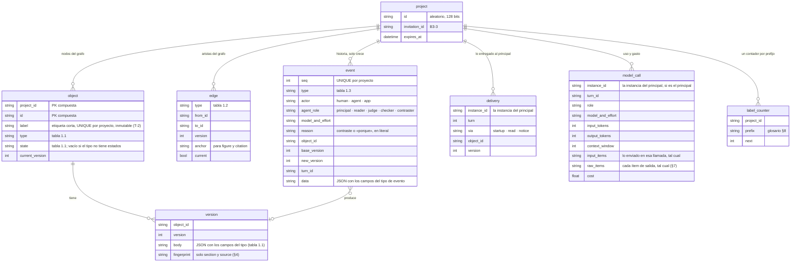

# Bloque 3 · Especificación

*Lo que necesita un agente de código para construir el almacén, la puerta de escritura, la firma y el despliegue. La idea está en `bloque-3.md`.*

## 1. Modelo de datos

*Los nombres de tablas, campos y valores van en inglés (T-1); la equivalencia con el diseño está en `../glosario.md`. Fuente de cada regla: el grafo del proyecto (fichas §9, N-1), los estados (`bloque-1-estados.md`), los contratos (fichas §7) y la memoria del principal (`bloque-2.md`). Esta sección no agrega reglas: las pone en tablas. Lo que el diseño no dice está marcado `[EL DISEÑO NO LO DICE]` y se decide en los defaults técnicos, no al programar.*

- **Se toma:** todo pertenece a un proyecto (clave compuesta, ids aleatorios); los binarios son del proyecto; un escritor global para SQLite.
- **El estado vigente se guarda junto con su evento, en la misma transacción.** Si no cuadran, gana la historia y se recalcula (estados §8: «con ella se reconstruye el estado de todo»).
- **Etiquetas cortas (T-2):** cada objeto tiene, además de su id interno, una etiqueta por proyecto con el prefijo de su tipo (glosario §8: `dec-12`, `sec-3`). Se asigna con `label_counter` en la misma transacción que crea el objeto; no se reutiliza ni se renombra. Cada cambio de la lista de una sección lleva también su etiqueta (`chg-7`). La traducción entre id interno y etiqueta ocurre en un solo lugar: al armar lo que se entrega al modelo y al leer su salida; ningún id interno llega al modelo.
- **Solo cuenta la versión vigente** de cada objeto; lo reemplazado queda en `VERSION` y en la historia (B2-1, M-1).

### 1.1 Nodos: tipos de `object`

*Lista cerrada de fichas §9. Cifra, dato y cita son anclas dentro del texto de una sección.*

| Tipo (`type`) | Estados (`state`, según `bloque-1-estados.md`) | Campos de `body` | Fuente |
|---|---|---|---|
| pedido · `request` | — | `text` en literal · `audience` | Fichas §9 · K-8 |
| criterio · `criterion` | `current` (cada cambio es una versión nueva, solo tuya) | `text` en literal · `request_id` | Estados §6 |
| caso del «Entendí» · `understanding_case` | `unconfirmed` · `confirmed` · `corrected` | `text` · `counts`: true · false · `criterion_id` | Estados §6 · C1 |
| premisa · `premise` | `current` · `contradicted` (se mantiene o cambia por «por aclarar») | `text` en literal · `request_id` · `exploratory`: true · false | Estados §6 · P4 · K-5 |
| sección · `section` | `draft` · `signed` · `changed_since_signoff` · `stale`. **`ready` («lista») no se guarda: se calcula** cuando no quedan pendientes (estados §1) | `text` Markdown · `role` {`value`: `conclusion` · `recommendation` · `other`, `state`: `proposed` · `confirmed`} · `open_changes` (cada uno con su etiqueta `chg-n`) | Estados §1 y §6 · K-2 · K-13 · A-1 |
| decisión · `decision` | `agent` · `human` · `confirmed` · `in_open_question` · `superseded` · `revoked` | `statement` · `instead_of` · `would_choose_if` · `assumption`: true · false · `origin`: `agent` · `human` · `human_marked_critical`: true · false. La criticidad no se guarda: la calcula una función de la app (fichas §3, T-5; ver 1.5) | Estados §2 · fichas §7 · D9 |
| cifra · `figure` | — | `section_id` · `anchor` · `value` | Fichas §9 · A-3 |
| dato · `datum` | — | `section_id` · `anchor` · `value` (literal de una fuente) | A-3 |
| cita · `citation` | — | `section_id` · `anchor` · `passage` literal | A-2 |
| fuente · `source` | — (cada reemplazo es una versión nueva) | `kind`: `file` · `web` · `calculation` · `url` · `replaces` (id) | A-1 · F-1 · F-2 |
| «por aclarar» · `open_question` | `open` · `resolved` | `question` · `options` {`contrast`, `consequence`, `risk`} · `depends_on` · `variants` rotuladas | Estados §4 · P5 · D21 |
| tarjeta · `card` | `open` · `answered` · `obsolete` | `decision_id` · `chosen_option` · `reason` | Estados §3 · P2 · R4 |
| propuesta · `proposal` | `open` · `accepted` · `discarded` | `section_id` · `base_version` · `anchor` · `operation`: `replace` · `insert_after` · `text` · `contrast` (T-4) | Estados §5 · D11 · C3 |
| firma · `signoff` | — | ver §4 («lo que guarda la firma») | Estados §1 · fichas §2 |
| pregunta del destinatario · `audience_question` | `open` · `addressed` · `declined` | `question` · `section_id` | Estados §9 · K-1 |
| ronda · `round` | `open` · `closed` | `kind`: `research` · `judge` · `reduced_doubt`: `yes` · `partly` · `no` · `coverage_inventory` (lo asignado y lo leído) | Estados §7 · A-5 |

### 1.2 Aristas: tipos de `edge`

*Lista cerrada de fichas §9. Cada arista tiene versión y su evento en la historia. **Regla de origen:** nace solo de un campo de la salida fija que la app valida, de una regla de la app o de un acto tuyo; si apunta a una etiqueta que no existe en el proyecto o a un `new-n` que no se declaró en la misma salida, la app la rechaza.*

| Tipo | De → a | La crea | Se valida |
|---|---|---|---|
| la cubre · `covers` | cifra → decisión | principal (vínculos) | la decisión existe y está vigente |
| se usa en · `used_in` | decisión → sección | principal (secciones donde se usa · decisiones usadas) y app (sección donde aparece una cifra vinculada) | la sección existe |
| viene de · `comes_from` | dato → fuente | app (dato reproducido, A-3) | el valor aparece literal en la fuente |
| viene de · `comes_from` | cita → fuente | principal (citas) | la app encuentra el pasaje en la fuente (A-2) |
| usa · `uses` | sección → fuente | principal (fuentes usadas) | la fuente existe |
| aplica · `applies` | decisión → criterio | principal | el criterio existe y está vigente |
| depende del supuesto · `depends_on_assumption` | decisión → decisión de supuesto o premisa | principal | apunta a una decisión con «supuesto: sí» o a la premisa |
| bloquea · `blocks` | «por aclarar» → sección o decisión | app | — |
| reemplaza · `supersedes` | decisión → decisión anterior | principal o tus actos | el principal solo reemplaza las suyas, vigentes y fuera de lo firmado (estados §2) |
| explica · `explains` | firma → decisión | app, al firmar | — |
| sobre · `about` | pregunta del destinatario → sección | juez, en la parada | la sección existe |

### 1.3 Historia: tipos de `event`

*Lista de estados §8 y de lo que el bloque 2 lee. Solo se agregan; nunca se editan.*

| Tipo | Qué registra (en `data`) | Fuente |
|---|---|---|
| `state_changed` | objeto, estado anterior y nuevo, quién y por qué | Estados §8 |
| `step_ended` | línea de triaje · riesgo al cerrar · **nota del agente**, completa · **lo diferido** · las etiquetas que la app asignó a cada `new-n` | Fichas §2 y §7 · B2-6 · T-3 · T-6 |
| `mode_set` | modo («normal» · «continúa hasta terminar») y tu mensaje en literal | Estados §8 · B2-1 |
| `human_message` | tu mensaje en literal y, después, su respuesta | Estados §8 · B2-2 |
| `stop_report` | el informe y si lo viste | Estados §8 · D19 |
| `decision_seen` | `seen_via`: `report` · `card` · `history` · `frame` | Estados §8 · M-1 |
| `edit` · `edit_undone` | versión base y nueva | Estados §8 · G-1 |
| `suspicious_edit_alert` | motivo · respondida o no | G-1 |
| `signoff_case` · `signoff_paused` · `brief_signoff` | resultado del caso · «pregunta de origen: no aplica» | E-2 · A-4 |
| `audience_question_declined` | «no abordado, decidido por ti» | K-1 |
| `usage_change` | `entered` · `updated` · `reviewed_unchanged` (con «porque») | A-1 |
| `source_new_version` | fuente reemplazada | A-1 |
| `role_changed` · `audience_changed` | valor anterior y nuevo | K-13 |
| `marked_critical` | decisión · la marcas o la desmarcas | Fichas §3 · T-5 |
| `edge` | `created` · `changed` · `superseded` | N-1 |
| `answer_without_reason` | tarjeta o «por aclarar» respondido sin «porque» válido | Estados §8 · P2 |
| `act_timed` | acto obligatorio (tarjeta, «por aclarar», firma) y su duración | K-11 |
| `probe` | por sonda: id de lo protegido · contradice · no · duda · pasaje; y si el principal lo había declarado | B2-7 |
| `startup` | motivo: `new_session` · `model_change` · `threshold` · y la instancia nueva del principal | B2-2 · B2-3 |
| `output_retry` | la salida no cumplió la forma; reintento o pendiente del agente | Fichas §7 |

### 1.4 Lo entregado y el uso de contexto

- **`delivery`** se escribe al entregar algo al principal: el arranque, cada `read(id)` y cada aviso, con la versión. «Lo que cambió» es lo vigente frente a lo último entregado, sea cual sea la instancia (B2-2).
- **`model_call`** guarda lo enviado y lo recibido en cada llamada, tal cual: con eso se rehace la conversación del principal entre turnos. También guarda el uso que reporta cada respuesta (tokens de entrada y salida, ventana del modelo). La app mide con eso el umbral (~40 % libre, B2-3) y el tope del arranque (≤ 15 % de la ventana, B2-2).

### 1.5 Criticidad (T-5)

- **Una sola función en Go** calcula si una decisión es crítica desde el grafo, con los cuatro motivos de fichas §3: cubre una cifra, está en una sección con rol conclusión o recomendación, afecta 2 o más secciones, o `human_marked_critical`. No se guarda.
- **Se llama al leer y en cada transacción que cambia aristas, el rol de una sección o tu marca.** En esa transacción compara el antes y el después: si una decisión con `state = agent` pasa a crítica, abre su tarjeta (estados §2); si es tuya o confirmada, no. Si está en una sección firmada, emite `state_changed` hacia `changed_since_signoff` en todos los casos (K-6, K-13).

### 1.6 Lo que este modelo no decide

- Las fechas (T-7), las migraciones (T-8), la configuración (T-9), los registros (T-10) y las pruebas (T-11) están en `defaults-tecnicos.md`.

## 2. Escritura

- **Condicionada por versión (se toma):** `UPDATE … WHERE id = ? AND current_version = ?` con `rowsAffected == 1`; el evento y la versión nueva en la misma transacción. Sin cambio canónico no hay escritura. Nunca hay una transacción abierta mientras se espera al modelo.

| Llega… | y entre medias cambió… | Qué pasa |
|---|---|---|
| Un paso del agente | El mismo texto, por ti | **Queda como propuesta** con su contraste; tu edición rige |
| Un paso del agente | Otra cosa (otra sección, una decisión) | Se aplica; las comprobaciones ven el conflicto si lo hay |
| Un paso del agente | Una sección firmada, en «cambió» o en firma (K-16, propuesta) | Queda como propuesta |
| Tu edición | Lo que sea del agente o la app | Se aplica la tuya; lo del agente que quedó debajo pasa a propuesta |
| Tu edición desde otra pestaña | — | No ocurre: la segunda pestaña es de solo lectura |

- **Deshacer (G-1):** cada edición tuya se revierte con un clic. Deshacer es un evento nuevo que restaura la versión anterior; si había una propuesta desplazada, vuelve a abrirse.
- **Edición sospechosa (G-1):** la app la detecta por regla (borra más de la mitad de la sección o borra texto con decisiones vinculadas `[inicial]`) y muestra un aviso con «Deshacer». No bloquea.
- **Guardado:** al salir del campo, cada ~30 s, al ocultar la pestaña y siempre antes de enviar un mensaje o firmar (se toma). El cliente no envía si el documento no cambió.

## 3. Puerta de escritura del agente (fichas §1 y §7, N-1)

| Componente | Herramientas | Lo que escribe |
|---|---|---|
| Principal | `search` (en el índice) · `read(id)` (bloque 2) | Nada directo. Su salida fija de cada paso (fichas §7) |
| Lector | Búsqueda web alojada de Meta (F-2) · `read(id)` de fuentes del proyecto | Nada. Devuelve hallazgos |
| Juez, comprobador, Wonder | Ninguna: todo llega en su encargo | Nada. Devuelven su forma fija |

**La app valida la salida del principal antes de aplicarla:**
1. tiene la forma fija; si no, un reintento y luego pendiente del agente (fichas §7);
2. cada ancla existe y es única en la versión que leyó (T-4): se compara contra el mismo Markdown entregado, en NFC y con espacios colapsados. `replace` reemplaza el ancla; `insert_after` inserta después de ella, y con ancla vacía, al inicio de la sección (la única forma válida en una sección nueva). Varios textos nuevos en una sección se buscan todos en `base_version`, no pueden solaparse y se aplican de atrás hacia adelante. Las anclas de cifras y citas se buscan en el texto resultante. Si un ancla no aparece o se repite, el rechazo dice cuántas veces aparece y pide una más larga (cuenta como el reintento);
3. sin contenido invisible ni HTML crudo (se toma);
4. filtro de códigos: solo etiquetas que existen en el proyecto o ids provisionales `new-n` declarados en esta misma salida (T-2, T-3). Cada `new-n` se declara una sola vez: una decisión o un «por aclarar», con su `id`; una sección nueva, con su entrada en `proposed_roles` (K-2). Un `new-n` nunca vale dentro del texto ni en `supersedes`, `source_id`, `used_sources`, `change_id` y `used_decisions`, que apuntan a lo que ya existe. Antes de crear aristas, la app asigna a cada `new-n` su etiqueta. Se comparan tras normalizar (NFKC, sin caracteres de formato, confusables UTS #39, guiones a «-»). Un rechazo vuelve al agente con el nombre que debe usar (se toma);
5. cada decisión nueva trae su contraste completo; cada vínculo apunta a una decisión que existe;
6. una decisión del agente solo reemplaza otra suya, vigente y fuera de lo firmado (estados §2);
7. cada cambio que el paso declara atendido está en la lista de esa sección; si lo declara «actualizado», el paso toca esa sección; si «revisado sin cambio», trae un «porque» válido (A-1). Si no, ese cierre se rechaza y vuelve al agente.

Lo que pasa la validación se aplica; luego corren las comprobaciones (flujo §1).

- **Largo de la nota y de lo diferido (T-6):** no se rechaza por largo. La nota se guarda completa en `step_ended`; la capa 3 y el arranque usan sus primeras 80 palabras `[inicial]`, marcadas «recortada». Lo diferido no se recorta; un ítem de más de 30 palabras se registra.
- **Una propuesta aceptada (T-4)** se aplica con su ancla, operación y versión base. Si el ancla ya no es única en la versión vigente, la app pide un paso nuevo al agente en vez de aplicarla a ciegas.

- **Verificación de hallazgos web (F-2):** Go descarga la URL (tiempo y tamaño acotados), normaliza el texto y busca el pasaje. Resultado: entra · no verificado (inaccesible) · descartado.
- **Límites `[inicial]`:** 8 llamadas a herramientas por paso; 3 lectores en paralelo.
- **No existe como herramienta:** firmar, responder tarjetas o «por aclarar», revocar, tocar la historia, escribir el estado de trabajo, borrar.

## 4. Huella, estado y firma

- **Huella `tq-md/1` (se toma):** SHA-256 de un JSON canónico (JCS) del árbol de goldmark con GFM: tipo de nodo, texto en NFC, niveles, celdas, destino de enlaces, contenido literal de bloques de código y Mermaid. Ignora marcadores de lista, carácter de énfasis, relleno y escapes.
- **Estado de la sección:** una sola función en Go que usan todas las vistas, con los 5 estados y los pendientes de bloque-1-estados §1.
- **«Cambió desde que la firmaste»** compara por componentes: la huella de la sección, la versión de cada decisión crítica firmada y la huella de cada fuente que la sección usa (A-1).
- **Firma (K-16, propuesta en el bloque 1):** al pedir firmar, la sección entra en firma; los pasos del agente sobre ella llegan como propuesta. Tu edición cancela la firma en curso.
- **Lo que guarda la firma:** sección (versión y huella) · decisiones críticas y criterios aplicados (id y versión) · fuentes usadas (id y huella) · tarjetas respondidas · tu explicación · pregunta de origen y tu respuesta (o «no aplica», A-4) · casos de aplicación y su resultado · modelo que contrastó (Wonder o Spark `xhigh`). El resultado de Wonder va al lado, no dentro del compromiso.
- **Límite honesto (se toma):** la huella prueba que nada cambió, no quién firmó.

## 5. Para el bloque 2

- **Lo entregado** se registra al entregarlo: arranque, lecturas y avisos, con versión. «Lo que cambió» = lo vigente frente a lo último entregado, sea cual sea la instancia del principal.
- **El estado de trabajo** (capas 1–3) se calcula desde el grafo y la historia en cada fin de paso (B2-1). Puede guardarse como caché, pero nunca es la fuente: si no cuadra, se recalcula.
- **Nota del agente y modo** (con tu mensaje de activación) se guardan como eventos; la capa 3 los lee.
- **El uso de contexto** de cada respuesta se guarda en `model_call` para el umbral.

## 6. Despliegue y acceso

- **Fly.io** (se toma): una máquina, disco de 3 GB, siempre encendida; plan B Railway con el mismo contenedor. **No se despliega desde la entrega hasta que termine el juzgamiento.**
- **Copia (se toma):** `VACUUM INTO` diaria fuera del host; ensayo de restauración con `integrity_check` el 2-nov.
- **Streaming (se toma):** sin límite de escritura en esas rutas, latido cada 15 s, un escritor por conexión, `idle_timeout` fijado.
- **Acceso por invitación (B3-3):** link con token, pocos proyectos por token; solo un POST crea proyecto. Topes: 3 USD por proyecto, 10 USD/día, 60 USD total, fondo aparte para el jurado `[inicial]`; reserva del máximo antes de cada llamada.
- **Tamaño (se toma):** sección ≤ 200 KB, fuente ≤ 5 MB, 25 MB por proyecto; al 80 % del disco no se aceptan proyectos nuevos, salvo del jurado.
- **Seguridad (se toma):** Mermaid ≥ 11.15 sin HTML crudo; CSP sin scripts en línea; cookies `__Host-`; `http.CrossOriginProtection`; el streaming nunca reenvía errores crudos del proveedor; una prueba recorre todas las rutas con la cookie de otro visitante.
- **Vencimiento:** 14 días, si el aviso lo promete; si no entra, el aviso no promete plazo.

## 7. Pila (se toma)

React + Vite (editor TipTap 3; tipos generados desde Go con `tygo`) · Go en un binario que embebe la página · `modernc.org/sqlite` en WAL, un `*sql.DB` de escritura con `SetMaxOpenConns(1)` y otro de lectura · goldmark v1 + GFM, `x/text/unicode/norm`, `gowebpki/jcs` · cliente de la Responses API de Meta que guarda cada ítem de salida crudo y lo reenvía byte a byte, con `store: false` e `include: ["reasoning.encrypted_content"]`.

## 8. Horas por rebanada `[inferencia]`

| Rebanada | Piezas de este bloque | Horas |
|---|---|---|
| 0 · Base | Esqueleto desplegado · almacén, historia y escritura condicionada · proveedor y streaming · lo entregado | 10–13 |
| 1 · Ciclo mínimo | Puerta de escritura y validación · huella y estado · firma guardada · una pestaña y guardado antes del turno | 7–9 |
| 2 · Protecciones | Estado de trabajo completo (vista) · avisos en el texto · el marco y la línea de vuelta (§9) | 8–13 |
| 3 · Potencia | Búsqueda web de lectores y verificación de pasajes | 2–3 |
| 4 · Casos difíciles | Propuestas por choque · deshacer y edición sospechosa | 3–4 |
| Entrega | Acceso por invitación y topes · copia y restauración · seguridad | 5–6 |
| **Total** | | **35–48** |

**Lectura honesta:** es la mitad de las 60–65 h del plan, antes de la lógica del bloque 1 (encargos, comprobaciones, firma, interfaz). Con agentes de código parte se solapa, pero no alcanza sin recortes. Las palancas, en orden: espejo git y cadena de huellas (ya fuera, B3-16), voz solo si sobra tiempo (B3-14), acceso por invitación mínimo (B3-3), y las rebanadas 3–4 tras interruptores, como ya dice el plan.

## 9. El marco (bloque 1, M-1 a M-4)

*Qué es y para qué: `bloque-1-fichas.md` §2, «El marco». Aquí, cómo se construye. Es una vista de solo lectura: no escribe nada salvo el evento «decisión vista», ningún modelo la redacta y nunca bloquea.*

- **Cálculo:** `frame(project)` reutiliza la función que calcula las capas 1 y 2 del estado de trabajo (§5) y le suma: el «porque» de cada tarjeta respondida (`event.reason`), tu explicación de firma vigente y los eventos «decisión vista». Solo muestra lo vigente: excluye decisiones reemplazadas y revocadas. Usa la misma caché del estado de trabajo, que se recalcula en cada fin de paso; los puntos «sin ver» se calculan al pedir la vista.
- **Contenido**, en este orden:
  1. **Para qué:** pedido, destinatario y premisa, en literal (capa 1).
  2. **Cómo se juzga:** criterios con su caso que cuenta y el que no (capa 1).
  3. **Esqueleto:** secciones en el orden del documento, con su estado y su primera línea (M-4: la primera oración del texto, hasta 200 caracteres `[inicial]`). Debajo de cada una, sus decisiones críticas vigentes. Una decisión que usan varias secciones aparece en cada una, con el mismo id.
  4. **Lo que te toca:** pendientes del humano (capa 1), incluido el informe de parada sin ver.
- **Ítem de una decisión:** ícono según el primer motivo de criticidad que cumpla, en este orden: cifra · conclusión o recomendación · varias secciones · marcada por ti. Al lado, el enunciado y un punto si no la viste.
- **Tarjeta al desplegar:** enunciado · en vez de · elegiría si · tu «porque» · tu explicación de firma, si hay · secciones que la usan · enlaces a la historia del párrafo (D7) y al texto. Desplegar registra `decision_seen` con `seen_via = frame`. Desplazarse por el panel no registra nada.
- **Filtro «solo lo que no viste»:** las decisiones con más aristas `used_in` primero; a igual número, en el orden del documento `[inicial]`.
- **Línea de vuelta (M-2):** aparece arriba del panel si pasaron ≥ 3 días `[inicial, parámetro]` desde tu último evento, o si terminó «continúa hasta terminar» desde tu última visita. Dice:
  - **dónde quedaste:** la última sección y el último acto tuyo;
  - **qué cambió:** el número de cambios de estado desde tu última visita, con enlace a la historia;
  - **qué te toca:** el número de tus pendientes.

  En vueltas más cortas, el panel abre igual, sin la línea, y la reentrada empieza por el informe pendiente (P3).
- **Firma:** la pantalla de firma no muestra el marco ni permite abrirlo.
- **Modelo de datos:** sin tablas nuevas. `decision_seen` guarda `seen_via` en `data` (§1.3).
- **Rendimiento:** ≤ 300 ms `[inicial]` con el caso de demo.
- **Hoja de ruta:** el intento de recuerdo antes de mirar (M-3: un objeto con texto, fecha y marcas) y la tesis de sección redactada por un modelo (M-4).
