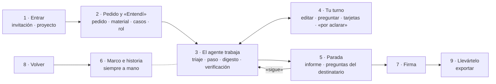

# Inventario de funcionalidades

**Respuesta:** el inventario está terminado. Son 9 momentos y 66 acciones: 63 tienen rebanada, 2 entran solo si sobra tiempo y 1 queda fuera del hackathon (H-3). No quedan huecos, y el caso de demo es el 5 (H-1). Cada acción se vuelve después una ruta de la API o un evento de la historia.

**Cómo leer la tabla.** «Tú» es lo que hace el humano y «App» es lo que la app muestra o hace sin que se lo pidas. La rebanada es la del plan §1 y §4: 0 a 4, «Entrega» (H-4), «si sobra» (B3-14 y B3-15) o «fuera del hackathon» (H-3). `[inferencia]` marca lo que deduje y no está escrito.

## 1 · Entrar

| # | Acción | Reb. | Fuente |
|---|---|---|---|
| 1a | Tú abres el link de invitación y ves el inicio: el aviso, tus proyectos y dos botones para empezar. Sin link, solo la página y el video públicos | Entrega | B3-3 · B3-18 |
| 1b | Tú creas un proyecto: pide solo un nombre y lleva al pedido. Con «Probar con el caso de demo», el pedido llega lleno con el caso de H-1 | 0 (API) · 1 (pantalla y caso de demo) | backlog 0.10 · B3-19 |
| 1c | Tú ves tus proyectos en el inicio y vuelves a uno | Entrega | B3-18 |
| 1d | App muestra lo gastado frente al tope del proyecto; avisa al 80 %; al tope, el agente se detiene y la firma conserva su saldo. El inicio avisa si no hay disco para proyectos nuevos o si se llegó al tope del día | 1 (lo gastado) · Entrega (avisos y saldo) | B3-20 · esp. §6 |
| 1e | Tú te registras con usuario y clave, sin correo: tu proyecto sin cuenta pasa a tu cuenta. Entras y sales | Entrega | B3-18 · B3-22 · esp. §1.7 |
| 1f | App te avisa cuántos días le quedan a tu proyecto sin cuenta (vence 7 días después de tu última actividad) | Entrega | B3-18 |
| 1g | App te dice que, para un segundo proyecto, necesitas una cuenta; con cuenta tienes hasta 3 | Entrega | esp. §1.7 y §6 · B3-18 |
| 1h | App avisa que el link agotó su saldo: ya no abre proyectos nuevos, y los que existen siguen. Dónde se ve: en el inicio `[inferencia]` | Entrega | B3-18 (detalle «Abuso») · B3-22 |

## 2 · Pedido y «Entendí»

| # | Acción | Reb. | Fuente |
|---|---|---|---|
| 2a | Tú escribes el pedido, el destinatario, los criterios y tu idea (o «exploratorio») | 1 | fichas §2 |
| 2b | Tú subes material y fuentes, incluido un cálculo como fuente | 1 | F-1 |
| 2c | Tú subes una nueva versión de una fuente; App avisa a las secciones que la usan | 2 | A-1 · estados §1 |
| 2d | App muestra el «Entendí» con un caso que cuenta y otro que no por criterio; tú corriges o confirmas | 1 | fichas §2 |
| 2e | Tú confirmas el rol de cada sección (si no respondes, rige lo propuesto) | 1 | K-2 · H-3; la criticidad lo usa |
| 2f | El principal crea una sección en un paso (`new-n`) o la propone en el «Entendí»; la API también permite crearla (tu botón está en 4q) | 1 `[inferencia]` (principal) · 0 (API) | esquema `new_text` · estados §6 · backlog 0.10 |

## 3 · El agente trabaja (lo que ves)

| # | Acción | Reb. | Fuente |
|---|---|---|---|
| 3a | Tú envías un mensaje; App guarda tu texto antes y muestra la respuesta en vivo | 0 | backlog 0.6 · 0.10 |
| 3b | App avisa si el arranque del principal pasa de su tope | 0 | bloque-2 §3 · plan §1 |
| 3c | App muestra la línea de triaje; tú la corriges con una palabra | 0 (ver) · 2 (corregir) | backlog 0.10 · fichas §8.3 |
| 3d | App muestra la nota del agente, plegada y con la etiqueta «nota del agente» | 0 | backlog 0.10 · B3-21 |
| 3e | App muestra el paso: el cambio y sus decisiones con contraste | 1 | fichas §2 |
| 3f | App muestra las secciones con su estado y su número de pendientes | 1 `[inferencia]` | bloque-3 §4 · fichas §5 |
| 3g | App marca en el texto «cambió desde que la firmaste», «escrita con lo anterior» y lo que tiene una propuesta | 2 | bloque-3 §4 · esp. §8 |
| 3h | Antes de investigar, App te pregunta «¿qué esperas encontrar?» (opcional) | 3 | flujos §2 |
| 3i | App muestra el digesto (hallazgos con pasaje, «no verificado», lo descartado a la vista, el inventario de cobertura); tú abres un pasaje y decides repetir la ronda con su costo o dejarlo «por aclarar» | 3 | fichas §2 · flujos §2 · A-5 |
| 3j | App muestra las fallas de la verificación; tú descartas lo que no aplica | 2 (comprobador y descartar) · 3 (juez y verificación por hallazgo) | fichas §2 · K-4 · A-2 · plan §1 · H-1 |
| 3k | Tú pides una auditoría | 3 | fichas §2 |
| 3l | Tú activas «continúa hasta terminar», con la advertencia de una línea | 4 | fichas §8.2 |
| 3m | App muestra el modo en la barra (lo gastado está en 1d) | 4 | bloque-3 §4 · H-3 |

## 4 · Tu turno

| # | Acción | Reb. | Fuente |
|---|---|---|---|
| 4a | Tú editas una sección: rige de inmediato | 0 (editor) · 2 (comprobaciones) | backlog 0.10 · fichas §2 |
| 4b | Si tu edición toca una decisión crítica, su tarjeta solo pide el «porque» o te ofrece «fue un error · deshacer» | 2 `[inferencia]` · 4 (deshacer) | fichas §2 y §8.2 · G-1 |
| 4c | Tú preguntas: el principal explica y no edita | 1 `[inferencia]` | fichas §2 |
| 4d | Tú respondes una tarjeta con una opción y un «porque» («ok» no cuenta) | 1 | fichas §8.2 |
| 4e | Tú respondes un «por aclarar», con sus opciones y variantes; App marca el que «no lo declaró el agente» | 2 | fichas §8.2 · bloque-2 §5 |
| 4f | Tú respondes en el chat; App precarga la tarjeta y cuenta al pulsar «aplicar» | fuera del hackathon | fichas §2 · H-3: el principal te pide responder en la tarjeta |
| 4g | Tú cierras un cambio sin cerrar: «actualizado» después de editar, o «revisado, no requiere cambio» con un «porque» | 2 | fichas §3 (A-1) · plan §1 |
| 4h | Tú cambias el rol de una sección (si una firmada tiene ahora una decisión crítica, pasa a «cambió»), o el destinatario del pedido, que solo cambia la preparación de la defensa | 1 (rol) · 2 (efecto del rol sobre lo firmado, y destinatario) | K-13 · fichas §2 · H-3 |
| 4i | Tú cambias un criterio (nueva versión) | 2 | estados §6 · H-3 |
| 4j | Ante tu premisa contradicha, tú la mantienes o la cambias, por «por aclarar» | 2 `[inferencia]` | estados §6 |
| 4k | Tú marcas o desmarcas una decisión como crítica | 2 | fichas §2 · T-5 · H-3 |
| 4l | Tú objetas una decisión y pasa a «por aclarar» | 4 | E-1 |
| 4m | Tú revocas una decisión tuya o confirmada | 4 | estados §2 · bloque-1 §1 · H-3 |
| 4n | Tú deshaces una edición tuya y puedes reaplicar la propuesta desplazada; si queda igual a lo firmado, la sección vuelve a «firmada» | 4 | G-1 · fichas §8.2 · estados §1 |
| 4o | Tú aceptas o descartas una propuesta del agente (choque o sección firmada) | 4 | fichas §8.2 |
| 4p | App alerta si ve sospechosa una edición tuya («¿Fue a propósito? · Deshacer»); no bloquea | 4 | G-1 · fichas §8.2 |
| 4q | Tú creas una sección con «+ Sección» y eliges su rol; si lo dejas vacío, lo propone el principal en su siguiente paso | 2 | K-17 · fichas §2 · H-3 |

## 5 · Parada

| # | Acción | Reb. | Fuente |
|---|---|---|---|
| 5a | App muestra el informe fijo, primero la respuesta, y propone firmar si no queda nada. Al terminar «continúa hasta terminar», primero la línea y el marco, con el informe a un clic y las contradicciones para tu revisión | 2 | fichas §2 · M-2 · bloque-2 §5 |
| 5b | Tú decides qué preguntas del destinatario abordar («no» queda en la historia) | 2 | fichas §8.2 |
| 5c | Tú dices «sigue» o «abordémoslo» | 2 | fichas §2 |
| 5d | Tú pides un análisis de sensibilidad, o lo aceptas cuando la parada lo propone | 1 (pedirlo, como cualquier mensaje) · fuera del hackathon (que la parada lo proponga) | bloque-1 §6 · H-3 (precisión del 28-oct) |

## 6 · Marco e historia

| # | Acción | Reb. | Fuente |
|---|---|---|---|
| 6a | Tú haces clic en un párrafo y ves su historia | 1 | plan §1 · D7 |
| 6b | App muestra el marco en un panel plegable a la izquierda, con el filtro «solo lo que no viste» | 2 | esp. §8 · B3-9 · M-1 |
| 6c | Tú despliegas una decisión del marco, o haces clic y vas a la historia de su párrafo | 2 | fichas §2 (El marco) |
| 6d | App registra «decisión vista» cuando se te muestra en un informe, una tarjeta, la historia abierta o al desplegarla en el marco | 2 `[inferencia]` | fichas §2 (Parada) |

## 7 · Firma

| # | Acción | Reb. | Fuente |
|---|---|---|---|
| 7a | Tú pulsas «Firmar sección»; App bloquea si quedan pendientes o cambios sin cerrar | 1 (básico) · 2 (completo) `[inferencia]` | fichas §2 · E-4 |
| 7b | Tú explicas sin mirar, a pantalla completa y sin el marco | 1 | fichas §2 · bloque-3 §4 |
| 7c | App indica si contrasta Spark porque Wonder no está disponible | 1 | fichas §1 · plan §1 |
| 7d | App muestra lo que falta sin la respuesta; tú revisas la historia o preguntas | 1 | fichas §2 |
| 7e | Tú respondes la pregunta de origen y el caso nuevo; tras 2 fallos, la firma se pausa | 1 | E-2 · E-3 |
| 7f | Tú firmas en breve una sección sin decisiones críticas | 1 | A-4 |
| 7g | Tú dejas la firma para después; «firma tú» no tiene efecto y el agente te ofrece empezar la explicación | 1 `[inferencia]` | fichas §2 · flujos §3 |
| 7h | Mientras firmas, los pasos del agente sobre esa sección llegan como propuesta; tu propia edición cancela la firma en curso | 1 (tu edición cancela) · 4 (pasos como propuesta) | K-16 · H-3 |
| 7i | App lista las propuestas abiertas al firmar; las no aceptadas pasan a la historia | 4 `[inferencia]` | fichas §2 |

## 8 · Volver

| # | Acción | Reb. | Fuente |
|---|---|---|---|
| 8a | Tras ≥ 3 días, o al terminar «continúa hasta terminar», App muestra la línea de vuelta y el marco, con el informe a un clic | 2 | fichas §2 · M-2 |
| 8b | En vueltas cortas, App muestra primero el informe pendiente | 2 | P3 |

## 9 · Llevártelo

| # | Acción | Reb. | Fuente |
|---|---|---|---|
| 9a | Tú descargas el documento en `.md`, con las secciones sin firmar marcadas, también sin cuenta | 2 | K-10 b · P3 · B3-18 · H-3 |
| 9b | Tú ves el proyecto como carpeta o lo exportas a Obsidian | si sobra | B3-15 |
| 9c | Tú explicas la firma o conversas por voz | si sobra | B3-14 |

## Huecos

**Resueltos (28-oct):** todos los de la v0.3. Los cerraron B3-18 a B3-21 (inicio, cuentas, crear proyecto, topes y nota del agente), K-17 (crear una sección), H-3 (rebanada de cada acción) y H-4 (rebanada «Entrega» en el plan).

**Caso de demo:** el caso 5 (H-1). Sostiene 1b y el «Listo cuando» de cada rebanada.

**Siguiente:** los bocetos de pantallas: el inicio, el proyecto trabajando, la tarjeta y el «por aclarar», la firma y la vuelta tras días.
