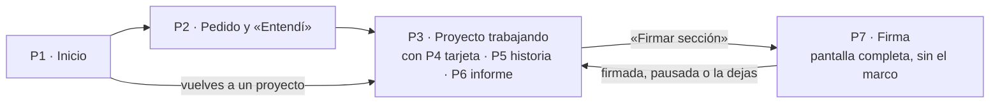

# Pantallas

**Respuesta:** son 4 pantallas y 3 piezas que viven dentro de ellas. Para la rebanada 1 bastan 4: el inicio mínimo, el pedido con el «Entendí», el proyecto trabajando (con la tarjeta y la historia) y la firma. El resto llega con su rebanada. Cada boceto dice qué ves, qué haces (con el número del inventario) y qué datos lee; esa última columna es la que usa la arquitectura.



**Cómo leer.** Los bocetos muestran zonas, no estilo. La interfaz va en inglés y en español (T-1); aquí se escribe en español. Entre corchetes, la rebanada.

## Recorrido del jurado con el caso 5

1. Abre el link y ve el inicio (P1). Pulsa «Probar con el caso de demo» (B3-19).
2. Ve el pedido de Paula ya lleno: el estado del arte sobre microplásticos para su comité, el criterio «solo estudios de campo» y los artículos como fuentes. Lo envía (P2).
3. El agente responde con el «Entendí»: cómo aplicará «campo», con un caso que cuenta y otro que no. El jurado lo confirma o lo corrige (P2).
4. El agente trabaja (P3): la respuesta llega en vivo, con la línea de triaje y la nota del agente. Aparece la regla de comparación (1,5 veces, no 60) como decisión crítica, y su tarjeta (P4).
5. El jurado responde la tarjeta con una opción y un «porque». Hace clic en la cifra y ve su historia (P5).
6. Pulsa «Firmar sección» (P7). Explica sin mirar y le falta el porqué de la regla: Wonder nombra qué falta, sin darle la respuesta, y le plantea un caso nuevo. Lo resuelve y firma.
7. Con la rebanada 2 se suman el «por aclarar» sobre qué cuenta como «campo» y la cita cuyo pasaje no está en su fuente. Con la 3, la ronda web y la cita que no existe (H-1).

## P1 · Inicio [1 mínimo · «Entrega» completo]

```
┌──────────────────────────────────────────────────────────────┐
│ tupaqnin · lo que firmas, lo entiendes y lo puedes defender  │
│ Aviso: qué es · no subas datos sensibles · sin cuenta, tu    │
│ proyecto vence en 7 días                         [Entrega]   │
├──────────────────────────────────────────────────────────────┤
│ [ Probar con el caso de demo ]   [ Proyecto en blanco ]      │
├──────────────────────────────────────────────────────────────┤
│ Tus proyectos                                                │
│  · Microplásticos · hace 2 h · 1 de 3 secciones firmadas     │
│  · …                                                         │
│ «Se borra en 6 días · crea tu usuario para conservarlo»      │
│ [ Crear usuario ]  [ Entrar ]                     [Entrega]  │
└──────────────────────────────────────────────────────────────┘
```

| Haces | Lee |
|---|---|
| 1a abrir el link · 1b crear (en blanco o con el caso de demo) · 1c volver a un proyecto · 1e registrarte o entrar | proyectos del dueño: nombre, última actividad, secciones firmadas de cuántas, días para vencer |
| Ves 1d, 1f, 1g y 1h: topes, vencimiento, «necesitas una cuenta» y saldo agotado | saldo del link, tope del día, disco, cuenta |

**En la rebanada 1:** solo los dos botones y la lista. Hasta «Entrega» no hay cuentas, así que la lista no filtra por dueño `[inferencia]`.

## Disposición general (29-oct, B3-9 precisada)

**Tres columnas, como un chat con su documento al lado.** El boceto navegable con el caso de demo está en `boceto-ui.html` (misma carpeta): manda sobre los dibujos de abajo en lo que es disposición; los datos que lee cada zona siguen siendo los de estas tablas.

```
┌ Izquierda · el marco ─┬ Centro · conversación ────────────┬ Derecha · el documento ─────────┐
│ [Proyecto ▾]          │ Pedido: «Qué quieres» + fuentes;  │ (aparece cuando hay secciones)  │
│ Línea de vuelta [2]   │  «Afinar ▸» para quién,           │ Síntesis · 1 te toca            │
│ Para qué (literal)    │  criterios, tu idea               │ …texto… [1,5 veces]             │
│ Cómo se juzga         │ «Entendí» como tarjeta            │  clic en un párrafo → historia  │
│ Esqueleto: secciones, │ El agente: texto, triaje, nota ▸  │ Traza ▸ (plegada)               │
│  1.ª línea, decisiones│ Tarjeta crítica: opción + porque  │ [ Firmar sección ]              │
│  críticas ▸           │ [ Dile al agente qué hacer… ]     │                                 │
│ Lo que te toca (n)    │                                   │                                 │
└───────────────────────┴───────────────────────────────────┴─────────────────────────────────┘
```

| Zona | Haces | Lee |
|---|---|---|
| Izquierda · el marco | cambiar de proyecto · desplegar una decisión (registra `decision_seen`, `frame`) · ir a la historia o a la tarjeta · ir a lo que te toca · filtro «solo lo que no viste» | `frame(project)` (espec. §9): pedido, destinatario y premisa en literal; criterios y sus casos; secciones con estado, primera línea y decisiones críticas; pendientes del humano. La línea de vuelta y el «sin ver» exacto, en la rebanada 2 |
| Centro · conversación | 2a escribir el pedido · 2b subir fuentes · 2d y 2e confirmar o corregir el «Entendí» · 3a enviar un mensaje · 3d leer la nota · 4d responder tarjetas | stream del turno (texto parseado, triaje, nota; nunca el JSON crudo, P-28), el «Entendí», las tarjetas abiertas |
| Derecha · documento | 4a editar · 6a clic en un párrafo · pedir firmar | texto vigente, cifras y citas vinculadas, avisos, historia del bloque (P5), lo gastado y el último triaje (traza) |

**Reglas que se mantienen:** el chat no confirma nada (una tarjeta solo se cierra con opción y «porque»); nada bloquea; la firma va a pantalla completa y oculta el marco y el texto (P7); ningún id interno a la vista (regla 7). En pantallas angostas, las tres columnas se apilan.

## P2 y P3 · versión del 28-oct (reemplazada por la disposición general)

*Se conserva para ver qué lee cada zona; la disposición vigente es la de arriba.*

### P2 · Pedido y «Entendí» [1]

```
┌─ Pedido ─────────────────────────┬─ «Entendí» (lo escribe el agente) ───┐
│ Qué quieres:  [               ]  │ Lo que entendí: …                    │
│ Para quién:   [ comité de tesis]  │ Criterio «solo de campo»:            │
│ Criterios:    + «solo de campo»  │   cuenta: «agua de grifo real…»      │
│ Tu idea:      [ embotellada > ]  │   no cuenta: «piloto de laboratorio» │
│   o ( ) exploratorio             │   [ Confirmar ] [ Corregir: ____ ]   │
│ Material:     [ Subir ] 3 arch.  │ Lo que leí de tu material: …         │
│ [ Enviar ]                       │ Secciones y su rol: Síntesis ·       │
│                                  │   conclusión [ Confirmar ]           │
└──────────────────────────────────┴──────────────────────────────────────┘
```

| Haces | Lee |
|---|---|
| 2a escribir el pedido · 2b subir material · 2d confirmar o corregir cada caso · 2e confirmar el rol de cada sección | pedido, destinatario, criterios, premisa, fuentes; del «Entendí»: lo entendido, casos por criterio, lo leído del material, rol propuesto por sección (fichas §7) |

No bloquea: si no respondes, el trabajo sigue y los casos quedan sin confirmar (fichas §2).

### P3 · Proyecto trabajando [0 editor · 1 lo demás]

```
┌ Barra: triaje «Tramo · Riesgo · si delega, por qué» · modo [4] · gastado 0,42/3 USD · [ Firmar sección ] ┐
├─ Izquierda (plegable) ─┬─ Editor de la sección ────────────────┬─ Panel ─────────────────────────┤
│ Secciones              │ Síntesis · borrador                   │ Chat                            │
│  · Estudios  borrador 2│ …texto… [1,5 veces]←cifra vinculada   │  respuesta en vivo (delta)      │
│  · Síntesis  borrador 1│ aviso: «cambió» / «escrita con lo     │ Nota del agente ▸ (plegada)     │
│  · Conclus.  firmada   │  anterior» / propuesta [2 · 4]        │ Te toca (2)                     │
│ [ + Sección ]      [2] │ clic en un párrafo → P5 historia      │  · tarjeta dec-4 → P4           │
│ El marco          [2]  │ [ Deshacer ]                      [4] │ Informe de parada → P6      [2] │
└────────────────────────┴───────────────────────────────────────┴─────────────────────────────────┘
```

| Zona | Haces | Lee |
|---|---|---|
| Barra | 3c ver la línea de triaje (corregirla en la 2) · 1d lo gastado · 3m modo [4] | último `step_ended` (triaje), suma de `model_call.cost` del proyecto, modo |
| Izquierda | elegir sección · 4q crear una [2] · el marco 6b y 6c [2, B3-9] | secciones con estado y número de pendientes; el marco: `frame(project)` (espec. §9) |
| Editor | 4a editar (rige de inmediato) · 6a clic en un párrafo · 4n deshacer [4] | texto vigente de la sección, sus cifras y citas vinculadas, avisos de cambio, propuestas |
| Panel | 3a enviar un mensaje · 3d leer la nota · 4c preguntar · 4d responder tarjetas | stream del turno (`delta`, `step`, `error`), nota del último paso, pendientes del humano |

## P4 · Tarjeta, dentro del panel [1] · y «por aclarar» [2]

```
┌─ Tarjeta · dec-4 · crítica: cifra ──────────────────────────┐
│ Comparar solo estudios con el mismo tamaño mínimo,          │
│ en vez de los conteos tal cual.                             │
│ Elegiría la otra si todos usaran el mismo filtro.           │
│ ( ) Mantener esta decisión   ( ) La otra opción             │
│ Porque: [__________________________________________]        │
│ [ Aplicar ]   ← solo con opción y «porque»; «ok» no cuenta  │
└─────────────────────────────────────────────────────────────┘
```

| Haces | Lee |
|---|---|
| 4d elegir y escribir el «porque» · 4b si es tu edición crítica: solo el «porque», o «fue un error · deshacer» [4] · 4e responder un «por aclarar», con sus opciones y variantes [2] | la decisión: enunciado, en vez de, elegiría si, motivo de criticidad, secciones que la usan. Responder registra el evento y `decision_seen` (`card`) |

## P5 · Historia de un párrafo, en un panel lateral [1]

```
┌─ Historia · Síntesis ¶3 ────────────────────────────────────┐
│ v3 · agente · 21:40 · dec-4 «mismo tamaño mínimo»           │
│     en vez de «conteos tal cual» · tu porque: «…»           │
│ v2 · tú · 21:32 · editaste «60 veces» → «1,5 veces»         │
│ v1 · agente · 21:10 · descartado: «la embotellada trae 60…» │
└─────────────────────────────────────────────────────────────┘
```

| Haces | Lee |
|---|---|
| 6a abrir desde el párrafo o desde una decisión del marco | versiones de la sección con su evento: quién, cuándo, decisión, contraste, «porque», lo descartado. Abrirla registra `decision_seen` (`history`) |

## P6 · Informe de parada, en el panel [2]

Primero la respuesta; después hecho · verificado · no verificado · por aclarar y tarjetas · siguiente (fichas §7). Con las preguntas del destinatario (5b), «sigue» o «abordémoslo» (5c), y «firmar» si no queda nada. Se bocetea con el backlog de la rebanada 2, junto con la vuelta tras días (8a y 8b).

## P7 · Firma, a pantalla completa y sin el marco [1]

```
┌─ Firmar «Síntesis» ─────────────────────────────────────────┐
│ 1 · Antes: pendientes 0 · propuestas abiertas 0  ✓          │
│ 2 · Explica sin mirar cada decisión crítica y su porqué:    │
│     [__________________________________________________]    │
│     Pregunta de origen: «¿de qué supuesto sale 1,5?» [____] │
│ 3 · Resultado (contrasta Wonder 1.0)                        │
│     dec-4 · falta en tu explicación (sin la respuesta)      │
│     [ Ver la historia de ese punto ] [ Preguntar al agente ]│
│     Caso nuevo: «un estudio usa otro filtro, ¿entra?» [___] │
│     casos fallidos: 0 de 2                                  │
│ [ Firmar ]  ← activo solo si todo coincide                  │
└─────────────────────────────────────────────────────────────┘
```

| Haces | Lee |
|---|---|
| 7a pedir firmar (si quedan pendientes, la pantalla los lista y no deja seguir) · 7b explicar · 7d revisar o preguntar · 7e pregunta de origen y caso nuevo · 7f firma breve, sin decisiones críticas · 7g dejarla para después | pendientes y cambios sin cerrar de la sección (estados §1), propuestas abiertas, decisiones críticas, supuesto de la pregunta de origen (elegido en el grafo), retorno de Wonder por decisión, casos fallidos de esta firma, si contrastó Spark (7c) |

Mientras firmas, tu edición de esa sección cancela la firma (K-16, 7h).

## Lo que pide la arquitectura (siguiente paso)

- **Vistas que lee la interfaz:** la lista de proyectos · el pedido con el «Entendí» · la sección con su texto, vínculos y avisos · los pendientes del humano · la historia de un párrafo · la preparación de la firma · `frame(project)` [2].
- **Acciones que escribe:** crear un proyecto (en blanco o con el caso de demo) · enviar el pedido · confirmar o corregir el «Entendí» · editar · enviar un mensaje · responder una tarjeta · pedir firmar, explicar y responder casos.
- **Streams:** el del turno (ya está en 0.6) y el del resultado de Wonder en la firma `[inferencia]`.
