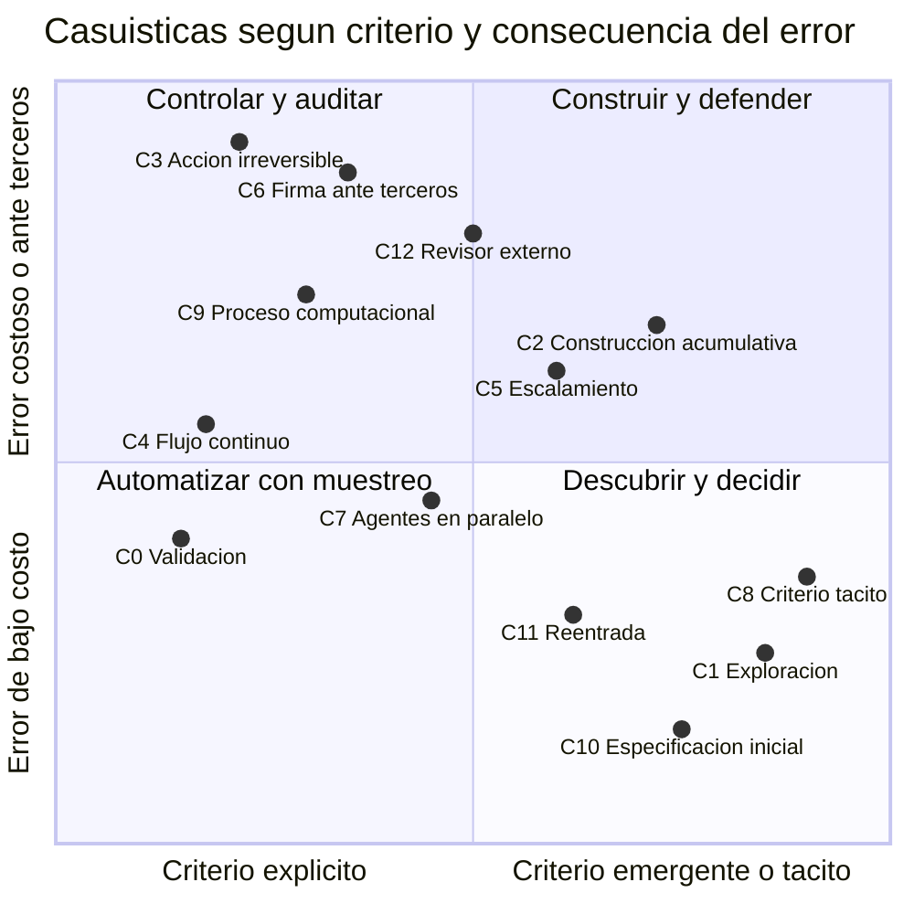
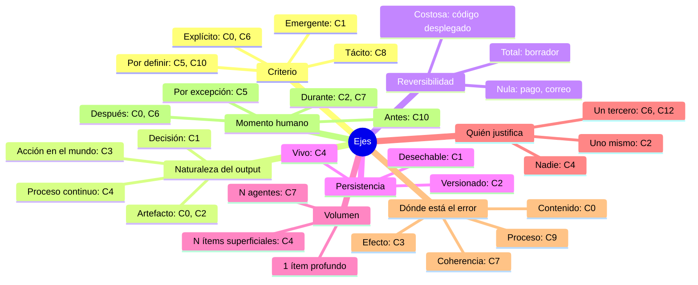
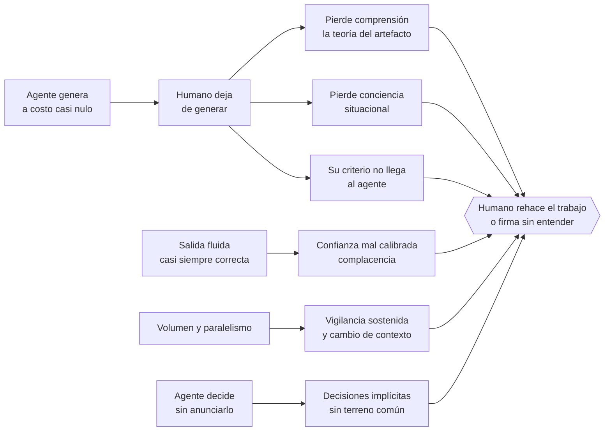
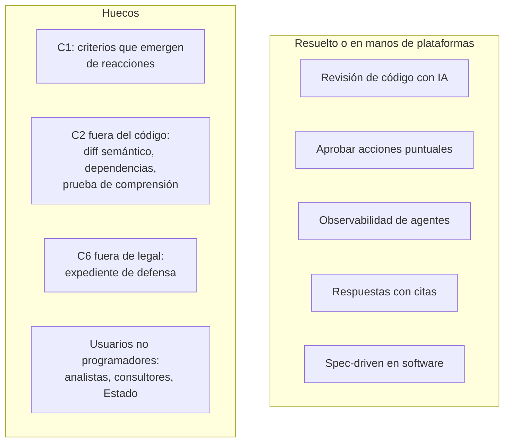
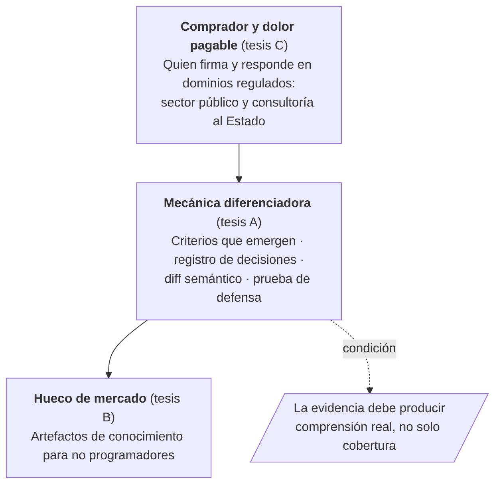

# El humano como cuello de botella en el trabajo con agentes de IA

*Lluvia de ideas · 7 de octubre de 2026 · Síntesis de 4 lentes: tipos de trabajo, ciencia cognitiva, mercado y abogado del diablo*

---

## 1. Idea en una línea

Revisar *outputs* es la unidad equivocada. El cuello de botella aparece porque, al dejar de generar, el humano pierde el proceso que le construía **comprensión, criterio y evidencia del cómo**. El producto debería tratar esos tres elementos como objetos de primera clase.

---

## 2. Casuísticas identificadas

| # | Casuística | Ejemplo | Qué frena al humano |
|---|---|---|---|
| 0 | **Validación** | Documento contra una rúbrica | Leer todo para verificar |
| 1 | **Exploración** | Nichos en el sector construcción | Decidir sin criterios previos |
| 2 | **Construcción acumulativa** | Metodología SyE de GEE (v5 → v7) | Seguirle el paso al agente; deuda de comprensión |
| 3 | **Acción irreversible** | Pagos, correos, deploys | Aprobar una por una lo que no se deshace |
| 4 | **Flujo continuo** | 2.000 tickets o facturas al día | No saber cuáles revisar; deriva silenciosa |
| 5 | **Escalamiento** | 10 % de reclamos fuera de política | Recibe los casos difíciles sin contexto |
| 6 | **Firma ante terceros** | Informe técnico estatal, escrito legal | Debe responder por él, así que rehace el razonamiento |
| 7 | **Agentes en paralelo** | 5 agentes, 5 secciones | Mantener la coherencia entre piezas |
| 8 | **Criterio tácito** | "Correcto, pero no suena a nosotros" | No puede explicar qué quiere |
| 9 | **Proceso computacional** | "El efecto es significativo" | El error está en el análisis, no en el texto |
| 10 | **Especificación inicial** | Encargo de 3 horas al agente | Especificar cuesta; si no lo hace, lo paga en la revisión |
| 11 | **Reentrada** | Volver al proyecto tras días | Reconstruir el contexto |
| 12 | **Revisor externo** | Jefe, auditor o cliente | Revisa lo que otro delegó, sin contexto |

### Mapa de casuísticas

Posición cualitativa: es un mapa para discutir, no una medición.

---

## 3. Ejes que distinguen las casuísticas

---

## 4. Diagnóstico: causas de fondo

| Causa | Mecanismo | Pesa más en |
|---|---|---|
| Asimetría producción–comprensión | Lo que uno genera se integra mejor que lo que solo lee (Naur; *generation effect*) | C2, C6, C10 |
| Conciencia situacional degradada | Fuera del bucle se pierde comprensión y proyección (Endsley; Bainbridge) | C3, C4, C5, C11 |
| Confianza mal calibrada | La fluidez del texto no refleja exactitud (Lee & See; Parasuraman) | C0, C6, C9 |
| Preferencias que se construyen | Los criterios se forman al ver opciones (Lichtenstein & Slovic; Klein) | C1, C8, C10 |
| Conocimiento tácito | "Sabemos más de lo que podemos decir" (Polanyi) | C1, C2, C8 |
| Vigilancia y cambio de contexto | La detección cae cuando los errores son raros | C4, C7 |
| Decisiones implícitas | Sorpresas de automatización; falta de terreno común | C2, C3, C7 |

### Soluciones ingenuas que empeoran el problema

- **Resumir más** da ilusión de comprensión y aumenta la complacencia.
- **Pedir aprobación para todo** produce fatiga y aprobación automática.
- **Puntajes de confianza globales** pasan de confiar de más a no usarlos tras el primer fallo.
- **Explicaciones post-hoc** son racionalizaciones plausibles, no trazabilidad.
- **Más autonomía** traslada el problema a las excepciones, donde el humano no tiene contexto.

---

## 5. Mercado

| Producto (muestra) | Casuística | Enfoque |
|---|---|---|
| CodeRabbit, Greptile, Graphite (Cursor) | C0, C7 | Agente revisa el PR antes que el humano |
| HumanLayer, GitHub Spec Kit, Kiro | C2, C10 (código) | Revisar especificación y diseño, no el código |
| gotoHuman, LangGraph Agent Inbox, Auth0 | C3, C5 | Bandejas y aprobación asíncrona |
| Langfuse, LangSmith, Braintrust | C4 | Trazas y colas de anotación |
| Harvey, CoCounsel, Clearbrief, VARI | C6 (legal) | Verificación de citas |
| Elicit, Consensus | C0 (investigación) | Afirmaciones con cita |
| Hex Notebook Agent | C9 | Celdas visibles y auditables |
| Decisive (académico), Patchwork (investigación) | C1, C2 | Criterios por pares; versiones revisables |

---

## 6. Tensiones (abogado del diablo)

1. **¿Se paga o se tolera?** Se paga por evitar consecuencias caras (legal, regulatoria, firma), no por comodidad.
2. **Riesgo de plataforma.** Diffs, resúmenes, citas y verificadores serán features de Anthropic, OpenAI o Cursor. Lo defendible es la neutralidad entre agentes, los criterios de dominio y un registro auditable de responsabilidad.
3. **¿Cuello de botella sano?** Acelerar la revisión puede convertirse en una máquina de firmar sin entender.
4. **¿Revisión o especificación?** Parte del dolor nace en una mala delegación.
5. **Elegir un problema.** Sincronización, confianza y diligencia tienen compradores distintos.

---

## 7. Tesis

| | Tesis | Comprador | Riesgo |
|---|---|---|---|
| **A. Cognitiva** | Comprensión, criterio y decisiones como objetos de primera clase | Quien co-construye (C2) | Vaga; difícil de cobrar |
| **B. Mercado** | No programadores que deciden y se apropian de artefactos de conocimiento | Analistas, consultores, Estado | Amplia |
| **C. Crítica** | Quien firma necesita evidencia verificable de diligencia, independiente del proveedor | Quien firma y responde | Puede derivar en "cubrirse" |

### Síntesis por capas

> **Formulación de trabajo:** *Para quien debe responder por documentos co-construidos con agentes, convertimos criterios y decisiones en evidencia explícita y verificable, para que pueda decidir, apropiarse y defender sin releerlo todo.*

---

## 8. Supuestos críticos y experimentos baratos

| Supuesto | Experimento | Se falsa si… |
|---|---|---|
| S1. El dolor es intenso | 10–15 entrevistas a analistas, consultores y especialistas públicos que usan IA; registro de 1 semana de tiempo de revisión | Menos de 1/3 lo pone entre sus 3 mayores dolores |
| S2. Pagarían por separado del LLM | Landing con precio y preventa | 0 preventas en 10 conversaciones calientes |
| S3. La mecánica mejora la detección, no solo la velocidad | Mago de Oz: documentos con errores sembrados, revisión normal vs. con la mecánica | La detección no mejora |
| S4. No es un feature inminente | Probar si un buen prompt en Claude da el 80 % del valor; revisar roadmaps | Se replica con un prompt |
| S5. El dolor persiste con mejores modelos | Comparar dos generaciones de modelos en la misma tarea | El tiempo de revisión cae en proporción a la calidad |
| S6. Es revisión y no especificación | Brazo extra en S3 con criterios definidos antes | Ese brazo reduce más la revisión que la herramienta |

**Piloto natural:** reconstruir el paso v6 → v7 de la metodología GEE como registro de decisiones y compararlo con revisar los documentos (S3, caso 2).

---

## Fuentes principales (aportadas por el subagente de mercado; no verificadas una por una)

- [Google Cloud – When AI writes the code, who reviews it?](https://cloud.google.com/transform/when-ai-writes-the-code-who-reviews-it-cto-google-cloud)
- [Circuit Breaker – 33k PR de agentes (arXiv)](https://arxiv.org/abs/2601.00753v1)
- [Cursor adquiere Graphite](https://siliconangle.com/2025/12/19/cursor-acquires-ai-code-review-startup-graphite/)
- [HumanLayer](https://humanlayer.dev/docs) · [GitHub Spec Kit](https://github.github.com/spec-kit/)
- [Decisive (ACL 2026)](https://preview.aclanthology.org/ingest-acl/2026.acl-long.1465/) · [Ink & Switch Patchwork](https://www.inkandswitch.com/patchwork/notebook/07/)
- [Stack Overflow 2025 – "almost right" AI code](https://venturebeat.com/ai/stack-overflow-data-reveals-the-hidden-productivity-tax-of-almost-right-ai-code)
- [Gartner – gobiernos y agentes de IA](https://itbrief.co.uk/story/governments-to-deploy-ai-agents-tighten-oversight-by-2029)
- [VARI – Legal Technology Hub](https://www.legaltechnologyhub.com/vendors/vari/)
- METR (jul. 2025), *Measuring the Impact of Early-2025 AI on Experienced Open-Source Developer Productivity*

**Referencias conceptuales:** Bainbridge (1983); Endsley (1995); Lee & See (2004); Parasuraman & Riley (1997); Pirolli & Card (2005); Polanyi (1966); Naur (1985); Lichtenstein & Slovic (2006); Klein et al. (2004); Rittel & Webber (1973).
