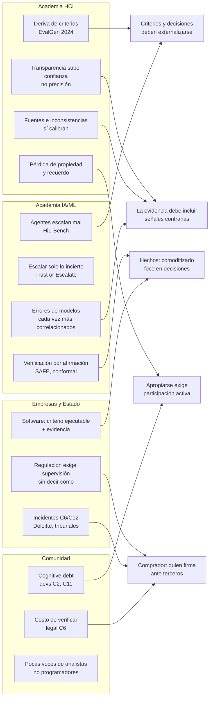
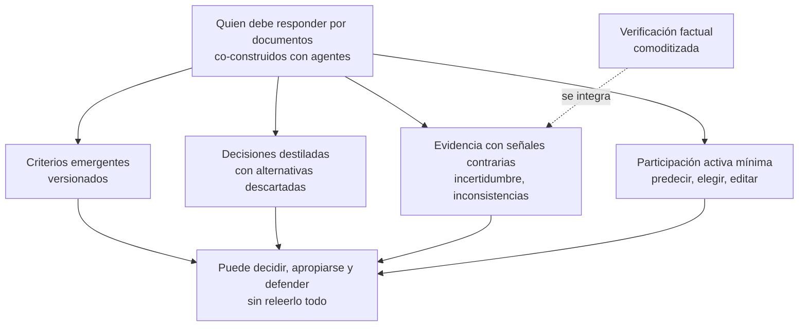

# Cómo abordan la academia y las empresas el cuello de botella humano en el trabajo con agentes

*7 de octubre de 2026 · Resultado del brief `brief-investigacion-cuello-de-botella.md` · 4 líneas: HCI, IA/ML, empresas y comunidad*

---

## 1. Conclusión en cinco puntos

1. **La verificación de hechos se está automatizando.** Hay técnicas probadas para descomponer un output en afirmaciones y verificarlas (SAFE, conformal factuality, cite-check legal). No es buen terreno para un producto nuevo.
2. **Los criterios se construyen al revisar.** La "deriva de criterios" (EvalGen, UIST 2024) y la elicitación activa (GATE, ICLR 2025) sustentan la idea de criterios emergentes del caso 1.
3. **Delegar erosiona comprensión y autoría.** Estudios de 2024–2026 muestran menos recuerdo, menos sentido de propiedad y más dependencia. En la comunidad, el término "cognitive debt" se volvió marco común en 2026. Esto sustenta el caso 2.
4. **Más transparencia no equivale a mejor verificación.** Explicaciones y trazas mejoradas suben la confianza sin subir la precisión. Lo que sí calibra son las fuentes, la incertidumbre y las inconsistencias visibles.
5. **El hueco está donde se cruzan documentos, co-construcción y firma ante terceros, para usuarios no programadores.** El software lo resuelve con criterios ejecutables (tests, políticas); en documentos no existe ese equivalente. La regulación, incluida la peruana, exige supervisión humana efectiva pero no dice cómo hacerla viable.

---

## 2. Mapa de hallazgos

---

## 3. Línea A: Academia HCI

| Hallazgo | Fuente | Implicación |
|---|---|---|
| Los criterios aparecen mientras se califican outputs (deriva de criterios) | Shankar et al., UIST 2024 | Criterios versionados, no fijos al inicio |
| Más confianza en la IA, menos pensamiento crítico; el esfuerzo pasa a verificar | Lee et al., CHI 2025 (n=319) | Confirma la asimetría producción–comprensión |
| La incertidumbre en primera persona reduce la dependencia errónea | Kim et al., FAccT 2024 | Mostrar duda, no solo respuesta |
| Las explicaciones suben la dependencia de lo correcto y de lo incorrecto; las fuentes y las inconsistencias no | Kim et al., CHI 2025 | Evidencia > narrativa |
| Trazas de agente mejoradas: errores detectados más rápido, pero precisión casi igual | Grunde-McLaughlin et al., 2026 (Microsoft) | Ver el proceso no garantiza verificar bien |
| Alinear y contrastar muchas respuestas hace viable el sensemaking | Gero et al., CHI 2024 | Apoya las tarjetas contrastantes del caso 1 |
| Atenuar el detalle sin borrar texto mejora la lectura | Gu et al., CHI 2024 | Alternativa al resumen |
| Escribir con un LLM baja el recuerdo y la propiedad | Kosmyna et al., 2025 (preprint, n pequeño) | Riesgo del caso 2; evidencia débil |
| La autoeficacia baja y la confianza en el modelo sube turno a turno | Park et al., CHI 2026 | "Deriva de autoría" |
| Editar y hacer prompts iterativos recuperan en parte la propiedad | Pennanen et al., 2026 (n=273) | Evitar delegar de una sola vez |
| Que el LM pregunte activamente predice mejor las preferencias | Li et al., ICLR 2025 (GATE) | Elicitación de criterios viable |

**Hueco:** casi todo es de laboratorio, con tareas cortas y un solo output. No hay estudios sobre documentos co-construidos durante semanas, reentrada ni firma real. **Nadie mide la defendibilidad.**

---

## 4. Línea B: Academia IA/ML

| Técnica | Estado | Límite |
|---|---|---|
| Modelos críticos (CriticGPT, OpenAI 2024) | Probado en código | Inventa bugs; el humano sigue filtrando |
| Debate (Khan et al., ICML 2024; DeepMind, NeurIPS 2024) | Probado en lectura y QA | Solo gana con asimetría de información y respuestas cerradas |
| Juez LLM que escala lo incierto (Trust or Escalate, ICLR 2025) | Probado con garantías estadísticas | Necesita calibración humana; no maneja criterios cambiantes |
| Verificación por afirmación (SAFE, NeurIPS 2024; conformal, ICML 2024) | Probado | Solo hechos verificables; no evalúa argumentos ni decisiones |
| Entropía semántica (*Nature* 2024) | Probado | No detecta errores dichos con seguridad |
| Supervisión de procesos (PRMs) | Probado en matemáticas | Sesgo hacia el resultado final |
| Monitoreo de la cadena de pensamiento (2025) | Propuesto, frágil | Puede dejar de reflejar el razonamiento real |
| Agentes que deciden cuándo preguntar (HiL-Bench, Scale AI 2026) | Benchmark | El rendimiento cae del 75–89 % al 4–24 % cuando deben decidir si escalar |

**Alertas:**
- Los jueces LLM favorecen a modelos parecidos y los errores se correlacionan más con la escala (Goel et al., ICML 2025). Supervisar IA con IA no es independiente.
- RLHF podría hacer al modelo más convincente sin hacerlo más correcto (Wen et al., ICLR 2025, resultado disputado).

**¿Se evapora con mejores modelos?** Se evapora la capa de verificación factual. Los criterios que se construyen, las decisiones implícitas y la responsabilidad ante terceros no dependen de la capacidad del modelo.

---

## 5. Línea C: Empresas y sector público

| Actor | Práctica | Casuística |
|---|---|---|
| Anthropic (Claude Code) | Explorar → planificar → implementar; verificación ejecutable y evidencia en vez de "terminé"; revisor adversarial con contexto limpio; SPEC.md por entrevista | C10, C0, C11 |
| GitHub Copilot agent | Quien invoca al agente no puede aprobar su PR; hace falta otro humano | C3, C12 |
| Assembled (2026) | 2 modelos revisan cada PR y una política autoaprueba el 43 %; los humanos solo ven lo complejo | C0, C5 |
| McKinsey (2025) | Humanos "above the loop": definen políticas y vigilan outliers | C4, C5, C7 |
| Microsoft Agent 365 | Control plane: inventario, identidad y trazas de agentes | C4, C7 |
| Deloitte / Gobierno de Australia | Informe con citas inventadas; lo detectó un académico externo; reembolso | **C6 + C12** |
| ABA Opinión 512 (EE.UU.) | El abogado verifica de forma independiente y responde por lo que firma | C6 |
| Clearbrief | Política modelo de cite-check con registro auditable | C6 |
| FINRA 2026 | Definir dónde va el humano, rastrear decisiones de agentes | C3, C4, C6 |
| UK AI Playbook, OMB M-25-21, AI Act Art. 14 | Supervisión humana significativa; la UE nombra el sesgo de automatización | C5, C6 |
| **Perú, DS 115-2025-PCM** (vigente desde ene-2026) | Supervisión humana efectiva en decisiones de alto impacto; poder detener, corregir o invalidar | C6, C3 |
| Provincia de Buenos Aires | Todo lo generado con IA es borrador hasta verificarse; declarar el origen | C6, C0 |

**Contradicción central:** el mercado quita humanos del gate (autoaprobación, auto mode). La regulación exige supervisión humana efectiva. **Nadie resuelve cómo hacer que la supervisión sea real y barata a la vez.**

**Quién paga hoy:**
- firmas legales (cite-check);
- consultoras y auditoras (riesgo reputacional tras Deloitte);
- finanzas reguladas (gobernanza de agentes);
- equipos de ingeniería (revisión de PRs).

El sector público aún no paga directamente. Crea obligaciones y podría trasladarlas a sus proveedores vía contratos.

---

## 6. Línea D: Comunidad (supuesto S1)

Reddit no fue accesible. Se usaron Hacker News, blogs, GitHub, foros y prensa especializada.

| Segmento | Señal | Casuísticas |
|---|---|---|
| **Devs intensivos en agentes** | Fuerte y reciente: hilos sobre "cognitive debt" con más de 500 puntos; "el cuello de botella ya no es escribir sino revisar" | C0, C2, C11, C12 |
| **Legal** | Fuerte y documentada: costo de verificar, responsabilidad personal, más de 2.000 casos de alucinaciones en tribunales | C6 |
| **Consultoría y sector público** | Aparece como incidentes, no como queja en primera persona | C6, C12 |
| **Marketing, RR. HH. y operaciones** | Encuestas: "brain fry" y "workslop" | C4, C0 |
| **Analistas no programadores** | Casi sin testimonios en fuentes abiertas | — |

**Lo que recomienda la comunidad:**
- cambios pequeños y revisión durante la edición;
- criterios o diseño explícitos antes de generar;
- guardar el razonamiento (logs, decisiones);
- IA que revisa IA y triage por riesgo;
- fricción deliberada (reescribir a mano), muy disputada;
- en legal y análisis: cita por afirmación y registro de claims con su estado.

**Veredicto sobre S1:**
- **Se sostiene** en devs (comprensión de lo acumulado) y en profesiones con firma (costo de verificar y responsabilidad).
- **Sin validar** en analistas y consultores no programadores, que son justo el segmento objetivo. Las entrevistas siguen siendo necesarias.

**Riesgo:** buena parte de la comunidad responde con "volver a hacerlo a mano" o "IA que revisa IA", no con "evidencia explícita de criterios".

---

## 7. Qué cambia en la tesis

| Componente de la tesis | Estado | Ajuste |
|---|---|---|
| Criterios como objetos explícitos | **Sustentado** (deriva de criterios, GATE) | Deben ser versionados y revisables |
| Decisiones implícitas como evidencia | **Sustentado** (HiL-Bench, trazas, comunidad) | Destilar decisiones, no mostrar logs crudos |
| Evidencia verificable | **Condicionado** | Debe incluir señales contrarias: incertidumbre, inconsistencias, alternativas descartadas |
| "Sin releerlo todo" | **En tensión** con la evidencia sobre propiedad | Exigir participación activa mínima: predecir, elegir, editar |
| Verificar hechos | **Comoditizado** | No es el diferenciador; integrarlo, no construirlo |
| Comprador: quien firma | **Sustentado** (legal, consultoras, regulación) | Entrada vía proveedores del Estado y consultoras |
| Segmento no programador | **Sin validar** | Prioridad de las entrevistas |

### Tesis ajustada

> *Para quien debe responder por documentos co-construidos con agentes: convertir criterios y decisiones en evidencia explícita, versionada y con señales contrarias, con una participación activa mínima del humano, para que pueda decidir, apropiarse y defender sin releerlo todo.*

---

## 8. Siguientes pasos

1. **Entrevistas S1** con analistas, consultores y especialistas públicos. Es el único segmento sin evidencia directa.
2. **Revisión manual en Reddit** con la guía del anexo.
3. **Piloto GEE v6 → v7** como registro de decisiones, midiendo comprensión y capacidad de defensa, no solo tiempo.
4. **Explorar el ángulo regulatorio peruano:** el DS 115-2025-PCM exige supervisión humana efectiva sin decir cómo. Eso es un posible gancho para proveedores del Estado.

---

## Anexo: guía para revisar Reddit a mano

- **Subreddits:**
  - Software: r/ExperiencedDevs, r/ClaudeAI, r/ClaudeCode, r/cursor, r/ChatGPTCoding, r/vibecoding.
  - Legal: r/LawFirm, r/Lawyertalk, r/paralegal.
  - Consultoría y análisis: r/consulting, r/analytics, r/datascience.
  - Investigación y trabajo general: r/academia, r/PhD, r/GovernmentContracting, r/ChatGPTPro, r/productivity.
- **Búsquedas:**
  - "review fatigue", "cognitive debt", "don't understand my own codebase", "babysitting agents";
  - "verify AI citations", "checking ChatGPT output takes longer";
  - "sign off AI report", "AI deliverable client mistake", "workslop".
- **Filtro:** "past year". En r/consulting y r/LawFirm, ordenar por "top" para medir intensidad en voces no programadoras.

---

## Fuentes principales

Reunidas por los subagentes de investigación. Conviene abrir cada fuente antes de citarla en un documento externo.

**Academia HCI**
- [Shankar et al., EvalGen (UIST 2024)](https://arxiv.org/abs/2404.12272)
- [Lee et al., pensamiento crítico y GenAI (CHI 2025)](https://www.microsoft.com/en-us/research/?p=1135061)
- [Kim et al., "I'm Not Sure, But…" (FAccT 2024)](https://arxiv.org/abs/2405.00623)
- [Kim et al., explicaciones y dependencia (CHI 2025)](https://arxiv.org/abs/2502.08554)
- [Grunde-McLaughlin et al., trazas de agentes (2026)](https://arxiv.org/abs/2602.16844)
- [Gero et al., sensemaking de muchas respuestas (CHI 2024)](https://arxiv.org/abs/2401.13726)
- [Gu et al., GP-TSM (CHI 2024)](https://arxiv.org/abs/2401.10873)
- [Kosmyna et al., "Your Brain on ChatGPT" (2025)](https://arxiv.org/abs/2506.08872)
- [Park et al., Authorship Drift (CHI 2026)](https://arxiv.org/abs/2602.05819)
- [Li et al., GATE (ICLR 2025)](https://arxiv.org/abs/2310.11589)

**Academia IA/ML**
- [CriticGPT (OpenAI 2024)](https://arxiv.org/abs/2407.00215)
- [Khan et al., debate (ICML 2024)](https://arxiv.org/abs/2402.06782)
- [Trust or Escalate (ICLR 2025)](https://iclr.cc/virtual/2025/oral/31838)
- [Goel et al., Great Models Think Alike (ICML 2025)](https://arxiv.org/abs/2502.04313)
- [SAFE (NeurIPS 2024)](https://arxiv.org/abs/2403.18802)
- [Entropía semántica (*Nature* 2024)](https://pmc.ncbi.nlm.nih.gov/articles/PMC11186750)
- [HiL-Bench (2026)](https://arxiv.org/abs/2604.09408)
- [Collaborative Gym (ICLR 2026)](https://arxiv.org/abs/2412.15701)

**Empresas y sector público**
- [Claude Code best practices](https://code.claude.com/docs/en/best-practices)
- [Assembled, cuello de botella en code review](https://www.assembled.com/blog/code-review-bottlenecks-how-we-hill-climbed-our-way-to-higher-pr-throughput)
- [McKinsey, The agentic organization](https://www.mckinsey.com/capabilities/people-and-organizational-performance/our-insights/the-agentic-organization-contours-of-the-next-paradigm-for-the-ai-era)
- [Deloitte y Gobierno de Australia](https://www.accountingtimes.com.au/technology/deloitte-to-refund-government-after-using-ai-in-440k-report)
- [UK AI Playbook](https://gov.uk/government/publications/ai-playbook-for-the-uk-government/artificial-intelligence-playbook-for-the-uk-government-html)
- [Perú, Reglamento de la Ley de IA (Cuatrecasas)](https://www.cuatrecasas.com/es/spain/tecnologia-medios-digitales/art/que-establece-el-reglamento-de-la-ley-de-inteligencia-artificial)
- [Clearbrief, políticas de cite-check](https://clearbrief.com/blog/responsible-ai-citation-checking-policies)

**Comunidad**
- [HN: Cognitive Debt](https://news.ycombinator.com/item?id=47196582)
- [Simon Willison, cognitive debt](https://simonwillison.net/2026/Feb/15/cognitive-debt)
- [Spinellis, revisar código de IA](https://www.spinellis.gr/blog/20260523/)
- [Thomson Reuters, AI verification gap](https://insight.thomsonreuters.com/sea/legal/posts/ai-said-so-now-what-the-ai-verification-gap-that-every-lawyer-needs-to-close)
- [Charlotin, base de alucinaciones en tribunales](https://www.damiencharlotin.com/hallucinations/)
- [BetterUp/Stanford, workslop](https://www.betterup.com/blog/hidden-costs-workslop)
