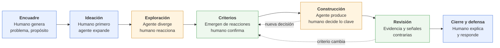
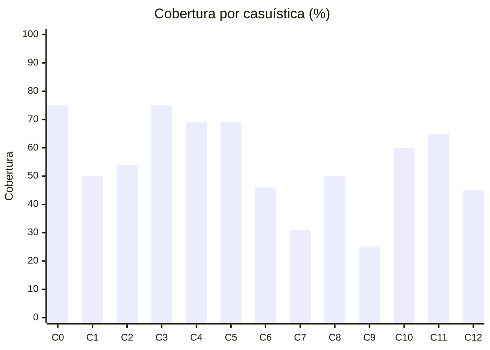
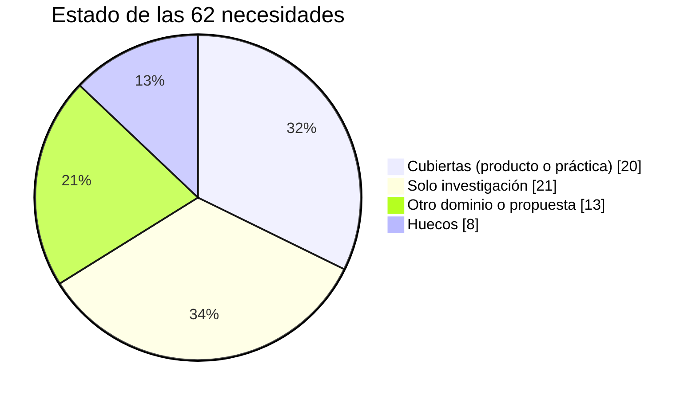
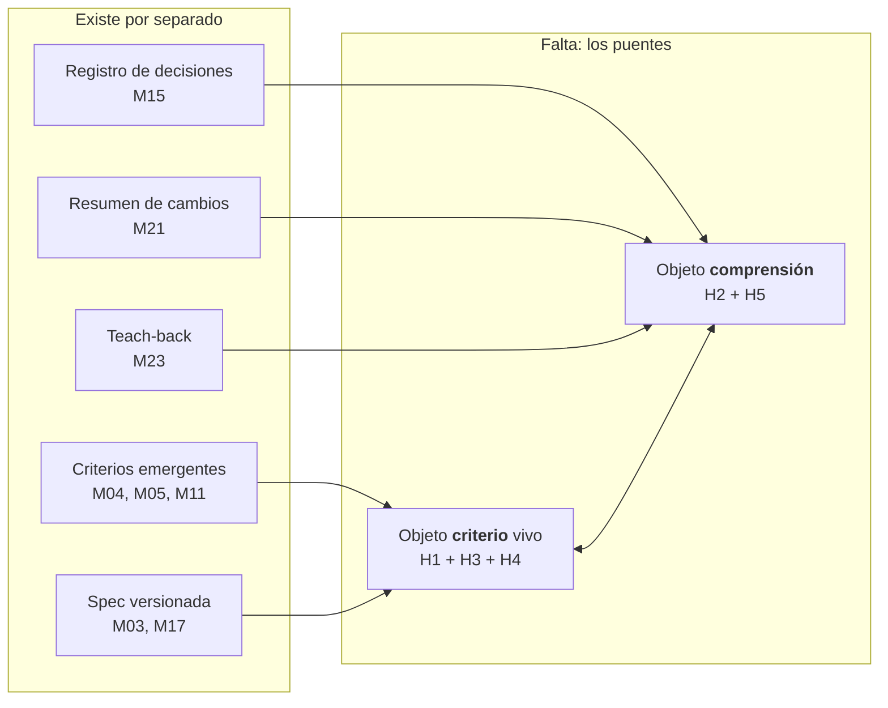

# Acervo de mecanismos: cómo se está resolviendo hoy el cuello de botella humano en el trabajo con agentes

*7 de octubre de 2026 · Consolida `cuello-de-botella-humano-agente.md`, `informe-investigacion-cuello-de-botella.md` y tres investigaciones nuevas por grupo de casuísticas · Producto para uso propio*

---

## 1. Resumen

- **44 mecanismos** catalogados, en tres familias: criterio y exploración (14), construcción y reentrada (12), verificación y responsabilidad (18).
- **62 necesidades** identificadas en las 13 casuísticas. De ellas:
  - **20** cubiertas por productos o prácticas aplicables a documentos;
  - **21** resueltas solo en investigación;
  - **13** resueltas solo en otro dominio (código o legal) o apenas propuestas;
  - **8** sin ningún mecanismo (huecos).
- **Cobertura media: 55 %.** Lo más cubierto es lo operativo: validación y acciones irreversibles (75 %). Lo menos cubierto: proceso computacional (25 %), agentes en paralelo (31 %), revisor externo (45 %) y firma ante terceros (46 %).
- **Tus casuísticas núcleo están a mitad de camino:** exploración 50 %, construcción acumulativa 54 %, criterio tácito 50 %, especificación 60 %, reentrada 65 %. Hay piezas maduras para adoptar ya, pero el puente entre ellas no existe.

---

## 2. Tesis actualizada: co-construcción, no solo revisión

El humano no es solo revisor. **Genera en los momentos que definen el trabajo**: encuadre, ideas iniciales, criterios y decisiones clave. La evidencia lo respalda:
- usar el LLM desde el inicio reduce la originalidad, la autoeficacia y la autoría (*Timing Matters*, CHI 2025);
- quienes escriben por contenido quieren poseer sobre todo la planificación (revisión CSCW 2025);
- "generar y luego comprender" preserva el aprendizaje, mientras que delegar lo erosiona (estudio de Anthropic, N=52);
- editar y hacer prompts iterativos recuperan en parte la propiedad (Pennanen et al., 2026).

> **Tesis:** *Para quien explora, construye y debe responder por documentos co-construidos con agentes: que la co-construcción sea genuina, con el humano generando en los momentos que definen el trabajo y el agente en el resto, y que criterios y decisiones se conviertan en evidencia explícita, versionada y con señales contrarias, para poder decidir, apropiarse y defender sin releerlo todo.*

### Quién genera en cada fase

*Azul: genera el humano. Naranja: genera el agente. Verde: conjunto. Las flechas punteadas son la deriva de criterios: el criterio cambia al ver resultados y debe volver a registrarse.*

---

## 3. Método de medición

Cada casuística se descompone en **necesidades** (lo que el humano requiere para dejar de ser cuello de botella). Cada necesidad recibe el puntaje de su mejor mecanismo disponible:

| Puntaje | Significado |
|---|---|
| **1** | Producto o práctica en uso, aplicable a documentos |
| **0,5** | Probado solo en investigación |
| **0,25** | Solo propuesta, o solo funciona en otro dominio (código o legal) |
| **0** | Hueco: ningún mecanismo |

**Cobertura de la casuística** = promedio de sus necesidades. Es una heurística para comparar y priorizar, no una medición exacta: la descomposición en necesidades y los puntajes son juicio propio sobre la evidencia reunida.

---

## 4. Cobertura por casuística

| Casuística | Cobertura | Necesidades | Cubiertas | Huecos | Lectura |
|---|---|---|---|---|---|
| C0 Validación | **75 %** | 4 | 2 | 0 | Verificar hechos y revisar diffs está resuelto; calibrar confianza sigue en investigación |
| C3 Acción irreversible | **75 %** | 4 | 3 | 1 | Aprobar, triage y deshacer local resueltos; lo que sale del sistema no se revierte |
| C4 Flujo continuo | **69 %** | 4 | 2 | 0 | Observabilidad madura, pero para técnicos |
| C5 Escalamiento | **69 %** | 4 | 2 | 0 | El punto débil es decidir cuándo escalar |
| C11 Reentrada | **65 %** | 5 | 3 | 1 | Memoria y resúmenes existen; nada se centra en decisiones y en lo olvidado |
| C10 Especificación | **60 %** | 5 | 2 | 1 | La spec se congela al inicio; no absorbe criterios emergentes |
| C2 Construcción acumulativa | **54 %** | 7 | 2 | 1 | Hay registro de decisiones y fases; falta diff semántico, propagación y medir la deuda |
| C1 Exploración | **50 %** | 6 | 1 | 1 | Casi todo es investigación; no existe el paso de criterio emergente a rúbrica |
| C8 Criterio tácito | **50 %** | 4 | 1 | 1 | Se captura estilo, no criterio sustantivo auditable |
| C6 Firma ante terceros | **46 %** | 6 | 1 | 0 | Resuelto en legal; fuera de legal solo hay declaraciones de uso de IA |
| C12 Revisor externo | **45 %** | 5 | 1 | 0 | Se sabe quién escribió, no qué se verificó ni con qué criterio |
| C7 Agentes en paralelo | **31 %** | 4 | 0 | 1 | Se aísla el trabajo, no se integra la comprensión |
| C9 Proceso computacional | **25 %** | 4 | 0 | 1 | Ver el proceso exige leer código |

### Distribución de las 62 necesidades

---

## 5. Catálogo de mecanismos

**Madurez:** P = producto en uso · D = práctica difundida · I = investigación probada · X = propuesta o emergente.
**Docs:** ¿funciona para documentos y no programadores? S = sí · P = parcial · N = no.
**Rol humano:** Co = co-genera · Rev = revisa.

### 5.1 Familia A: criterio y exploración (C1, C8, C10)

| # | Mecanismo | Cómo funciona | Ejemplos | Mad. | Docs | Rol |
|---|---|---|---|---|---|---|
| M01 | Elicitación activa | El agente pregunta y plantea casos límite en vez de exigir un prompt completo | [GATE, ICLR 2025](https://arxiv.org/abs/2310.11589) | I | S | Co |
| M02 | Entrevista para SPEC | Prompt mínimo, el agente entrevista y escribe SPEC.md; se implementa en sesión nueva | [Claude Code best practices](https://code.claude.com/docs/en/best-practices) | D | S | Co |
| M03 | Especificación viva | Principios, spec, plan y tareas versionados; el humano aprueba cada artefacto | [Spec Kit](https://github.com/github/spec-kit), [Kiro](https://kiro.dev/docs/specs/), [crítica de Fowler](https://www.martinfowler.com/articles/exploring-gen-ai/sdd-3-tools.html) | P | P | Co |
| M04 | Criterios emergentes al calificar | Califica outputs y el sistema propone criterios alineados (deriva de criterios) | [EvalGen, UIST 2024](https://arxiv.org/abs/2404.12272) | I | S | Co |
| M05 | Feedback convertido en principios | Elogios, críticas o reescrituras se vuelven principios explícitos y editables | [ConstitutionMaker](https://arxiv.org/abs/2310.15428) | I | S | Co |
| M06 | Preferencias aprendidas de ediciones | Infiere la preferencia desde la diferencia entre borrador y versión editada | [PRELUDE/CIPHER, NeurIPS 2024](https://www.microsoft.com/en-us/research/publication/aligning-llm-agents-by-learning-latent-preference-from-user-edits/) | I | S | Co |
| M07 | Perfil de gusto por pares o muestras | Elegir entre pares o subir muestras crea un perfil de estilo | [Midjourney personalization](https://docs.midjourney.com/docs/personalization), [Claude styles](https://www.anthropic.com/news/styles) | P | S | Rev |
| M08 | Ejemplos y contraejemplos | Salidas buenas y malas con su razón, en vez de reglas abstractas | Práctica general | D | S | Co |
| M09 | Sensemaking de muchas respuestas | Agrupa y resalta similitudes y diferencias entre decenas de respuestas | [Gero et al., CHI 2024](https://arxiv.org/abs/2401.13726) | I | S | Rev |
| M10 | Exploración estructurada | Primero dimensiones del problema, luego variantes divergentes | [Luminate, CHI 2024](https://arxiv.org/abs/2310.12953), [DesignAID](https://dspace.mit.edu/handle/1721.1/153130) | I | S | Co |
| M11 | Panorama de opciones y criterios | Mapa de opciones y criterios antes de decidir; "decidir cómo decidir" | [Selenite, CHI 2024](https://arxiv.org/abs/2310.02161), [InDecision](https://arxiv.org/abs/2504.12433), [CritLens](https://arxiv.org/pdf/2606.08426) | I | S | Co |
| M12 | Ideación humana primero | El humano genera ideas antes de consultar; el agente expande o critica | [Timing Matters, CHI 2025](https://arxiv.org/abs/2502.06197), [Doshi & Hauser 2024](https://pmc.ncbi.nlm.nih.gov/articles/PMC11244532) | I | S | Co |
| M13 | Forcing functions / IA provocadora | Juzgar antes de ver la sugerencia; el agente objeta en vez de obedecer | [Buçinca et al.](https://arxiv.org/abs/2102.09692), [Sarkar](https://arxiv.org/abs/2411.02263) | I | S | Co |
| M14 | IA como thought partner | Marco de diseño: razonar con el humano, no por él | [Collins et al. 2024](https://arxiv.org/abs/2408.03943) | X | S | Co |

**Límites clave de la familia:**
- Casi todo está probado con textos cortos, imágenes o código.
- Las dimensiones propuestas por el modelo anclan el pensamiento humano (M10, M11). La única mitigación con evidencia es M12.
- Los perfiles de gusto son caja negra.
- Las forcing functions funcionan, pero los usuarios las valoran peor.

### 5.2 Familia B: construcción acumulativa, reentrada y paralelo (C2, C11, C7)

| # | Mecanismo | Cómo funciona | Ejemplos | Mad. | Docs | Rol |
|---|---|---|---|---|---|---|
| M15 | Registro de decisiones (ADR) | Registro inmutable por decisión: contexto, opciones, descartes, consecuencias | [Osmani, intent debt](https://addyosmani.com/blog/intent-debt/), [ADR con agentes](https://www.braingrid.ai/blog/architecture-decision-records-for-ai-coding-agents) | D | S | Co |
| M16 | Memoria de proyecto | Archivos que el agente lee al iniciar: contexto activo, progreso, patrones | [Cline Memory Bank](https://docs.cline.bot/features/memory-bank.md), CLAUDE.md | P | S | Rev |
| M17 | Fases con compuertas | Preguntas → investigación → diseño → plan → implementación, con aprobación entre fases | [HumanLayer](https://docs.humanlayer.com/guide/skills-workflows), [RPI](https://cc.bruniaux.com/guide/workflows/rpi/) | D | S | Co |
| M18 | Checkpoints, rewind y ramas | Instantánea antes de cada prompt; restaurar o bifurcar | [Claude Code checkpointing](https://code.claude.com/docs/en/checkpointing) | P | P | Rev |
| M19 | Control de versiones para prosa | Borradores con intención; el bot propone en una rama con diff y razón por edición | [Upwelling](https://www.inkandswitch.com/upwelling/), [Patchwork](https://www.inkandswitch.com/patchwork/notebook/2024-version-control/07/) | I | S | Co |
| M20 | Procedencia de autoría | Colorea el texto según su origen: propio, IA o cita | [iA Writer Authorship](https://ia.net/topics/see-what-ai-wrote), [HaLLMark](https://arxiv.org/abs/2311.13057) | P | S | Co |
| M21 | Resumen de reentrada | Resume la actividad desde la última visita | [Drive "catch me up"](https://www.techloy.com/google-drive-adds-catch-me-up-to-help-users-track-file-changes/) | P | S | Rev |
| M22 | Walkthroughs y explicaciones interactivas | Recorrido o visualización generada para reconstruir el modelo mental | [Willison](https://simonwillison.net/guides/agentic-engineering-patterns/interactive-explanations/) | X | P | Rev |
| M23 | Comprensión activa (teach-back) | Preguntas conceptuales o quiz antes de aceptar el trabajo | [Anthropic, N=52](https://www.anthropic.com/research/AI-assistance-coding-skills) | I | S | Co |
| M24 | Comentarios de IA anclados | La IA comenta fragmentos y el humano reescribe | [AnchoredAI](https://arxiv.org/abs/2509.16128) | I | S | Co |
| M25 | Orquestación paralela aislada | Cada agente en su espacio; el humano revisa y fusiona | [Vibe Kanban](https://www.vibekanban.com/docs/getting-started.md), [Conductor](https://thenewstack.io/a-hands-on-review-of-conductor-an-ai-parallel-runner-app/) | P | N | Rev |
| M26 | Trazabilidad entre artefactos | Grafo que enlaza requisitos, diseño y verificación y propaga cambios | [Graph-RAG para trazabilidad](https://arxiv.org/pdf/2412.08593) | X | S | Rev |

**Límites clave de la familia:**
- Casi todo es práctica de desarrolladores, sin estudios controlados.
- La memoria de proyecto reorienta al agente, no al humano.
- "Catch me up" resume ediciones, no decisiones.
- La propiedad psicológica cae con IA aunque se personalice el estilo ([N=176](https://arxiv.org/abs/2601.10236)).
- Nadie mide la deuda de comprensión ([Storey](https://arxiv.org/abs/2603.22106) la plantea como pregunta abierta).

### 5.3 Familia C: verificación, acción y responsabilidad (C0, C3–C6, C9, C12)

| # | Mecanismo | Cómo funciona | Ejemplos | Mad. | Docs |
|---|---|---|---|---|---|
| M27 | Verificación por afirmación | Descompone en afirmaciones y verifica cada una contra una fuente | [SAFE](https://arxiv.org/abs/2403.18802), [CiteGuard](https://arxiv.org/abs/2510.17853) | I | S |
| M28 | Cite-check con reporte (legal) | Valida cada cita y entrega un reporte al firmante | [Clearbrief](https://www.lawnext.com/2025/12/clearbrief-launches-cite-check-report-to-give-law-firm-partners-an-audit-trail-against-ai-hallucinations.html) | P | S |
| M29 | Certificado de verificación (legal) | PDF con la deliberación, la metodología y un hash | [VARI](https://www.legaltechnologyhub.com/vendors/vari/) | P | S |
| M30 | Audit trail criptográfico | Cadena firmada de intentos del agente y decisiones humanas | [Borrador IETF VAP](https://www.ietf.org/archive/id/draft-ailex-vap-legal-ai-provenance-00.txt) | X | P |
| M31 | Crítico adversarial y debate | Otro modelo con contexto limpio busca fallas | [CriticGPT](https://arxiv.org/abs/2407.00215), [Debate](https://arxiv.org/abs/2402.06782) | D | P |
| M32 | Juez con escalamiento calibrado | Decide solo con confianza garantizada; lo demás se escala | [Trust or Escalate](https://arxiv.org/abs/2407.18370) | I | P |
| M33 | Triage por riesgo / clasificador | Lo de bajo riesgo se autoaprueba; lo riesgoso llega al humano | [Auto mode](https://anthropic.com/engineering/claude-code-auto-mode), [Assembled](https://www.assembled.com/blog/code-review-bottlenecks-how-we-hill-climbed-our-way-to-higher-pr-throughput) | P | P |
| M34 | Aprobación, permisos e interrupción | El agente pausa antes de acciones sensibles | [LangGraph](https://docs.langchain.com/oss/python/langgraph/human-in-the-loop), [gotoHuman](https://docs.gotohuman.com/human-reviews.md) | D | S |
| M35 | Sandbox, dry-run y deshacer | Actuar sobre un snapshot y restaurar con un comando | [Gemini CLI checkpointing](https://geminicli.com/docs/cli/checkpointing/) | P | P |
| M36 | Separación de roles | Quien delega al agente no puede aprobar su resultado | [GitHub Copilot](https://docs.github.com/en/copilot/how-tos/use-copilot-agents/coding-agent/review-copilot-prs) | P | P |
| M37 | Revisión por diff o artefacto intermedio | Revisar cambios acotados o el plan, no el producto entero | Spec Kit, track changes | D | P |
| M38 | Paquete de contexto para escalar | Al escalar: resumen, intentos, confianza y motivo | [Handoff en soporte](https://querypal.com/blog/ai-support-agent-handoff) | D | S |
| M39 | Observabilidad con muestreo | Trazar todo y calificar una muestra con rúbricas | [Langfuse](https://langfuse.com/docs/evaluation/evaluation-methods/annotation-queues.md) | P | P |
| M40 | Notebooks auditables | El agente trabaja en celdas inspeccionables y reproducibles | [Hex](https://hex.tech/product/notebooks/) | P | N |
| M41 | Estándares de evidencia de auditoría | El auditor documenta la confiabilidad del output de IA | [PCAOB vía Fieldguide](https://www.fieldguide.io/resource-articles/pcaob-generative-ai-existing-standards) | D | S |
| M42 | Declaración de uso de IA / provenance | Declarar qué hizo la IA y qué verificó el humano | [CDC](https://cdc.gov/ai/resources/considerations-for-generative-ai-use-in-scientific-work.html), C2PA | D | S |
| M43 | Señales de calibración | Incertidumbre en primera persona, fuentes e inconsistencias visibles | [Kim et al., FAccT 2024](https://arxiv.org/abs/2405.00623), [Kim et al., CHI 2025](https://arxiv.org/abs/2502.08554) | I | S |
| M44 | Atenuar detalle sin borrar | Renderizado por saliencia en vez de resumen | [GP-TSM, CHI 2024](https://arxiv.org/abs/2401.10873) | I | S |

**Límites clave de la familia:**
- Toda la evidencia para el firmante depende de una base de autoridades verificables (jurisprudencia). En planes o informes de política no existe ese ancla.
- Los certificados prueban que se hizo el proceso, no que el contenido sea correcto.
- El triage reduce la fatiga (se aprobaba el 93 % de los permisos), pero deja pasar riesgos (17 % de falsos negativos en auto mode).
- Los errores de modelos parecidos se correlacionan, así que la crítica IA→IA no es independiente.

---

## 6. Matriz mecanismo × casuística

● cubre bien · ◐ parcial. Cuando un mecanismo solo cubre bien en código o en legal y no en el dominio natural de la casuística, se marca como parcial.

| Mecanismo | Mad. | Docs | C0 | C1 | C2 | C3 | C4 | C5 | C6 | C7 | C8 | C9 | C10 | C11 | C12 |
|---|---|---|---|---|---|---|---|---|---|---|---|---|---|---|---|
| M01 Elicitación activa | I | S |  |  |  |  |  |  |  |  | ◐ |  | ● |  |  |
| M02 Entrevista para SPEC | D | S |  |  |  |  |  |  |  |  |  |  | ● | ◐ |  |
| M03 Especificación viva | P | P |  |  | ◐ |  |  |  |  |  |  |  | ● | ◐ |  |
| M04 Criterios emergentes | I | S | ◐ | ◐ |  |  |  |  |  |  | ● |  |  |  |  |
| M05 Feedback → principios | I | S |  |  |  |  |  |  |  |  | ● |  | ◐ |  |  |
| M06 Preferencias de ediciones | I | S |  |  | ◐ |  |  |  |  |  | ● |  |  |  |  |
| M07 Perfil de gusto | P | S |  | ◐ |  |  |  |  |  |  | ● |  |  |  |  |
| M08 Ejemplos y contraejemplos | D | S |  |  |  |  |  |  |  |  | ◐ |  | ◐ |  |  |
| M09 Sensemaking de respuestas | I | S | ◐ | ● |  |  |  |  |  |  |  |  |  |  |  |
| M10 Exploración estructurada | I | S |  | ● |  |  |  |  |  |  | ◐ |  |  |  |  |
| M11 Panorama de opciones y criterios | I | S |  | ● |  |  |  |  |  |  |  |  | ◐ |  |  |
| M12 Ideación humana primero | I | S |  | ● |  |  |  |  |  |  | ● |  | ◐ |  |  |
| M13 Forcing functions | I | S | ◐ | ◐ |  |  |  |  |  |  | ◐ |  |  |  |  |
| M14 Thought partner | X | S |  | ◐ |  |  |  |  |  |  | ◐ |  | ◐ |  |  |
| M15 Registro de decisiones | D | S |  |  | ● |  |  |  |  | ◐ |  |  |  | ● |  |
| M16 Memoria de proyecto | P | S |  |  | ◐ |  |  |  |  |  |  |  |  | ● |  |
| M17 Fases con compuertas | D | S |  |  | ● |  |  |  |  |  |  |  | ● | ◐ |  |
| M18 Checkpoints y ramas | P | P |  | ● | ◐ |  |  |  |  |  |  |  |  | ◐ |  |
| M19 Versiones para prosa | I | S |  |  | ● |  |  |  |  | ◐ |  |  |  | ◐ |  |
| M20 Procedencia de autoría | P | S |  |  | ◐ |  |  |  | ◐ |  |  |  |  |  | ◐ |
| M21 Resumen de reentrada | P | S |  |  |  |  |  |  |  | ◐ |  |  |  | ● |  |
| M22 Walkthroughs | X | P |  |  | ● |  |  |  |  |  |  |  |  | ● |  |
| M23 Teach-back | I | S | ◐ |  | ● |  |  |  |  |  | ◐ |  |  |  |  |
| M24 Comentarios anclados | I | S |  |  | ◐ |  |  |  |  |  | ◐ |  |  |  |  |
| M25 Orquestación paralela | P | N |  |  |  |  |  |  |  | ● |  |  |  |  |  |
| M26 Trazabilidad entre artefactos | X | S |  |  | ◐ |  |  |  |  | ◐ |  |  |  |  |  |
| M27 Verificación por afirmación | I | S | ● |  |  |  |  |  | ◐ |  |  |  |  |  | ◐ |
| M28 Cite-check (legal) | P | S | ● |  |  |  |  |  | ◐ |  |  |  |  |  | ◐ |
| M29 Certificado (legal) | P | S |  |  |  |  |  |  | ◐ |  |  |  |  |  | ◐ |
| M30 Audit trail criptográfico | X | P |  |  |  | ◐ |  |  | ◐ |  |  |  |  |  | ◐ |
| M31 Crítico adversarial | D | P | ● |  |  |  |  |  |  |  |  | ◐ |  |  | ◐ |
| M32 Juez con escalamiento | I | P | ● |  |  |  | ◐ | ● |  |  |  |  |  |  |  |
| M33 Triage por riesgo | P | P |  |  |  | ● | ● | ◐ |  |  |  |  |  |  |  |
| M34 Aprobación y permisos | D | S |  |  |  | ● |  | ◐ |  |  |  |  |  |  |  |
| M35 Sandbox y deshacer | P | P |  |  |  | ● | ◐ |  |  |  |  |  |  |  |  |
| M36 Separación de roles | P | P |  |  |  | ◐ |  |  | ◐ |  |  |  |  |  | ◐ |
| M37 Revisión por diff | D | P | ● |  |  |  |  |  |  |  |  |  |  |  | ◐ |
| M38 Paquete para escalar | D | S |  |  |  |  |  | ● |  |  |  |  |  |  |  |
| M39 Observabilidad | P | P |  |  |  |  | ● | ◐ |  |  |  |  |  |  |  |
| M40 Notebooks auditables | P | N |  |  |  |  |  |  |  |  |  | ● |  |  | ◐ |
| M41 Estándares de auditoría | D | S |  |  |  |  |  |  | ◐ |  |  |  |  |  | ◐ |
| M42 Declaración de uso de IA | D | S |  |  |  |  |  |  | ◐ |  |  |  |  |  | ◐ |
| M43 Señales de calibración | I | S | ● |  |  |  |  |  |  |  |  |  |  |  | ◐ |
| M44 Atenuar sin borrar | I | S |  |  |  |  |  |  |  |  |  |  |  | ◐ | ◐ |

**Lectura de la matriz:**
- **C6 y C12** reciben muchos ◐ y ningún ●: hay piezas sueltas pero nada las resuelve.
- **La familia A** se concentra en C1, C8 y C10, casi toda en investigación (I).
- **La familia C** cubre bien lo operativo (C3, C4, C5), con productos maduros pero pensados para técnicos.
- **18 de 44 mecanismos** ponen al humano a co-generar; casi todos están en las familias A y B.

---

## 7. Necesidades por casuística

**1** cubierta · **0,5** solo investigación · **0,25** otro dominio o propuesta · **0** hueco

<b>C0 Validación (75 %)</b>

| Necesidad | Mejor mecanismo | Puntaje |
|---|---|---|
| Verificar hechos y citas | M27, M28 | 1 |
| Revisar solo lo que cambió | M37 | 1 |
| Calibrar confianza | M43 | 0,5 |
| Crítica independiente | M31 | 0,5 |

<b>C1 Exploración (50 %)</b>

| Necesidad | Mejor mecanismo | Puntaje |
|---|---|---|
| Registrar la decisión y su porqué | M15 | 1 |
| Generar opciones divergentes y estructuradas | M10, M18 | 0,5 |
| Comparar opciones sin leerlas todas | M09 | 0,5 |
| Hacer emerger criterios desde reacciones | M04, M11 | 0,5 |
| Proteger la ideación propia del anclaje | M12 | 0,5 |
| Convertir criterios emergentes en rúbrica versionada | — | **0** |

<b>C2 Construcción acumulativa (54 %)</b>

| Necesidad | Mejor mecanismo | Puntaje |
|---|---|---|
| Registrar decisiones y su porqué | M15 | 1 |
| Avanzar por fases con compuertas | M17 | 1 |
| Entender qué cambió en el argumento | M19 | 0,5 |
| Verificar comprensión y capacidad de defensa | M23 | 0,5 |
| Conservar autoría con participación generativa | M24, M12 | 0,5 |
| Propagar cambios entre documentos interdependientes | M26 | 0,25 |
| Medir la deuda de comprensión | — | **0** |

<b>C3 Acción irreversible (75 %)</b>

| Necesidad | Mejor mecanismo | Puntaje |
|---|---|---|
| Autorizar antes de actuar | M34 | 1 |
| Reducir fatiga de aprobación | M33 | 1 |
| Simular o deshacer localmente | M35 | 1 |
| Revertir efectos externos | — | **0** |

<b>C4 Flujo continuo (69 %)</b>

| Necesidad | Mejor mecanismo | Puntaje |
|---|---|---|
| Trazar todas las ejecuciones | M39 | 1 |
| Autoaprobar por política | M33 | 1 |
| Detectar deriva de calidad | M32, M39 | 0,5 |
| Muestreo estadístico formal | M39 | 0,25 |

<b>C5 Escalamiento (69 %)</b>

| Necesidad | Mejor mecanismo | Puntaje |
|---|---|---|
| Paquete de contexto al escalar | M38 | 1 |
| Cola priorizada de excepciones | M34, M38 | 1 |
| Decidir bien cuándo escalar | M32 | 0,5 |
| Convertir la decisión humana en precedente | M05 | 0,25 |

<b>C6 Firma ante terceros (46 %)</b>

| Necesidad | Mejor mecanismo | Puntaje |
|---|---|---|
| Declarar uso de IA | M42 | 1 |
| Verificar citas y fuentes | M27, M28 | 0,5 |
| Poder defender el documento en vivo | M23 | 0,5 |
| Expediente de lo verificado, cómo y por quién | M29 | 0,25 |
| Registrar criterios, supuestos y alternativas descartadas | M15 | 0,25 |
| Vincular la aprobación con la versión final | M30 | 0,25 |

<b>C7 Agentes en paralelo (31 %)</b>

| Necesidad | Mejor mecanismo | Puntaje |
|---|---|---|
| Coordinar un plan común | M17 | 0,5 |
| Integrar borradores paralelos | M19 | 0,5 |
| Aislar el trabajo de cada agente | M25 | 0,25 |
| Detectar contradicciones de fondo entre piezas | — | **0** |

<b>C8 Criterio tácito (50 %)</b>

| Necesidad | Mejor mecanismo | Puntaje |
|---|---|---|
| Capturar estilo y voz | M07 | 1 |
| Convertir feedback en principios explícitos | M05 | 0,5 |
| Aprender el criterio de las ediciones | M06 | 0,5 |
| Auditar y versionar el criterio aplicado | — | **0** |

<b>C9 Proceso computacional (25 %)</b>

| Necesidad | Mejor mecanismo | Puntaje |
|---|---|---|
| Crítica del proceso analítico | M31 | 0,5 |
| Proceso visible e inspeccionable | M40 | 0,25 |
| Reproducibilidad y linaje | M40 | 0,25 |
| Resumen verificable de supuestos y filtros para no programadores | — | **0** |

<b>C10 Especificación inicial (60 %)</b>

| Necesidad | Mejor mecanismo | Puntaje |
|---|---|---|
| El agente entrevista para el encargo | M02 | 1 |
| Fases con compuertas | M17 | 1 |
| Spec versionada | M03 | 0,5 |
| Elicitación con casos límite | M01 | 0,5 |
| Actualizar la spec con criterios emergentes | — | **0** |

<b>C11 Reentrada (65 %)</b>

| Necesidad | Mejor mecanismo | Puntaje |
|---|---|---|
| Memoria de proyecto | M16 | 1 |
| Resumen de cambios desde la última visita | M21 | 1 |
| Recuperar el porqué | M15 | 1 |
| Reconstruir el modelo mental | M22 | 0,25 |
| Reentrada centrada en decisiones y en lo olvidado | — | **0** |

<b>C12 Revisor externo (45 %)</b>

| Necesidad | Mejor mecanismo | Puntaje |
|---|---|---|
| Saber qué hizo la IA y qué el humano | M20, M42 | 1 |
| Leer eficientemente sin contexto | M44 | 0,5 |
| Paquete estándar de evidencia para el receptor | M28, M29 | 0,25 |
| Separación de roles | M36 | 0,25 |
| Saber qué se verificó y con qué criterio | M41 | 0,25 |

---

## 8. Los 8 huecos

| # | Hueco | Casuística | Relevancia para ti |
|---|---|---|---|
| H1 | Convertir criterios emergentes en rúbrica versionada | C1 | **Alta** |
| H2 | Medir la deuda de comprensión | C2 | **Alta** |
| H3 | Auditar y versionar el criterio tácito aplicado | C8 | **Alta** |
| H4 | Actualizar la spec con criterios emergentes | C10 | **Alta** |
| H5 | Reentrada centrada en decisiones y en lo olvidado | C11 | **Alta** |
| H6 | Detectar contradicciones de fondo entre piezas paralelas | C7 | Media |
| H7 | Resumen verificable del proceso analítico para no programadores | C9 | Media |
| H8 | Revertir efectos externos | C3 | Baja |

**Patrón:** H1, H3 y H4 son el mismo hueco visto desde tres casuísticas. **No existe un objeto "criterio" vivo** que nazca al reaccionar, se versione, alimente la spec y se pueda auditar después. H2 y H5 son el otro lado de la moneda: **no existe un objeto "comprensión"** que se pueda medir y reconstruir.

### Partes ya resueltas, sin puente

Además de los huecos, hay necesidades que solo se resuelven por partes:
- **C2:** propagación de cambios (0,25) y diff semántico (0,5).
- **C6:** expediente y criterios registrados (0,25 cada uno).
- **C12:** qué se verificó y con qué criterio (0,25).

---

## 9. Implicaciones para tu producto de uso propio

### Adoptar ya (mecanismos maduros, sin construir nada)

| Mecanismo | Uso en nuestro flujo |
|---|---|
| M12 Ideación humana primero | Tú propones primero; yo expando y critico después |
| M02 Entrevista para SPEC | Antes de encargos grandes, te entrevisto y dejo un encargo escrito |
| M17 Fases con compuertas | Preguntas → hallazgos → estructura → redacción, con tu aprobación entre fases |
| M15 Registro de decisiones | Cada decisión con contexto, alternativas descartadas y consecuencias |
| M16 + M21 Memoria y reentrada | Un archivo de estado del proyecto y un resumen al retomar |
| M43 Señales de calibración | Marcar incertidumbre, fuentes e inconsistencias en lugar de explicaciones largas |
| M23 Teach-back | Al cerrar una etapa, preguntas para comprobar que puedes defenderla |

### Construir (los huecos que te duelen)

1. **Objeto "criterio" vivo** (H1, H3, H4): nace de tus reacciones, se confirma, se versiona y alimenta la spec y el verificador.
2. **Objeto "comprensión"** (H2, H5): mide qué decisiones conoces y cuáles no, y arma la reentrada desde ahí.
3. **Diff semántico y propagación** (C2): "esta decisión cambió la premisa X; afecta las secciones Y y Z".

El piloto natural sigue siendo reconstruir la metodología GEE v6 → v7 con estos objetos.

---

## 10. Advertencias sobre la evidencia

- Los catálogos los reunieron subagentes con búsqueda web. Marcaron cuando no verificaron algo:
  - No se pudo confirmar "Decisive"; lo más cercano son CritLens, InDecision y Selenite.
  - No se encontró "QRSPI" en fuentes oficiales de HumanLayer; sus docs describen RPI.
  - No hay evaluación independiente ni datos de adopción de VARI.
- Muchas prácticas de desarrolladores (ADR con agentes, memoria, fases, spec-driven) no tienen estudios controlados; su madurez es de adopción, no de evidencia.
- Los porcentajes de cobertura dependen de cómo se descompuso cada casuística en necesidades. Sirven para priorizar, no como medida exacta.
