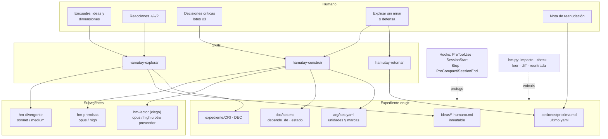
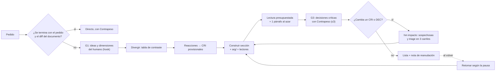
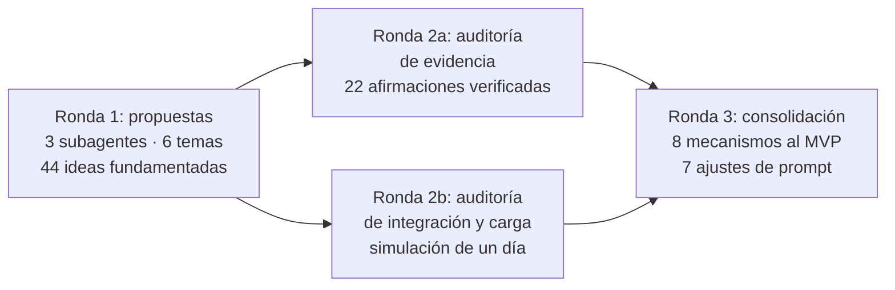

# hamutay: punto de partida (nombre, gentle-ai, arquitectura v1.2 y rondas de ideas)

*7 de octubre de 2026 · Resultado de 3 fases con 15 subagentes: 3 de revisión, 5 de encuadre, 2 de auditoría de arquitectura, 3 de lluvia de ideas y 2 de auditoría de ideas, más la consolidación del orquestador. Los archivos de trabajo están en `proyecto/` (anexo).*

---

## 0. Resumen

- **Nombre:** `hamutay`, quechua para "comprender o reflexionar a fondo". Libre en npm, PyPI y crates.io, y sin producto ni empresa con ese nombre.
- **Qué es:** un harness delgado para Claude Code (y portable a OpenCode). Son 3 skills, 3 subagentes con modelo y esfuerzo fijados, 4 hooks y un script `hm.py`. Trabaja sobre un expediente Markdown en git.
- **Relación con gentle-ai:** no se monta encima. Se toman sus patrones y se aísla su protocolo ODD en el repo de documentos. La razón: ODD es obligatorio, no se puede apagar por proyecto y asume código. gentle-ai sigue intacto en los repos de código.
- **Lo que hamutay agrega donde gentle-ai no llega:**
  - criterio vivo;
  - comprensión y defensa humana;
  - reentrada humana;
  - ideación humana primero;
  - verificación de documentos sin tests;
  - propagación de cambios argumentales.
- **Estimación (por calibrar en el piloto):** en un día del caso GEE v6 → v7 se mantienen unas 14 interacciones, pero la lectura baja de unas 6.400 a unas 4.050 palabras (−37 %). En una exploración, de unas 2.500 a unas 800 (−68 %).
- **Evidencia:** de las 18 ideas mejor puntuadas, ninguna queda con evidencia "fuerte" tras la auditoría: 7 moderadas, 8 débiles, 1 especulativa y 2 mixtas. Ninguna está probada en documentos largos co-escritos con IA. El piloto es parte del diseño, no un trámite.

---

## 1. Nombre

| Finalista | Significado | Pros | Contras |
|---|---|---|---|
| **`hamutay`** (recomendado) | Comprender o reflexionar a fondo (quechua) | Nombra el núcleo: entender y poder defender. Raíz peruana, sin aire comercial, 3 sílabas, funciona como CLI (`hamutay init`) | Ya existe el usuario `hamutay` en GitHub (sin repos), así que la organización tendría que llamarse `hamutay-dev` u otro |
| `hilvan` | Puntada provisional antes de la costura definitiva | Es la metáfora exacta del flujo: el agente hilvana y tú coses | En inglés no dice nada y pierde la tilde |
| `urdimbre` | Hilos fijos del telar | Representa el criterio vivo como estructura | Largo para un CLI |

**Descartados por choque directo:**
- `bitacora`: panel para agentes de programación en PyPI.
- `telar`: multiplexor de agentes.
- `khipu`: pasarela de pagos.
- `marginalia`, `yachay`, `yuyay`, `tinkuy`, `phronesis`.

**Descripción para el repo:**
- ES: *"Harness ligero para co-construir documentos con agentes de IA: criterios que se versionan, decisiones registradas y comprensión que se cuida."*
- EN: *"A lightweight harness for co-writing documents with AI agents: versioned criteria, recorded decisions, and human understanding by design."*

**Antes de fijarlo, tres comprobaciones:**
1. Buscar manualmente en `github.com/search`; la búsqueda de repos estaba bloqueada en esta sesión.
2. Consultar INDECOPI y WIPO.
3. Confirmar la acepción en un diccionario quechua.

---

## 2. Cómo funciona gentle-ai: lo que importa para el diseño

Revisión estática de v4.0.0 (HEAD `eb81278`) y de Engram v3.2.1. No se ejecutó nada.

### 2.1 Modelo y esfuerzo por agente

- **Se fijan por rol, no por complejidad.** Hay presets en la TUI (balanced, performance, economy, diversity, custom) que se guardan en `~/.gentle-ai/state.json`. En Claude Code se escriben como `model:` y `effort:` en el frontmatter de cada agente.
- **No hay selección dinámica.** La única regla adaptativa: si quien escribió usó un modelo pequeño, la verificación sube un nivel.
- **Hallazgo crítico.** En Claude Code solo los agentes `jd-*` (Judgment Day) y `review-*` reciben modelo. Los roles de ODD (explorador, worker, verify, orquestador) se guardan en la configuración pero no se aplican, y corren con el default. **Consecuencia:** los subagentes de hamutay deben fijar modelo y esfuerzo en su propio frontmatter.
- **Precedencia verificada en la documentación oficial de Claude Code:**
  1. parámetro `model` en la invocación;
  2. frontmatter;
  3. `CLAUDE_CODE_SUBAGENT_MODEL`;
  4. sesión.

  `CLAUDE_CODE_EFFORT_LEVEL` anula el `effort` del frontmatter, y `CLAUDE_CODE_SUBAGENT_MODEL_FORCE=1` anula los presets sin avisar. **Así se emula la selección dinámica:** el orquestador pasa `model` al invocar según el riesgo, y para subir el esfuerzo se usa una variante de archivo.

### 2.2 Orquestación

- El orquestador trabaja directo por defecto y delega solo ante disparadores:
  - más de unas 5 búsquedas seguidas o más de unos 10k tokens de evidencia: un explorador de solo lectura;
  - escritores en paralelo sobre archivos disjuntos;
  - unos 150k tokens de contexto acumulado;
  - un verificador independiente para cambios de alto riesgo.
- El contexto se pasa **por referencia** (`Spec: odd/tasks/x.md, T2, S3-S4`) y el verificador da un veredicto por cada `S#`.

### 2.3 ODD: el flujo, y por qué no se monta encima

- **Flujo:** autorizar → explorar → resolver dudas (una pregunta, solo si hay una decisión real) → dimensionar (la "prueba de reanudación") → registrar el documento de feature (`S#` literales del usuario, `T#`, Log) → implementar → cerrar con `Risk:` y uno de cuatro estados (*Working, Checking, Ready, Needs your decision*).
- **Cambios de requisito:** solo se reescribe el `S#` afectado.
- **Se inyecta en `~/.claude/CLAUDE.md` como obligatorio en cada pedido**, sin interruptor y sin exclusión por proyecto. La documentación de Claude Code dice que el CLAUDE.md global y el del proyecto no se anulan entre sí, así que el modelo puede seguir cualquiera de los dos.
- **Lección del autor:** en v4 retiró SDD, su flujo por fases pesado, porque la ceremonia costaba más de lo que aportaba.

### 2.4 Lo demás

| Pieza | Qué es | Uso en hamutay |
|---|---|---|
| Skills | `SKILL.md` en `<proyecto>/.claude/skills/`; sobreviven a `sync` y las del proyecto tienen prioridad | Las skills de hamutay viven ahí |
| Hooks | `SessionStart`, `Stop`, `UserPromptSubmit` (registro de skills) y compactación | Hooks propios (§4.4) |
| Persona | Respuestas cortas, una pregunta a la vez, sin menús | Choca con la exploración; queda fuera del repo de documentos |
| RDD | Revisión transaccional atada a bytes de código; un `.md` de prosa se clasifica como pasivo y no recibe revisor | No sirve para documentos |
| Judgment Day | Dos jueces ciegos en paralelo, solo se corrige lo confirmado, hasta 2 rondas, APPROVED o ESCALATED. Sus criterios son de código | Se toma el patrón, no los agentes |
| Lossless Blocking Prompts | Preguntas bloqueantes sin pérdida; existen solo dentro del orquestador global | Se toma el patrón |
| Engram | Memoria del agente: SQLite + FTS5, `type` libre, versión por `topic_key`, conflictos por búsqueda léxica con juicio del agente, autoría siempre "agent". Su documentación pide no editarlo a mano | **No es un expediente humano.** Fuera del MVP; en v2, como índice |

---

## 3. Encuadres evaluados (fase 2)

| Encuadre | Aporte que quedó | Lo que se descartó |
|---|---|---|
| 1. Reutilización máxima de gentle-ai | Glosario que reinterpreta ODD como modo alternativo; reglas de Judgment Day; apagar RDD por clon | Depender del ODD obligatorio y del formato de gentle-ai como camino principal |
| 2. Independiente y portable | `AGENTS.md` canónico, importado desde `CLAUDE.md`; skills que leen Claude Code y OpenCode; un archivo de agentes que genera el frontmatter de cada host | — |
| 3. Humano primero | Presupuesto de atención por tipo de contacto, ideas humanas inmutables, Contrapeso, `generada_por`, reentrada que empieza por recordar | La regla del 85 % de aceptación y la deuda calificada por el agente |
| 4. Operación | Catálogo de roles con modelo y esfuerzo, `model` por invocación según el riesgo, diversidad en la información de cada lector, presets | 13 subagentes; quedaron 3 en el MVP |
| 5. Artefactos | Expediente en git como fuente de verdad, IDs con prefijo de 3 letras, enlaces solo hacia lo que sostiene al registro, `hm impacto`, `@v` | 10 tipos de registro; quedan CRI, DEC y `arg/` |

**Auditorías de la arquitectura:**
- **A (ceremonia):** la v1 tenía unos 50 conceptos con nombre y repetía el error de SDD. La lectura de la prosa no estaba presupuestada, así que el registro se sumaba a ella. Las señales que gobiernan al humano las fijaba el propio agente, lo que volvía las métricas circulares.
- **B (técnica):**
  - `omitClaudeMd` existe, pero también quita `AGENTS.md`.
  - `tools` no restringe rutas: las reglas duras van en hooks `PreToolUse`.
  - El aislamiento de ODD va con `claudeMdExcludes` **[por probar]**.
  - Hooks como `SubagentStop`, `PreCompact`, de tipo `prompt` y los plugins no se estaban aprovechando.

---

## 4. Arquitectura v1.2

> **Nota de alcance histórico (DEC-002).** Esta sección documenta el diseño v1.2 tal como se formuló, incluido el principio 4.1 "el humano genera en los momentos que definen el trabajo; el agente genera el resto". Ese principio describe una salvaguarda contextual del arranque (G1), no un techo al aporte del agente. El objetivo vigente es la codirección: humano y agente conducen el razonamiento y la construcción según quién comprenda más, con el agente compartiendo sus razones y sin reducir al humano a aprobador. Los principios se preservan sin reescritura; el ajuste conceptual queda registrado en `docs/decisiones/DEC-002-cocreacion-humano-agente.md`.

### 4.1 Principios

1. **El humano genera en los momentos que definen el trabajo:** encuadre, ideas, dimensiones de lo bueno y decisiones críticas. El agente genera el resto.
2. **Flujo proporcional.** Lo pequeño se atiende directo; el expediente se abre solo cuando el trabajo lo exige.
3. **El expediente en git es la verdad para el humano.** La memoria del agente es auxiliar.
4. **Ninguna señal que gobierne al humano la decide el agente sobre sí mismo.** Qué es crítico se define por reglas mecánicas. Las marcas de verificación las pone otro subagente. Las confirmaciones exigen una cita humana. La defensa la califica el humano.
5. **Las reglas duras van en hooks; las blandas, en instrucciones.**
6. **Se reduce la lectura, no solo las interacciones.** El presupuesto de lectura es parte del producto.

### 4.2 Vista general

### 4.3 Flujo y contactos humanos

| Contacto | Cuándo | Tope | Si se excede |
|---|---|---|---|
| G1 Generar | Al empezar un trabajo grande | 1 (≤10 min, 3–7 viñetas y "¿qué distingue una buena opción?") | — |
| Reaccionar | Sobre la tabla de contraste | 1 por tabla | — |
| G3 Decidir | DEC y CRI críticos | ≤3 por lote | A la cola visible en la reentrada |
| Leer | Por sección: lo marcado `?`/`✗`, lo `≈` crítico, lo que cambió y 1 párrafo al azar | ~20 % de la prosa (estimado) | Si el párrafo al azar tiene un error, toda la sección pasa a ser obligatoria |
| Explicar sin mirar | Sección con una DEC crítica nueva, y al retomar | 1 por evento | Lo omitido se agrega a la lectura |
| "¿Distingue o revoca?" | Una corrección contradice un CRI | 1 pregunta binaria | — |
| Alerta en caliente | Choque con un CRI confirmado, cambio de premisa multisección o algo irreversible | ≤1 por sesión | — |
| Nota de reanudación | Al cerrar | 30 s | — |

### 4.4 Componentes del MVP

**Skills:**

| Skill | Qué hace |
|---|---|
| `hamutay-explorar` | **G1:** ideas y dimensiones humanas en `ideas/*-humano.md`. Un hook impide crear `opciones.yaml` antes de ese archivo. Las dimensiones sirven como ejes y como CRI semilla `provisional`. `hm-divergente` expande cada idea humana (`deriva_de`), luego propone opciones propias, con un eje obligatorio por tarjeta. Se presenta una **tabla de contraste** con celdas de ≤8 palabras. Las reacciones +/–/? se convierten en CRI provisionales con ejemplo y contraejemplo. Los descartes quedan en su tarjeta |
| `hamutay-construir` | Redacta citando CRI y DEC y genera `arg/<sec>.yaml` con las unidades en `?`. Invoca `hm-premisas` y `hm-lector`. Entrega `hm leer <sec>`. Si hay una DEC crítica nueva, pide explicar sin mirar y contrasta. Lleva las DEC y CRI críticos en lotes G3 con su Contrapeso (el mejor caso del descarte propio). Si una corrección contradice un CRI, pregunta "¿distingue o revoca?". Ante un cambio, ejecuta `hm impacto` y el triage |
| `hamutay-retomar` | Se gradúa por la duración de la pausa (abajo). Al cerrar, pide la nota *"cuando vuelva, primero…"* |

**Niveles de `hamutay-retomar`:**
- **Menos de 3 días:** `proxima.md` y la última cita literal.
- **De 3 a 14 días:** lo anterior, más recuerdo libre y 4 bloques: estado, lo no recordado, lo que cambió (diff de esqueleto) y la cola con la próxima decisión.
- **Más de 14 días o entrega:** lo anterior, más una pregunta de proyección ("si el supuesto X fuera falso, ¿qué cambiarías?"), contrastada con `hm impacto` y calificada por el humano.

**Subagentes.** Los tres llevan `omitClaudeMd: true`, reciben las reglas con `skills:` y no ven la conversación.

| Subagente | Modelo/esfuerzo | Ve | Produce | Por qué así |
|---|---|---|---|---|
| `hm-divergente` | sonnet/medium | Encuadre, ideas y ejes | Tarjetas | Generar en volumen no exige el modelo mayor |
| `hm-premisas` | opus/high | Sección, `arg/`, CRI y DEC vigentes, fuentes | Marcas `✓ ≈ ? ✗` con `marcado_por`, contradicciones con DEC, revisión de que el esqueleto coincida con el texto | Evita que el redactor califique su propio texto, porque los jueces prefieren lo suyo (Panickssery, NeurIPS 2024). Absorbe al lector de fuentes y al de coherencia |
| `hm-lector` | opus/high (otro proveedor si se usa OpenCode) | Solo la sección | Dudas con cobertura explícita, pre-mortem y el proveedor que usó | Es el lector externo (C12). Lo que se diversifica es la información que recibe, no el número de jueces: 9 jueces LLM de 7 familias equivalen a unos 2 votos independientes (Apple, 2026), y los errores se correlacionan incluso entre proveedores (Kim & Garg, ICML 2025) |

El **orquestador** es la sesión principal (opus/medium) y redacta. Pasa `model` en la invocación para subir de nivel según el riesgo.

**Registros:**

| Registro | Campos |
|---|---|
| `CRI-###` | `regla`, `ejemplos`, `contraejemplo`, `preguntas`, `no_aplica_si`, `estado: provisional\|confirmado\|reemplazado`, `cita_humana`, `version`, `reemplazado_por`, `aplica_a` |
| `DEC-###` | `pregunta`, `elegida`, `descartes` con razón, `supuestos`, `critico`, `generada_por`, `contrapeso`, `estado` |
| `doc/<sec>.md` | Frontmatter con `depende_de: [DEC-007, CRI-004@2]` y `estado: borrador\|sospechosa@ID\|lista` |
| `arg/<sec>.yaml` | Unidades (`tipo`: tesis, razón, supuesto, cifra, conclusión o recomendación) con `texto` (≤25 palabras), `parrafo`, `marca`, `marcado_por` y `usa` (opcional) |
| `opciones.yaml` | `ejes`, `deriva_de`, `descartada_por` |
| `encargo.md` | En formato ODD: `S#` literales, `T#` y Log |
| `sesiones/` | `proxima.md` y `ultimo.yaml` |

**Cuándo una DEC es crítica (regla mecánica que el humano puede subir):**
- cambia o contradice un CRI;
- afecta a dos o más secciones;
- toca una cifra, una conclusión o una recomendación.

**Los descartes de un CRI siguen el patrón de los precedentes legales:**
- *distinguir* sube la versión menor y añade `no_aplica_si`;
- *revocar* sube la versión mayor y lo marca `reemplazado_por`.

**Hooks:**

| Hook | Regla |
|---|---|
| `PreToolUse` (Write/Edit) | Bloquea editar `ideas/*-humano.md`. Bloquea crear `opciones.yaml` sin el archivo humano. Bloquea `confirmado` sin la cita en el transcript **[por probar]**. Bloquea `estado: lista` si hay secciones sospechosas, `?`/`✗` en unidades críticas, un CRI crítico provisional o `marcado_por` igual al redactor |
| `SessionStart` | Calcula la pausa y propone `hamutay-retomar` en el nivel que toca |
| `Stop` | `hm check` **solo informativo**: corre en cada turno, así que no debe bloquear |
| `PreCompact` y `SessionEnd` | Guardan `ultimo.yaml` |

**`hm.py`** usa solo la biblioteca estándar de Python:

| Comando | Qué hace |
|---|---|
| `hm impacto <ID>` | Marca secciones sospechosas, asigna el carril y la bandera `aplica`/`distingue`/`contradice` |
| `hm check` | Valida IDs, enlaces, versiones y estados que bloquean; avisa de dependencias no declaradas por coincidencia léxica |
| `hm leer <sec>` | Presupuesto de lectura con el párrafo al azar |
| `hm diff <sec> vA vB` | Diff del esqueleto argumental |
| `hm reentrada` | Genera la vista de reentrada |

**Triage en tres carriles:**
1. No cambia el esqueleto: se limpia solo.
2. No es crítico: lo reescribe el agente.
3. Es crítico: va al humano en G3.

**Empaquetado:** un plugin de Claude Code con skills, agentes y hooks. `AGENTS.md` es la instrucción canónica y `CLAUDE.md` contiene `@AGENTS.md`.

### 4.5 Relación con gentle-ai

| Se toma (patrón) | Se aísla | Queda para v2 |
|---|---|---|
| Encargo `S#/T#/Log` y "solo lo afectado" | ODD, vía `claudeMdExcludes` en `.claude/settings.json` del repo de documentos **[por probar con `/memory`]** | Modo acoplado (glosario sobre ODD) si se quiere convivir |
| Encargo por referencia y veredicto por `S#` | La persona Gentleman | Engram como índice (`topic_key = hm/<ID>`, `mem_review` al subir de versión) |
| Cuatro estados públicos | RDD, mediante `review mode disable --scope clone` | Reglas de Judgment Day como skill de documentos |
| Una corrección y luego escalar al humano | — | Presets de modelos |

---

## 5. Lo que gentle-ai no resuelve: rondas de lluvia de ideas

### 5.1 Proceso

Los seis temas fueron:
- T1 criterio vivo;
- T2 comprensión y lectura;
- T3 reentrada;
- T4 co-generación y exploración;
- T5 verificación sin tests;
- T6 cambios interdependientes.

### 5.2 Mecanismos que entran al MVP

La evidencia es la ajustada por la auditoría de la ronda 2a.

| # | Mecanismo | Tema | Fundamento | Evidencia | Qué vigilar |
|---|---|---|---|---|---|
| M1 | `arg/<sec>.yaml`: hoja de afirmaciones y esqueleto argumental con marcas `✓ ≈ ? ✗` | T5, T6 | Papeles de trabajo de auditoría (AS 1215), fact-checking, Toulmin | Moderada (hoja) / débil (esqueleto) | Que la extracción por LLM omita unidades |
| M2 | Lectura presupuestada derivada de M1, más 1 párrafo al azar | T2 | Read-back en aviación; muestreo de auditoría | Moderada / débil (el muestreo de un párrafo no tiene poder estadístico: es un detector, no una calibración) | Errores en la muestra repetidos indican mala calibración |
| M3 | Enlaces sospechosos y triage en 3 carriles | T6 | Trazabilidad de requisitos (DOORS, PTC) | Moderada (práctica) / débil (triage) | Que el agente limpie sus propias sospechas |
| M4 | CRI provisional que se aplica; un "sí" con cita solo si es crítico | T1 | Lazy consensus de Apache | **Especulativa**: con una sola persona, silencio no equivale a acuerdo | Los CRI provisionales se listan en la reentrada |
| M5 | "¿Distingue o revoca?" como única pregunta de versionado | T1 | Doctrina del precedente | Débil (es una analogía) | ¿Las preguntas resultan útiles o molestas? |
| M6 | Explicar sin mirar y luego contrastar | T2, T3 | Self-explanation (Bisra et al. 2018, g≈0,55); testing effect | Moderada, pero en aprendizaje, no en defensa documental | Que el LLM cruce mal el recuerdo con las DEC; el humano corrige el cruce |
| M7 | Reentrada graduada: nota, claves contextuales y 4 bloques | T3 | I-PASS (Starmer, NEJM 2014: −23 % errores médicos y −30 % eventos adversos prevenibles, diseño pre-post en 9 programas); intenciones de implementación (d≈0,65) | Moderada (I-PASS) / débil (nota: Trafton 2003 trata interrupciones de segundos, no pausas de días) | Tiempo hasta la primera acción útil tras la pausa |
| M8 | G1 ampliado (ideas y dimensiones humanas primero, con hook) y tabla de contraste | T4 | *Timing Matters*, CHI 2025 (N=60); Gero et al., CHI 2024 | Moderada (G1) / débil (tabla: Gero solo encontró ventaja con 50 respuestas, no con 9, y no probó celdas resumidas) | Que las celdas resumidas oculten diferencias |

**Ajustes de prompt o plantilla, que no son mecanismos:**
- convertir reacciones en un CRI con ejemplo y contraejemplo;
- llevar las preguntas abiertas a la cola;
- expandir desde la idea humana, con un eje obligatorio por tarjeta;
- Contrapeso = el mejor caso del descarte propio;
- pre-mortem en el prompt del lector;
- el redactor no pone `✓` en lo suyo;
- aviso léxico de dependencias no declaradas.

### 5.3 Pasan a v2

- Deriva de criterios contada y anclas (si el piloto supera ~10 CRI).
- Encargo generado desde los CRI.
- Atenuar texto sin borrarlo.
- `comprension.yaml` y repaso espaciado.
- Pre-mortem hecho por el humano.
- Diseño por conjuntos y comparación por pares.
- Lector de fuentes separado.
- GRADE y ACH.
- Dependencias semánticas.
- Mantenimiento de la verdad de supuestos (TMS).
- Cruce entre secciones.

### 5.4 Descartados

| Idea | Motivo |
|---|---|
| Contador de "aplicado y leído sin objeción" | Lo llevaría el agente: métrica circular |
| Read-back con frase propia por párrafo | Unos 24 contactos más por día |
| Pregunta antes de leer | Duplica M6 |
| Síntesis I-PASS del receptor | Duplica la nota de reanudación |
| Panel fijo de 3 lectores | 9 jueces equivalen a unos 2 votos independientes |
| Regla del 85 % de aceptación | Sin sentido estadístico con lotes de 3 |

### 5.5 Cómo cambia la carga (estimación)

| Día GEE v6 → v7 | Interacciones | Palabras leídas | Minutos |
|---|---|---|---|
| MVP v1.1 | ~14 | ~6.400 | ~57 |
| Todas las mejores ideas sin integrar | ~48 | ~6.750 | ~70 |
| **v1.2 integrada** | **~14** | **~4.050** | **~43** |

Sumar ideas sin integrarlas triplica las interacciones. Integradas, se conservan las interacciones y baja la lectura.

---

## 6. Trazabilidad de la arquitectura

| Versión | Cambio principal | Por qué |
|---|---|---|
| v1 | Consolidación de 5 encuadres: 8 skills, 9 subagentes, 10 tipos de registro | Primera síntesis |
| v1.1 | Recorte a 3 skills, 2 subagentes y 2 registros; hooks para las reglas duras; aislamiento de ODD; Engram fuera | Auditoría A (ceremonia, circularidad) y auditoría B (verificación técnica) |
| **v1.2** | Se agregan `arg/`, lectura derivada con muestra, enlaces sospechosos, CRI provisional, distinguir o revocar, explicar sin mirar, reentrada graduada, G1 ampliado y `hm-premisas` | Rondas de ideas y auditorías de evidencia e integración |

---

## 7. Piloto: GEE v6 → v7

- **Diseño:** el mismo capítulo con y sin hamutay. Se parte de la etiqueta `v6-base` y se registra solo el delta.
- **Medidas:**
  1. palabras leídas e interacciones por día, comparadas con la tabla de §5.5;
  2. defensa a la semana, separando recuerdo de proyección;
  3. tiempo hasta la primera acción útil tras una pausa;
  4. errores encontrados en el párrafo al azar;
  5. **recall de los lectores** con errores sembrados en una copia de 2 secciones (referencia: los revisores humanos detectan unos 3 de 9; Schroter et al. 2008).
- **Éxito:** menos lectura con una defensa igual o mejor.
- **Saltos a vigilar:**
  - silencio como acuerdo (M4);
  - pasar de interrupciones de segundos a pausas de días (M7);
  - pasar de aprendizaje escolar a defensa documental (M6);
  - celdas resumidas (M8);
  - que partir el contexto no elimine la correlación de errores;
  - que el agente limpie sus propias sospechas (M3);
  - falsos negativos del esqueleto argumental (M1).

---

## 8. Pendientes técnicos (por probar antes de construir)

| # | Prueba | Si falla |
|---|---|---|
| P1 | `claudeMdExcludes` sobre `~/.claude/CLAUDE.md` en el repo de documentos; verificar con `/memory` (1 minuto) | Modo acoplado con glosario, o una cuenta o perfil de Claude Code sin gentle-ai para documentos |
| P2 | Un hook `PreToolUse` puede leer `transcript_path` y validar `cita_humana` | La confirmación pasa por un comando explícito del humano |
| P3 | `omitClaudeMd` más `skills:` precargadas dan a los subagentes las reglas de hamutay | Reglas escritas en el cuerpo de cada agente |
| P4 | `model` por invocación funciona desde una skill | Variantes de archivo por modelo |
| P5 | Comportamiento de los hooks en OpenCode | Por ahora, solo Claude Code |

---

## 9. Decisiones que te tocan

1. **Nombre:** `hamutay`, `hilvan` o `urdimbre`, más las tres comprobaciones de §1.
2. **Diversidad del lector:** usar otro proveedor vía OpenCode para `hm-lector` o quedarse en Claude.
3. **Organización:** un repo por entregable o un monorepo con varios documentos interdependientes.
4. **Alcance del piloto:** qué capítulo del delta GEE v6 → v7.
5. **Si vale la pena el modo acoplado** con gentle-ai, o basta con el aislado.

---

## Anexo: archivos de trabajo (`proyecto/`)

| Fase | Archivos |
|---|---|
| 1. Revisión | `fase1/gentle-ai-tecnico.md`, `fase1/engram.md`, `fase1/nombres.md` |
| 2. Arquitectura | `fase2/_brief-encuadres.md`, `encuadre-1…5`, `arquitectura-v1.md`, `auditoria-A-ceremonia.md`, `auditoria-B-tecnica.md`, `arquitectura-v1.1.md` |
| 3. Ideas | `fase3/_brief-ronda1.md`, `ronda1-T1-T4.md`, `ronda1-T2-T3.md`, `ronda1-T5-T6.md`, `ronda2-auditoria-evidencia.md`, `ronda2-auditoria-integracion.md` |

Las fuentes de cada afirmación están en esos archivos. Lo que un subagente no pudo verificar está marcado ahí como "no verificado".
