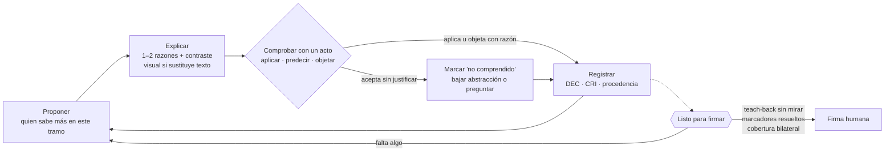
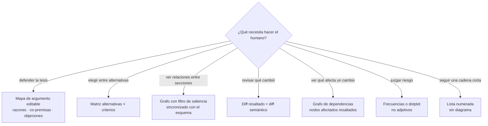
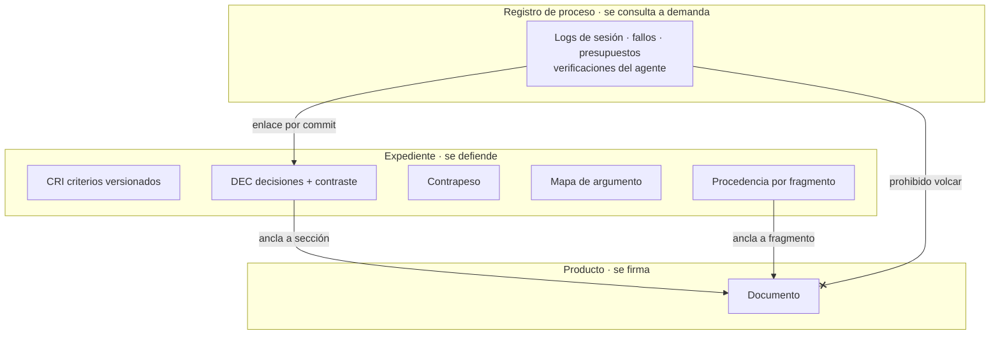

# 09 · Consolidación preliminar: proponer, explicar y comprobar sin frenar la construcción

## 1. Resumen

- La literatura nueva respalda el principio de codirección y cambia el mecanismo que lo garantiza. Una explicación del agente, por buena que sea, sube la aceptación pero no la comprensión. Lo que produce comprensión es un **acto breve del humano**: aplicar, predecir, objetar o reformular.
- La tensión entre explicar más y leer menos se resuelve con cinco palabras clave: explicación **selectiva y contrastiva**, **verificación barata**, **actos en lugar de lectura**, **visuales que sustituyen texto** y **adaptación a la pericia por tema**.
- La fricción se reparte en dos tipos. La fricción informativa (contraste, incertidumbre, fuente) acompaña todo el flujo y no lo detiene. La fricción de acto (teach-back sin mirar) va solo en la puerta "listo para firmar". Con esto se eliminan el bloqueo de G1 y las colas de G3.
- El liderazgo en cada tramo lo tiene quien posee el conocimiento específico que ese tramo necesita. Por eso D4 se reformula: deja de ser un problema de asignación de roles y pasa a ser una señal que se observa.
- Lo que el agente entiende del humano se pierde en el chat en pocos turnos. Los criterios (CRI) deben ser artefactos versionados, con estado y reinyectados en cada paso.
- La industria converge en canales separados: producto, expediente y registro de proceso. Mezclarlos fue el defecto de los docs 06–08.

## 2. Principios de diseño que emergen

**P1. La garantía de comprensión es un acto del humano, no una explicación del agente.**
- Chi et al. (2001): en tutoría, las explicaciones del tutor (~50 % de sus enunciados) solo se correlacionaron con aprendizaje superficial. Cuando a los tutores se les prohibió explicar y solo podían preguntar, el aprendizaje no bajó. [moderada]
- Bansal et al. (2021): las explicaciones aumentaron la aceptación de la IA "independientemente de si es correcta" y no mejoraron el desempeño conjunto. [moderada]
- ICAP (Chi y Wylie 2014): si una parte hace todo el aporte sustantivo y la otra solo asiente, la que asiente queda en modo activo, no constructivo. El efecto aparece en ítems difíciles, no en los fáciles. [moderada]

**P2. Abaratar la verificación antes que encarecer la aceptación.**
- Vasconcelos et al. (2023, cinco estudios, N=731): la dependencia excesiva es una elección costo-beneficio. Las explicaciones la reducen solo cuando abaratan verificar. [moderada]
- La síntesis de Microsoft Research advierte que las citas imitan rigor y pueden *reducir* la verificación si no llevan al pasaje exacto. [práctica]

**P3. Fricción informativa en el flujo, fricción de acto solo en la firma.**
- Buçinca et al. (2021, N=199): las funciones de forzamiento cognitivo (decidir antes de ver la IA) redujeron la dependencia excesiva (≈48 % frente a ≈64 %). Fueron las peor valoradas y beneficiaron sobre todo a personas con alta necesidad de cognición. [moderada]
- Bastani et al. (2025, ~1.000 estudiantes): el chat libre dio +48 % en la práctica y −17 % en el examen sin IA. El tutor con guardarraíles no tuvo ese daño. [fuerte]
- Según los practicantes que revisa CMU, la firma humana conviene solo para cambios materiales, porque los gates universales agregan latencia. [práctica]

**P4. El liderazgo emerge de la brecha de conocimiento y se sostiene con conductas igualadoras.**
- Zieris y Prechelt (2021): las brechas de conocimiento específico del sistema frenan más que las de conocimiento general, y las parejas complementarias son las más eficaces. [moderada]
- Bryant et al. (2008, ~14.900 enunciados): no hay efecto del rol sobre el nivel de abstracción. Domina la charla de nivel intermedio y los roles rotan con poca conversación. [moderada]
- Ververs y Prechelt (2025): las brechas de conocimiento generan brechas de poder, y estas llevan al desenganche (se deja de preguntar, proponer y objetar). Se reparan con meta-comunicación y conductas igualadoras. [moderada]

**P5. La explicación se adapta a la pericia por tema y se desvanece según el desempeño.**
- Inversión de la pericia (Kalyuga): la guía detallada ayuda al novato y perjudica al experto en esa tarea. Desvanecer los prompts según el desempeño superó a mantenerlos (Nückles et al. 2010). [moderada]
- Tutor CoPilot (RCT, 900 tutores): +4 pp de dominio en general y +9 pp con los tutores menos calificados. El mecanismo fue pedir que el otro explique su razonamiento en lugar de darle la respuesta. [fuerte]
- Kulik y Fletcher (2016): los tutores por pasos (0,76 DE) no fueron superados por los de subpasos (0,40 DE). Verificar en cada decisión basta; no hace falta hacerlo en cada frase. [moderada]

**P6. Lo que el agente entiende del humano es una hipótesis persistida, no memoria de chat.**
- PrefEval (ICLR 2025): sin ayuda, el cumplimiento de una preferencia ya declarada cae por debajo del 10 % a los 10 turnos en la mayoría de los modelos. [fuerte]
- UserBench (2025): los mejores modelos descubren menos del 30 % de las preferencias del usuario. [moderada]
- EvalGen (2024): los criterios aparecen al evaluar salidas concretas ("criteria drift"), así que no se pueden fijar de antemano. [moderada]

**P7. La influencia del agente y la autoría deben quedar a la vista.**
- Jakesch et al. (2023, N=1.506): con un asistente sesgado, los participantes escribieron en la línea del modelo con el doble de probabilidad y también desplazaron su opinión. La mayoría no lo notó. [fuerte]
- Draxler et al. (2024): las personas no sienten propiedad sobre el texto de la IA, pero igual se declaran autoras. La propiedad percibida crece con la influencia real que tuvieron sobre el texto. [moderada]
- Padmakumar y He (2024): InstructGPT homogeneizó los ensayos, y el efecto viene del texto del modelo que se aceptó. [moderada]

## 3. Cómo se resuelve la tensión entre explicar más y leer menos

El deber de explicar del agente no se mide en palabras. Se cumple cuando el humano puede actuar sobre la propuesta. Cada palanca reduce la lectura y sube la comprensión a la vez.

| Palanca | Qué hace el agente | Lectura que ahorra | Evidencia |
|---|---|---|---|
| Explicación selectiva y contrastiva | "Propongo A en lugar de B porque…; elegiría B si…". Da 1–2 causas y deja el resto a demanda | Elimina las listas exhaustivas de razones | Miller 2019 [moderada]; Si et al. 2024, argumentar a favor y en contra reduce la dependencia excesiva [débil] |
| Verificación barata | Ancla cada afirmación a su pasaje, marca el diff resaltado y escribe un "diff semántico" de pocas líneas (afirmación añadida, retirada o debilitada) | Ya no hace falta releer la sección para saber qué cambió | Vasconcelos 2023 [moderada]; Diffamation: el resaltado explica casi toda la ganancia [débil] |
| Actos en lugar de lectura | Cierra con una pregunta de aplicación, predicción u objeción ("¿qué pasa con el indicador X sin línea base?") | Un acto de una línea reemplaza la relectura | Chi 2001 [moderada]; Shen y Tamkin 2026: delegar resta ~17 % de comprensión, y preguntar después de generar la preserva [moderada] |
| Visuales que sustituyen | Genera un esquema solo cuando la tarea es localizar, comparar o ver relaciones, y lo pone en reemplazo de los párrafos, no como añadido | La estructura se ve sin leer prosa | Larkin y Simon 1987 [moderada]; Schroeder et al. 2018: construir mapas g=0,72 frente a estudiarlos g=0,43 [fuerte] |
| Adaptación a la pericia | Donde el humano domina, una línea de razón y la explicación a demanda. Donde es novato, un ejemplo resuelto que se desvanece | Ahorra la redundancia que el experto no necesita | Kalyuga [moderada]; Tutor CoPilot [fuerte] |

Dos reglas completan la solución. Primera, **turnos cortos**: una cosa a la vez, sin perder el tema actual y escalonando lo difícil (Zieris y Prechelt 2015 [moderada]). Los bloques largos de propuesta más explicación dejan al humano en modo pasivo. Segunda, **preguntar solo cuando mejora lo que viene**: CollabLLM bajó el tiempo total un 10,4 % con usuarios reales al valorar cada pregunta por su efecto en los turnos siguientes [moderada]. Preguntar bien no frena.

### Ciclo de cocreación

La construcción nunca se detiene: aceptar sin justificar no bloquea nada, solo deja la sección como **no firmable**. La única puerta es "listo para firmar". El humano también propone, y entonces el agente comprueba su propia comprensión con un **teach-back del agente**: resume en 3–5 líneas la intención y los criterios del humano, y el humano marca cada punto como correcto, incorrecto o incompleto.

### Qué visual genera el agente y cuándo

| Regla para todo visual | Razón |
|---|---|
| El visual va en lugar del texto, nunca además de él, en temas que el humano domina | Inversión de la pericia y redundancia (Kalyuga et al. 2003) [moderada] |
| Sin decoración: cada nodo sirve a una decisión | Los detalles seductores dañan, sobre todo junto a diagramas relevantes (Sundararajan y Adesope 2020) [fuerte] |
| Cada nodo y cada arista se anclan a un fragmento del documento | Un diagrama con errores cuesta el doble: Graphologue tuvo ~8 % de relaciones erróneas [débil] |
| El humano edita o reordena; no solo mira | Para universitarios, un mapa ya hecho rinde g=0,32 (Schroeder et al. 2018) [fuerte] |
| Se deriva de estructura confirmada (DEC, premisas), no de prosa libre | Exactitud y verificación barata |
| Persiste entre sesiones como mapa vivo | El efecto crece con el uso sostenido (g=0,36 con menos de una semana frente a 0,72 con más de cuatro) |

## 4. Consolidación mecanismo por mecanismo de la arquitectura v1.2 (doc 05)

| Mecanismo de 05 | Estado | Cambio y razón |
|---|---|---|
| Skill explorar | Cambia | Elicita con 2–3 variantes contrastadas en una sola dimensión, luego formula el criterio implícito y lo hace confirmar. Laddering de 2 escalones como máximo (EvalGen; GATE; Dieste et al. 2008) |
| Skill construir | Cambia | Implementa el ciclo de la sección 3 con pasos pequeños. Los desarrolladores expertos ejecutan ~2 pasos por prompt y revisan cada cambio (Huang et al. 2025) |
| Skill retomar y reingreso graduado | Se mantiene | El reingreso se gradúa según el perfil de pericia y arranca con el teach-back del agente sobre lo acordado |
| Subagente divergente | Cambia | Las alternativas se generan sobre dimensiones explícitas, no como paráfrasis, para contrarrestar la homogeneización (Luminate; Padmakumar y He) |
| Subagente premisas | Se mantiene y amplía | Marca las co-premisas implícitas frente a las razones independientes. Alimenta el mapa de argumento (Twardy 2004) |
| Subagente lector ciego | Se mantiene y amplía | Produce el esquema inverso (una línea por párrafo), que se compara con el resumen del humano (Dang et al. 2022) |
| Hooks | Cambia | No bloquean la construcción. Solo hacen dos cosas: imponen la puerta de firma y separan canales (sección 6) |
| CLI en Python | Se mantiene | Suma `estado` (firmable o no por sección), `cobertura` y `procedencia` |
| CRI | Cambia | Cada criterio queda versionado con el ejemplo que lo originó y con estado (confirmado, inferido o pendiente), y se reinyecta en cada paso (PrefEval; Burton et al. 1990: lo plausible no equivale a lo del experto) |
| DEC | Cambia | Registra el contraste, quién propuso y quién objetó. Así la autoría queda visible en la firma (Draxler; Jakesch) |
| Contrapeso | Se mantiene | Es la forma contrastiva que pide Miller y el argumento para responder "¿por qué no B?" |
| Explicar sin mirar | Se mantiene y se mueve | Pasa a ser el acto de la puerta de firma y deja de ser un control continuo. Rozenblit y Keil: la ilusión de comprensión cae al explicar; Kosmyna 2025: con LLM cuesta citar el propio texto [débil] |
| Presupuesto de lectura ~20 % + párrafo aleatorio | Se elimina | Se reemplaza por lectura dirigida a lo causal y material, con todo lo demás marcado explícitamente "no revisado". En Scim, resaltar aceleró la lectura sin mejorar la precisión |
| G1, hook que bloquea opciones | Se elimina | Pasa a ser "esbozar primero" opcional y graduable, solo en decisiones a firmar. Lo eficaz es lo menos preferido y no beneficia a todos por igual (Buçinca). El orden de los aportes queda registrado |
| G3, lotes de ≤3 decisiones críticas | Se elimina | Las decisiones se clasifican por nivel de riesgo. Las de forma pasan sin firma; las de tesis, cifras y conclusiones se acumulan para la puerta |
| Meta de −37 % de lectura | Se elimina | Nunca se midió. La sustituyen las métricas del protocolo 08 |
| Deber de proponer → explicar → comprobar | Nuevo | Pasa a ser una regla explícita del agente en todos los skills |
| Perfil de pericia por tema | Nuevo | Se infiere de las respuestas a los actos y regula cuánto explica el agente y quién toma la iniciativa |
| Detector de desenganche | Nuevo | Vigila la caída de preguntas, propuestas y objeciones, las aprobaciones sin edición y las respuestas cada vez más cortas. Cuando se dispara, el agente devuelve la decisión al humano (Ververs y Prechelt) |
| Marcador `[POR ACLARAR: …]` | Nuevo | Concentra la incertidumbre en marcadores accionables en lugar de matizar cada frase. Ninguna sección es firmable mientras tenga marcadores (Spec Kit) |
| Incertidumbre en primera persona y en frecuencias | Nuevo | Formatos como "No estoy seguro, pero…" o "14 de 20 escenarios". La incertidumbre impersonal tuvo efectos más débiles (Kim et al. 2024; Fernandes et al. 2018) |
| Vistas visuales | Nuevo | Esquema, mapa de argumento editable, matriz y diff semántico, según la sección 3 |

## 5. Aportes a D1–D4 (doc 07) y al protocolo 08

| Dimensión | Aporte |
|---|---|
| D1 Trazabilidad | Procedencia por fragmento: quién propuso, quién editó y si se aceptó tal cual (CoAuthor). Proporción de texto del agente aceptado sin modificar como métrica de homogeneización |
| D2 Comprensión humana | Actos frente a lectura. La comprensión se verifica en lo causal, donde la ilusión es mayor, y se omite en hechos y procedimientos |
| D3 Comprensión bilateral | Teach-back del agente con una métrica propia (% de afirmaciones sobre el humano aceptadas sin corregir). CRI con estado. La ToM literal no predice la adaptación funcional (Riemer et al. 2025) |
| D4 Conducción dinámica | Se reformula como pregunta: "¿quién tiene el conocimiento específico de este tramo?". La señal se observa en el modo del humano: si da instrucciones concretas está en aceleración y lidera; si hace preguntas abiertas está en exploración y el agente propone y explica (Barke et al. 2023) |

Para el protocolo 08 se agregan cinco cosas a la rúbrica (aplica / repite / acepta sin justificar / rechazo justificado):
1. Distinguir **dirigir al agente** de **evaluar el contenido**. En los PR de agentes, ~26 % de los comentarios humanos son órdenes (Duma et al. 2026).
2. Medir con ítems difíciles o de transferencia, porque en los fáciles el efecto no aparece (ICAP).
3. Registrar el porcentaje de "aprobado sin edición" como señal ambigua (76,4 % en LearnLM), que siempre se cruza con los actos.
4. Contar las señales de desenganche por ronda.
5. Hacer un A/B interno de texto solo frente a texto más visual, midiendo el tiempo hasta detectar un error plantado.

## 6. Anti-patrón: el registro de proceso dentro del producto

Los docs 06–08 mezclaron investigación con fallos de herramientas, presupuestos de caché y matices en cada frase. Es el equivalente documental del "código pulido que baja la guardia" y de la deuda de comprensión: el lector paga por leer proceso y no gana capacidad de defender el contenido (Storey 2026; Osmani 2026) [práctica]. La industria lo resuelve con canales distintos: el log de sesión de Copilot se enlaza desde cada commit y no entra al cuerpo del PR, y Kiro y Spec Kit separan intención, diseño y tareas en archivos distintos [práctica]. CMU encontró además que un cambio sin intención registrada es más difícil de evaluar [moderada].

**Regla del harness**:
1. El agente escribe el contenido dentro de un contenedor delimitado (`<producto>…</producto>`), y solo ese contenido se vuelca al documento. La delimitación estructural es más robusta que la instrucción "no incluyas logs" (guía de prompting de Anthropic) [práctica].
2. Un hook de escritura revisa el producto. Si detecta patrones de proceso (nombres de herramientas, presupuestos, "no pude acceder", conteos de lectura), devuelve ese texto a `expediente/proceso/` con su enlace al commit. Este hook redirige: no frena la construcción.
3. La incertidumbre aparece en el producto de solo dos formas: una etiqueta de fuerza por hallazgo, o un marcador `[POR ACLARAR]` que impide firmar.
4. "¿Por qué cambió esto?" se responde desde el registro de proceso, a demanda, y no queda incrustado en el documento.

## 7. Preguntas abiertas para el piloto

1. ¿Qué acto (aplicar, predecir u objetar) da la mejor señal de comprensión por segundo invertido en documentos de planeamiento? No hay estudios comparativos con profesionales adultos.
2. ¿El teach-back sin mirar en la puerta de firma basta para detectar la ilusión de comprensión, o hacen falta actos durante la construcción?
3. ¿Con qué datos se estima de forma confiable el perfil de pericia por tema, y cuántos actos hacen falta para empezar a desvanecer la guía?
4. ¿Los visuales derivados del expediente reducen el tiempo hasta detectar un error frente al texto solo, con el humano real de tupaqnin?
5. ¿Qué umbral del detector de desenganche separa la confianza legítima de la aprobación automática?
6. ¿Cuánta fricción en la puerta tolera el humano antes de saltarla o automatizarla? Buçinca muestra que lo eficaz es lo menos preferido.

## 8. Fuentes

- Chi y Wylie 2014, ICAP — https://csi.asu.edu/wp-content/uploads/2018/01/ChiWylie2014ICAP.pdf
- Chi et al. 2001, tutoría — https://education.asu.edu/sites/default/files/lcl/image3_2.pdf
- Kulik y Fletcher 2016 — https://apps.dtic.mil/sti/pdfs/AD1030353.pdf
- Lee y Kalyuga, inversión de la pericia — https://my.chartered.college/impact_article/expertise-reversal-effect-and-its-instructional-implications/
- Wang et al. 2024, Tutor CoPilot — https://arxiv.org/pdf/2410.03017v1
- Kestin et al. 2025 — https://pmc.ncbi.nlm.nih.gov/articles/PMC12179260/
- Eedi y DeepMind, LearnLM — https://arxiv.org/abs/2512.23633v1
- Miller 2019 — https://ar5iv.labs.arxiv.org/html/1706.07269
- Bansal et al. 2021 — https://arxiv.org/abs/2006.14779
- Buçinca et al. 2021 — https://arxiv.org/pdf/2102.09692
- Vasconcelos et al. 2023 — https://arxiv.org/abs/2212.06823
- Microsoft Research, dependencia apropiada — https://www.microsoft.com/en-us/research/?p=1080732
- Kim et al. 2024, incertidumbre — https://www.arxiv.org/abs/2405.00623
- Si et al. 2024, explicaciones contrastivas — https://arxiv.org/abs/2310.12558v2
- Lee et al. 2025, pensamiento crítico — https://advait.org/files/lee_2025_ai_critical_thinking_survey.pdf
- Jakesch et al. 2023 — https://arxiv.org/pdf/2302.00560
- Bryant et al. 2008 — https://users.sussex.ac.uk/~bend/papers/ijhcs07.pdf
- Zieris y Prechelt 2021 — https://dl.gi.de/items/1147691e-fd6d-41e9-8099-86e7d593be72/full
- Zieris y Prechelt 2015 — https://dl.gi.de/items/61db3fb4-5b56-4ec7-b321-d953ba32ff38/full
- Ververs y Prechelt 2025 — https://arxiv.org/html/2508.00462v1
- Barke et al. 2023 — https://arxiv.org/abs/2206.15000
- Huang et al. 2025 — https://arxiv.org/html/2512.14012v1
- Shen y Tamkin 2026 — https://arxiv.org/html/2601.20245v1
- Draxler et al. 2024 — https://arxiv.org/abs/2303.03283v2
- Padmakumar y He 2024 — https://arxiv.org/abs/2309.05196v3
- Dang et al. 2022 — https://arxiv.org/abs/2208.09323v1
- Fok et al. 2023, Scim — https://arxiv.org/pdf/2205.04561
- Suh et al. 2024, Luminate — https://arxiv.org/abs/2310.12953v1
- CoAuthor — https://arxiv.org/abs/2201.06796
- Bastani et al. 2025 — https://knowledge.wharton.upenn.edu/article/without-guardrails-generative-ai-can-harm-education/
- GATE — https://arxiv.org/abs/2310.11589
- CollabLLM — https://arxiv.org/abs/2502.00640
- UserBench — https://arxiv.org/abs/2507.22034
- PrefEval — https://arxiv.org/abs/2502.09597
- EvalGen — https://arxiv.org/abs/2404.12272
- Riemer et al. 2025 — https://proceedings.mlr.press/v267/riemer25a.html
- Dieste et al. 2008 — https://www.inf.puc-rio.br/wer/WERpapers/artigos/artigos_WER08/dieste.pdf
- Burton et al. 1990 — https://research.bond.edu.au/en/publications/the-efficacy-of-knowledge-elicitation-techniques-a-comparison-acr/
- Larkin y Simon 1987 — https://mechanism.ucsd.edu/bill/teaching/F12/cs200/Readings/larkin.whyadiagramissometimesworth.1987.pdf
- Schroeder et al. 2018, reseña — https://www.clearinghouse.edu.tum.de/wp-content/uploads/2023/10/CHU_KR-19_ENG_Schroeder-2_2017.pdf
- Twardy 2004 — https://philarchive.org/rec/TWAAMI
- Sundararajan y Adesope 2020 — https://news.wsu.edu/2020/03/19/seductive-details-inhibit-learning/
- Diffamation — https://aviz.fr/old/diffamation/diffamation-CHI2010.pdf
- Fernandes et al. 2018 — https://mucollective.northwestern.edu/project/uncertainty-bus
- Graphologue — https://arxiv.org/pdf/2305.11473
- GitHub Copilot, logs de sesión — https://docs.github.com/en/copilot/how-tos/use-copilot-agents/coding-agent/track-copilot-sessions
- Kiro, specs — https://kiro.dev/docs/specs.md
- GitHub Spec Kit — https://github.com/github/spec-kit/blob/main/spec-driven.md
- Agarwal et al. 2026, CMU — https://www.alphaxiv.org/abs/2607.07980.md
- Duma et al. 2026 — https://arxiv.org/pdf/2605.02273
- Storey 2026, deuda cognitiva — https://margaretstorey.com/blog/2026/02/09/cognitive-debt/
- Osmani 2026, deuda de comprensión — https://addyosmani.com/blog/comprehension-debt/
- Rozenblit y Keil 2002, vía Silk-Eglit y Kurtz — https://repositories.cdlib.org/content/qt582378mf/qt582378mf.pdf?t=op2kua
- Kosmyna et al. 2025 (preprint) — https://arxiv.org/abs/2506.08872v1
- Kalyuga et al. 2003 — https://ro.uow.edu.au/edupapers/136
- Anthropic, guía de prompting — https://platform.claude.com/docs/en/build-with-claude/prompt-engineering/claude-prompting-best-practices

## No verificado

- Bastani et al. 2025: las cifras vienen de la nota institucional; el artículo de PNAS no se leyó.
- Doshi y Hauser 2024: las cifras de novedad (~8 %) y utilidad (~9 %) no están confirmadas.
- Metaanálisis de Alvarez Ortiz 2007 sobre mapeo de argumentos (~0,8 DE) y los tamaños de efecto por principio de Mayer: recordados, no leídos.
- La "meseta de interacción" en el texto original de VanLehn 2011.
- Kosmyna et al. 2025: preprint con críticas metodológicas serias. Se usa solo como señal débil.
- Chong y Hurlbutt 2007, solo vía reseña. Ping-pong pairing y los timers de rotación del mob: práctica, sin fuente primaria.
- Documentación oficial del plan mode de Claude Code (solo guías de terceros).
- El teach-back del agente y la comparación del esquema inverso con el resumen del humano son inferencias de diseño sin estudio que las respalde.
- Maier, Shaikh, Sharma, KITE y Pan y Rickard se toman del doc 07; no se reverificaron aquí.
- No hay estudios de cocreación de documentos profesionales largos con agentes que midan comprensión o capacidad de defensa. Toda la transferencia a tupaqnin es inferencia.
