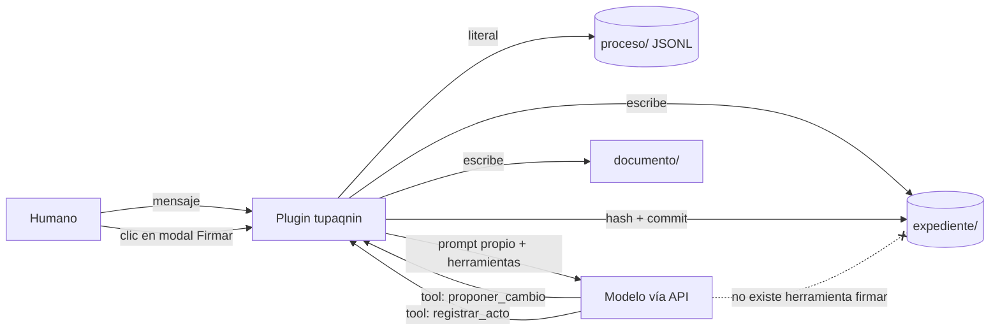
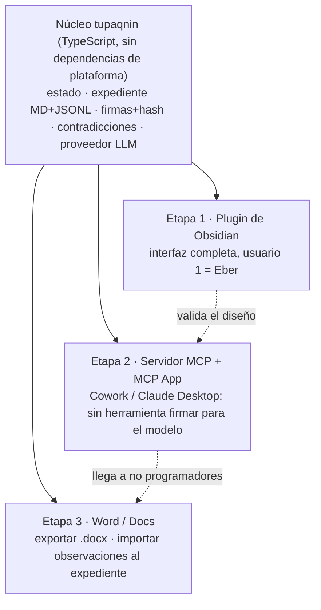

# 10 · ¿tupaqnin como plugin de Obsidian?

Fecha: 2026-10-17 · Marcas: **[V]** verificado en la fuente · **[A]** resumen o fuente secundaria · **[I]** inferencia o cálculo propio. Lo no verificado va solo en la lista final.

## 1. Respuesta corta

Sí conviene, con condiciones: que Obsidian sea **la primera interfaz** y no la plataforma de la que todo depende. Si el plugin es dueño del bucle del agente, tres problemas que en Claude Code exigían hooks frágiles quedan resueltos por construcción: el plugin decide qué escribe cada canal, firmar es un clic que el modelo no puede emitir y el system prompt es enteramente de tupaqnin [I]. Condiciones: (1) solo escritorio en v1; (2) motor por **clave de API propia** con caché y enrutamiento Haiku/Sonnet, no la suscripción (la vía de suscripción es zona gris legal y fue lo que agotó "dos semanas de plan"); (3) núcleo en TypeScript independiente de Obsidian, para llegar después a Cowork (MCP) y a Word; (4) asumir que Obsidian es nicho: valida el diseño con Eber, pero no llega a quien entrega en Word.

## 2. Por qué Obsidian encaja

La API pública cubre lo que la interfaz de tupaqnin necesita: vistas propias en la barra lateral (`ItemView`), modales, comandos, barra de estado, escritura atómica (`Vault.process`, `processFrontMatter`), eventos de cambio y extensiones completas de CodeMirror 6 (marcar, insertar widgets, ocultar rangos) [V] ([obsidian.d.ts](https://github.com/obsidianmd/obsidian-api/blob/master/obsidian.d.ts); [Decorations](https://github.com/obsidianmd/obsidian-developer-docs/blob/main/en/Plugins/Editor/Decorations.md)).

| Requisito v1 | En Claude Code | En Obsidian | Ganancia / pérdida |
|---|---|---|---|
| Proponer y escribir ya en el borrador; Agrega / Quita / Suaviza | Edit del agente + texto en el chat | El agente llama a una herramienta; el plugin escribe con la API `Editor` y ancla widgets CM6 al rango cambiado | **Gana**: los botones quedan junto al cambio |
| Contraste, pregunta de acto, "un ok no confirma" | Output style + reglas del prompt | Panel lateral; el **plugin** valida que la respuesta sea un acto | **Gana**: la regla deja de depender del modelo |
| Teach-back; "explicar sin mirar" | Imposible ocultar el texto | Modal + desenfoque CSS o replace decorations sobre el documento | **Gana** (es una ayuda: el archivo sigue abierto en otras apps) |
| Puerta "listo para firmar"; firma solo humana | Skill + hook; el agente con shell podía imitarla | Comando + modal; firma = evento de la interfaz + hash SHA-256 (Web Crypto) + commit hecho por el plugin | **Gana mucho**: sin herramienta "firmar" en manos del agente |
| Tres canales separados | Hooks que no reescriben Edit de forma fiable | Carpetas `documento/`, `expediente/`, `proceso/`; solo el plugin escribe | **Gana mucho**: separación por construcción |
| Registro literal de mensajes humanos | Hook de prompt | El plugin recibe el mensaje antes que el modelo y lo guarda en JSONL | **Gana**: ya no hace falta un hook |
| Estado único (borrador / lista / firmada / cambió) | CLI `tq estado` | Frontmatter + hash recalculado en `vault.on('modify')` | Igual; más visible |
| Aviso de contradicción | Hook + LLM | Candidatos deterministas en `editor-change` + Haiku; marcas en el texto | **Gana**: aparece en el texto, no en el chat |
| Señales: costo, minutos, pendientes | Statusline | `addStatusBarItem`; métricas locales | **Gana**: $ exacto por respuesta de API; **pierde** "% del plan" |
| Vistas editables | Archivos sueltos | Canvas (archivo JSON), Bases (vistas con API oficial), `ItemView` para diff y grafo | **Gana**, con el límite de Canvas (§3) |
| System prompt de programación | Output style; queda base de código | Prompt 100 % propio si el plugin llama a la API | **Gana**: problema eliminado |

Cómo funciona el bucle cuando el plugin es su dueño:

El modelo solo actúa mediante herramientas que el plugin ejecuta o rechaza. No hay shell. Por eso proceso y producto quedan separados sin interceptar nada [I].

## 3. Lo que se pierde o arriesga

| Riesgo | Evidencia | Impacto |
|---|---|---|
| **Móvil** | Node y Electron no existen en móvil; un plugin que los use debe declarar `isDesktopOnly` [V] ([Mobile development](https://github.com/obsidianmd/obsidian-developer-docs/blob/main/en/Plugins/Getting%20started/Mobile%20development.md)) | v1 solo escritorio; en móvil, a lo más leer o firmar |
| **Sin streaming en `requestUrl`** | La respuesta no trae stream; la petición lleva abierta desde ago-2024 sin respuesta oficial [V] ([obsidian.d.ts](https://github.com/obsidianmd/obsidian-api/blob/master/obsidian.d.ts); [A] [foro](https://forum.obsidian.md/t/support-streaming-the-request-and-requesturl-response-body/87381)) | En escritorio se resuelve con `https` de Node; en móvil, `fetch` con CORS |
| **Canvas sin API oficial** | `obsidian.d.ts` no menciona canvas; solo hay tipos del archivo [V] ([canvas.d.ts](https://github.com/obsidianmd/obsidian-api/blob/master/canvas.d.ts)); los plugins avanzados parchean internos [A] ([foro](https://forum.obsidian.md/t/any-details-on-the-canvas-api/57120)) | Generar y leer `.canvas` es estable; manipular el lienzo en vivo es frágil |
| **Alcance** | ~1 M de usuarios estimados en 2023, sin datos por ocupación [V] ([Wikipedia](https://en.wikipedia.org/wiki/Obsidian_(software))) | Analistas y consultores del sector público entregan en Word con control de cambios [I] |
| **Exportar a .docx** | Depende de Pandoc (plugin Enhancing Export); hay fallos por YAML [V/A] ([obsidian-stats](https://www.moritzjung.dev/obsidian-stats/plugins/obsidian-enhancing-export); [foro](https://forum.obsidian.md/t/enhanced-export-to-docx-failed-mapping-values-not-allowed/94946)) | La ida funciona; la vuelta (observaciones en Word → expediente) no está resuelta |
| **Mantenimiento por una sola persona** | Hay cambios que rompen la API (p. ej. `BaseOption#shouldHide` en 1.12) [A] ([changelog](https://obsidian.md/changelog/2026-02-27-desktop-v1.12.4/)); Smart Composer quedó sin desarrollo activo [V] ([README](https://github.com/glowingjade/obsidian-smart-composer)) | Mantener el núcleo fuera de Obsidian reduce la superficie que se rompe |
| **Competencia** | Copilot (2,66 M de descargas) y Claudian (2,44 M) ya son interfaces de agentes [V] ([stats](https://raw.githubusercontent.com/obsidianmd/obsidian-releases/master/community-plugin-stats.json)) | No hay que competir en "agente en Obsidian", sino en comprensión y firma |
| **Abuso de la CLI** | Desde 1.12 un plugin puede atender comandos de la CLI de Obsidian (`registerCliHandler`) [V] | No registrar "firmar" en la CLI |
| **Secretos** | `SecretStorage` guarda en localStorage del vault, no en el llavero del sistema [V] ([Store secrets](https://github.com/obsidianmd/obsidian-developer-docs/blob/main/en/Plugins/Guides/Store%20secrets.md)) | Aceptable para uso propio |

Las políticas también pesan: no se permite telemetría en el cliente, y el README debe declarar el uso de red [V] ([Developer policies](https://github.com/obsidianmd/obsidian-developer-docs/blob/main/en/Community%20directory/Developer%20policies.md)). Los minutos humanos y el costo se quedan en el vault.

## 4. Motor de IA

Precios por millón de tokens (entrada / salida / lectura de caché): Sonnet 5.5 $2 / $10 / $0,10; Opus 5.5 $4 / $20 / $0,20; Haiku 5.5 $0,10 / $0,50 / $0,01 hasta 100K tokens de prompt [V] ([Pricing](https://platform.claude.com/docs/en/about-claude/pricing)). Escribir caché de 1 h en Sonnet 5.5 cuesta $4 [V].

**Supuestos de la sesión tipo** [I]: 2 h y 40 intervenciones humanas; 3 llamadas por intervención; unos 30K tokens de contexto por llamada, casi todo en caché; 1,5K tokens nuevos y 0,7K de salida por llamada. Resultado: Sonnet con caché ≈ **$1,7**; sin caché ≈ $8; Opus con caché ≈ $3,4; Haiku ≈ $0,08; cada chequeo de contradicción con Haiku ≈ $0,002.

| Opción | Costo / sesión | Control del system prompt | Riesgo de términos | Escritorio / móvil |
|---|---|---|---|---|
| **A. Clave de API directa** con capa de proveedor intercambiable | ≈ $1,7 con Sonnet y caché; visible al centavo | Total | Ninguno: es la vía permitida [V] | Ambos (móvil sin Node; falta probar CORS) |
| **B. Agent SDK** dentro de Obsidian | Igual que A (exige clave) | Total (`systemPrompt` propio), pero llegan system reminders de Claude Code [V] | Bajo con clave; **prohibido** ofrecer el login de claude.ai [V] | Solo escritorio (subproceso) |
| **C. CLI de Claude Code** vía ACP o `claude -p --output-format stream-json` con la suscripción | "Gratis", pero descuenta del plan; ese consumo provocó el corte de las dos semanas | `--system-prompt-file` lo reemplaza; `--tools ""` y `--strict-mcp-config` lo restringen [V] | **Zona gris**: la letra permite el binario oficial con login propio, pero Anthropic aplica restricciones "sin aviso previo" y desde 2026 corta los harnesses de terceros [V/A] | Solo escritorio |
| **D. MCP desde Claude Desktop / Cowork** | Descuenta del plan; sin detalle en tokens | Ninguno: las instrucciones llegan como herramientas o skills | Ninguno: es una app nativa [V] | Desktop; Cowork en web y móvil (beta) |
| **E. Modelos locales (Ollama)** | $0 en tokens | Total; API compatible con Mensajes, **sin caché** [V] ([Ollama](https://docs.ollama.com/api/anthropic-compatibility)) | Ninguno | Solo escritorio |

Términos clave. *"Unless previously approved, Anthropic does not allow third party developers to offer claude.ai login or rate limits for their products, including agents built on the Claude Agent SDK. Use the API key authentication methods… instead."* El uso se rige por los Commercial Terms [V] ([Agent SDK overview](https://code.claude.com/docs/en/agent-sdk/overview)). La página legal añade que no se puede "route requests through Free, Pro, or Max plan credentials on behalf of their users". Sí permite que un usuario inicie sesión en el binario de Claude Code sin modificar [V] ([Legal and compliance](https://code.claude.com/docs/en/legal-and-compliance)). Smart Composer advierte de cuentas "banned or restricted" por usar OAuth de terceros [V] ([README](https://github.com/glowingjade/obsidian-smart-composer)).

**Recomendación: opción A.**
- **Enrutamiento por tarea**: Haiku para candidatos de contradicción y clasificación; Sonnet para escribir, contrastar y hacer teach-back; Opus solo en "listo para firmar".
- **Caché**: bloque estático (prompt + herramientas + criterios) con TTL de 1 h, porque las pausas humanas superan los 5 min. Reanudar con caché fría cuesta unos $0,10 [I].
- **Tope de gasto** por sesión y por mes en la barra de estado. El costo sale del campo de uso de cada respuesta de la API.
- **Proveedor intercambiable** con la forma de la API de Mensajes. Ollama u OpenRouter (sin sobreprecio por token; 5,5 % al comprar créditos [V] ([FAQ](https://openrouter.ai/docs/faq))) entran cambiando URL y clave.

Con 20 sesiones al mes, A cuesta unos $35. Es comparable a un plan, pero el gasto es explícito y se puede cortar [I]. C queda como modo experimental para uso propio, nunca como camino principal. D es el canal de la etapa 2 (§6).

## 5. Qué ya existe

| Plugin | Descargas | Motor | Patrón de edición | Licencia | Le falta para ser tupaqnin |
|---|---|---|---|---|---|
| Copilot | 2,66 M | Claude Code, Codex, opencode; BYOK | Agente con permisos | **AGPL-3.0** | Decisiones, comprensión, firma |
| Claudian | 2,44 M | Agent SDK con prompt propio ("You are Claudian…") | Escribe directo; diff por palabra | MIT | Ídem; el agente tiene bash |
| Agent Client | 303 K | ACP (9 agentes) | Diff por palabra; permiso por acción | Apache-2.0 | No envía system prompt propio |
| Smart Composer | 177 K | API BYOK + OAuth | Sugerir y aplicar con un clic | MIT | Sin desarrollo activo |
| AI Co-Editor | 488 | Cualquiera que escriba archivos | Control de cambios, autoría, "audit note" | MIT | No registra el porqué [A] |

Fuentes: [V] [registro](https://raw.githubusercontent.com/obsidianmd/obsidian-releases/master/community-plugins.json) y los README de [Copilot](https://github.com/logancyang/obsidian-copilot), [Claudian](https://github.com/YishenTu/claudian), [Agent Client](https://github.com/RAIT-09/obsidian-agent-client); [A] [AI Co-Editor](https://community.obsidian.md/plugins/live-coedit).

**Hueco que llena tupaqnin**: ningún plugin revisado tiene chequeos de comprensión, un expediente de criterios y decisiones, separación entre proceso y producto ni una puerta de firma humana [V para lo revisado]. La infraestructura de "agente en Obsidian" ya está resuelta; el valor está en la capa de comprensión [I].

**Reutilizar o construir** [I]: construir el plugin propio, porque la puerta de firma y los canales exigen controlar la interfaz. Tomar ideas o código de Claudian (diff inline) y Agent Client (permisos), conservando sus avisos de licencia, y el patrón de revisión de AI Co-Editor. **No derivar de Copilot**: el código derivado tendría que ser AGPL.

## 6. Alternativas

| Superficie | Alcance al usuario objetivo | Encaje con v1 | Esfuerzo para una persona | Dependencia |
|---|---|---|---|---|
| **Obsidian** | Bajo-medio (incluye a Eber) | **Alto**: prompt, interfaz, canales y firma propios | Medio | Baja (archivos MD) |
| **Cowork + MCP App** | Alto: más del 90 % del uso de Cowork no es software [V] ([blog](https://claude.com/blog/cowork-web-mobile)) | Medio: sin system prompt (output styles ignorados) [V] ([platform-support](https://claude.com/docs/plugins/platform-support)); interfaz en iframe [V] ([MCP Apps](https://blog.modelcontextprotocol.io/posts/2026-01-26-mcp-apps/)) | Bajo-medio | Alta (Anthropic) |
| **Word / Google Docs** | El más alto: ahí viven los entregables | Medio: control de cambios nativo (WordApi 1.6 [A]; Docs `SUGGEST` [V] ([Docs API](https://developers.google.com/workspace/docs/api/how-tos/suggestions))); expediente en un backend aparte | Alto | Media |
| **App propia** | Bajo al inicio | Máximo | Muy alto | Baja |
| **VS Code** | Bajo (desarrolladores) | Alto en lo técnico | Medio | Baja |

## 7. Cómo cambia el diseño v1

| Se conserva | Cambia | Se elimina |
|---|---|---|
| Ciclo proponer → escribir → contrastar; preguntas de acto; teach-back | **Hooks → código del plugin** (registro, inicio, avisos y protección de evidencia pasan a ser funciones) | Hook de protección de evidencia: el agente no tiene shell |
| Una sola puerta "listo para firmar" | **CLI `tq` en Python → núcleo TypeScript** (`estado/check/firmar/init` como funciones y comandos) | Output style como mecanismo: se reemplaza por un prompt propio |
| Tres canales | **Skill de firma → modal** con evento de la interfaz + hash + commit | Lógica de "canales como aviso": la separación es estructural |
| Expediente en Markdown + JSONL | **Statusline → ítem de la barra de estado** ($, minutos, pendientes) | Dependencia de Claude Code o Pi como anfitrión |
| Estado único calculado | **Vistas → Canvas (mapa de argumento), Bases (matriz y decisiones), `ItemView` (diff y grafo)** | |
| Señales visibles | **Pruebas P1–P5b → pruebas técnicas de Obsidian** (§9) + pruebas del núcleo en Vitest | |
| Aviso de contradicción | Motor: suscripción → clave de API con enrutamiento por modelo | |

## 8. Decisiones para Eber

1. **Motor de v1.** Opciones: API propia / CLI con suscripción / ambas. **Recomiendo API propia** con tope mensual (p. ej. $30), y la CLI solo como experimento personal.
2. **¿Abandonar el plugin de Claude Code?** Opciones: congelarlo / mantenerlo en paralelo / descartarlo. **Recomiendo congelarlo** y llevar su lógica al núcleo TS; dos interfaces a la vez no las mantiene una sola persona.
3. **Alcance de plataforma.** Opciones: solo escritorio / escritorio + móvil. **Recomiendo solo escritorio** (`isDesktopOnly: true`); en móvil, a lo más leer.
4. **Publicación.** Opciones: uso propio con BRAT / directorio comunitario desde v1. **Recomiendo uso propio** hasta pasar las pruebas de §9 con un documento real; publicar después (la revisión es gratuita y automática [V] ([Submit](https://github.com/obsidianmd/obsidian-developer-docs/blob/main/en/Plugins/Releasing/Submit%20your%20plugin.md))).

## 9. Pruebas técnicas previas

| # | Prueba | Si falla |
|---|---|---|
| T1 | Streaming de la API de Anthropic desde el escritorio con `https` de Node (y con `fetch` + cabecera de acceso desde navegador) | Usar `requestUrl` sin streaming con indicador de progreso |
| T2 | Caché de 1 h: medir aciertos y costo real en una sesión de 2 h con un documento real | Reducir contexto (expediente resumido) o bajar a Haiku más tareas |
| T3 | Firma: confirmar que ningún comando, ni la CLI de Obsidian ni un proceso externo, puede firmar sin el modal (`isTrusted`/`lastEvent`) | Exigir que el humano escriba una frase y verificarla con hash |
| T4 | Distinguir escrituras del plugin de ediciones humanas (marca propia + `editor-change`) para "cambió desde la firma" | Basar el estado solo en el hash, sin atribuir autoría |
| T5 | Widgets CM6 "Agrega / Quita / Suaviza" estables en vista de edición y comportamiento en modo lectura | Llevar los botones al panel lateral |
| T6 | Generar un `.canvas` y reaccionar a ediciones humanas con un diff de nodos y aristas | Mapa de argumento en una `ItemView` propia (JSON Canvas solo para exportar) |
| T7 | Bases: editar una propiedad dispara `modify` y recalcula el estado | Matriz en una `ItemView` propia |
| T8 | Exportar a .docx con Pandoc un documento con frontmatter, tablas y citas | Exportar sin frontmatter o con un conversor propio |

## 10. Fuentes y No verificado

**Fuentes principales**: [obsidian.d.ts](https://github.com/obsidianmd/obsidian-api/blob/master/obsidian.d.ts) · [Docs para desarrolladores de Obsidian](https://github.com/obsidianmd/obsidian-developer-docs) · [Pricing de Claude](https://platform.claude.com/docs/en/about-claude/pricing) · [Agent SDK overview](https://code.claude.com/docs/en/agent-sdk/overview) · [Modifying system prompts](https://code.claude.com/docs/en/agent-sdk/modifying-system-prompts) · [Legal and compliance](https://code.claude.com/docs/en/legal-and-compliance) · [CLI reference](https://code.claude.com/docs/en/cli-reference) · [RFD de system prompt en ACP](https://agentclientprotocol.com/rfds/client-system-prompt) · [claude-agent-acp](https://github.com/agentclientprotocol/claude-agent-acp) · [Registro de plugins](https://raw.githubusercontent.com/obsidianmd/obsidian-releases/master/community-plugin-stats.json) · [Plataformas de plugins de Claude](https://claude.com/docs/plugins/platform-support) · [MCP Apps](https://blog.modelcontextprotocol.io/posts/2026-01-26-mcp-apps/) · [Ollama](https://docs.ollama.com/api/anthropic-compatibility) · [OpenRouter FAQ](https://openrouter.ai/docs/faq).

**No verificado**
- Que la cabecera `anthropic-dangerous-direct-browser-access` siga vigente en 2026 y la política CORS desde Electron o móvil.
- Si la CLI de Obsidian puede ejecutar cualquier comando registrado por un plugin.
- Si orquestar la CLI de Claude Code desde un plugin consume del plan o del "extra usage" tras abril de 2026, y si Anthropic lo considera un harness de terceros.
- Que los planes Max incluyan créditos mensuales de API ($100 / $200).
- El comportamiento real de `override` en claude-agent-acp ante los system reminders (el campo es "unstable").
- Si SecretStorage cifra en disco.
- La calidad de Haiku o de modelos locales para detectar contradicciones en español técnico de políticas.
- La API de comentarios de Word (WordApi 1.4) y los límites actuales de Apps Script.
- Que analistas y consultores (no solo Eber) acepten Obsidian: hace falta una prueba con 3 a 5 personas.
- La cifra de 36Kr ("decenas de millones de usuarios") contradice la estimación de 2023; no se usó.
