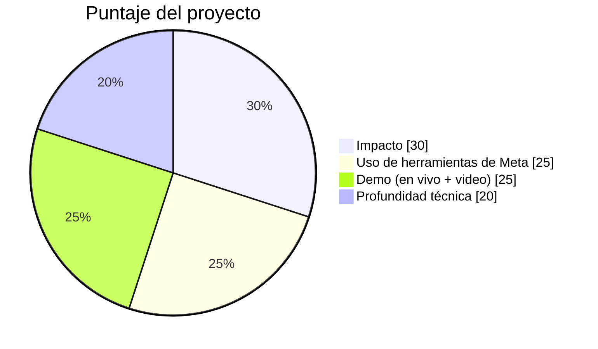
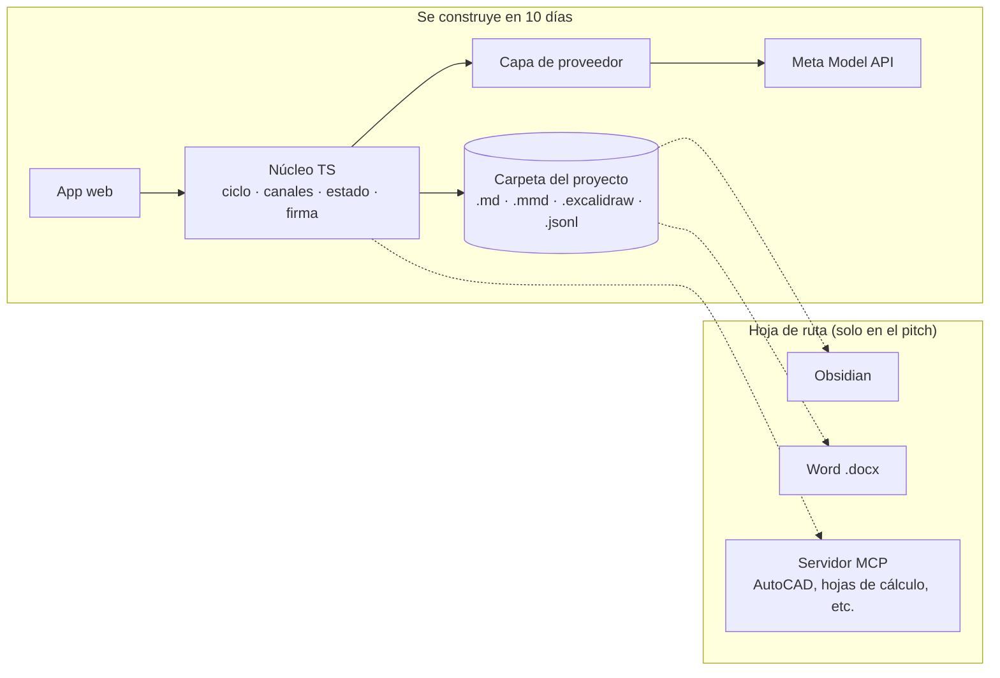
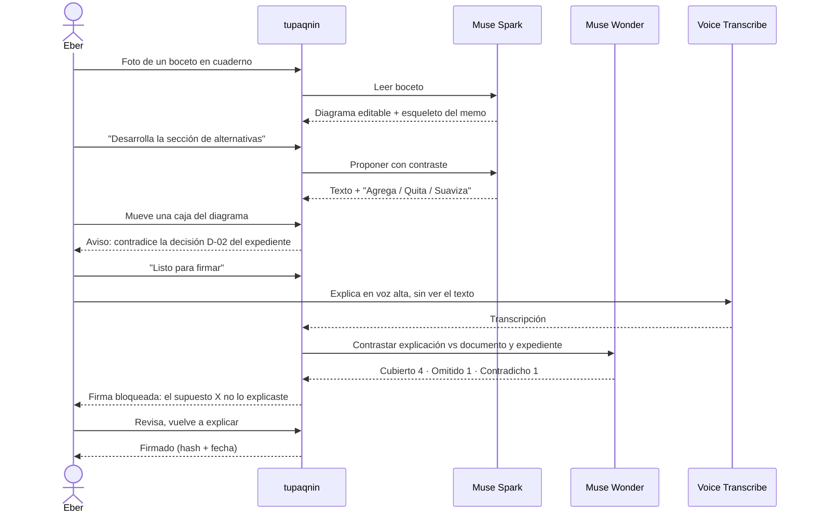
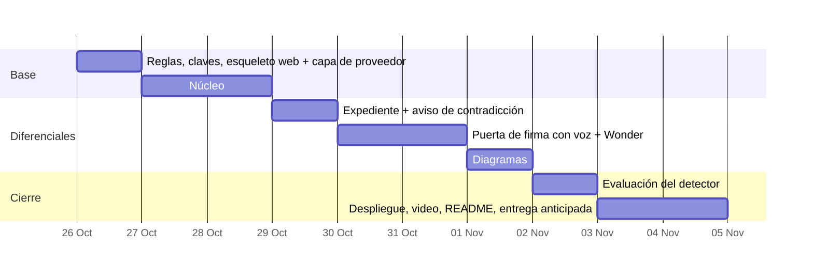

# 11 · tupaqnin en el Meta Global AI Developer Hackathon

Marcas de evidencia: **[V]** verificado en fuente oficial · **[S]** fuente secundaria · **[J]** juicio propio.

## 1. Lo que cambia respecto al doc 10

| Tema | Doc 10 | Ahora |
|---|---|---|
| Motor de IA | API de Anthropic (Haiku/Sonnet/Opus) | **Modelos de Meta** (Muse Spark / Muse Wonder). El hackathon se construye sobre Meta Model API, Muse Code o los modelos abiertos de Meta [V] |
| Primera interfaz | Plugin de Obsidian | **App web propia**, con archivos compatibles con Obsidian (ver §4) |
| Horizonte | Uso propio, validar con un documento real | 10 días, demo pública, jurado internacional |
| Lo que se conserva | Núcleo en TypeScript independiente de la plataforma, canales separados, firma humana, expediente | Igual. El hackathon no cambia el diseño, cambia el orden |

El cambio de motor es barato: Meta Model API es compatible con los SDK de OpenAI y de Anthropic cambiando solo la URL base [V]. El núcleo debe tener una capa de proveedor desde el día 1.

## 2. Datos del hackathon que importan

- **Fechas** [V]: construcción del 26 oct al 4 nov; entrega **4 nov, 21:00 ET = 21:00 hora de Lima** (Lima no cambia de horario; ET pasa a UTC-5 el 1 nov). Juzgamiento 4–8 nov; final en vivo y ganadores el 9 nov.
- **Premios del track Indie** [S, según el waiver]: 1.º $150k · 2.º $100k · 3.º $75k · 4.º $50k · 5.º $25k. Bonos aparte (hasta $50k, p. ej. voto de la comunidad o proyecto más viral), anunciados ~10 nov.
- **Lente del track Indie** [V]: creatividad, ambición técnica y que funcione.
- **Pesos de evaluación** [S, del waiver vía guía secundaria; confirmar en las Reglas Oficiales]:

- **Créditos**: $150 en Meta Model API por participante [S].
- **Temas** [V]: *Build for Your World* (resolver un problema que conoces de primera mano, liberar tiempo y espacio mental) o *Push the Frontier*. **tupaqnin encaja en Build for Your World** casi palabra por palabra.
- **Pendiente**: las Reglas Oficiales (formato del video, si el repo debe ser público, campos de entrega) salen antes del 26 oct. Revisarlas el día 1.
- **Propiedad** [S]: conservas la propiedad, pero otorgas a los organizadores una licencia perpetua y no exclusiva; nada de lo compartido es confidencial. **No usar el marco GEE ni material de Ceplan en la demo.**
- **Elegibilidad** [V]: excluye a personas "afiliadas al gobierno". Ya no estás en CEPLAN; conviene confirmar cómo definen el término cuando salgan las Reglas.

## 3. Cómo se gana: traducir el puntaje a decisiones de diseño

| Criterio | Qué buscan | Implicancia para tupaqnin |
|---|---|---|
| Impacto (30 %) | Quién se beneficia y cuánto; si podría usarse de verdad | Presentar el problema con un caso que el jurado reconozca (ver §6) y con usuarios más allá de ti: analistas, ingenieros, médicos, estudiantes de tesis |
| Uso de Meta (25 %) | Ir más allá de una integración básica; mostrar capacidades inesperadas | Usar **cuatro** capacidades de Meta, cada una con una función que no sería posible sin ella (§5) |
| Demo (25 %) | Que funcione en vivo y un buen video | Un solo recorrido de 3 minutos con un momento de "falla atrapada" (§6). Link probable por el jurado |
| Profundidad técnica (20 %) | Ingeniería sólida y refinada | Una evaluación pequeña y honesta del detector de comprensión (§7), más la separación de canales por construcción |

[J] Lo que más diferencia a tupaqnin no es "un agente que escribe documentos" (eso existe en todos lados), sino **la puerta de comprensión**: el humano explica sin mirar y el sistema detecta qué no entiende antes de firmar. Todo el plan gira alrededor de que ese momento se vea en la demo.

## 4. Plataforma: app web propia, con archivos portables

Tus dos argumentos apuntan al mismo lugar: quien redacta documentos vive en Word/Docs, y los especialistas (ingenieros, médicos) necesitarán conectar con sus herramientas (AutoCAD, etc.). Ninguna de las dos cosas la da bien un plugin de Obsidian. Para el hackathon pesa además un tercer factor: **el jurado debe poder abrirlo sin instalar nada**.

| Opción | Jurado puede probarlo | Diagramas | Conexión futura con otras apps | Esfuerzo en 10 días |
|---|---|---|---|---|
| Plugin de Obsidian | Solo por video (instalar Obsidian + BRAT) | Mermaid y Excalidraw vía plugins | Limitada a lo que permite Obsidian | Medio |
| Complemento de Word / Google Docs | Requiere cuenta y permisos | Pobre (imágenes estáticas) | Atada a la suite | Alto |
| **App web propia** | **Sí, con un link** | **Mermaid + Excalidraw embebidos** | **Total (MCP, API, exportes)** | Medio |

**Propuesta:** app web (TypeScript, React) que guarda todo como archivos abiertos:

- documento en Markdown, mapas en Mermaid/Excalidraw, expediente en Markdown + JSONL;
- la carpeta de un proyecto se puede abrir tal cual en Obsidian (tu flujo actual no se pierde);
- exportar a .docx al final, para quien entrega en Word.

Obsidian pasa a ser un adaptador posterior, no se descarta. La conexión con AutoCAD u otras apps va en el pitch como hoja de ruta (servidor MCP), no en el build.

## 5. Uso de los modelos de Meta: cada uno con una función propia

| Capacidad de Meta | Función en tupaqnin | Por qué no es "integración básica" |
|---|---|---|
| **Muse Spark 1.3** (texto, imágenes, PDF; razonamiento ajustable; salida estructurada) [V] | Coescritura: propone, escribe en el borrador y explica con contraste; detecta contradicciones con el expediente; genera y lee diagramas | Razonamiento bajo en chequeos rápidos, alto en propuestas: enrutamiento por tarea dentro del mismo modelo |
| **Muse Wonder 1.0** (el más capaz) [V] | Solo en la puerta de firma: contrasta tu explicación con el documento y el expediente | Modelo caro reservado para el momento crítico; mismo patrón que Opus en el doc 10 |
| **Muse Voice Transcribe** (25 idiomas, incluye español, tiempo real) [V] | **Explicar sin mirar, en voz alta**: hablas 1–2 minutos y el sistema evalúa qué cubriste, omitiste o contradijiste | Convierte un control de comprensión en algo natural (explicarlo como a un colega). Es la capacidad "inesperada" |
| **Comprensión de imágenes** de Muse Spark [V] | **Del boceto al diagrama**: fotografías un esquema hecho a mano (cuaderno, pizarra) y aparece como diagrama editable vinculado al texto | Lleva el canal visual del humano al documento, en la dirección humano → agente |

Opcional (solo si sobra tiempo): **SAM 3.1** para recortar y señalar partes de una imagen técnica (un plano, una captura de AutoCAD) que el texto menciona. [J] Agrega puntos de "uso de Meta", pero no lo pongas en el camino crítico; forzar un modelo sin una función clara resta.

**Costo** [V para precios, J para el estimado]: Spark cuesta $1,25 / $4,25 por millón de tokens de entrada/salida y $0,15 en caché; Wonder $4 / $20; voz $0,18 por hora. Una sesión de demo completa (coescritura con caché + una firma con Wonder + 3 min de voz) queda bajo $1. Los $150 de crédito alcanzan holgadamente para desarrollo, evaluación y la demo pública con un tope.

**Usar modo Standard, no Contributor.** Contributor abarata mucho pero permite a Meta entrenar con tus prompts y documentos [V]; es incompatible con el discurso de "tu documento, tu firma".

## 6. La demo (25 % del puntaje + gran parte del impacto)

**Mensaje central (en inglés para el jurado):** *"Sign only what you understand."*

**Gancho de impacto, con un caso real:** en 2025 Deloitte Australia tuvo que reembolsar parte de un informe de AU$440 000 al gobierno australiano por errores aparentemente generados con IA, como referencias a investigaciones inexistentes y una cita inventada de un fallo judicial. El problema no fue usar IA: fue que nadie que firmó el informe lo entendía lo suficiente como para notarlo.

Recorrido de 3 minutos, con un documento ficticio pero realista (un memo de evaluación de política pública):

Claves del video:
- **El momento de la falla** (firma bloqueada) es lo que el jurado va a recordar. No lo escondas; es el producto.
- Mostrar el costo en pantalla (barra de estado) refuerza "funciona y es barato".
- 10 segundos finales con un segundo dominio (p. ej., un documento de diseño de ingeniería) para mostrar alcance.
- Interfaz bilingüe; video en inglés con subtítulos. Tu historia personal (economista en Lima, deuda cognitiva con agentes) va en los primeros 15 segundos.

## 7. Profundidad técnica: una evaluación pequeña y honesta

[J] Lo que más credibilidad da a un proyecto individual es medir. Propuesta para 1 día de trabajo:

- Tomar 3 documentos de prueba y escribir ~30 explicaciones habladas o escritas, cada una con fallas sembradas a propósito (omitir un supuesto, invertir una relación causal, contradecir una decisión del expediente).
- Medir cuántas fallas detecta la puerta (precisión y exhaustividad) con Spark y con Wonder, y su costo.
- Reportar el resultado tal como salga, incluso si un modelo más barato basta. Un número honesto pesa más que una afirmación grande.

Esto también te deja un hallazgo útil para el diseño: si Spark detecta igual de bien, la firma se abarata.

## 8. Alcance y plan de 10 días

**Debe estar (sin esto no hay demo):**
1. Editor con borrador + panel del agente; el agente escribe propuestas con contraste y "Agrega / Quita / Suaviza".
2. Expediente mínimo: decisiones confirmadas + aviso de contradicción.
3. Puerta de firma con voz (Voice Transcribe) y contraste con Wonder; estado único (borrador / lista para firmar / firmada / cambió desde la firma).
4. Demo pública con link, documento de ejemplo precargado y tope de gasto.

**Debería estar:** diagrama editable vinculado al texto (Mermaid generado por el agente, editable en Excalidraw); boceto fotografiado → diagrama.

**Fuera del hackathon:** matriz de alternativas, grafo de dependencias, ida y vuelta con Word, Obsidian, MCP, SAM.

Regla de corte [J]: si al **31 oct** la puerta de firma con voz no funciona de punta a punta, se elimina todo lo de "debería estar" y se pule solo el recorrido principal. Entregar el **4 nov a mediodía**, no a las 21:00.

Para los bonos (comunidad/viral): publicar avances cortos en LinkedIn y X durante la semana (un clip de la firma bloqueada vale más que cualquier texto). Tu red latinoamericana en español es una ventaja para el voto de la comunidad.

## 9. Riesgos

| Riesgo | Mitigación |
|---|---|
| 10 días en solitario, en paralelo a la búsqueda laboral | Alcance cortado arriba; regla de corte del 31 oct |
| Voz en el navegador (WebSocket, audio PCM a ritmo real) más difícil de lo previsto | Plan B: grabar y enviar el archivo completo al endpoint de transcripción (hasta 10 min) [V] |
| Clave de API expuesta en una demo pública | Backend mínimo que guarda la clave, con límite de uso; opción "trae tu propia clave" |
| Las Reglas Oficiales exigen algo no previsto (repo público, duración del video) | Revisarlas el 26 oct antes de escribir código |
| Muse Wonder sigue en *preview* [V] | Si falla, la puerta usa Spark con razonamiento alto (la evaluación de §7 dice cuánto se pierde) |
| Material sensible en la demo | Solo documentos ficticios; nada de Ceplan ni del marco GEE |

## 10. Decisiones para Eber

1. **Plataforma para el hackathon.** Opciones: app web propia / plugin de Obsidian. **Recomiendo app web** con archivos compatibles con Obsidian.
2. **Motor.** Muse Spark para trabajo continuo y Muse Wonder solo en la firma, en modo Standard. Esto **reemplaza** la decisión 1 del doc 10 mientras dure el hackathon; la capa de proveedor permite volver a Anthropic después.
3. **Puerta de firma por voz como pieza central.** Recomiendo que sí; es el uso más original de las herramientas de Meta y el momento más claro de la demo.
4. **Caso de la demo.** Opciones: memo de política pública (tu dominio) / documento de diseño de ingeniería / ambos. **Recomiendo el memo como recorrido principal** y 10 s de ingeniería al final.
5. **Plugin de Claude Code y `tq` en Python.** Recomiendo congelarlos durante el hackathon; la lógica que sirva pasa al núcleo TypeScript (ya era la recomendación del doc 10).

## Fuentes

- [Página oficial del hackathon (Cerebral Valley)](https://cerebralvalley.ai/e/meta-ai-developer-hackathon)
- [Guía con premios y pesos de evaluación (ReconScribe)](https://reconscribe.com/meta-global-ai-developer-hackathon-2026/)
- [Meta Model API — visión general](https://dev.meta.ai/docs/overview)
- [Meta Model API — precios y límites](https://dev.meta.ai/docs/pricing-rate-limits)
- [Muse Voice Transcribe — voz a texto](https://dev.meta.ai/docs/speech-to-text)
- [AP vía CTV News — reembolso de Deloitte Australia](https://www.ctvnews.ca/business/article/deloitte-to-partially-refund-australian-government-for-report-with-apparent-ai-generated-errors/)
