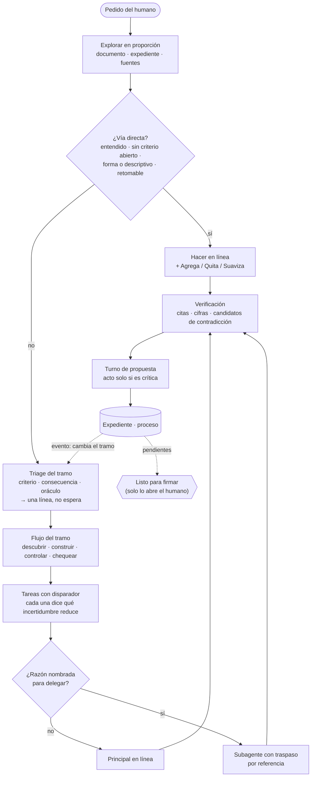
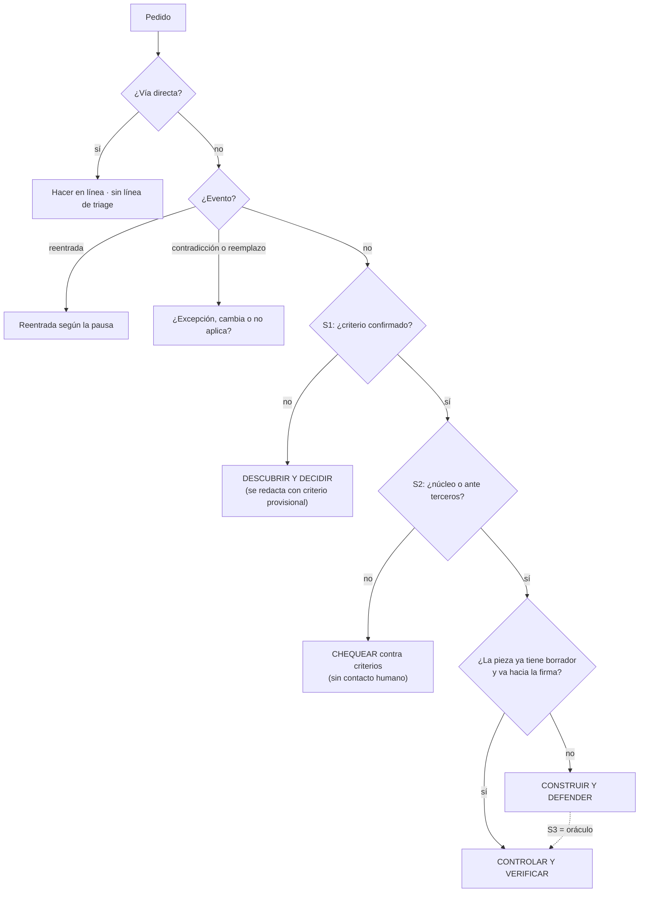
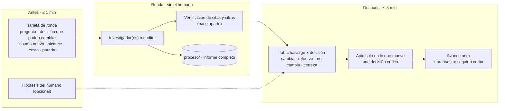
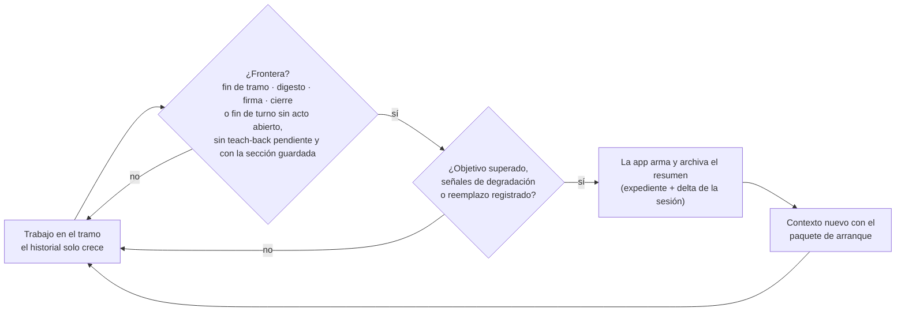
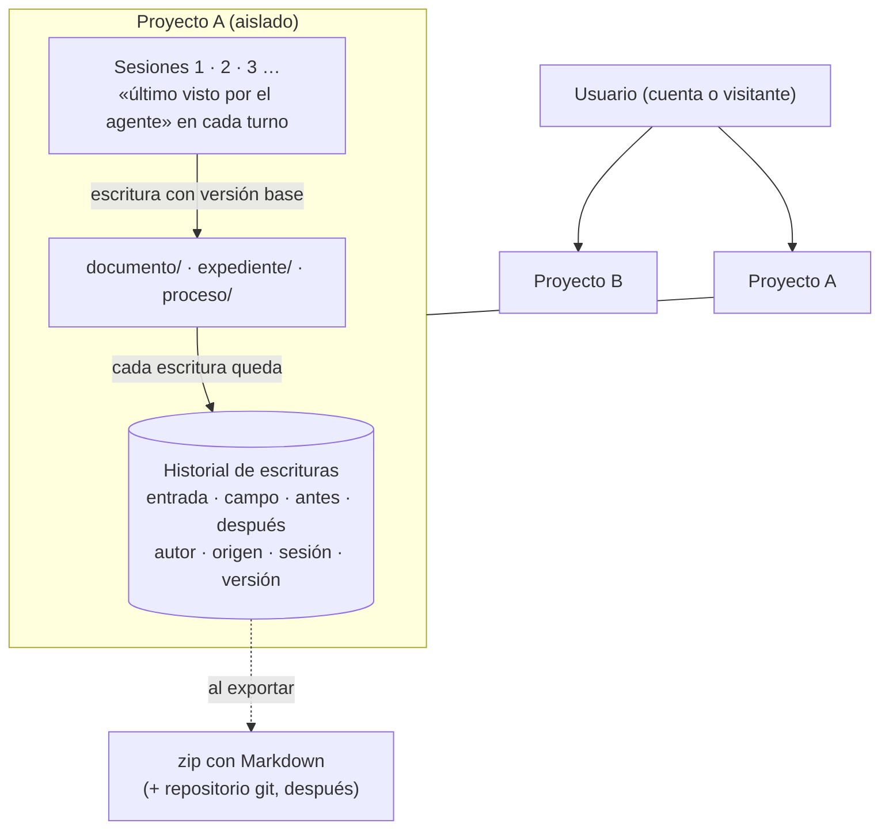

# 12 · Flujo de funcionamiento de tupaqnin

*Cómo trabaja tupaqnin cuando una persona cocrea un documento con él:*
- *cómo clasifica cada pedido y qué cambia según el tramo;*
- *dónde interviene el humano y con cuánto esfuerzo;*
- *qué agentes existen y con qué modelo y esfuerzo;*
- *cómo se organizan las rondas de investigación y auditoría;*
- *qué verificación protege contra alucinaciones;*
- *cómo se evita acumular documentos.*

*Etiquetas: `[fuerte]` `[moderada]` `[débil]` `[práctica]` (observado en los casos 01–02 o en gentle-pi) `[inferencia]`. Referencias a gentle-pi: HEAD 51b766d (24-oct-2026).*

## 0. Resumen

- **Un agente principal conduce con el humano.** Delegar exige una razón nombrada; si no hay razón, todo se hace en línea. `[práctica]`
- **El triage clasifica el tramo, no el proyecto.**
  - Usa tres señales que el agente lee del estado: criterio, consecuencia y oráculo.
  - Muestra el tramo en una línea que no espera respuesta; el humano la corrige con una palabra.
  - Los pedidos simples van por una vía directa, sin triage visible. `[práctica]` `[inferencia]`
- **El principal conduce y coescribe; delega lo que se lee y lo que se juzga, no lo que se escribe y se explica.** El tamaño de una tarea nunca dispara una delegación: la disparan cinco razones que mide la app (§5.2). `[práctica]` `[moderada]`
- **Agentes: dos subagentes.** Un investigador-lector y un juez adversarial; el resto son funciones acotadas.
  - El investigador-lector busca en la web o lee dentro del proyecto, incluidas las fuentes que sube el humano. Las lecturas transversales y las lecturas pesadas salen del principal.
  - La verificación de citas y cifras es una capacidad de la app, no un agente.
  - El análisis de la sección activa y el explicador son capacidades del principal.
  - El limpiador es una regla sobre dónde se escribe. `[práctica]` `[moderada]`
- **El principal no recuerda: relee.** Arranca, y se reinicia en las fronteras de trabajo, con un paquete que la app arma desde el estado y el expediente. Lee las secciones a demanda y trabaja con un presupuesto de contexto chico.
  - La memoria del agente (con la forma de Engram) guarda punteros, lecciones y resúmenes de sesión; nunca criterios ni decisiones.
  - Dentro de un tramo el historial solo crece; la única poda es el reinicio. Lo que está en vuelo (acto abierto, predicción del teach-back, último turno de propuesta) lo guarda la app.
  - Nada que deba defenderse vive solo en la conversación. `[fuerte]` `[práctica]`
- **Construir y correr el oráculo nunca esperan al humano.** Lo que exige un acto suyo son la firma y las rebajas de contacto (DEC-003).
- **Toda ronda tiene tarjeta antes y digesto después.**
  - Se lanza sola si cabe en el tope de sesión y no rige una autorización anticipada; si no, queda propuesta.
  - El avance se mide neto: lo resuelto menos lo creado. Si no avanzó, se propone cortar. `[práctica]` `[moderada]`
- **Modelo y esfuerzo por rol, siempre explícitos.** Spark en todos los roles, con el esfuerzo de cada tarea; Wonder en el contraste de la firma y como opción de perfil para el principal. Lo confirma una micro-prueba propia, porque no hay comparación pública de Wonder `medium` frente a Spark `high` (§10.1). `[fuerte]` (documentación oficial) `[inferencia]`
- **Nada se escribe fuera de cuatro lugares:** documento, expediente, proceso y un scratch de sesión. Los subagentes devuelven traspasos, no archivos. `[práctica]`

## 1. Principios del flujo

Además de los principios del [planteamiento](../planteamiento.md) §3 y de DEC-003, el flujo se rige por seis reglas operativas.

| Regla | Por qué | Evidencia |
|---|---|---|
| **En línea por defecto; delegar solo con una razón nombrada** (§5.2) | En los casos sobraron roles; pocas funciones atraparon errores reales | Caso 02: 40 o más roles de subagente (caso-02 `notas.md` §4); caso 01: una docena de funciones por ciclo (caso-01 `etapa2.md` §2) `[práctica]`. Que solo el recálculo, el inventario de contradicciones, una auditoría adversarial y la verificación de fuentes detectaran errores es una lectura de esos registros `[inferencia]`. En gentle-pi, un bug de 3 líneas pasó de 335 s a 77 s resuelto en línea (`README.md` §Measured, n=1) `[práctica]` |
| **Traspaso por referencia, nunca por paráfrasis** | Una especificación parafraseada dejó 13 de 26 pruebas fallando; pasada por referencia, las aprobó todas | gentle-pi `README.md` §Measured, PR #1718 (n=1) `[moderada]` |
| **Toda tarea nace de un disparador y declara qué incertidumbre reduce** | Los ciclos giraban porque no entraba nada nuevo: DES010–012 con mérito «indeterminado», y 5 de 28 ciclos dedicados al propio protocolo | caso-01 `etapa2.md` §4; caso-02 §3; L-09 `[práctica]` |
| **Verificar con señal externa antes que con opinión** | La autocorrección sin señal externa no mejora y a veces empeora | Huang et al. 2023; Kamoi et al. 2024 `[fuerte]`. Una herramienta determinista bajó las URL que no resuelven a menos del 1 %, según la competencia del modelo con herramientas (Rao et al. 2026, preprint) `[moderada]` |
| **Lo intermedio no se escribe como documento** | Cada rol dejaba un documento: la depuración bajó de 619 a 86 archivos y en unas dos horas volvió a 421 | caso-01 `etapa2.md` §4 `[práctica]` |
| **El principal trabaja con contexto chico y no recuerda: relee** (§9) | La calidad cae mucho antes de llenar la ventana nominal, y en trabajo de varios turnos el modelo se ancla en sus propias respuestas | NoLiMa y RULER: la mayoría de los modelos cae con fuerza ya a 32k tokens; Laban et al. 2026: −39 % de media en conversaciones de varios turnos `[fuerte]`. En gentle-pi el padre no se degrada porque el estado vive en un documento que relee (`assets/orchestrator-memory.md`) `[práctica]` |

## 2. Triage: clasificar el tramo antes de actuar

### 2.1 La zona va por tramo, no por proyecto

Un mismo documento pasa por varias zonas del [cuadrante de 01](01-cuello-de-botella-humano-agente.md): se descubre al encuadrar, se construye al redactar y se controla al firmar ante terceros.
- Cada etapa del caso 01 tuvo un dolor propio (diagnóstico §2).
- El reparto de quién genera cambia por fase ([04](04-acervo-mecanismos.md) §2).
- gentle-pi tampoco clasifica una sola vez: vuelve a clasificar cuando algo cambia (`assets/orchestrator.md:53`).

`[fuerte]` en los documentos; `[inferencia]` como regla.

Del proyecto solo queda el **destino**: `uso propio` o `ante terceros`. Se fija al crear el proyecto y se cambia a mano. Define el techo de consecuencia y si corre el juicio adversarial automático (§6.3). La puerta de firma es la misma con los dos destinos (diseño v1 §3).

**Tramo** = pieza (sección) × fase. El cuadrante es vocabulario para el humano; la decisión la toman tres señales observables.

### 2.2 Señales

| Señal | Valores | De dónde sale |
|---|---|---|
| **S1 · Criterio de la pieza** | ninguno · provisional · confirmado | `criterios.md` y `decisiones.md` |
| **S2 · Consecuencia de la pieza** | forma · descriptivo · núcleo · ante terceros | Regla mecánica del diseño v1 §2.2: una cifra, una conclusión, una recomendación o un cambio que afecta dos o más secciones cuenta como núcleo. El destino pone el techo |
| **S3 · Oráculo** | sí (cálculo, dato, render, fuente consultable) · no | Contenido de la pieza (diseño v1 §2.5) |
| **Eventos** | reentrada · contradicción con un criterio o decisión · **criterio o decisión reemplazado o revocado** · cambio de alcance | `humano.jsonl` · `tq check` · lista de secciones |

Ninguna señal exige preguntarle al humano. Los conteos (páginas, fuentes, secciones) nunca clasifican (gentle-pi `assets/orchestrator.md:37`).

**Reemplazo o revocación.** Cuando un criterio o una decisión se reemplaza, `tq check` busca candidatos de contradicción en **todas** las secciones y decisiones que lo citan o comparten sus términos, no solo en los párrafos que cambiaron. Una sección firmada que dependía de lo reemplazado pasa a «cambió desde que la firmaste». Es la reversión silenciosa vista desde el otro lado: un criterio nuevo que nunca alcanzó lo ya escrito.

### 2.3 Regla de mapeo

- **Vía directa.** El pedido se entiende, no toca un criterio abierto ni una pieza núcleo, y se podría terminar con el pedido, el diff del documento y el expediente. Es la prueba de reanudación de gentle-pi aplicada a documentos (`assets/orchestrator.md:31-37`). Cubre la mayoría de los pedidos de forma, y también pasa por el chequeo de contradicciones.
- **Qué ve el humano.** Una línea dentro del primer turno, por ejemplo: `Tramo: construir · «Brecha de cobertura» · criterio confirmado · núcleo · con oráculo → corro el cálculo primero.`
- **Quién decide.** El agente clasifica y no espera confirmación: eso sería una compuerta (L-06), y un «ok» no confirma nada (L-02). El humano corrige con una palabra («es núcleo», «explorar») y la corrección queda como dato de su criterio.
- **Qué cuenta como confirmado.** Para S1 y para la excepción de cifras (§4.1), «confirmado» exige un acto:
  - juzgar el caso del teach-back con una razón, o
  - responderlo antes de ver la predicción del agente.

  Un «sí» deja el criterio provisional (rige el diseño v1 §2.3). Construir no depende de esto: el criterio provisional basta para redactar (DEC-003 §1).
- **Cuándo se reevalúa.** Solo ante un evento:
  - aparece una pieza nueva;
  - un criterio se confirma o se reemplaza;
  - aparece un oráculo;
  - la pieza entra a pendientes de firma;
  - hay reentrada o corrección humana;
  - el alcance crece.

  Nunca turno por turno.
- **Ante la duda que una mirada acotada no resuelve, se sube la consecuencia.** Bajarla crea deuda; subirla solo agrega fricción, que el humano baja con una palabra (adaptado de gentle-pi `assets/orchestrator.md:41`). `[inferencia]`
- **Red de seguridad.** La red es la corrección de una palabra más la subida ante la duda. No hay una red independiente de la regla mecánica de criticidad. Una decisión escrita como afirmación («usamos X») puede escapar a esa regla: queda como riesgo abierto (§14).

### 2.4 Casuísticas que aplican a documentos

| Casuística | Tratamiento |
|---|---|
| C1, C8, C10 | Núcleo, tramo *descubrir*. Corresponde a los huecos H1, H3 y H4 de 04 §8: no existe un objeto criterio vivo |
| C2 | Núcleo, tramo *construir* |
| C11 | Evento de reentrada, no zona |
| C6, C12 | Destino del proyecto: fija el techo de consecuencia |
| C9 | Condicional: piezas con cifras calculadas; es el caso que tiene oráculo |
| C0 | Tramo automático: chequeo contra criterios confirmados |
| C5 | Cambia de sentido: es el agente quien eleva una decisión al humano, con su contexto |
| C3, C4 | No aplican: lo único irreversible es la firma o la entrega, y ya tienen su puerta |
| C7 | Excluido para escribir (un solo frente, diseño v1 §0); permitido para leer (investigadores en paralelo) |

`[moderada]`

## 3. Flujo por tramo

| | Descubrir y decidir | Construir y defender | Controlar y verificar | Chequear (sin contacto) | Evento: reentrada |
|---|---|---|---|---|---|
| **Fases** ([04](04-acervo-mecanismos.md) §2) | Encuadre, ideación, exploración, criterios | Construcción | Revisión, cierre y defensa | Forma | Cualquiera |
| **Quién genera primero** | El humano, si quiere (invitación, no bloqueo); luego el agente diverge y redacta con el criterio provisional | El agente redacta; el humano decide lo clave | El agente prepara la evidencia; el humano predice y explica | El agente | El agente, con la nota |
| **Ciclo que predomina** | Divergir → reaccionar → formular el criterio | Pasos pequeños del ciclo de cocreación | Oráculo, verificación de afirmaciones, una crítica independiente | Ajuste a los criterios confirmados | Reconstruir el modelo mental |
| **Fricción informativa** | Variantes que difieren en una sola dimensión; matriz alternativas × criterios | Contraste («en vez de B…»), Agrega / Quita / Suaviza, «Dudo de x» | Frecuencias en vez de adjetivos; nivel de evidencia por afirmación | Un aviso agregado | Estado en 1–3 líneas y qué cambió |
| **Acto humano** | Elegir con una razón; teach-back cuando nace un criterio | Un acto de una línea, solo en decisiones críticas | **Predecir** antes de ver el resultado del oráculo; puerta ≤ 5 min por sección | Ninguno | Un caso nuevo si la pausa supera los 7 días |
| **Riesgo de deuda** (diagnóstico §1) | Se crea: criterio en paráfrasis, investigación no digerida | Se acumula: versión sobre versión no comprendida, reversión silenciosa | Se consolida: cierres que congelan, retiro del humano | Deriva: se aplica un criterio que ya cambió | Releerlo todo |
| **Sale del tramo cuando** | El criterio se confirma (mientras tanto se construye con el provisional) | No quedan decisiones críticas sin acto, o aparece un oráculo | La pieza es firmable o vuelve a descubrir | No hay hallazgos, o uno reabre un criterio | Vuelve al tramo previo |

**Tipos de tarea por tramo.** No hay un plan fijo de investigar → analizar → proponer → auditar. Cada tarea entra a la lista solo si se cumple su disparador.

| Tramo | Tarea | Disparador | Incertidumbre que reduce |
|---|---|---|---|
| Descubrir | Entrevista de encargo | Sin encuadre | Qué se pide y para quién |
| | Divergir variantes | Sin criterio | Qué opciones existen |
| | Ronda de investigación, según la regla de §6.1 | Afirmación núcleo sin fuente, o pregunta abierta del humano | Qué dice la evidencia |
| | Formular el criterio + teach-back | Hay reacciones sin criterio | Qué quiere el humano |
| Construir | Redactar un paso | Pieza en construcción, con criterio provisional o confirmado | — |
| | Registrar la decisión con contraste | Decisión crítica | Por qué se eligió |
| | Supuestos del cálculo como decisión crítica | Cifra calculada | ¿Con qué supuestos se calculó? |
| | Chequeo de contradicciones | Cada cambio | ¿Se revirtió algo? |
| | Barrido por reemplazo | Un criterio o decisión se reemplaza o revoca | ¿Qué quedó escrito con lo anterior? |
| Controlar | Correr el oráculo | Hay oráculo. Corre siempre; la predicción se pide antes de *mostrar* el resultado, con el alcance de la ficha a la vista (§7.1), y si no llega, el acto queda pendiente | ¿El cálculo sostiene la afirmación, y mide lo que la afirmación dice? |
| | Verificación de afirmaciones (§7) | Ítems de riesgo 1–3 o 5 | ¿Cada cifra y cada cita tienen respaldo? |
| | Juicio adversarial (§6.3) | E1: pieza núcleo ante terceros entra a *controlar*. E2: termina «continúa hasta terminar» con secciones núcleo ante terceros cambiadas. O el humano pide «Auditar» | ¿Qué falla no vio quien escribió? |
| Chequear | Ajuste a criterios | Cambio en una pieza con criterio confirmado | ¿Cumple lo ya fijado? |
| Reentrada | Nota, qué cambió, caso nuevo | Pausa | ¿Qué recuerda el humano? |

## 4. Contacto humano y esfuerzo

### 4.1 Puntos de contacto

**Contacto** = un mensaje del agente que pide respuesta. Leer un turno de propuesta sin pregunta no es contacto, aunque sus minutos sí cuentan.

| Contacto | Acto | Lo dispara | Min por evento | Frecuencia estimada |
|---|---|---|---|---|
| Encuadre | Generar o dibujar (opcional) | El humano; el agente lo invita | 5–15 | 1 por documento |
| Aporte propio (boceto, caso testigo, prueba externa) | El aporte cuenta como acto (L-16) | Humano | 2–10 | 0–2 por sesión |
| Corrección del triage | Una palabra | Humano | < 0,2 | Ocasional |
| Elección entre alternativas | Elegir con una razón | Agente | 1–3 | 0–2 por hora |
| Decisión crítica (incluye los supuestos de un cálculo) | Predecir, reformular o aplicar | Regla de criticidad o el humano | 1–2 | 3–6 por hora |
| Teach-back del agente | Juzgar el caso nuevo | Nace o cambia un criterio | 1–2 | 1–2 por hora |
| Contradicción o hallazgo de auditoría | ¿Error, excepción o no aplica? | Chequeo o auditor | 1–2 | 0–2 por hora |
| Tarjeta de ronda | Ninguno: puede cancelar o ajustar; hipótesis opcional | Agente | ≤ 1 | 1 por ronda |
| Digesto de ronda | Acto solo sobre lo que mueve una decisión crítica | Fin de la ronda | ≤ 5 | 1 por ronda |
| Corte de ciclo | Seguir con una razón; si no hay respuesta, se corta | Ronda sin avance neto | < 1 | Ocasional |
| Reentrada | Leer la nota; un caso nuevo si la pausa supera los 7 días | Inicio | 1 / 3 / 5 | 1 por sesión |
| Puerta de firma | Explicar sin mirar (voz o texto) | Solo el humano | ≤ 5 por sección | 1 por sección |

Las cifras son `[inferencia]` hasta medirlas. Con los máximos de la tabla, una hora con ronda suma unos 32 min, por encima del objetivo del diseño v1 (≤ 15 contactos y ≤ 25 min por hora). Dos reglas lo frenan: un solo acto abierto a la vez (diseño v1 §2.3) y el paso 1 de §4.2, que rige siempre. La Fase 0a lo mide.

**Para no saturar en documentos cuantitativos.** La regla «toca una cifra» marcaría casi cada turno de un documento de economista. Por eso una cifra no genera acto propio cuando ya la cubre una de estas dos cosas:
- un criterio confirmado que fija su **interpretación** (unidad, universo, periodo);
- un oráculo cuyos supuestos ya tuvieron su acto.

**La cobertura no se supone: se comprueba.** El acto sobre los supuestos confirma el cálculo, no que la cifra del texto sea lo que el oráculo mide. Si el agente se confunde de oráculo (otra variable, otro universo o periodo, datos viejos, un cálculo que él mismo escribió y que reproduce su error), la exención daría un falso aseguramiento (§7.1). Por eso la exención rige solo si:
- (a) la capa 1 encuentra el valor normalizado en la salida de una ficha de oráculo vigente, o la cifra cita por id el criterio que la interpreta;
- (b) la capa 2, en contexto nuevo, recibe solo la frase y el alcance de la ficha o del criterio, y responde «corresponde»;
- (c) no cambió ningún dato ni el texto desde el acto.

Si falla cualquiera, la cifra **conserva su acto de una línea**: no se bloquea nada y queda en pendientes como «sin correspondencia comprobada». Un criterio de forma («toda cifra lleva su año») no basta, porque no dice nada de cómo se interpreta la cifra. **Donde no haya capa 2, en el hackathon incluido, toda cifra conserva su acto.** `[inferencia]`, a medir en la Fase 0a.

### 4.2 Presupuesto humano

El humano declara un presupuesto por sesión, en minutos y en $. El presupuesto nunca bloquea.

1. **Siempre, aunque no haya presupuesto declarado:** el agente interrumpe en el momento solo por una contradicción con algo confirmado o por un cambio de premisa que afecta varias secciones. Lo demás se agrupa al final del tramo.
2. Al exceder el presupuesto, lo no crítico pasa a solo informar.
3. Usa un acto más barato: elegir A/B con una razón en vez de aplicar a un caso nuevo.
4. Propone cortar el ciclo o firmar por tramos.

Un acto crítico nunca se descarta. Queda como pendiente, expresado en **minutos de puerta estimados**, para que la deuda futura se vea antes de que la puerta crezca (contrapeso de DEC-003).

**Contra el retiro del humano (L-10):**
- la puerta es barata;
- ante una autorización anticipada hay un único aviso (diseño v1 §10);
- **«continúa hasta terminar» construye hasta una versión revisable y se detiene** (§4.4); no amplía el tope, no lanza rondas, no confirma y no firma;
- al volver, la nota de reentrada abre con las decisiones críticas pendientes, ordenadas por cuántas secciones afectan (campo `afecta`, diseño v1 §5.2).

### 4.3 Voz e imagen

| Momento | Voz | Imagen |
|---|---|---|
| Puerta: explicar sin mirar | Sí (doc 11) | — |
| Encuadre | Sí: contarlo como a un colega | Sí: boceto o pizarra |
| Reentrada de más de 7 días | Sí: responder el caso nuevo | — |
| Hipótesis antes de una ronda | Sí, en una frase | — |
| Objeción estructural | — | Sí: redibujar la relación |
| Elegir en una matriz, contradicciones, cifras | No | No |

- La transcripción es el literal que se registra, y sobre ella se aplica la regla de qué confirma.
- **Todo boceto leído vuelve como teach-back con predicción**, por ejemplo: «leí tu boceto así: A depende de B; con eso, el caso X…». No vuelve como un diagrama ya aceptado. `[inferencia]`
- En el hackathon, la voz se usa solo en la puerta: se graba en el navegador, se convierte a un archivo WAV PCM de 16 kHz y se envía a través del backend. Los demás momentos quedan para después.

### 4.4 «Continúa hasta terminar»

El humano autoriza que el agente construya sin él hasta una **versión revisable**. Detenerse al final no viola DEC-003: no espera una aprobación para seguir construyendo, y cualquier mensaje del humano lo reanuda. Lo que no se hace es parar por una decisión de contenido: ahí rige el criterio provisional.

**Versión revisable**, por cada sección del alcance:
- borrador completo, aunque tenga `[POR ACLARAR]`;
- cada decisión provisional registrada con su contraste, como pendiente;
- `tq check` corrido, con sus candidatos listados;
- los oráculos corridos, con su predicción pendiente;
- los minutos de puerta estimados.

No es «listo para firmar»: le falta el humano.

**Qué decisiones son solo del humano**

| Solo del humano: la rama se estaciona | Provisional: se toma y se marca |
|---|---|
| Ampliar o cambiar el encargo o el alcance | Elegir entre alternativas de contenido |
| Gastar por encima del tope (rondas incluidas) | Redactar con un criterio provisional |
| Cambiar el destino (uso propio ↔ ante terceros) | Supuestos de un cálculo (el acto queda pendiente) |
| Efectos fuera del documento (ítem de riesgo 4) y la firma | Estructura, orden y forma |
| Resolver una contradicción con algo confirmado | Elegir el oráculo (§7.1) |
| Un cambio de premisa que afecta dos o más secciones | — |

Ante una de la izquierda, la rama afectada queda con `[POR ACLARAR]` y el agente sigue con las secciones que no dependen de ella (campo `afecta` y citas a esa decisión). **Para del todo** si no queda ningún frente independiente, o si se trata de un cambio de premisa o de encargo, porque seguir sería construir sobre algo que probablemente cambie (reversión silenciosa). Gentle-pi hace lo mismo: pausa solo lo que depende de lo que falta (`assets/orchestrator-tracking.md:21`). `[práctica]`

**Cuándo se detiene**

| Momento | Qué pasa |
|---|---|
| Al activar el modo | Una línea que no espera: «Entiendo terminar como: secciones X–Y revisables · paro si… · tope $Z · no confirma ni firma». El humano la corrige con una palabra |
| 80 % del tope | No abre unidades nuevas; cierra lo abierto hacia la versión revisable |
| Antes de cada turno | Si el gasto más el estimado del turno supera el 100 %, para al terminar el turno en curso, nunca a mitad de una decisión |
| Al terminar | Para con la versión revisable |
| Ante una decisión solo del humano | Estaciona la rama; para del todo solo en los casos de arriba |

- **Todo cuenta contra el tope:** principal, subagentes, verificación, juicio y búsquedas, en $ (L-12).
- **La deuda de puerta es un medidor, no una parada.** Se muestra siempre. Si el humano fija un umbral opcional, al alcanzarlo el agente no abre piezas núcleo nuevas y propone firmar por tramos (diseño v1 §3.6). Una parada por deuda haría del humano la compuerta (DEC-003: «ni el humano ni el agente son compuerta del avance»).
- **Rondas: no se lanzan**, porque su digesto necesita un acto humano; quedan propuestas. Los hechos puntuales en línea sí, porque son parte de construir.
- **Juicio adversarial: una pasada al detenerse (E2, §6.3)**, solo si hay secciones núcleo ante terceros que cambiaron y su costo cabe antes del 100 %. En uso propio, «Auditar» se ofrece en el parte.

**Al detenerse deja un parte de regreso**, legible en ≤ 5 min: por qué paró y qué haría después; las decisiones solo del humano que lo detuvieron, con sus opciones y las secciones estacionadas; las decisiones provisionales, ordenadas por cuántas secciones afectan; las predicciones pendientes; y los minutos de puerta por sección, el total y el gasto frente al tope. El detalle va a `proceso/`.

`[inferencia]`: los umbrales están sin medir.

## 5. Agentes

### 5.1 Catálogo

| Pieza | Tipo | Cuándo | Entrada | Devuelve |
|---|---|---|---|---|
| **Principal** | Agente: conduce y coescribe | Siempre | Paquete de arranque + secciones leídas a demanda (§9) | Propuestas, análisis de la sección activa, explicación, visuales; juicio sobre lo que devuelve cada subagente |
| **Investigador-lector** | Subagente de solo lectura, de 1 a 4 en paralelo. Dos modos: *web* (búsqueda) y *proyecto* (documento, expediente, `proceso/` y **fuentes que subió el humano**: PDF y textos) | Web: la búsqueda excede el presupuesto de evidencia del principal y se cumple la regla de rondas (§6.1). Proyecto: una lectura transversal o una lectura pesada (D2 y D5, §5.2) | Encargo pasado por referencia (§5.3), con ids y versiones | Web: digesto de ≤ 2k tokens, con el informe completo al canal de proceso. Proyecto: ≤ 2k tokens de pasajes y hechos localizados (sección o fuente, versión, pasaje y razón), **sin opciones ni recomendación**. En modo proyecto no lee `proceso/agente/` (lo impide la herramienta), amplía los candidatos de `tq check` y nunca los filtra, y tiene un presupuesto propio de ~40k: si lo excede, se parte por secciones y el principal juzga el impacto con todos los pasajes juntos |
| **Verificación de afirmaciones** | Capacidad de la app (capa 1) + verificador LLM acotado (capa 2) | Ítems de riesgo 1–3 o 5 (§7) | Afirmación + pasaje **obtenido por la app**, sin borrador ni conversación | Respaldada · no respaldada · fuente inexistente · no se pudo comprobar (motivo) |
| **Juez adversarial** | Subagente de solo lectura, dos lentes en un mismo encargo, una pasada | E1, E2 o a pedido (§6.3) | Pieza vigente congelada + decisiones y criterios + fuentes + cifras eximidas con su ficha | Filas de hallazgos localizados (pasaje + razón + severidad) y el mejor caso de la alternativa descartada |
| **Contraste de firma** | Llamada aparte con Wonder, en contexto nuevo (nunca hereda la conversación) | Puerta de firma | Solo la explicación del humano + la sección vigente + sus decisiones | Cubierto · omitido · contradicho, cada uno con su pasaje |
| **Boceto → diagrama** | Función acotada sobre imagen | Aporte visual del humano | Imagen + secciones y decisiones vigentes | Mermaid o Excalidraw, con los nodos sin ancla marcados, más un teach-back |

**Lo que se descartó como agente:**

| Sugerido | Destino | Por qué |
|---|---|---|
| **Orquestador puro** (el principal solo coordina) | Se rechaza: el principal conduce y coescribe | Quien redacta la frase que el humano lee es quien la defiende en el turno siguiente (DEC-003 §2). Un escritor aparte ahorra contexto, pero obliga al principal a explicar de segunda mano y suma llamadas y latencia en el turno más frecuente, construir. Evidencia: en tareas secuenciales, todas las variantes multiagente bajaron el rendimiento entre 39 % y 70 % (Kim et al. 2025, preprint) `[moderada]`; Cognition (abr-2026): funcionan los lectores y un revisor en contexto limpio, «when writes stay single-threaded» `[práctica documentada]`. gentle-ai tuvo un orquestador «COORDINATOR, not an executor» en su flujo SDD; lo retiró en v4.0.0 (`internal/assets/retired_workflow_ratchet_test.go:17-19`) tras medir que delegar cada pregunta costaba +46–65 % de tokens y ~3× el tiempo sin ganar calidad (gentle-pi `odd/tasks/lean-delegation-context.md:19-20`, n pequeño). Hoy los dos repos dicen «when in doubt the parent works inline» (gentle-ai `README.md:154`) `[práctica]`. El contexto se cuida con el reinicio en frontera (§9.5) y delegando las lecturas (D2, D5) |
| **Escritor** | En línea, con reinicio en la frontera | Un escritor secuencial con traspaso por referencia no es el caso de redactores en paralelo que Cognition y Anthropic rechazan, pero rompe «quien propone explica» y arrancaría igual con ~20–30k (necesita los criterios y decisiones en literal). Se reconsidera si una prueba con fuentes reales muestra que el principal supera el objetivo **dentro de un solo paso** de construir (§14) `[inferencia]` |
| Analista que propone | Se reparte entre el principal (análisis y opciones) y el investigador-lector en modo proyecto (lecturas transversales y pesadas, que devuelven pasajes, no opciones) | Quien propone tiene que explicar (DEC-003 §2), así que el análisis que lleva a una propuesta se queda en el principal. Lo que necesita muchas secciones a la vez es lo que más contexto consume y lo que más se degrada (§9.1); sale a un lector de solo lectura que devuelve pasajes, no conclusiones. Cognition y Anthropic desaconsejan dividir el contexto entre agentes **que escriben**; un lector de solo lectura con traspaso por referencia es otro caso `[práctica documentada]` `[inferencia]` |
| Auditor «normal» | Se reparte entre la verificación de afirmaciones y el chequeo de contradicciones | Ninguna auditoría vio el error más caro de los casos, la reversión silenciosa (de 7 decisiones sobrevivieron unas 2): apareció dos meses después, al consolidar (caso-01 README §3) `[práctica]` |
| **Consulta experta** (forma compatible del analista) | Después, a medir: el principal consulta a Wonder ante una decisión crítica con dos o más alternativas viables y recibe el análisis para sí; el humano nunca lo ve directo | Cognition: funciona solo si el principal sabe cuándo y qué preguntar `[práctica documentada]` |
| Explicador visual | Plantillas deterministas + regla de elección del principal + la función de boceto | Lo que se muestra (estado, pendientes, cambios, alternativas, impacto) se deriva del expediente sin LLM. Un explicador aparte puede inventar relaciones y rompe «quien propone explica» (DEC-003 §2) `[inferencia]` |
| Limpiador | Regla de runtime (§8) | Limpiar después no frenó la acumulación (619 → 86 → 421). En gentle-pi la limpieza la hace el runtime, no un agente `[práctica]` |

### 5.2 Cuándo se delega

Solo con una de estas razones; si no hay ninguna, el principal trabaja en línea:

| Razón | Qué se lanza |
|---|---|
| **D1 ·** La investigación excede el presupuesto de evidencia del principal: un lote de ≤ 3 llamadas y ~10k tokens, o más de ~5 búsquedas seguidas (gentle-pi `assets/orchestrator-delegation.md:21`) | Investigadores en modo web, según §6.1 y §6.2 |
| **D2 ·** Una **lectura transversal**: barrido por reemplazo (§2.2), impacto de un cambio en dos o más secciones que no son la activa, o consulta a `proceso/` (§9.4) | Un investigador-lector en modo proyecto |
| **D3 ·** Ítems de riesgo 1, 2 o 5 en lo escrito (§7) | La verificación de afirmaciones (capacidad de la app; capa 2 acotada) |
| **D4 ·** Etapa crucial E1 o E2, o el humano pide «Auditar» (§6.3) | Un juez adversarial |
| **D5 ·** Una **lectura pesada**: el paso exige leer más de ~20k tokens de fuentes (estimado por el tamaño de los archivos subidos o citados) | Un investigador-lector en modo proyecto sobre esas fuentes. Los datos tabulares no se leen al contexto: se procesan con código, como oráculo |

**El tamaño de una tarea nunca dispara una delegación**; la dispara una de estas razones (gentle-pi `odd/tasks/delegate-for-reason.md:6`). Todo lo demás se hace en línea, sea cual sea su extensión: redactar una sección larga es en línea y, si se llega al objetivo de contexto, el principal se reinicia en la frontera.

**Siempre en el principal:** lo que el humano lee como propuesta o explicación, y su defensa en el turno siguiente; registrar decisiones con su contraste; el teach-back y los actos; el juicio sobre la salida de cualquier subagente (qué hallazgos pasan, cuáles son los ≤ 3 y si un candidato aplica); y el triage. Ningún subagente habla con el humano. Cada delegación deja en `proceso/` su razón y la medida que la disparó.

Llegar al presupuesto de contexto **no** es una razón para delegar: con un solo frente y sin subagentes que escriban, la «siguiente unidad» suele ser redactar, que no se puede delegar. Al llegar al presupuesto, el principal **se reinicia en la siguiente frontera** (§9.5).

- **Que exista un modelo más barato no es razón para delegar.** gentle-pi lo probó y lo eliminó (`odd/tasks/delegate-for-reason.md`, L51).
- **Tampoco hay redactores en paralelo:** se trabaja un solo frente a la vez (diseño v1 §0).
- **Delegar es una herramienta con una razón enumerada.** La app valida esa razón contra lo que mide: los tokens de `usage` y el número de búsquedas. No puede validar que la razón sea verdadera.
- Es una extensión propia, inspirada en las comprobaciones de admisión de gentle-pi; esas comprobaciones eximen a los subagentes de solo lectura (`docs/readme-reference.md:722-724`). `[inferencia]`

### 5.3 Traspaso por referencia

Todo encargo a un subagente lleva:

- el encargo literal del humano (cita, no resumen) y los identificadores, **con su versión**, de los criterios, decisiones y secciones que aplican. Nunca se pasan solo deltas: el caso 02 tuvo un auditor que recibió una versión vieja y luego solo los cambios (caso-02 `notas.md` §4);
- la pregunta que responde y la decisión o marcador `[POR ACLARAR]` que podría cambiar;
- las fuentes preferidas y excluidas del dominio, y el formato de salida;
- los límites: número de llamadas, tiempo y qué no debe abordar.

En los sistemas de investigación documentados, los encargos vagos causaron trabajo duplicado. Sin indicación explícita, los agentes elegían granjas de SEO antes que fuentes primarias (Anthropic, *multi-agent research system*). `[práctica documentada]`

Las fuentes por dominio son lo que Eber llamó «investigadores tuneados con fuentes»: un archivo de fuentes por proyecto, que el humano puede editar. Meta no filtra dominios en su búsqueda (da HTTP 400 en Messages y no está documentado en Responses). Por eso las fuentes se aplican de dos formas: como instrucción en el prompt y como filtro posterior de la app sobre las `url_citation`.

## 6. Rondas de investigación y auditoría

### 6.1 Ciclo de una ronda

1. **Regla de inicio.** La ronda tiene que nombrar qué entra de nuevo (un dato, una fuente, un caso, un juicio humano o un resultado de oráculo) y qué decisión podría cambiar. Si no lo puede nombrar, se propone no lanzarla. `[práctica]` (caso-01 `etapa2.md` §4: las rondas sin insumo nuevo cerraron en «indeterminado»)
2. **Quién la lanza.**
   - **Se lanza sola, sin esperar respuesta,** si se cumplen tres condiciones: (a) la pidió el humano, o el agente nombra su disparador y su insumo nuevo; (b) su costo estimado cabe en el **tope de sesión**, que es el que declare el humano o, si no declara, el tope por defecto de la app, visible en la barra; (c) no rige una autorización anticipada. La tarjeta se muestra y el humano puede cancelarla o ajustarla; no hace falta un «ok» (L-06).
   - **Queda como propuesta en la nota, sin bloquear la construcción,** si excede el tope (es un compromiso de costo y lo decide el humano, DEC-002), si rige una autorización anticipada o si sería la **tercera ronda sobre la misma pregunta** sin un acto humano de por medio.
3. **La verificación de citas y cifras es un paso aparte, al final**, no mezclado con la generación. En un preprint de 2026, recuperar el registro bibliográfico en una segunda etapa subió las referencias correctas del 51 % al 78 %, con 0,8 % de regresiones; integrarlo en una sola etapa dio 4,8 % de regresiones (Rao y Callison-Burch 2026). `[moderada]`
4. **El digesto es una tabla, no prosa:** pregunta → respuesta corta → qué sección o decisión cambia → contraste con lo confirmado → fuentes verificadas → certeza. La tabla *Summary of Findings* de GRADE subió las respuestas correctas del 11–44 % al 87–93 % y bajó el tiempo para encontrar lo clave de ~4 min a ~90 s (Rosenbaum et al. 2010). `[moderada]`
5. **El informe completo queda en `proceso/`** como entrada de la ronda, no como documento suelto. Se consulta a demanda, siempre a través del investigador-lector en modo proyecto y nunca cargándolo en el principal (§9.4), y no cuenta en la señal de peso (§8). El digesto dice cuánto creció el proceso.
6. **El avance se mide neto:** marcadores y decisiones resueltos menos los creados. Por ejemplo: «esta ronda resolvió 2 marcadores, creó 1 y confirmó 1 decisión». **Si el avance es cero o negativo, el agente propone cortar,** y seguir exige una razón del humano. Es el gesto que funcionó en el caso 02: «no se realizará una nueva ronda» (diagnóstico §4). `[práctica]`

### 6.2 Cuántos investigadores

La regla de esfuerzo va escrita, como en el sistema de Anthropic, y la fija el triage:

| Pregunta | Investigadores | Llamadas por investigador |
|---|---|---|
| Hecho puntual | 0 (el principal, en línea) | ≤ 3; si hacen falta más, sale a un investigador |
| Comparación o pregunta con varias fuentes | 2–4 en paralelo | 10–15 |
| Investigación amplia | Se parte en preguntas, como máximo 2 rondas por pregunta sin un acto humano de por medio | — |

Un sistema multiagente consume unas 15 veces los tokens de un chat, y su fallo típico es lanzar demasiados subagentes o duplicar búsquedas (Anthropic). Por eso el tope por defecto es de 4 investigadores y la tarjeta muestra el costo estimado antes de lanzar. El tope de búsquedas lo impone la app con `max_tool_calls`, porque Meta no permite fijar cupos desde la herramienta. `[práctica documentada]`

### 6.3 Juicio adversarial (Judgment Day adaptado)

Adapta el Judgment Day de gentle-pi (`skills/judgment-day/SKILL.md`). Allí corre solo a pedido, con dos jueces ciegos del mismo modelo, una pasada, filas de hallazgos congeladas por el controlador, corrección mínima de los ids autorizados, re-juicio solo de lo corregido, dos rondas como máximo, y un veredicto que no autoriza la entrega. `[práctica]`

| Judgment Day | En tupaqnin | Por qué |
|---|---|---|
| Solo a pedido | **Automático en dos etapas cruciales y a pedido** (tabla siguiente) | Eber: «en las etapas cruciales de la construcción y disponible para que pueda ser pedido» |
| Dos jueces ciegos | **Un juez con dos lentes en un mismo encargo:** *argumento* (¿la conclusión se sigue de la evidencia y de los criterios?, ¿alguna cifra eximida no corresponde a su oráculo?) y *lector externo* (la objeción más fuerte de un revisor y el mejor caso de la alternativa descartada). Un segundo juez solo si es de **otra familia de modelos** (capa de proveedor) o si se mide que mejora la detección | Varios jueces o un debate de la misma familia no superan de forma fiable a la autoconsistencia (Smit et al. 2024; Zhang et al. 2025) `[fuerte]`; mezclar familias sí ayuda (Verga et al. 2024) `[moderada]`. Ningún dato muestra que un segundo juez de Meta decorrelacione `[inferencia]` |
| Corrige un agente aparte | **El humano clasifica y corrige el principal.** El humano recibe **≤ 3 hallazgos**, ordenados por severidad: «¿error, excepción o no aplica?», con objeción o razón. El principal corrige solo lo marcado como «error» | DEC-002: los compromisos son del humano; la escritura es de una sola hebra. Los críticos LLM inventan errores; humano + crítico inventa menos (McAleese et al. 2024) `[moderada]`. Localizar es lo difícil (Tyen et al. 2023) |
| Re-juicio, dos rondas | **Re-juicio solo de los pasajes corregidos**, en contexto nuevo (Spark `medium`), sin hallazgos nuevos. Una segunda corrección solo si el **mismo** hallazgo sigue fallando. Lo que sobrevive queda como `[POR ACLARAR]` y no bloquea | Sin ese límite, una corrida de gentle-pi hizo ~6 rondas y agotó el tope de 60 min (`odd/tasks/delegate-for-reason.md`, L45) `[práctica]` |
| Veredicto | «Sin hallazgos severos» **no habilita la firma** y no es una compuerta | Una sola puerta (DEC-003); L-06 |
| Alcance congelado | La versión de la pieza queda fijada al lanzar el juicio; si cambia antes de terminar, se descarta | Evita juzgar un blanco móvil (`SKILL.md:47`) |

**Severo** = impediría *listo para firmar* o engañaría a un tercero: contradice algo confirmado, la conclusión no se sostiene en lo citado, una cifra está mal interpretada, o falta una alternativa que un revisor exigiría. El resto se cuenta en el digesto y queda en `proceso/`.

**Cuándo corre**

| Etapa | Disparador que comprueba la app | Destino |
|---|---|---|
| **E1** | Una pieza núcleo **entra a *controlar*** (tiene borrador y pasa a pendientes de firma). Una vez por entrada, no por cada versión: la que crea la propia corrección no lo redispara | Ante terceros |
| **E2** | Se detiene «continúa hasta terminar» con secciones núcleo cambiadas (§4.4). Juzga solo lo que cambió | Ante terceros |
| **A pedido** | El humano pide «Auditar» sobre una pieza, con su versión | Ambos destinos |

- No son disparadores: el reemplazo de un criterio o una decisión (lo cubre el chequeo de contradicciones, sin LLM), cada escritura ni el cierre del encuadre.
- Rigen las condiciones (b) tope y (c) autorización anticipada de §6.1. El costo de un juicio es bajo (~0,05 USD con Spark `high` sobre ~20k de entrada) `[inferencia]`; lo caro son los minutos del humano (§4.1), por eso el tope de ≤ 3.

## 7. Verificación mínima contra alucinaciones

**Ítems de riesgo en documentos.** Adaptan los seis de gentle-pi (`assets/orchestrator.md:41`): un error que sería difícil de detectar, difícil de deshacer o que alcanza a terceros.

1. Una cifra o un dato sin fuente reproducible.
2. Una afirmación atribuida a una fuente (cita, autor, norma).
3. Una contradicción con una decisión o un criterio confirmado, o con un compromiso ante terceros.
4. Un efecto fuera del documento que no se puede deshacer (envío, publicación).
5. El resultado de un proceso computacional sin reproducir. Sus supuestos van como decisión crítica (§3).
6. Un error que ningún oráculo detectaría.

**Tres capas, de la más barata a la más cara:**

| Capa | Qué hace | Cuándo | Evidencia |
|---|---|---|---|
| **1 · Determinista** | Comprueba que la fuente existe (DOI en CrossRef, URL que responde) y que una cita o una cifra normalizada aparece en un texto ya obtenido. Genera los **candidatos** de contradicción de `tq check`, que el principal juzga en su mismo turno (diseño v1 §7) con los pasajes localizados; si los candidatos tocan dos o más secciones, los pasajes los trae el investigador-lector (§9.4) | Siempre que hay ítems 1–3. Los candidatos de contradicción, en cada cambio y en cada reemplazo de un criterio | Las herramientas deterministas bajaron las URL que no resuelven a menos del 1 %, según la competencia del modelo con herramientas (Rao et al. 2026, preprint) `[moderada]`; el inventario de contradicciones fue lo que destapó la reversión del caso 01 `[práctica]` |
| **2 · Verificador LLM acotado** | Juzga si el pasaje sostiene la afirmación. Recibe **solo la afirmación y el pasaje obtenido por la app** (primero los *snippets* de `web_search_call.results`; si no alcanzan, el texto que la app descarga del HTML o del PDF con capa de texto), en un contexto nuevo, sin borrador ni conversación | Ítems 1–2 que la capa 1 no resuelve (paráfrasis, cifras redondeadas), y **toda cifra que va con una afirmación interpretativa** (comparación, tendencia, causa) | Los jueces reconocen y favorecen su propio texto (Panickssery et al. 2024) `[fuerte]`; verificar sin ver el borrador reduce las alucinaciones (CoVe, Dhuliawala et al. 2023) `[moderada]` |
| **3 · Juicio adversarial** | Busca fallas de argumento que la verificación de hechos no ve | §6.3 | Ver §6.3 |

- **Cuarto estado: «no se pudo comprobar (motivo)».** Cubre la página que bloquea, el muro de pago, el PDF escaneado o el PDF de más de 100 páginas (en esos, Meta no extrae texto más allá de la página 100). No cuenta como falla ni crea un requisito de firma: se muestra en pendientes como «sin comprobar», y el humano puede aportar el pasaje (aportar cuenta como acto, L-16) para que pase a la capa 2.
- **Se descarta como ceremonia:**
  - que el redactor se revise en el mismo contexto;
  - varios jueces de la misma familia o un debate entre ellos;
  - las firmas y los hashes de agentes;
  - los aplicadores ciegos duplicados sin oráculo, que en el caso 01 cerraron en «indeterminado» en todas las unidades;
  - las auditorías repetidas sobre los mismos pasajes.

  `[práctica]` `[fuerte]`
- **Lo inferencial nunca bloquea:** se muestra como contraste.
- **Diversidad de modelos.** Mientras haya un solo proveedor (Meta), no hay diversidad de familia. La capa de proveedor permite agregarla después para las piezas ante terceros. `[inferencia]`

### 7.1 Si el agente se confunde de oráculo

Un oráculo (cálculo, dato, render, fuente consultable) es la señal externa más fuerte (L-13), pero solo si mide lo que la afirmación dice. Las confusiones posibles:

| Confusión | Qué la detecta hoy | Qué agrega la ficha |
|---|---|---|
| Mide otra variable, otro universo, periodo o unidad | Casi nada: el número puede coincidir | El `alcance`, visible antes de predecir y comprobado por la capa 2 |
| Fuente o versión de datos equivocada o vieja | Nada, si el número es plausible | `datos` con hash y fecha de corte; caduca si cambian |
| Cálculo correcto sobre datos equivocados | La predicción, solo si el humano espera otra magnitud | `control` (ante terceros) |
| El agente escribió el oráculo y reproduce su propio error | Nada: el mismo error en los dos lados | `autor`; si es el agente, `control` obligatorio ante terceros |
| Criterio de interpretación aplicado a una cifra que no le corresponde | Nada | La exención exige el vínculo por id (§4.1) |
| El texto cambia después de correr el oráculo | `tq check` y las versiones | — |

La más grave es la cuarta: las pruebas que escribe un modelo tienden a validar el comportamiento que observa, también cuando es incorrecto (Konstantinou et al. 2024, cuatro modelos) `[moderada]`, y los modelos favorecen su propio texto (Panickssery et al. 2024) `[fuerte]`. Es el problema del oráculo de las pruebas de software (Barr et al. 2015) `[fuerte]`.

**Ficha de oráculo `ORA-n`** en el expediente, que llena casi entera la app:

| Campo | Quién | Cuándo |
|---|---|---|
| `prueba`: id del pasaje o de la decisión + la afirmación literal | Agente | Siempre |
| `alcance`: variable · universo · periodo · unidad | Agente; el humano lo juzga en el acto de supuestos | Siempre |
| `datos`: fuente, archivo, hash y fecha de corte | App (la fuente, el agente) | Siempre |
| `autor` del cálculo: agente · humano · externo, con la ruta y el hash del script | App | Siempre |
| `control`: un valor publicado por la fuente que el cálculo debe reproducir, con su pasaje | Agente o humano; la app comprueba la coincidencia | Ante terceros, si el autor es el agente |
| `refuta`: qué resultado haría falsa la afirmación | Agente | Ante terceros |

- **Elegir el oráculo no es un acto aparte:** el agente lo propone (sabe más del cálculo, DEC-002), y el acto de supuestos del cálculo cubre también el alcance y la fuente, en una sola pregunta de aplicar («si el universo fuera solo rural, ¿la brecha sube o baja y por qué?»). Pasa a decisión crítica propia solo si contradice una decisión de fuente confirmada, o si falta el control en una pieza núcleo ante terceros.
- **El oráculo del humano** (una cifra publicada, su planilla) es un aporte y cuenta como acto (L-16): es la forma más fuerte de L-13.
- **Predicción.** La tarjeta muestra primero el alcance y el corte de datos, y pide la predicción en esa unidad. Con el humano presente, la vista oculta la cifra hasta que predice o pasa el turno (el archivo ya la tiene: construir no espera); un solo velo abierto a la vez, y nunca una cola de velos al volver de «continúa hasta terminar». Si predicción y resultado difieren en dirección u orden de magnitud, la pregunta no es «¿aceptas?», sino **«¿quién se equivoca: tu expectativa, el oráculo o la afirmación?»**.
- Se descarta un verificador LLM que juzgue cada oráculo completo: repetiría la autoconfirmación de la misma familia (§7).

## 8. Higiene documental

| Regla | Cómo |
|---|---|
| **Superficies cerradas por construcción** | Solo existen herramientas de escritura para los cuatro lugares: documento, expediente, proceso (incluida la memoria del agente en `proceso/agente/`, §9.6, que los subagentes no pueden leer) y scratch de sesión. En gentle-pi, las *Allowed edit surfaces* son una comprobación de admisión, no un guardia de escritura (`docs/readme-reference.md:720`); en una app propia, escribir fuera es imposible |
| **Los subagentes no escriben archivos** | Devuelven un traspaso al principal. El informe completo se guarda como entrada de la ronda en `proceso/` |
| **Un solo vigente por objeto** | Se edita en su lugar y las versiones anteriores se recuperan con git, no con copias «históricas». La inmutabilidad excesiva multiplicó los vigentes en el caso 02 (§4.5) |
| **Scratch de sesión** | Lo efímero de los agentes va a un directorio de sesión que el runtime borra al cerrar (gentle-pi `docs/readme-reference.md:734-742`) |
| **Poda solo determinista y reversible** | Solo en `proceso/`: se mueve a un archivo, no se borra, y queda un manifiesto. Nunca se pide al humano aprobar listas de rutas: la depuración de 518 rutas se aprobó con «ok procedamos» (caso-01 `etapa2.md` §4) |
| **Peso del proceso a la vista** | La señal de peso del expediente y el proceso frente al documento (diseño v1 §10) no cuenta los informes completos de las rondas. El crecimiento de cada ronda se ve en su digesto |

## 9. Contexto del principal y memoria del agente

El principal coescribe, analiza la sección activa y explica, turno tras turno y a lo largo de días. Si trabaja con «el contexto completo», empeora justo cuando más importa. Esta sección define qué carga, cómo se mantiene chico su contexto, cuándo se reinicia y qué recuerda entre sesiones.

### 9.1 Por qué importa

**La calidad cae mucho antes de llenar la ventana.**

| Evidencia | Qué muestra | Fuerza |
|---|---|---|
| NoLiMa (Modarressi et al. 2025); RULER (Hsieh et al. 2024) | A 32k tokens, 11 de 13 modelos rinden menos de la mitad que con contexto corto; solo la mitad de 17 modelos se sostiene bien a 32k | `[fuerte]` |
| Du et al. 2025 | Con recuperación perfecta, la longitud sola baja el rendimiento entre 13,9 % y 85 % | `[fuerte]` |
| Laban et al. 2026 (ICLR) | En conversaciones de varios turnos, el rendimiento cae 39 % de media: el modelo asume pronto y se ancla en sus propias respuestas. Es el patrón de la construcción acumulativa | `[fuerte]` |
| Chroma, *Context Rot* 2025 | Un solo distractor ya resta; el historial completo rinde mucho peor que uno focalizado | `[fuerte]` (técnico) |
| Anthropic, *Effective context engineering*; documentación de compactación | Compactar pierde lo literal y lo que el prompt de resumen no previó; por sí solo «no basta» para pasar instrucciones claras entre ventanas | `[fuerte]` como documentación |
| Meta, Responses API y receta de contexto | Meta no compacta ni recorta: exceder la ventana da error 400. Ofrece conteo previo de tokens (`/v1/responses/input_tokens`) y caché automática de prefijos. No publica datos de degradación de Spark ni de Wonder en razonamiento o trabajo agéntico | `[fuerte]` sobre lo que ofrece |

No hay un umbral universal publicado. La ventana de 1M de Spark no es un presupuesto: la única cifra pública de contexto largo es de recuperación, y recuperar no predice razonar sobre lo recuperado. `[inferencia sobre fuerte]`

**Huella estimada del flujo**, si el principal carga todo (estimación con supuestos: 1,4 tokens por palabra, ~60 turnos y ~2,5 llamadas por turno en 3 horas) `[inferencia]`:

| Escenario | Arranque | Al final |
|---|---|---|
| Sesión de 3 h, documento de 25 000 palabras, 30 decisiones y 15 criterios | ~57k tokens | ~214k (≈ 300k si se reenvía el razonamiento); cruza 150k entre la hora 1,2 y la 1,8, antes de la puerta de firma |
| Retomar 5 días después | ~67–75k antes de la primera palabra | — |
| Informe de 60 000 palabras | ~119k | Cruza 150k a los ~35 min |

Lo que más infla no es la investigación (el digesto pesa ~2 %), sino el trabajo ordinario: cargar el documento completo, releer secciones dejando varias versiones de la misma en el historial, los diffs y salidas de `tq check`, las búsquedas en línea y el razonamiento retenido.

**Lo que ya mostraron los casos:**
- En el caso 02 hubo 4 handoffs (9 099 palabras) con «prompt para el chat nuevo» y una regla de releer «autoridad y protocolo completos» tras perder el contexto (caso-02 `notas.md` §4, §7).
- En el caso 01 se creó un documento de contexto para «retomar sin releer todo el corpus» (caso-01 `etapa1.md` §3) y la prosa se comprimió en 498 códigos para caber (caso-01 README §3.5).

`[práctica]`

### 9.2 Dos memorias, dos dueños

| | Expediente (memoria del humano) | Memoria del agente |
|---|---|---|
| **Para qué** | Defender el documento: es la fuente de verdad | Que el agente recupere el contexto mínimo sin releerlo todo |
| **Contiene** | Criterios, decisiones, actos, firmas, nota de reentrada; el documento; `humano.jsonl` | Por sesión: id de sesión e ids tocados (versiones y fechas en el registro de sesiones de la app, §9.8); punteros (id + versión) a lo vigente; lecciones de proceso (fuentes que bloquean, búsquedas que funcionaron, rarezas de formato); estado en vuelo guardado por la app; resúmenes de sesión, marcados «del agente, sin acto» |
| **Nunca contiene** | Proceso del agente | Criterios, decisiones, actos, firmas, texto del documento, mensajes literales del humano, contenido externo sin pasar por el expediente, y afirmaciones sobre la intención, la preferencia o lo que descartó el humano (solo punteros a ids de `humano.jsonl` o `actos.jsonl`) |
| **Quién la lee** | El humano y el agente | Solo el agente; el humano no tiene que mirarla |
| **Quién escribe** | El agente propone; los actos son del humano | La app, a partir de lo que devuelve el agente. Las lecciones las registra la app desde los resultados de las herramientas (fecha, llamada, resultado). Los subagentes no la leen ni la escriben |
| **Si se contradicen** | Gana siempre | Se corrige sin preguntar al humano; si contradice algo que el humano aún no decidió, entra como candidato de `tq check`, nunca como juicio silencioso del agente |
| **Cuándo caduca** | Por reemplazo o revocación (§2.2) | Por ítem, cuando cambia la versión de lo que apunta; las lecciones, por recomprobación (se reintentan cada cierto número de usos). Nunca por calendario |

**Fundamento.** Las memorias de agente imitan experiencias pasadas y propagan sus errores (Xiong et al. 2025), se desordenan si nadie las poda, y se envenenan con muy poco: más de 80 % de éxito de ataque con menos de 0,1 % del almacén contaminado (AgentPoison, NeurIPS 2024). Por eso es un índice subordinado y verificable, no una segunda fuente de verdad. `[fuerte]`

**Engram cumple exactamente esta función: está diseñado como memoria del agente.** De él se toman la forma (tipo, `topic_key` con versiones, resumen de sesión estructurado) y el protocolo:
- el padre selecciona el contexto y los hijos no leen la memoria;
- se busca primero y se lee completo después;
- el resumen se archiva por código al compactar, como hace la extensión de Pi (`plugin/pi/index.ts:3104-3140`), en vez de depender de que el modelo obedezca.

`[práctica]`

**Disparadores de su protocolo que se anulan**, porque chocan con tupaqnin:
- guardar como hecho que «el usuario confirmó una recomendación», porque un «ok» no confirma (L-02);
- la captura de prompts, que duplica `humano.jsonl`.

### 9.3 Paquete de arranque

Al iniciar, al retomar y en cada reinicio, el principal no carga los documentos: recibe un paquete que **la app arma de forma determinista, sin LLM**.

| Pieza | Fuente | Por qué |
|---|---|---|
| Instrucciones del rol y herramientas | Fijas | Prefijo estable para la caché |
| Criterios confirmados y decisiones críticas vigentes **en literal** (cita, elección, contraste, `afecta`): los que afectan a la sección activa, los de alcance global y los citados en el pedido. Del resto, un índice de una línea (id, versión, título), que se lee a demanda | Expediente | Es lo que se perdió en los casos (reversión silenciosa, criterio en paráfrasis); nunca se resume |
| Estado (`tq estado`): secciones, tramo, firmas, pendientes, `[POR ACLARAR]` | Estado calculado | Qué falta y qué rige |
| Nota de reentrada y últimos mensajes del humano | Expediente, `humano.jsonl` | Lo que el humano dejó dicho, en literal |
| Esqueleto del documento: encabezados y, si existe, una línea de argumento por sección | Documento, expediente | Ubicar sin cargar el texto |
| Texto completo de la sección activa, con su versión | Documento | El frente único |
| **Estado en vuelo:** acto abierto con su pregunta, último turno de propuesta en literal con su contraste, y predicción oculta del teach-back pendiente | Estado de sesión, escrito por la app | Sin esto, el principal nuevo explicaría de segunda mano o perdería un acto válido |
| Ítems vigentes del último resumen (cada uno con referencias versionadas), marcados «del agente, sin acto», más una línea con los ítems caducados | Memoria del agente | Alternativas exploradas y trabajo a medias, que el expediente no guarda |

- **Tamaño estimado:** ~20–30k tokens para un documento de 25 000 palabras y ~30–40k para uno de 60 000. **Tope:** cerca del 40 % del objetivo de contexto (~25k). Un documento de 60 000 palabras ya lo supera; en ese caso, del índice de decisiones que no afectan a la sección activa queda solo una línea por grupo, y si aun así lo supera, se registra en `proceso/` para calibrar. `[inferencia]`
- **Orden para la caché:** primero lo estable (instrucciones, criterios, decisiones) y después lo variable (estado, sección, turno). La caché de Meta es por prefijo: cualquier cambio en medio invalida lo que sigue. `[fuerte]`
- **Precedencia:** lo del expediente entra primero; la memoria del agente entra después y solo con lo que no lo contradice. Las alternativas «descartadas» salen solo del expediente.
- **La vía directa (§2.3)** ya supone que un pedido se puede terminar con el pedido, el diff y el expediente; el paquete aplica esa misma prueba al arranque.
- Si falta la predicción oculta de un teach-back, se repite con un caso nuevo.

### 9.4 Durante la sesión: contexto chico por diseño

| Regla | Cómo | Evidencia |
|---|---|---|
| **Presupuesto de contexto del principal** | Objetivo por defecto: **~64k tokens**, con un tope duro de 150k. La ocupación se estima con el `usage` de la respuesta anterior más lo agregado desde entonces; el conteo previo de Meta (`/v1/responses/input_tokens`) se usa solo cerca del objetivo o del tope, o tras herramientas alojadas, cuyo `usage` es acumulado. El costo sale del `usage` real. La barra muestra la ocupación y el costo. El objetivo se calibra en uso | Degradación desde 32k en la mayoría de los modelos `[fuerte]`; el valor 64k es `[inferencia]` |
| **Secciones a demanda, con versión** | El principal lee con `leer_sección(id)`, que devuelve el texto vigente y su versión. Una relectura se agrega con su versión nueva; las anteriores quedan hasta el reinicio | Leer a demanda en vez de precargar (Anthropic; receta de Meta) `[moderada]` |
| **Dentro del tramo el historial solo crece; la poda es el reinicio** | No se edita el medio del historial. El reinicio rearma el contexto sin observaciones viejas ni razonamiento de turnos cerrados | Editar el medio rompe la caché por prefijo y obliga a respetar los ítems de razonamiento y los pares de llamada y resultado de herramienta (dev.meta.ai, prompt caching y Responses API) `[fuerte]`; enmascarar observaciones viejas rinde igual o mejor que resumir (Lindenbauer et al. 2025) `[fuerte]`; Meta permite descartar el razonamiento de turnos cerrados `[moderada]` |
| **Reemplazo a mitad de sesión** | Si un criterio o una decisión se reemplaza o revoca, la app agrega al final del historial un aviso con la versión nueva en literal. El reinicio en la siguiente frontera la integra al paquete | §2.2; el aviso queda después en el historial y gana sobre la versión vieja |
| **Lecturas transversales fuera del principal** | Barrido por reemplazo, impacto en dos o más secciones y consultas a `proceso/` van al investigador-lector en modo proyecto, que devuelve ≤ 2k tokens de pasajes localizados | Los subagentes como aislamiento de contexto que devuelven 1–2k tokens (Anthropic) `[fuerte]` |
| **Criterios cerca del punto de uso** | Antes de una tarea, el principal recita en una línea los criterios y decisiones que aplican, en su versión vigente en contexto (la del paquete o la de un aviso posterior), y después propone | Recitar la evidencia antes de resolver mitiga la caída por longitud (Du et al. 2025) `[moderada]`; las instrucciones del inicio se diluyen (IFScale) `[moderada]` |
| **La firma en contexto fresco** | El contraste de firma es una llamada aparte con entrada declarada (§5.1); nunca hereda la conversación | Evita juzgar con un contexto degradado y enviar más de 200k tokens a Wonder `[inferencia]` |

**Señales de degradación que comprueba la app**, no la autoevaluación del modelo:
- cita a un id de criterio o decisión inexistente, reemplazado o con contenido distinto;
- «cita» del humano que no aparece en `humano.jsonl`;
- propuesta sobre una versión de sección que no es la vigente;
- reaparece una alternativa descartada en el expediente;
- candidatos de contradicción juzgados «no aplica» que el humano revierte después;
- predicción de un teach-back que contradice un criterio ya confirmado.

Dos o más señales en los últimos ~10 turnos adelantan el reinicio (§9.5). `[inferencia]` sobre el principio de verificar con señal externa (§1).

### 9.5 Reiniciar en vez de compactar

- **Cuándo.** En la primera frontera después de superar el objetivo, ver señales de degradación o registrar un reemplazo. Una frontera puede ser gruesa (fin de tramo, digesto de ronda, firma de una sección, cierre de sesión) o fina (fin de un turno sin acto abierto ni teach-back pendiente y con la sección guardada). Nunca se reinicia a mitad de una decisión. Si se alcanza el tope duro de 150k, se reinicia al terminar el turno en curso: el estado en vuelo ya está guardado.
- **Antes de reiniciar,** la app arma el resumen desde el expediente más el delta de la sesión (actos, versiones tocadas) y le agrega las notas del principal sobre alternativas exploradas y trabajo a medias, marcadas «del agente, sin acto». El resumen nunca parte del resumen anterior. La app lo archiva en la memoria del agente.
- **Retomar días después es el mismo mecanismo,** con una pausa larga. Antes de usar el resumen, la app comprueba su vigencia ítem por ítem contra las versiones del expediente.
- **Compactar con un resumen del modelo queda como último recurso** y nunca toca lo que debe defenderse. Eso ya está escrito en el expediente o el documento antes de cualquier compactación, así que compactar solo puede perder proceso. `[inferencia sobre fuerte]`
- **Por qué reiniciar y no delegar:** el estado ya vive en archivos, así que reiniciar es determinista y barato. Además, cada reinicio prueba si el expediente basta para retomar: si no basta, falta algo en el expediente, y eso es información útil. `[inferencia]`
- **El humano no ve el reinicio,** salvo una línea en la barra («contexto renovado»), y no hay reinicio manual: no gestiona el contexto del agente. No pierde nada: lo suyo vive en el expediente.

### 9.6 Implementación de la memoria del agente

| Opción | Qué es | A favor | En contra |
|---|---|---|---|
| **A · Engram como sidecar** | El backend lanza `engram serve --session-owned` (token que protege todo) con versión fijada, un directorio de datos por proyecto y sin captura de prompts ni captura pasiva. Usa solo sesiones, observaciones con `topic_key`, búsqueda, lectura completa, cierre de sesión y contexto de compactación | Búsqueda con reranking, historial por tema y caducidad ya hechos; interoperable con otros agentes del usuario | Diseñado para un solo usuario de confianza: el campo de proyecto no aísla entre visitantes (`DOCS.md:237`); se aísla con un proceso por espacio (`ENGRAM_DATA_DIR`). No admite discos de red (NFS/SMB). No hay imagen oficial local; el binario estático se agrega a la imagen de la app. Pasó de v3.2.1 a v3.6.0 en 17 días, con cambios incompatibles. `mem_context` ordena por recencia, no por pertinencia. Engram Cloud replica un SQLite local que sigue siendo la autoridad; sus permisos por proyecto no aíslan el servidor local (§9.8) |
| **B · Memoria propia con la forma de Engram** | Archivos en `proceso/agente/` (`memoria.jsonl` con tipo, `topic_key`, título, contenido, versión, refs y sesión; `sesiones.jsonl`) detrás de una interfaz de memoria con los mismos campos y operaciones que el subconjunto de A | Misma pila; aislamiento natural por proyecto; historial en git; privacidad bajo control. Sus campos se alinean con la exportación 0.2.0 de Engram, así que pasar a Engram es un adaptador por `POST /import` | Hay que escribir la búsqueda (a esta escala, filtro por tipo y `topic_key` más texto) |

- **Evidencia de comportamiento:** no hay evidencia, en ningún sistema, de que los modelos guarden y recuperen bien por sí solos. Las pruebas de Engram cubren el contrato de las herramientas, no la conducta del modelo (`docs/AGENT-BEHAVIOR-EVIDENCE.md`), y gentle-pi lo dice explícitamente (`docs/readme-reference.md:92`). Por eso, en las dos opciones **lo crítico lo hace la app por código**: armar el paquete, guardar el estado en vuelo, archivar el resumen y comprobar la vigencia. `[fuerte]`
- **¿Usar Engram directamente?** El repo es público y MIT (`LICENSE`): se puede usar el binario, copiar y adaptar código conservando el aviso de copyright y la licencia. Se puede decir «compatible con Engram» o «basado en Engram»; un fork necesita otro nombre y no puede usar el logo (`TRADEMARKS.md`). En una app web, el argumento que lo hace viable es que **el único cliente de Engram sería el backend**, que es justo el «cliente de confianza» de su modelo (`DOCS.md`, política de confianza local), y el backend impone el aislamiento por proyecto. Pero toda la barrera queda en el backend: hay lecturas por id sin filtro de proyecto, búsquedas con `all_projects`, y un proyecto omitido cae en el del proceso. Hace falta un adaptador con reglas fijas (proyecto siempre explícito, nada de lecturas por id sin comprobar el dueño, el modelo nunca recibe herramientas de Engram) y pruebas de aislamiento. El borrado de un proyecto existe solo por CLI (`engram delete project --hard`). `[práctica]`
- **¿Hace viable llegar al hackathon con memoria?** No cambia lo que la demo muestra: el memo de 3 minutos no lee memoria del agente; todo sale del expediente y de las tablas de la app (§11). Lo caro no es el almacén sino la tubería (armar el resumen, comprobar su vigencia, integrarlo al paquete), y esa hay que escribirla con cualquier opción. Estimados: sidecar 12–16 h; un proceso por proyecto 18–26 h; memoria mínima 3–5 h. `[inferencia]`
- **Recomendación:** para el hackathon, solo la interfaz de memoria documentada con los campos de la exportación 0.2.0 de Engram, sin implementarla. Después del piloto, Engram como sidecar (`--session-owned`, versión fijada y con suma de verificación, disco local) detrás del adaptador, con el backend como único cliente. La opción B queda como plan de respaldo. La memoria vive en una tabla de la app (como el historial, §9.8) y se exporta a `proceso/agente/`. `[inferencia]` Es la decisión 7 de §12.

### 9.7 Costo del contexto

- Cada llamada reenvía el contexto. Sin caché, una sesión de 3 horas con contexto completo suma ~20M tokens de entrada (~25 USD).
- La caché de prefijos es lo que baja el costo varias veces, a ~5 USD: cuesta 0,15 USD por millón frente a 1,25, sin recargo por contexto largo, y un historial que solo crece es su caso ideal.
- El paquete y los reinicios lo bajan ~30–40 % más, a ~3–4 USD.
- **El control de contexto se justifica por calidad (§9.1), no por costo.** La barra muestra el costo por llamada.

`[inferencia]`, a medir.

### 9.8 Proyectos, sesiones, versiones y cambios fuera del flujo

tupaqnin es, para empezar, una **app web**. El usuario entra (con cuenta o, en el hackathon, como visitante; §12 decisión 9), inicia uno o más proyectos, y cada proyecto tiene sus sesiones de trabajo. El usuario no tiene por qué saber git ni ver un historial técnico: la app registra todo.

**Versiones sin que el usuario vea git**

| Qué | Cómo lo hace la app | Qué ve el usuario |
|---|---|---|
| **Historial de escrituras por proyecto** | Tabla de solo agregado en la base de datos de la app: entrada, campo, antes, después, autor (humano, agente o app), origen (sesión N, edición directa, importación), sesión y versión. Las ediciones humanas de una misma entrada se agrupan al salir del campo o cada ~30 s | «Historial» del proyecto |
| **Último visto por el agente** | Al terminar cada turno, la app registra la versión de cada entrada que el agente tenía en contexto. La sesión se cierra explícitamente o por inactividad (~30 min); el reinicio de §9.5 no la cierra | Nada |
| **Valor anterior** | Se lee del historial | «Antes / después» en la vista de cambios |
| **Archivos** | Imágenes y audio de la puerta van al almacenamiento de archivos de la app; el expediente guarda su hash y su ruta | Nada |
| **Exportar** | Zip con el estado vigente en Markdown abierto (compatible con Obsidian) y, si el usuario lo pide, el historial. Después del hackathon: un repositorio git por proyecto generado desde el historial, y el envío opcional a un repositorio propio | Botón «Exportar» |

Así se conserva lo que el doc 11 llamó archivos abiertos, sin pedirle a nadie que use git. Para el hackathon, una tabla en la base de datos evita lo que git exige en el servidor (disco persistente, binario o biblioteca, decidir el almacenamiento el día 1) y da lo mismo que la demo usa: autor, antes y después. git queda como forma de exportación. `[inferencia]`

**Editar criterios y decisiones.** En el editor, criterios y decisiones no se editan en su lugar: «Editar» crea la entrada nueva que revoca la anterior y dispara el barrido (§2.2; diseño v1 §5.2, reversión silenciosa D-04). El texto del documento sí se edita libremente.

**Cambios fuera del flujo.** En la app web son lo que el humano escribe **sin el agente**:
- editar un criterio, una decisión o el texto, entre sesiones o durante una;
- importar un archivo;
- más adelante, sincronizar con Obsidian o una carpeta local.

Lo que pasa por la app queda con autor y origen. Aun así, la detección no depende solo del registro: al abrir, la app también compara el contenido que el agente vio por última vez con el actual. Lo que cambió sin una escritura registrada (una sincronización externa, un fallo) aparece como «fuera del flujo, autor no registrado» y se trata igual. Si una escritura no logra registrarse, la app la rechaza: no queda a medias.

**Al abrir una sesión** se aplica el patrón de gentle-ai (foto de lo último visto, reconciliar, preguntar solo por el conflicto real, nunca preferir en silencio lo más nuevo), con dos diferencias: la foto es «lo último visto por el agente» y la comparación la hace la app.

1. **La app lista los cambios** entre lo último que vio el agente en la sesión anterior y el estado actual, sin contar los de autor agente o app. Para cada uno: entrada (id), campo, antes → después y fecha.
2. **Si lo cambiado es un criterio o una decisión, se trata como reemplazo (§2.2):** barrido de lo que depende de ello. Si es texto, corre el chequeo de contradicciones normal sobre las secciones tocadas. Una sección firmada que cambió pasa a «cambió desde que la firmaste».
3. **Los criterios y decisiones cambiados entran al paquete de arranque en literal, antes y después**, para que el principal no razone con la versión vieja. Del texto basta la versión vigente, porque la sección activa entra completa (§9.3).
4. **La edición rige, porque es del humano** (DEC-002): el texto nuevo vale desde ese momento. Si fue una decisión, la nueva entrada queda `pendiente`, con la edición como aporte. Pasa a `confirmada` cuando el humano da una razón o un caso, porque un aporte cuenta como acto solo si lo nombra en `humano.jsonl` (diseño v1 §5.2; L-02).
5. **Si es crítica,** la razón y el «lo elegiría si…» se piden una vez, dentro de la nota de reentrada, sin interrumpir. Si no llegan, la decisión rige como `pendiente`, el trabajo sigue y el acto queda en pendientes de firma (§4.2). Lo único que espera es *listo para firmar* de las secciones que la citan.
6. **Si una edición directa choca con una propuesta pendiente del agente sobre la misma entrada,** gana la edición. La propuesta se marca «hecha sobre una versión anterior», y solo ese conflicto se le pregunta al humano.

**Durante una sesión,** si el humano edita en otra pestaña:
- cada escritura declara la versión sobre la que se hizo, y la app la rechaza si ya no es la vigente (nunca pisa una edición humana);
- si la rechazada es del agente, la app agrega al historial del principal la versión nueva en literal (como el aviso de reemplazo de §9.4), y el agente rehace la propuesta sobre ella;
- eso **no cuenta** como señal de degradación: la señal «versión no vigente» de §9.4 solo cuenta cuando la versión vigente ya estaba en el contexto del principal.

**Memoria del agente en la app web**
- **Ámbito: el proyecto.** Ni el expediente ni la memoria se mezclan entre proyectos. Una memoria a nivel de cuenta (preferencias de trabajo comunes a los proyectos del usuario) queda para después y será opcional.
- **Contenido ligero por sesión:** id de sesión, ids tocados, el resumen marcado «del agente, sin acto» y las lecciones registradas por la app. No guarda copia literal ni versiones: el valor anterior está en el historial, y las fechas, versiones vistas, costo y tokens de cada sesión están en el registro de sesiones de la app, que usa la interfaz.
- **Dónde:** la memoria del agente en `proceso/agente/`, que viaja con el proyecto al exportarlo.
- **Engram en este modelo:** Engram Cloud tiene usuarios y permisos por proyecto, pero solo replica. La autoridad es un SQLite local por instalación (`docs/engram-cloud/README.md`), y el servidor local no aísla entre clientes ni proyectos (`DOCS.md`, política de confianza local). En una app con cuentas o visitantes, el agente leería de ese SQLite local, así que exigiría un proceso por proyecto. Se confirma la opción B. Engram queda como integración opcional después, por ejemplo para quien ya lo usa en local, a través de la exportación e importación 0.2.0. `[práctica]` `[inferencia]`
- **Borrar y vencer:**
  - un proyecto de visitante vence a los N días y se borra entero (historial, memoria, audio);
  - borrar una entrada la quita del vigente, pero no del historial; para quitarla también del historial se borra el proyecto;
  - el audio de la puerta (voz, dato personal) se guarda fuera del historial y se borra con el proyecto;
  - con Meta se usa `store: false` (§10.1).

## 10. Modelo y esfuerzo

### 10.1 Valores por defecto

| Rol o tarea | Modelo | Esfuerzo | Fallback |
|---|---|---|---|
| Principal: triage, chequeos, formato | Spark 1.3 | `low` | — |
| Principal: propuestas y análisis | Spark 1.3 | `medium` | — |
| Principal: decisión crítica, teach-back | Spark 1.3 | `high` | — |
| Investigador-lector (web y proyecto) | Spark 1.3 | `low` | — |
| Investigador-lector: barrido por reemplazo | Spark 1.3 | `medium` | — |
| Notas del agente para el resumen de reinicio (§9.5; después del hackathon) | Spark 1.3 | `low` | — |
| Verificador LLM acotado | Spark 1.3 | `low` | — |
| Juez adversarial | Spark 1.3 | `high` | — |
| Re-juicio de lo corregido | Spark 1.3 | `medium` | — |
| Contraste de firma | Wonder 1.0 | `high` | Spark 1.3 `xhigh` (el «razonamiento alto» del doc 11 §9) |
| Boceto → diagrama | Spark 1.3 | `medium` | — |

- **El esfuerzo siempre se fija de forma explícita.** Meta acepta de `minimal` a `max` en Spark 1.3 y Wonder 1.0 (`none` da error), pero **no documenta un valor por defecto**: si se omite, decide el modelo, y el costo se vuelve impredecible (L-12). La guía oficial pide el nivel más bajo que dé resultados aceptables (dev.meta.ai/docs/reasoning). `[fuerte]`
- **El principal: Spark por defecto, Wonder `medium` como opción de perfil.** Eber pidió comparar Wonder `medium` con Spark `high`.
  - **No hay ninguna comparación pública en esos niveles.** Todo lo publicado está en `max`: Artificial Analysis da Wonder 52 frente a Spark 48 en su índice, con menos tokens de salida en Wonder; Meta no dice cuántos tokens de razonamiento genera cada nivel. `[moderada]`
  - **Meta recomienda Wonder para orquestar subagentes y Spark para tareas de subagente y bucles de herramientas.** Como el principal coescribe y no orquesta (§5.1), el caso de uso es el de Spark. `[fuerte]` sobre la guía
  - **Costo estimado** con los supuestos de §9.7: Spark `high` ~1,7 USD/h frente a Wonder `medium` ~3,8 USD/h, unas 2,3 veces. `[inferencia]`
  - **Latencia.** En `max`, Wonder da el primer token a ~26,5 s y Spark a ~72,9 s, pero Spark `xhigh` (~29,6 s) ya iguala a Wonder `max`; en `medium` y `high` no hay datos. Un esfuerzo alto es lento en el turno visible, así que las propuestas van en `medium` y `high` queda para decisiones críticas y teach-back. `[moderada]`
  - **Wonder está «in preview».** Por eso, si el perfil elige Wonder, hay un fallback automático por disponibilidad a Spark, **visible en la barra**.
  - **Lo decide una micro-prueba propia** el 28-oct (~1 h, < 3 USD): unas pocas tareas reales de propuesta con contraste y teach-back, en Spark `medium`, Spark `high` y Wonder `medium`, midiendo tokens reales, tiempo hasta el primer token con un techo absoluto, costo y la preferencia ciega de Eber. La prueba completa (§14.6) va a la Fase 0a. Si Wonder `medium` gana con claridad y cabe en el techo de latencia, pasa a ser el valor por defecto.
- **No hay selección dinámica por complejidad.** La única subida automática es por tarea (crítica → `high`) o por riesgo nombrado (auditor). gentle-pi descartó subir la verificación por haber usado un modelo pequeño (`docs/delegated-verification.md:26`).
- **Modo Standard, no Contributor**, por la razón del doc 11 §5.
- **Protocolo: la Responses API desde el día 1.** La búsqueda web no existe en Chat Completions, y las herramientas personalizadas son exclusivas de Responses. El historial lo lleva la app (`store: false` con `include: ["reasoning.encrypted_content"]`), sin `previous_response_id`: combinarlos da HTTP 400.
- **Costo por sesión** `[inferencia]`: depende sobre todo del contexto que se reenvía en cada llamada (§9.7). Con el paquete, la poda, los reinicios y la caché, se estima del orden de 1–3 USD por hora sin ronda, más ~1 USD por una ronda de 3 investigadores; sin control de contexto pero con caché, ~1,5 veces más; sin caché, varias veces más. Las búsquedas web cuestan 2,50 USD por cada 1 000 consultas. La tarjeta de ronda muestra el estimado. Los PDF de las rondas se envían como texto extraído, no como archivo.

### 10.2 Configuración del usuario

La resolución va por capas, como en gentle-pi (`lib/agents-config.ts:353-366`):

1. lo que el usuario fija para un rol (modelo, esfuerzo o ambos);
2. el perfil del proyecto;
3. los valores de §10.1.

Si el usuario fija solo el esfuerzo, el modelo sale de la capa siguiente; si no fija nada, rige §10.1 completo. Es la idea de Eber de «fallback por defecto, quizá solo esfuerzo». La barra de estado y las tarjetas de ronda muestran **qué capa decidió el modelo y el costo estimado**. No hay presets con nombre: con dos modelos, un perfil basta. `[práctica]` `[inferencia]`

## 11. Qué entra en el hackathon

Cruce con el plan de 10 días del [doc 11](11-hackathon-meta.md) §8, que no tiene holgura:

| Pieza | Hackathon | Dónde cabe |
|---|---|---|
| Esfuerzo por tarea del principal | **Debe** | Núcleo (horas) |
| Línea de triage + vía directa; sin reevaluación automática por evento (el humano corrige con una palabra) | **Debe** | Núcleo (≈ 0,5 día) |
| Perfil de modelo y esfuerzo por rol en un archivo JSON; la barra muestra el costo y qué capa decidió el modelo | **Debe** | Base (horas) |
| Fallback de modelo por disponibilidad (Wonder en preview), visible en la barra | **Debe** | Capa de proveedor (2–3 h) |
| Micro-prueba de modelo del principal: latencia, razonamiento y costo | **Debe** | 28-oct (~1 h, < 3 USD) |
| Control del 100 % del tope antes de cada turno, contando todo (subagentes incluidos), fusionado con el tope de gasto de la demo | **Debe** | Base (1–2 h) |
| Reglas de prompt: «lo que el humano lee lo escribe y defiende el principal»; «sin capa 2, toda cifra conserva su acto» | **Debe** | Regla de prompt (0 días) |
| Responses API como protocolo | **Debe** | Base (sin costo extra) |
| Chequeo de contradicciones en cada escritura + barrido al reemplazar una decisión + aviso de reemplazo agregado al historial | **Debe** | Expediente (horas) |
| Paso 1 de §4.2 como comportamiento por defecto | **Debe** | Regla de prompt (0 días) |
| Contraste de firma con Wonder + voz por archivo WAV, como llamada aparte en contexto nuevo | **Debe** (ya estaba) | Firma |
| Paquete de arranque mínimo: criterios y decisiones en literal, estado, nota, encabezados y sección activa (sin línea de argumento por sección) | **Debe** | Núcleo: reemplaza a «cargar todo», no es trabajo extra (≈ 0,5 día) |
| `leer_sección` con versión (devuelve texto y versión, sin reemplazar lecturas anteriores) + contador de ocupación en la barra existente | **Debe** | Núcleo (horas) |
| Historial de escrituras gestionado por la app: tabla de solo agregado (entrada, campo, antes, después, autor, origen, sesión, versión), con escritura condicionada a la versión base; exportar en zip | **Debe** | Expediente (≈ 0,5 día) |
| En el editor, criterios y decisiones no se editan en su lugar: «Editar» crea la entrada que revoca la anterior y dispara el barrido. Si no entra, el expediente es de solo lectura en el editor y se cambia por el chat | **Debe** | Expediente (horas) |
| «Qué cambió desde tu última sesión» al abrir: cambios hechos fuera del flujo, con antes y después, tratados como reemplazo | **Debería** | Sujeto al corte del 31-oct; muestra bien en la demo |
| Cotejo de ids de criterios y decisiones y de citas del humano (dos señales de §9.4) | **Debería** | Dentro de la verificación del 1-nov |
| **Verificación mínima de citas**: DOI → CrossRef; URL → estado y título; cita literal o cifra normalizada sobre el *snippet* o el texto extraído; el resto → «no se pudo comprobar» | **Debería**, alternativa a la fila siguiente | 1-nov |
| Boceto → diagrama con teach-back (si pasa una prueba con un boceto real el día 1) | **Debería**, alternativa a la fila anterior | 1-nov |
| Reinicio automático sin resumen del modelo (paquete + estado en vuelo), en frontera, por objetivo, tope o reemplazo | **Debería**, por debajo de los dos anteriores | Si sobra tiempo; sujeto al corte del 31-oct |
| Ronda de investigación con tarjeta y digesto; investigador-lector en modo proyecto (con fuentes subidas y D5); verificador LLM acotado; juicio adversarial con E1, E2 y «Auditar»; ficha de oráculo y velo; «continúa hasta terminar» con versión revisable, 80 % y parte de regreso; consulta experta; presupuesto con degradación completa; voz fuera de la puerta; memoria del agente (resumen de sesión con notas y lecciones); Engram como sidecar | **Después** | — |

**Regla de corte del 31-oct:** si la puerta con voz no funciona de punta a punta, salen los «Debería».

El hackathon no cubre sesiones que superen el objetivo de contexto; la demo (un memo de 3 minutos) no se acerca a él. La predicción oculta del teach-back se guarda por código como parte del núcleo, porque ya hace falta guardarla para ocultarla.

## 12. Decisiones para Eber

Estado después de las respuestas de Eber del 24-oct y de la ronda 5 (análisis, auditoría adversarial y de viabilidad, y validación independiente).

| # | Tema | Pediste | Resolución propuesta | Estado |
|---|---|---|---|---|
| 1 | Catálogo | Principal que orquesta y ejecuta solo lo pequeño; especialistas de investigación, análisis-propuesta, escritor, auditor | **Se cuida el contexto del principal, pero no convirtiéndolo en orquestador:** conduce y coescribe, y delega lo que se lee y lo que se juzga por cinco razones medibles (D1–D5). El lector de proyecto se extiende a tus fuentes subidas. Se descartan el escritor y el analista que propone, porque rompen «quien propone explica»; la consulta experta a Wonder queda para medir (§5) | **Confirmar**: diverge de lo que pediste |
| 2 | Juicio adversarial | Automático en etapas cruciales + a pedido (Judgment Day) | Automático en E1 (pieza núcleo ante terceros entra a *controlar*) y E2 (se detiene «continúa hasta terminar»), y «Auditar» a pedido. Un juez con dos lentes; un segundo, solo de otra familia de modelos (§6.3) | Adoptado, con ajuste en el número de jueces |
| 3 | Modelo del principal | Comparar Wonder `medium` y Spark `high`, configurable con valor por defecto | Spark por defecto (propuestas `medium`, críticas `high`), Wonder `medium` como opción de perfil con fallback visible. Lo decide la micro-prueba del 28-oct (§10.1) | Adoptado, sujeto a la prueba |
| 4 | Oráculo y acto propio | ¿Qué pasa si el agente se confunde de oráculo? | La exención de acto exige correspondencia comprobada; ficha de oráculo mínima, dentro del acto de supuestos. En el hackathon toda cifra conserva su acto (§4.1, §7.1) | Adoptado |
| 5 | «Continúa hasta terminar» | Construir hasta una versión revisable; parar al terminar, por decisión solo tuya o por tope | Tal cual, con «versión revisable» y «solo del humano» definidas, umbrales de 80 % y 100 %, y parte de regreso. La deuda de puerta es un medidor, no una parada (§4.4) | Adoptado |
| 6 | Qué «Debería» ocupa el 1-nov | Analizarlo al final del diseño | — | Pendiente |
| 7 | Memoria del agente | ¿Engram directo o adaptado? ¿Hace viable la memoria en el hackathon? | Engram es MIT y se puede usar con el backend como único cliente, pero no cambia la demo. Hackathon: interfaz documentada; después del piloto, Engram como sidecar detrás de un adaptador (§9.6) | **Confirmar** |
| 8 | Contexto del principal | Tomar lo del punto 1 | Objetivo de ~64k con reinicio en frontera; las lecturas pesadas salen al lector (D5); la prueba de §14.6 suma un brazo de 40k | Adoptado |
| 9 | Cuentas en el hackathon | — | (b) proyecto de demostración por visitante, sin cuenta y con vencimiento; (a) cuentas después | Pendiente |

## 13. Cómo cambia el diseño v1

| | |
|---|---|
| **Se conserva** | Ciclo de cocreación, criticidad por decisión, teach-back con predicción, puerta de firma, tres canales, estado único, chequeo de contradicciones, señales de costo |
| **Cambia** | (1) Subagentes: de «ninguno en el núcleo» a investigador-lector y juez adversarial, solo con razón nombrada. (2) El aviso de avance por ciclo pasa de condicional a núcleo cuando hay rondas, y mide el avance neto. (3) La predicción del oráculo pasa de «antes de correrlo» a «antes de ver el resultado» (v1 §2.2). (4) El teach-back confirma solo con un juicio con razón o con una predicción oculta (v1 §2.4). (5) La excepción de cifras modifica la regla mecánica de criticidad (v1 §2.2). (6) Reemplazar un criterio o una decisión barre todo el documento y puede pasar una sección firmada a «cambió desde que la firmaste» (v1 §6–7). (7) La separación de canales se aplica en el runtime de la app (superficies cerradas), no con hooks de Claude Code. (8) Engram vuelve como memoria **del agente**, no como índice del expediente (v1.1 lo había sacado al evaluarlo como registro de decisiones). (9) El juicio adversarial corre en dos etapas cruciales y a pedido, con un juez de dos lentes (v1 §6). (10) «Continúa hasta terminar» construye hasta una versión revisable y se detiene por reglas explícitas (v1 §10). (11) La exención de acto para cifras exige correspondencia comprobada con el oráculo o el criterio. (12) Las ediciones fuera del flujo se detectan por el historial de la app y la comparación con lo último visto, no por hooks de Claude Code; un aporte se evidencia con una escritura de autor humano registrada por la app |
| **Nuevo** | Cinco razones medibles de delegación (D1–D5) y «lo que el humano lee lo escribe el principal»; ficha de oráculo; parte de regreso; fallback de modelo por disponibilidad; triage por tramo con vía directa; tarjeta y digesto de ronda; verificación en tres capas con estado «no se pudo comprobar»; ítems de riesgo para documentos; supuestos de cálculo como decisión crítica; modelo y esfuerzo por rol con resolución por capas; presupuesto humano; paquete de arranque; presupuesto de contexto del principal con reinicio en frontera; memoria del agente subordinada al expediente; estado en vuelo guardado por la app; historial de solo crecimiento con el reinicio como única poda; señales de degradación comprobadas por la app; historial de escrituras por proyecto gestionado por la app (el usuario no usa git; git queda como exportación); escritura condicionada a la versión base; «qué cambió desde tu última sesión» |
| **Se descarta** | El orquestador puro y el escritor aparte; los agentes analista que propone, explicador y limpiador; varios auditores o jueces de la misma familia; protocolos de ronda con firmas y hashes; los condicionales de v1: `tq-lector` (lo cubre el contraste con Wonder), `tq-divergente` (función del principal) y `tq-premisas` (capa 2 + auditor) |

## 14. Preguntas abiertas

1. ¿Las tres señales separan bien los tramos en un documento real? Medirlo contra una clasificación a ciegas del humano sobre una muestra de piezas, no contra sus correcciones espontáneas (con un humano que responde «ok», no corregir no significa acertar).
2. ¿Qué fracción de turnos marca críticos la regla de cifras, con y sin la excepción de §4.1?
3. ¿La verificación mínima distingue citas reales de inventadas? Prueba mínima de 10 citas (5 reales y 5 inventadas) si entra el 1-nov; si no, después.
4. ¿El digesto en tabla mejora la detección de errores, además de la comprensión? La evidencia de GRADE solo mide comprensión.
5. ¿Qué decisiones de diseño escapan a la regla mecánica de criticidad, por ejemplo afirmaciones como «usamos X»?
6. ¿Con qué ocupación se degrada Spark en este trabajo? Calibrar el objetivo de ~64k con una prueba propia: la misma tarea de propuesta y de contraste a 30k, 40k, 60k, 100k y 150k, contando las señales de §9.4. El brazo de 40k prueba la alternativa «objetivo más bajo y reinicios más frecuentes».
7. ¿Alcanza el paquete de arranque para retomar? Comparar, sobre el mismo estado, un arranque con el paquete y otro con todo cargado.
8. ¿Cuántos tokens por palabra produce el tokenizador de Spark en prosa técnica en español, y cuánto razonamiento genera en `medium` y `high`? Corrige las estimaciones de §9.1 y §9.7.
9. ¿Las notas del agente en el resumen mejoran el retomar frente al paquete con estado en vuelo, sin ellas? Misma prueba que la 7.
10. ¿Cuándo pasar del historial en base de datos a un repositorio git por proyecto, con qué biblioteca y con qué almacenamiento? Se decide después del hackathon; no está en la ruta crítica.
11. Con fuentes reales subidas (un PDF largo, datos), ¿un solo paso de construir supera el objetivo de contexto aun con D5? Si sí, se reconsidera el escritor aparte (§5.1).
12. ¿Wonder `medium` supera a Spark en propuesta con contraste y teach-back, dentro del techo de latencia? Micro-prueba del 28-oct; prueba completa en la Fase 0a.
13. ¿Con la exención condicionada, qué fracción de cifras conserva su acto en un documento cuantitativo real, y cuántas veces el control está disponible?

## No verificado

- Todos los tiempos, frecuencias, costos y valores de esfuerzo por defecto: son propuestas sin medición.
- Las cifras de benchmark de gentle-pi son de una sola corrida, publicadas por su autor.
- Los estudios de Rao et al. (2026) y de Zhang et al. (2025) son preprints.
- No hay una comparación directa entre un juez LLM y la verificación por recuperación sobre las mismas citas inventadas; §7 combina estudios distintos.
- El costo en tokens de los PDF y del razonamiento en `high` (Meta no los documenta).
- La lectura de bocetos a mano (la documentación de comprensión de imágenes no la menciona) y la calidad de Voice Transcribe con cifras en español.
- La huella de contexto de §9.1 y el costo de §9.7 son estimaciones con supuestos declarados; no se midieron.
- No hay datos públicos de degradación de Muse Spark 1.3 ni de Wonder 1.0 con contexto largo en tareas de razonamiento o escritura; las cifras de contexto largo de Meta son de recuperación y se vieron en una fuente secundaria.
- Si el razonamiento cifrado reenviado se cobra como entrada (Meta no lo documenta).
- La calidad de las notas del agente en el resumen de reinicio.
- No hay evidencia publicada de que los modelos sigan bien un protocolo de memoria (guardar sin que se lo pidan, archivar al compactar), en Engram ni en otros sistemas.

## Fuentes

- **Repositorio:**
  - [planteamiento](../planteamiento.md) · [DEC-002](../decisiones/DEC-002-cocreacion-humano-agente.md) · [DEC-003](../decisiones/DEC-003-nadie-limita-el-avance.md)
  - [01](01-cuello-de-botella-humano-agente.md) · [04](04-acervo-mecanismos.md) · [11](11-hackathon-meta.md)
  - [diseño v1](../diseno/README.md) · [diagnóstico](../casos/diagnostico-y-aprendizajes.md) · [caso 02](../casos/caso-02-motor-valoraciones/README.md)
- **gentle-pi / gentle-shell** ([repositorio](https://github.com/Gentleman-Programming/gentle-pi), HEAD 51b766d): `README.md`, `docs/readme-reference.md`, `assets/orchestrator*.md`, `assets/agents/`, `lib/agents-config.ts`, `odd/tasks/delegate-for-reason.md`, `docs/delegated-verification.md`.
- **Meta Model API:**
  - [Reasoning](https://dev.meta.ai/docs/reasoning) · [Models](https://dev.meta.ai/docs/models) · [Pricing](https://dev.meta.ai/docs/pricing-rate-limits)
  - [Search grounding](https://dev.meta.ai/docs/search-grounding) · [Speech to text](https://dev.meta.ai/docs/speech-to-text)
- **Sistemas multiagente:**
  - [Anthropic · How we built our multi-agent research system](https://www.anthropic.com/engineering/multi-agent-research-system)
  - [Cognition · Don't Build Multi-Agents](https://cognition.com/blog/dont-build-multi-agents)
- **Verificación:**
  - [Huang et al. 2023](https://arxiv.org/abs/2310.01798) · [Kamoi et al. 2024](https://arxiv.org/abs/2406.01297) · [Tyen et al. 2023](https://arxiv.org/abs/2311.08516)
  - [Panickssery et al. 2024](https://arxiv.org/abs/2404.13076) · [Dhuliawala et al. 2023 (CoVe)](https://arxiv.org/abs/2309.11495)
  - [Rao et al. 2026 (URL)](https://arxiv.org/abs/2604.03173) · [Rao y Callison-Burch 2026 (citas)](https://arxiv.org/abs/2604.03159)
- **Engram** ([repositorio](https://github.com/Gentleman-Programming/engram), HEAD 98912f8, v3.6.0): `DOCS.md`, `docs/intended-usage.md`, `docs/AGENT-BEHAVIOR-EVIDENCE.md`, `plugin/pi/index.ts`, `internal/mcp/mcp.go`.
- **Contexto y memoria:**
  - [NoLiMa](https://huggingface.co/papers/2502.05167) · [RULER](https://arxiv.org/abs/2404.06654) · [Lost in the Middle](https://arxiv.org/abs/2307.03172) · [Du et al. 2025](https://arxiv.org/abs/2510.05381) · [Laban et al. 2026](https://arxiv.org/abs/2505.06120) · [Chroma, Context Rot](https://www.trychroma.com/research/context-rot) · [IFScale](https://arxiv.org/abs/2507.11538)
  - [Anthropic · Effective context engineering](https://www.anthropic.com/engineering/effective-context-engineering-for-ai-agents) · [Anthropic · Compaction](https://platform.claude.com/docs/en/build-with-claude/compaction) · [Lindenbauer et al. 2025](https://arxiv.org/abs/2508.21433)
  - [Xiong et al. 2025](https://arxiv.org/abs/2505.16067) · [AgentPoison](https://arxiv.org/abs/2407.12784) · [MemGPT](https://arxiv.org/abs/2310.08560)
  - Meta: [Responses API](https://dev.meta.ai/docs/protocols/responses) · [Token counting](https://dev.meta.ai/docs/token-counting) · [Prompt caching](https://dev.meta.ai/docs/prompt-caching) · [Multi-turn context management](https://dev.meta.ai/docs/cookbook/multi-turn-context-management)
- **Revisores:** [Smit et al. 2024](https://arxiv.org/abs/2311.17371) · [Zhang et al. 2025](https://arxiv.org/abs/2502.08788) · [Verga et al. 2024](https://arxiv.org/abs/2404.18796) · [McAleese et al. 2024](https://arxiv.org/abs/2407.00215).
- **Síntesis de evidencia:** [Rosenbaum et al. 2010](https://pubmed.ncbi.nlm.nih.gov/20434024).
