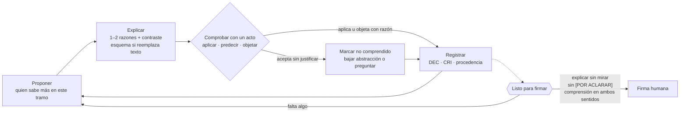
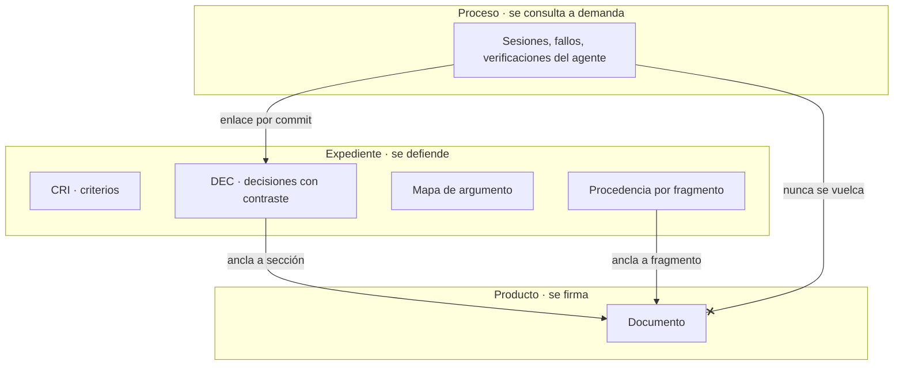
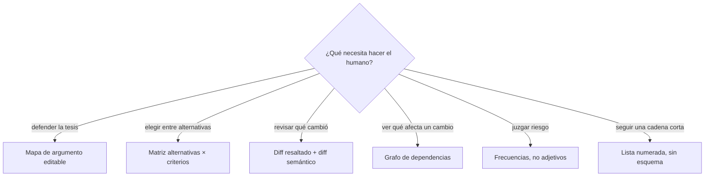
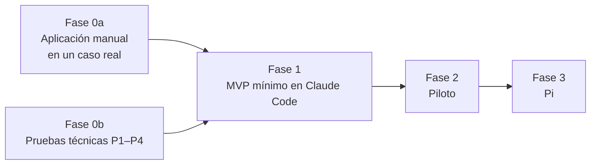

# tupaqnin · Planteamiento y estrategia

*Vigente desde el 16 de octubre de 2026. Es el diseño de referencia; la arquitectura v1.2 ([05](investigacion/05-arquitectura-inicial.md)) queda como historia. Decisiones: [DEC-002](decisiones/DEC-002-cocreacion-humano-agente.md) y [DEC-003](decisiones/DEC-003-nadie-limita-el-avance.md). Evidencia: [07](investigacion/07-base-investigacion-cocreacion.md), [09](investigacion/09-consolidacion-preliminar-cocreacion.md) y el [diagnóstico y los aprendizajes de casos reales](casos/diagnostico-y-aprendizajes.md).*

## 1. Qué es

Un harness para que humano y agente **cocreen** documentos complejos sin que ninguno limite el aporte del otro, y de modo que el humano pueda firmar y defender lo creado. Se construye primero sobre Claude Code.

## 2. El problema, en dos fallas

| Falla | Cómo se ve | Qué la evita |
|---|---|---|
| El humano frena | Todo espera su lectura y aprobación | Nada bloquea la construcción |
| El humano pierde el hilo (deuda cognitiva) | Firma lo que no puede defender | Quien propone explica, la comprensión se comprueba con actos y existe una puerta de firma |

## 3. Principios

1. **Comprender es hacer.** La garantía es un acto breve del humano (aplicar, predecir, objetar, reformular), no la explicación del agente.
2. **Abaratar la verificación.** Cada afirmación se ancla a su fuente o pasaje; los cambios se muestran como diferencias, no como texto nuevo.
3. **Fricción informativa en todo el flujo, fricción de acto solo en la firma.** Contraste, incertidumbre y fuente siempre; "explicar sin mirar" solo en "listo para firmar".
4. **Conduce quien tiene el conocimiento del tramo.** No se asignan roles; se observa quién sabe y se devuelve la decisión cuando el otro se desengancha.
5. **La explicación se adapta a la pericia por tema.** Donde el humano domina, una línea y más a demanda; donde no, un ejemplo que se retira a medida que demuestra dominio.
6. **Lo que el agente entiende del humano se guarda fuera del chat.** Criterios versionados, con su ejemplo de origen y su estado.
7. **La autoría queda a la vista.** Se registra quién propuso, quién editó y quién objetó.
8. **Construir pronto, especificar lo suficiente.** Donde hay un oráculo externo (pruebas, render, datos), se construye y se verifica antes de especificar más (caso 02).

## 4. El ciclo de cocreación

Cuando el humano propone, el agente comprueba su propia comprensión con un **teach-back**: resume en 3–5 líneas la intención y los criterios del humano, y el humano marca cada punto como correcto, incorrecto o incompleto.

## 5. Tres canales separados

**Regla:** el documento contiene solo contenido. La incertidumbre aparece de dos formas: una etiqueta de evidencia por hallazgo, o un marcador `[POR ACLARAR: …]` que impide firmar. Los fallos de herramientas, presupuestos y listas de verificación van al canal de proceso. Los documentos 06–08 de este repositorio muestran por qué: mezclar proceso con contenido los volvió difíciles de leer y de defender.

## 6. Explicar sin aumentar la lectura

| Palanca | Qué hace el agente |
|---|---|
| Explicación contrastiva | "A en vez de B porque…; elegiría B si…". Una o dos causas; el resto, a demanda |
| Verificación barata | Ancla al pasaje exacto y entrega un diff semántico: afirmación añadida, retirada o debilitada |
| Actos en vez de relectura | Cierra con una pregunta de aplicación u objeción de una línea |
| Esquemas que reemplazan | Solo para localizar, comparar o ver relaciones, y en lugar de los párrafos |
| Adaptación a la pericia | Menos explicación donde el humano domina; más donde no |

Qué esquema corresponde a cada situación:

Todo esquema se deriva del expediente (no de prosa libre), ancla cada nodo a un fragmento, no lleva decoración y el humano lo puede editar: construir o corregir un mapa rinde más que mirarlo.

## 7. Componentes del MVP

*El diseño técnico vigente, con lo que entra en la Fase 1 y lo que es condicional, está en [`diseno/`](diseno/README.md). Esta tabla es el catálogo completo de partida.*

| Componente | Qué hace |
|---|---|
| Skill `tupaqnin-explorar` | Muestra 2–3 variantes que difieren en una sola dimensión, formula el criterio implícito en tus reacciones y te pide confirmarlo |
| Skill `tupaqnin-construir` | Aplica el ciclo de §4 en pasos pequeños |
| Skill `tupaqnin-retomar` | Abre con el teach-back del agente sobre lo acordado y la nota "cuando vuelva, primero…" |
| Subagente `tq-divergente` | Genera alternativas sobre dimensiones explícitas, no paráfrasis |
| Subagente `tq-premisas` | Marca afirmaciones y premisas implícitas; alimenta el mapa de argumento |
| Subagente `tq-lector` (ciego) | Produce un esquema inverso (una línea por párrafo) para contrastar con tu resumen |
| Expediente | `CRI` versionado con ejemplo de origen y estado (confirmado, inferido o pendiente); `DEC` con contraste y quién propuso u objetó; procedencia por fragmento |
| Hooks | Solo dos funciones: la puerta de firma y la separación de canales (redirigen, no bloquean) |
| `tq.py` | `impacto`, `check`, `estado` (firmable o no), `cobertura`, `procedencia`, `diff`, `reentrada` |
| Señales | Perfil de pericia por tema y detector de desenganche (menos preguntas y objeciones, aprobaciones sin edición) |
| Avisos (no bloquean) | Contradicción de un texto nuevo con un `DEC` o `CRI` confirmado; avance por ciclo (qué incertidumbre se redujo); costo del ciclo |
| Estado de evidencia | Cada afirmación y componente declara si está diseñado, probado a mano, probado con oráculo o usado en un caso real |
| Reglas de `DEC` | Cita literal del humano y qué no cuenta como confirmación: un «ok» o «avancemos» no confirma contenido |

En el producto se usan nombres; los códigos (`CRI-004`, `DEC-007`) quedan en el expediente. La gobernanza es proporcional al proyecto: no se simulan controles institucionales.

**Se elimina de v1.2:** el presupuesto de lectura del ~20 % con párrafo al azar, el bloqueo de G1, los lotes de G3 y la meta de −37 % de lectura, que nunca se midió.

## 8. Estrategia

Se construye solo lo que la Fase 0a muestre necesario.

**Aplicación manual (Fase 0a):**
- Un caso real acotado: un capítulo o una sección. El caso está por elegir.
- El agente sigue §4–6 por instrucción, sin código.
- Registro mínimo, una fila por propuesta: qué se propuso · quién · acto de comprobación · resultado (aplica / repite / acepta sin justificar / rechazo justificado) · minutos.
- Al cerrar: puerta de firma con explicar sin mirar y, una semana después, una pregunta sobre un caso nuevo.
- El protocolo completo de [08](investigacion/08-marco-base-testeable.md) queda para un piloto comparativo posterior.

## 9. Qué medir

- **Comprensión:** resultado de los actos según la rúbrica de 08, y el caso nuevo a la semana.
- **Avance:** tiempo hasta tener una sección firmable; ningún paso bloqueado.
- **Costo humano:** minutos de lectura, de actos y de reentrada, por separado.
- **Señales ambiguas:** porcentaje aceptado sin edición, siempre cruzado con los actos.
- **Comprensión inversa:** porcentaje de puntos del teach-back del agente que marcas como correctos.
- **Retiro del humano:** si la puerta de firma se delega, se salta o se autoriza por adelantado.

## 10. Preguntas abiertas

1. ¿Qué acto da la mejor señal de comprensión por tiempo invertido?
2. ¿Basta la puerta de firma, o hacen falta actos durante la construcción?
3. ¿Con qué datos se estima el perfil de pericia por tema?
4. ¿Los esquemas derivados del expediente reducen el tiempo para detectar un error frente al texto solo?
5. ¿Qué umbral del detector de desenganche separa la confianza legítima de la aprobación automática?
6. ¿Cuánta fricción en la puerta se tolera antes de saltarla?

## 11. Dónde está cada cosa

| Ruta | Contenido |
|---|---|
| `docs/planteamiento.md` | Este documento: diseño y estrategia vigentes |
| `docs/diseno/` | Diseño técnico v1: núcleo de la Fase 1, condicionales y hallazgos de auditoría |
| `docs/decisiones/` | Decisiones del proyecto |
| `docs/investigacion/01`, `03`, `04` | Problema, informe inicial y acervo de mecanismos |
| `docs/investigacion/05` | Arquitectura v1.2 (historia) |
| `docs/investigacion/07` | Base de investigación por dimensiones D1–D4 |
| `docs/investigacion/08` | Protocolo completo de evaluación |
| `docs/investigacion/09` | Consolidación de la literatura sobre el principio de cocreación |
| `docs/investigacion/fases/` | Trabajo y fuentes de la arquitectura v1.2 |
| `docs/casos/diagnostico-y-aprendizajes.md` | Diagnóstico de la deuda cognitiva y aprendizajes de casos reales |
| `docs/casos/caso-02-motor-valoraciones/` | Caso público: motor de valoraciones de Observa Perú |
